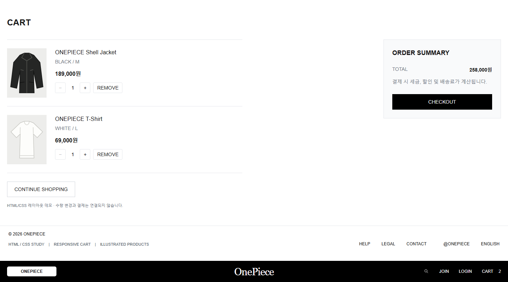
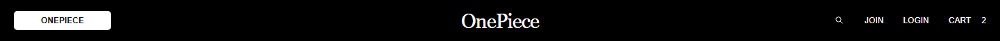
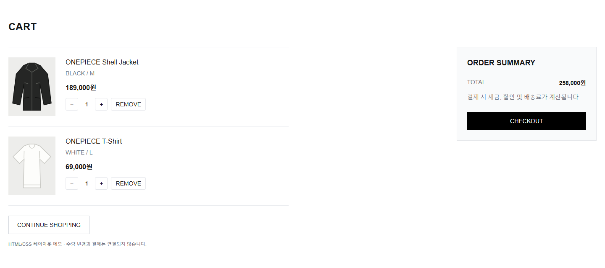
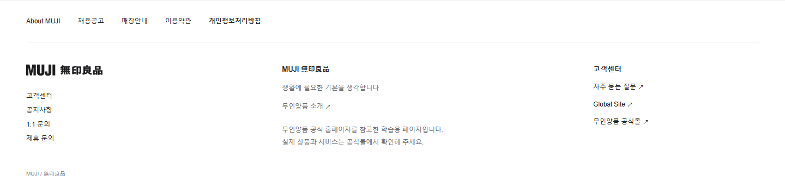
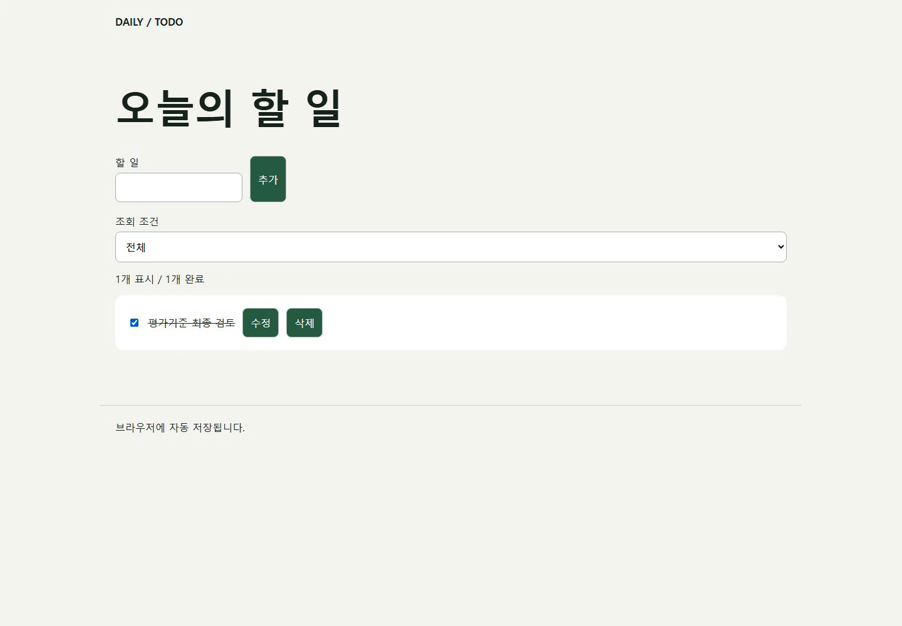

# 프론트엔드 개발 — HTML/CSS 클론과 JavaScript Todo

HTML/CSS로 장바구니 화면을 구성하고, JavaScript로 Todo의 생성·조회·수정·삭제를 구현했습니다.

## 장바구니 화면

ONEPIECE 장바구니의 2열 상품/주문 요약 배치, 상품 정보의 위계, 하단 고정 내비게이션과 푸터 구성을 HTML/CSS로 재구성했습니다. 상품명·옵션·가격·합계와 여백을 맞추고, 768px 미만에서는 한 열로 전환합니다. 상품 그림은 직접 작성한 SVG이며 시스템 글꼴을 사용합니다.

장바구니는 레이아웃 데모입니다. 수량 변경·상품 삭제·회원 인증·결제 기능은 연결하지 않았습니다. 아래 Todo에서는 실제 JavaScript CRUD를 제공합니다.

| 평가 항목 | 구현 내용 | 확인 결과 |
|---|---|---|
| 시맨틱 구조 | header/nav/main/section/form/footer, ul/li, dl, 제목 위계 | 영역별 구조와 수량 폼 확인 |
| 접근성 | 본문 바로가기, 입력 label, 그림 alt, 초점 표시 | Tab·Enter로 본문 이동, 수량 입력 접근, 메뉴 개폐 통과 |
| CSS 레이아웃 | border-box, Flex, Grid, 480/768/1280px 분기 | 320~1920px의 15개 폭에서 가로 넘침 없음 |
| 스타일 재사용 | CSS 변수, 공통 버튼·상품·내비게이션 클래스 | 공통 스타일로 화면 크기별 배치 조정 |

### 전체 화면



### 헤더·본문·푸터







반응형 화면: [375px](assets/clone-375.png) · [768px](assets/clone-768.png) · [1440px](assets/clone-1440.png)

## JavaScript Todo

실행 파일은 [HTML](todo/index.html), [CSS](todo/css/style.css), [JavaScript](todo/js/todo.js)입니다.

| 동작 | 데이터·화면 처리 | 예외 대응 |
|---|---|---|
| 생성 | submit 이벤트, UUID와 객체 배열 추가 | 공백·120자 초과 차단 |
| 조회 | 전체·진행 중·완료 필터와 빈 목록 표시 | 잘못된 저장 항목·중복 ID·빈 제목 필터링 |
| 수정 | find로 대상 확인, map으로 변경 | 취소·공백·길이 검사 |
| 완료 | checkbox와 map으로 상태 변경 | 재렌더 후에도 같은 위임 이벤트 사용 |
| 삭제 | filter로 제거, 목록과 개수 재계산 | 삭제 후 새로고침 보존 |
| 저장 | localStorage 저장·복원 | 손상된 JSON·읽기/쓰기 오류 표시 |

사용자 입력은 textContent로 표시합니다. DocumentFragment로 목록을 모아 교체하고 목록 컨테이너 하나에 이벤트를 위임합니다.

### Todo 시연 영상

[](assets/todo-demo.webm)

[Todo 추가 → 수정 → 새로고침 → 완료 → 필터 조회 → 삭제 시연 보기](assets/todo-demo.webm)

실제 브라우저에서 녹화한 WebM 영상입니다. 썸네일이나 링크를 클릭하면 원본 영상으로 이동하며, 재생하거나 내려받아 확인할 수 있습니다.

출처: [원본 영상 assets/todo-demo.webm](assets/todo-demo.webm)의 **00:02** 장면을 캡처했습니다. 썸네일 파일은 [assets/todo-demo-thumbnail.png](assets/todo-demo-thumbnail.png)입니다.

## 실행과 검증

Node.js 환경에서 다음을 실행합니다.

```powershell
npm ci
npm run serve
```

브라우저에서 http://127.0.0.1:8766/clone/ 또는 http://127.0.0.1:8766/todo/ 를 엽니다.

브라우저 회귀 검사는 다음과 같이 실행합니다.

```powershell
npx playwright install chromium
npm test
```

2026-11-16 Chromium에서 6개 검사가 통과했습니다. 클론의 전체·영역·15개 화면 폭, 시맨틱·라벨·키보드 이동·메뉴, Todo CRUD·새로고침·공백/HTML 입력·수정 취소·저장 복구, 중복·잘못된 저장 항목과 120자 경계를 확인했습니다. 이는 검사한 환경의 동작 결과이며 모든 브라우저의 동일한 렌더링이나 평가 점수를 보장하지 않습니다.
