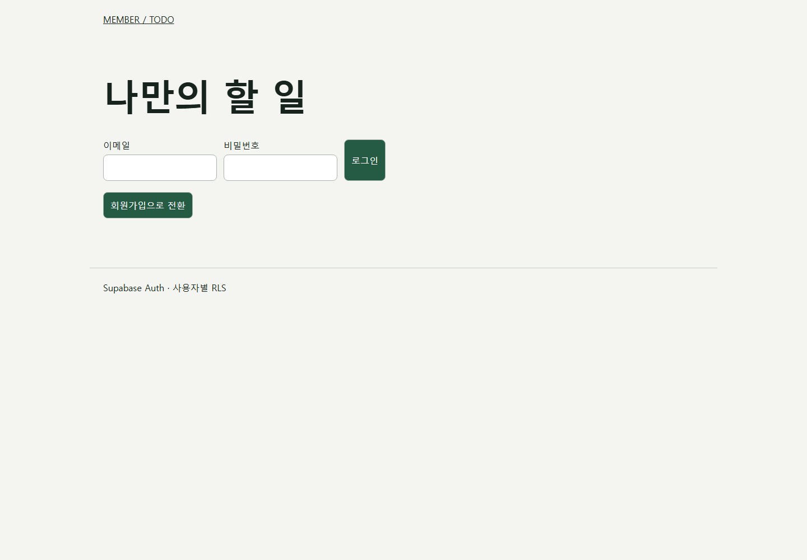

# 회원 전용 Todo — React / Next.js / Supabase

기존 JavaScript Todo의 추가·조회·수정·삭제를 컴포넌트와 Hook으로 전환하고 사용자별 데이터 저장 및 인증을 추가했습니다.

[실행 앱](https://assignment-member-todo.vercel.app) · [로그인](https://assignment-member-todo.vercel.app/login)



## 평가기준 대응

| 평가 항목 | 코드 | 판단 근거 |
|---|---|---|
| 컴포넌트·Props | components/AuthForm.tsx, TodoBoard.tsx, TodoRow.tsx, TodoEditor.tsx | 인증·목록 상태·항목·수정 책임 분리, Todo/Props 타입 |
| Hook·비동기 | TodoBoard useState/useMemo/useEffect | 쓰기 응답 성공 후 반영, 실패 메시지, 구독 cleanup |
| 조건부·목록 UI | loading.tsx, error.tsx, TodoBoard | 로딩·오류·빈 목록·성공 표시, todo.id key |
| 파일·동적 라우트 | /login, /todos, /todos/[id] | 인증 redirect, id 형식 확인, 미존재·타인 항목 404, 목록 복귀 |
| 렌더링·외부 데이터 | lib/server.ts, lib/supabase.ts, proxy.ts | 서버 초기 조회, 클라이언트 입력, 갱신 쿠키 전달, RLS |

서버에서 getUser()로 확인한 사용자 id를 조회 조건에 넣습니다. 클라이언트가 보내는 user_id만 신뢰하지 않고 DB의 RLS도 auth.uid()로 검사합니다. 공개키만 브라우저로 전달하며 서비스 역할 키는 사용하지 않습니다.

## Supabase 테이블

| 테이블 | PK | FK | 정책 |
|---|---|---|---|
| auth.users | id | Supabase 관리 | 회원 인증 |
| public.practice_profiles | id | auth.users.id | 본인 프로필만 접근 |
| public.practice_todos | id | user_id → auth.users.id | 본인 할 일만 CRUD |

회원가입 트리거 `on_practice_signup`이 `practice_create_profile()`을 호출해 `practice_profiles`를 생성합니다. title은 trim 후 1~120자이며 user_id/created_at 복합 인덱스로 회원별 최신 목록 조회를 돕습니다. 브라우저와 서버의 Todo CRUD는 모두 `practice_todos`를 사용합니다.

전용 스키마는 기존 `profiles`·`todos`와 별개의 테이블을 생성합니다. 적용 전부터 있던 인증 계정에 프로필을 추가하는 backfill은 수행하지 않으며, 적용 이후 가입한 계정에는 새 프로필이 생성됩니다.

## 실행

1. [schema-practice.sql](schema-practice.sql)을 검토한 뒤 사용할 Supabase 실습 프로젝트에서 한 번 실행합니다. 전용 테이블·함수·트리거 이름이 이미 존재하면 전체 트랜잭션이 실패하며 기존 객체를 덮어쓰지 않습니다. 이 앱의 현재 테이블 이름은 해당 스키마와 일치합니다.
2. 실행 환경에 `NEXT_PUBLIC_SUPABASE_URL`과 `NEXT_PUBLIC_SUPABASE_PUBLISHABLE_KEY`를 설정합니다. 브라우저에는 publishable 또는 기존 anon 공개키만 사용합니다.
3. Node.js 24에서 `npm ci` → `npm run test:config` → `npm run check` → `npm run build` → `npm run dev`를 실행합니다. 누락된 설정·원격 HTTP URL·비밀키 형식은 빌드 전에 거부합니다. 이 검사는 형식 검사이며 실제 프로젝트 인증 성공을 뜻하지 않습니다.
4. Supabase Auth의 Site URL/Redirect URLs에 개발 URL과 /auth/callback을 설정합니다. 메일 확인 링크는 Route Handler에서 code를 세션으로 교환합니다.
5. [TESTING.md](TESTING.md)의 두 계정·실패 상태 검증을 수행합니다.

## 검증 결과

2026-11-16 오류 재시도와 인증 응답 캐시 정책을 보완한 코드로 실제 Supabase SDK 검증 24개, 실제 Auth 갱신 검증 6개, 브라우저 검증 20단계를 통과했습니다. 두 독립 계정의 로그인·프로필 권한·Todo CRUD·RLS·동적 상세 수정·완료/필터·새로고침 보존·쓰기 실패·타인 상세 차단·삭제·로그아웃을 확인했습니다. 브라우저 단계에는 실제 설정의 프로덕션 빌드와 서버 시작도 포함됩니다.

다시 시도 버튼은 React 전환 안에서 서버 데이터를 새로 요청하고 오류 경계를 초기화합니다. 로컬 Auth/PostgREST 모사 환경의 빈 상태·로딩·조회 오류·재시도·잘못된 로그인·회원가입 안내 8개 검사도 통과했습니다.

만료 세션 검사는 SDK 시계를 토큰 만료 이후로 진행시키고 쿠키 만료 시각을 과거로 주입한 뒤 실제 Auth 갱신 API가 성공하는지 확인하는 방식입니다. 갱신된 토큰의 실제 사용자 검증, proxy의 새 쿠키·캐시 금지 헤더, 다음 새로고침의 로그인 유지까지 통과했습니다. 실제 시간 경과로 JWT가 만료될 때까지 기다린 검사는 아닙니다.

Vercel 프로덕션 배포를 완료하고 해당 주소에서 두 계정 로그인·Todo CRUD·회원별 목록 분리·타인 상세 차단·쓰기 실패·만료 상태 주입 후 실제 갱신·새로고침 인증 유지 등 25개 검사를 통과했습니다. 생성한 테스트 항목과 각 검사 세션을 정리했습니다. 배포본의 세션 종료 검사는 해당 검사 세션만 종료하는 local 방식이며, UI 로그아웃 버튼의 전체 세션 종료 검사는 앞선 실연결 브라우저 검사에 포함됩니다.

기존 회원의 실제 magic-link 메일 발송·수신부터 동일 브라우저의 PKCE callback 교환, 실제 사용자 확인, 새로고침 인증 유지, 검사 세션 종료까지 8개 검사를 통과했습니다. callback은 307 이동과 no-store 응답을 확인했습니다. 이 검사는 기존 회원 로그인 메일이며 신규 가입 확인 메일 검증과 구분합니다.

## 로컬 UI 회귀 검사

먼저 형제 과제 `02-frontend` 폴더에서 `npm ci`와 `npx playwright install chromium`을 실행합니다. 이 과제는 해당 Playwright 설치를 재사용하며 별도 브라우저 의존성을 추가하지 않습니다. 이 폴더에서 다음을 실행합니다.

```powershell
npm ci
npm run test:config
npm run check
npm run test:ui
npm run test:smoke
npm run test:auth-cookies
```

`test:ui`는 loopback에 Auth/PostgREST 응답을 모사하고 가짜 공개 설정으로 프로덕션 빌드를 만든 뒤 Chromium으로 8개 UI 상태를 확인합니다. 결과는 표준 출력에 표시하며 실제 Supabase 계정이나 인증정보를 사용하지 않습니다. 실행 후 배포할 때는 배포 환경의 공개 설정으로 다시 빌드합니다. 54321 포트는 이 검사 중 로컬 응답 서버가 사용합니다.

`test:auth-cookies`는 합성 PKCE 코드 교환과 만료 세션 갱신을 loopback에서 확인합니다. callback의 세션 쿠키 전달과 인증 쿠키가 갱신된 응답의 `private, no-store` 캐시 정책을 검사합니다. 두 검사는 같은 로컬 포트를 사용하므로 순서대로 실행합니다.

## 배포 — 필수

개인 공개 GitHub 저장소를 Vercel에서 Import합니다. 여러 과제를 한 저장소에 넣었다면 Root Directory를 이 폴더로 지정합니다. Node.js 24, Install Command `npm ci`, Build Command `npm run build`를 사용하고 환경변수 두 개를 빌드 전에 등록합니다. Supabase의 Site URL 및 Redirect URLs를 배포 주소와 인증 callback에 맞게 설정하고 가입·로그인·Todo CRUD를 배포 사이트에서 다시 검증합니다.

`NEXT_PUBLIC_` 설정은 빌드 시 브라우저 코드에 반영되므로 값을 바꿨다면 다시 빌드·배포해야 합니다.

**제출:** 이 폴더의 GitHub URL과 [실제 Vercel 앱](https://assignment-member-todo.vercel.app) 두 개입니다. Node.js 24와 고정 의존성 설치로 프로덕션 빌드를 완료했고, 배포 주소에서 두 계정 회귀 25개와 기존 회원 실제 메일 인증 8개 검사를 통과했습니다.
