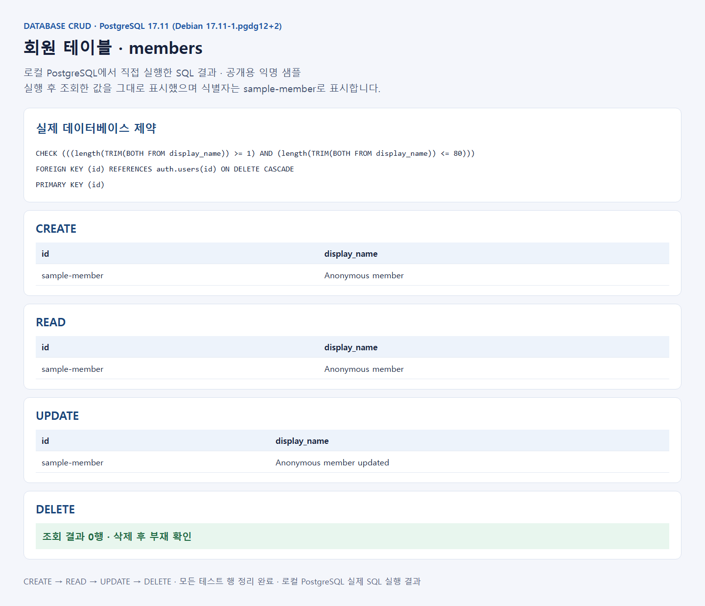
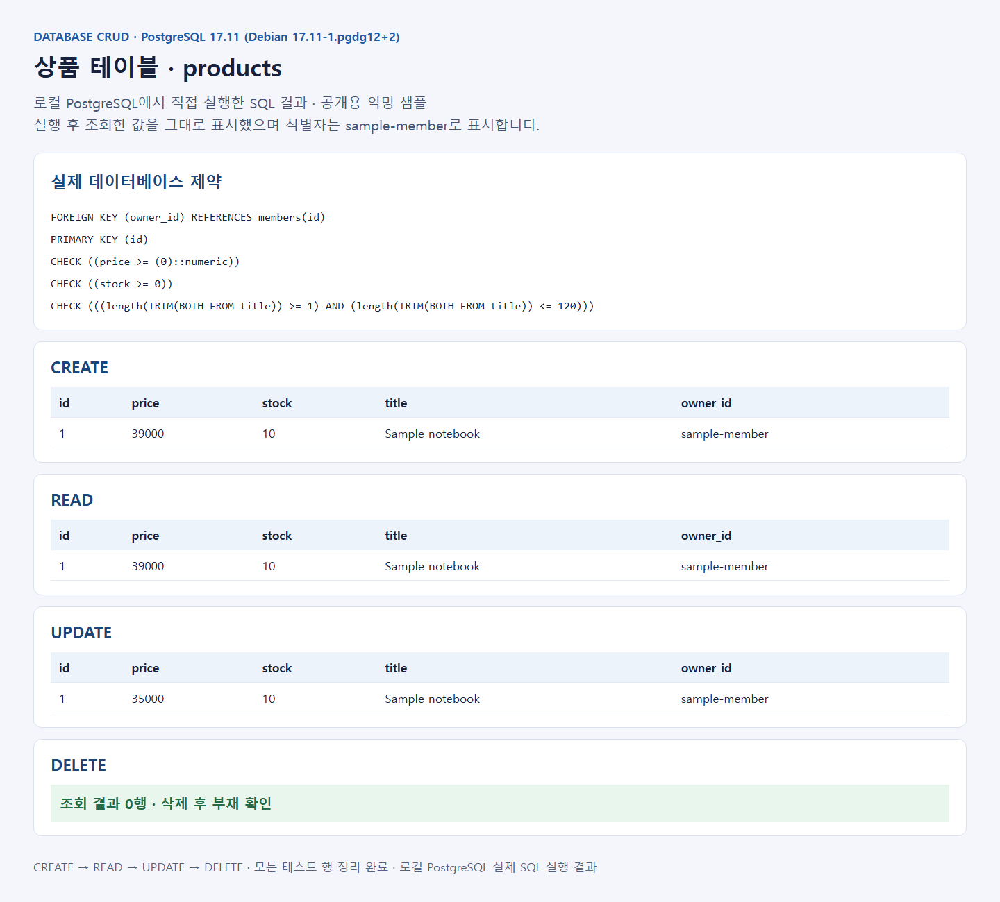
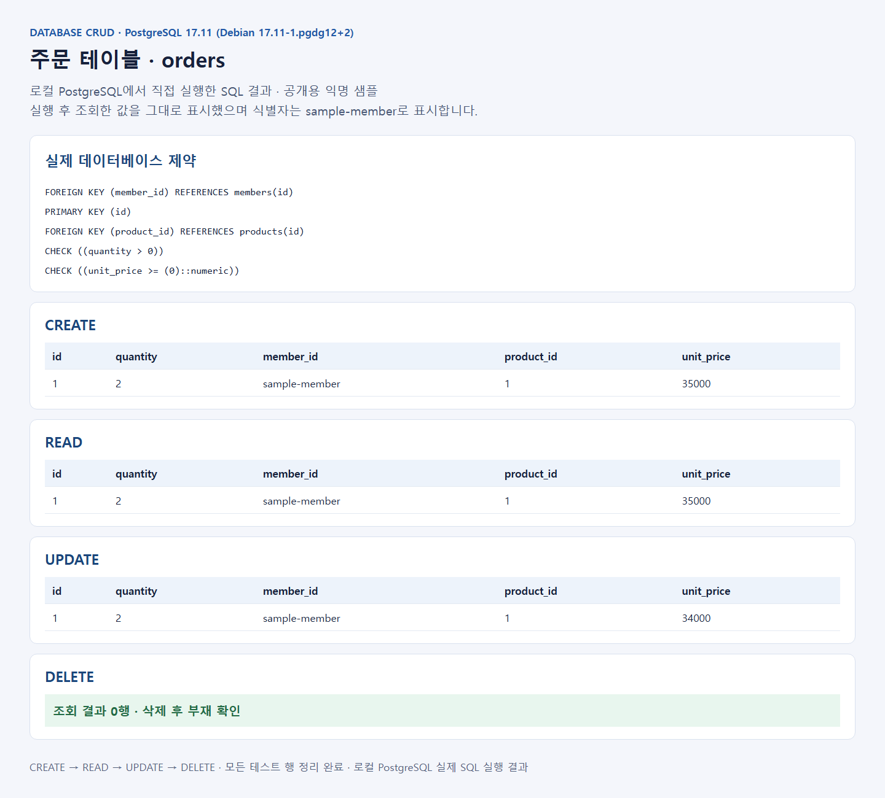
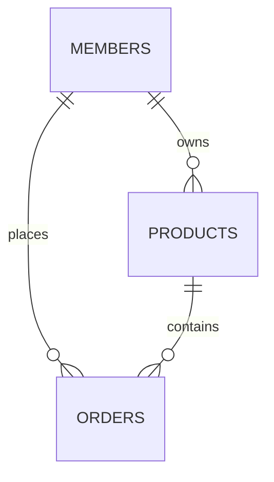

# 데이터베이스 AI 활용

회원·상품·주문 스키마, Supabase SDK CRUD, 사용자별 RLS와 원자적 주문 트랜잭션을 구현했습니다.

## 평가기준 대응

| 평가 항목 | 구현 위치 | 구현 내용·한계 |
|---|---|---|
| 테이블 및 객체 생성 | schema.sql | PK/FK, CHECK, identity, FK 인덱스, ALTER 및 임시 DROP. 스키마 전체를 하나의 트랜잭션으로 적용 |
| 데이터 변경·검증 | main.py | 3개 테이블 CRUD와 전후 출력 |
| 트랜잭션 정합성 | schema.sql place_order / main.py | 행 잠금·원자적 주문·재고 부족 실패 후 재고 비교 |
| Supabase·RLS·uv | pyproject.toml / schema.sql | PostgreSQL 역할 기반 RLS, uv.lock 재현, 실제 Supabase SDK CRUD 14단계·두 계정 RLS 11조건 통과 |

## 실행 및 제출 절차

1. 동일한 이름의 테이블·함수가 없는 Supabase 실습 프로젝트에서 schema.sql 실행. 이름이 충돌하면 전체 트랜잭션을 롤백합니다.
2. Supabase Auth에서 전용 테스트 계정 생성.
3. `uv sync --frozen` 후 `SUPABASE_URL`, `SUPABASE_PUBLISHABLE_KEY` 환경변수 설정.
4. uv run python main.py 실행 후 콘솔을 캡처.
5. 별도 두 번째 계정으로 타인의 회원·주문·상품 쓰기가 차단되는지 검증.

RPC는 본인 소유 데모 상품만 주문하도록 제한했습니다. 실서비스 일반 고객 주문·결제 로직은 범위에 포함하지 않습니다. 주문 수정/삭제는 CRUD 시연이며 재고 복구까지 처리하는 취소 로직이 아닙니다.

## 실행 화면

아래 화면은 로컬 PostgreSQL 17에서 익명 샘플로 SQL을 실행한 뒤 실제 조회 결과를 브라우저로 표시하여 캡처했습니다. 각 화면에 데이터베이스에서 조회한 PK/FK/CHECK와 생성·조회·수정·삭제 후 상태를 함께 표시했습니다.

### 회원 CRUD

회원 이름을 생성하고 조회한 뒤 수정합니다. 관련 주문·상품을 먼저 정리한 후 회원을 삭제하고 0행을 확인합니다.



### 상품 CRUD

상품 가격을 39,000에서 35,000으로 변경하고 조회합니다. 상품 소유자는 익명 식별자로 표시했습니다.



### 주문 CRUD

원자적 주문 함수로 주문을 생성한 뒤 단가 수정·조회·삭제를 실행합니다. 단가 수정은 CRUD 학습용 동작입니다.



## 데이터 모델 상세

| 테이블 | 필드 | 타입 | 키·제약 |
|---|---|---|---|
| members | id | uuid | PK, FK → auth.users.id, 사용자 삭제 시 CASCADE |
| members | display_name | text | NOT NULL, 공백 제외 1~80자 |
| products | id | bigint identity | PK, 자동 생성 |
| products | owner_id | uuid | FK → members.id, NOT NULL |
| products | title | text | NOT NULL, 공백 제외 1~120자 |
| products | price | numeric(12,2) | NOT NULL, 0 이상 |
| products | stock | integer | NOT NULL, 0 이상, 기본값 0 |
| products | description | text | ALTER로 추가, 기본값 빈 문자열 |
| orders | id | bigint identity | PK, 자동 생성 |
| orders | member_id | uuid | FK → members.id, NOT NULL |
| orders | product_id | bigint | FK → products.id, NOT NULL |
| orders | quantity | integer | NOT NULL, 1 이상 |
| orders | unit_price | numeric(12,2) | NOT NULL, 0 이상 |
| orders | created_at | timestamptz | NOT NULL, 기본값 now() |



3개 테이블 조건을 지키기 위해 한 주문은 상품 1종으로 제한했습니다. 회원명·상품명 등을 주문에 중복 저장하지 않고 FK로 연결합니다. `unit_price`는 주문 당시 가격이므로 현재 상품 가격과 별도로 보존하는 거래 스냅샷입니다. 다품목 주문으로 확장하면 주문과 주문상세를 분리해야 합니다. 이름은 소문자 snake_case, 금액은 부동소수점 대신 numeric을 사용합니다.

## 재현 명령과 전용 계정

```powershell
uv sync --frozen
# SUPABASE_URL과 SUPABASE_PUBLISHABLE_KEY를 실행 환경에 설정
uv run python main.py
uv run python verify_rls.py
```

로그인 비밀번호는 실행 중 숨김 입력으로 받습니다. 서비스 역할 키는 필요하지 않습니다. `uv.lock`을 생성했고 `uv sync --frozen`으로 의존성을 설치했습니다. 재현할 때도 같은 명령을 사용합니다.

`main.py`는 기존 members 프로필이 없는 전용 테스트 계정에서 실행합니다. 데모 회원·상품·주문을 생성하고 FK 역순으로 제거합니다. 실행마다 고유 표식을 붙여 본인이 이번 실행에서 만든 데이터만 정리하며, 중간 실패 때도 정리를 시도합니다. 응답을 잃어 생성 ID를 받지 못한 상품은 고유 표식으로 찾아 정리합니다. `cleanup_complete`로 정리 결과를 확인합니다. Supabase Auth 계정은 유지합니다.

콘솔 출력은 회원 식별자를 `sample-member`로 바꾸고 로그인 입력은 화면에 표시하지 않습니다. `run_demo(client, user_id, emit=None)`을 호출하면 로그인된 클라이언트로 동일한 흐름을 실행하고 익명화된 결과를 받을 수 있습니다.

[verify_rls.py](verify_rls.py)는 신규 프로필을 만들 수 있는 계정 A와 다른 계정 B를 사용합니다. A의 테스트 행만 생성·정리합니다. 타인 데이터 조회가 빈 결과인지, 수정·삭제·명의 도용·타인 상품 주문이 거부되는지, A로 재조회했을 때 실제 원본이 보존되는지 검사합니다. SQL Editor 관리자 테스트는 RLS를 우회하므로 두 계정 SDK 검증을 대신할 수 없습니다.

## 트랜잭션 정합성 검증

- `place_order`는 한 RPC 호출 내에서 상품 행을 `FOR UPDATE`로 잠그고 재고를 차감한 뒤 주문을 생성합니다. 예외가 나면 전체 호출이 롤백됩니다.
- RPC는 `SECURITY INVOKER`로 실행되어 RLS가 유지됩니다. 실습 범위에서는 본인이 소유한 상품에만 주문을 만들도록 제한합니다.
- 회원·주문은 본인만 조회/변경 가능하고 상품은 인증 사용자에게 읽기만 공개합니다. 상품 쓰기는 소유자만 허용합니다.
- `main.py`의 재고 부족 검사는 **쓰기 전 실패** 검사입니다. 이것만으로 쓰기 후 롤백이 입증되지는 않습니다.
- 쓰기 후 실패는 [transaction-proof.sql](transaction-proof.sql)에서 첫 UPDATE 이후 잘못된 주문 수량 INSERT를 실행하여 확인합니다. 내부 서브트랜잭션 롤백 후 재고와 주문 수를 비교하고 맨 끝의 `ROLLBACK`으로 검증용 변경을 제거합니다. 명시적 `COMMIT`은 별도 임시 테이블로 확인합니다.
- `transaction-proof.sql`은 members 프로필 1개가 필요합니다. SQL Editor 관리자 실행이므로 이 결과는 RLS 검증으로 사용하지 않습니다.

## 실제 제출 캡처

| 캡처 | 포함할 내용 |
|---|---|
| 테이블 구조 | members/products/orders의 PK, FK, CHECK |
| CRUD | 세 테이블의 생성·조회·수정·삭제 콘솔 결과 |
| 트랜잭션 | proof_results 결과와 COMMIT 확인 SELECT |
| RLS | 두 계정 테스트 PASS 출력 |

**GitHub 공개 저장소의 이 과제 경로**를 제출하며 웹 서비스 배포 주소는 이 영역에서 요구되지 않습니다.

본인이 설명할 핵심은 PK/FK 관계, CHECK가 막는 데이터, SDK 호출과 SQL RPC의 차이, 여러 SDK 호출이 자동으로 하나의 트랜잭션이 되지 않는 이유, RLS에서 `USING`과 `WITH CHECK`의 역할입니다.

## 현재 검증 결과

2026-11-16 기준 `uv sync --frozen`, Python 구문 검사, Supabase SDK·dotenv·APIError import가 통과했습니다. PostgreSQL 17 임시 컨테이너에서 `schema.sql`과 `transaction-proof.sql`을 실행하고 CRUD, PK/FK/CHECK, 두 사용자 식별자의 RLS, RPC 실패 시 상태 보존, 쓰기 후 롤백과 명시적 COMMIT을 확인했습니다. [제약·CRUD 검사](tests/test_constraints.sql) 21개와 익명화·오류 분류·정리 범위의 네 테스트도 통과했습니다.

```powershell
.\verify-local-postgres.ps1
uv run --frozen python -m unittest discover -s tests -p test_demo_support.py -v
```

이 명령은 로컬에 있는 `pgvector/pgvector:pg17` 이미지를 사용합니다. 이름이 매번 다른 임시 컨테이너를 생성하고 호스트 포트·외부 네트워크·영구 볼륨 없이 실행한 뒤 정리합니다. 테스트용 `auth.users`와 `auth.uid()`를 구성하고 테이블 소유자가 아닌 `authenticated` 역할로 RLS를 검사합니다.

첨부 화면은 PostgreSQL 정책과 SQL 동작의 로컬 검증 결과입니다. 별도로 실제 Supabase에서 SDK 회원·상품·주문 CRUD 14단계와 두 계정 RLS 11조건을 실행해 통과했습니다. 생성한 테스트 데이터의 정리와 세션 종료를 확인했으며 Auth 계정은 유지했습니다. 네트워크 오류를 권한 거부로 잘못 판정하지 않도록 SDK RLS 검사는 PostgreSQL 권한 오류 코드 `42501`만 예상 거부로 처리합니다.

[레벨별 과제 목록](../README.md) · [전체 과제 목록](../../README.md)
