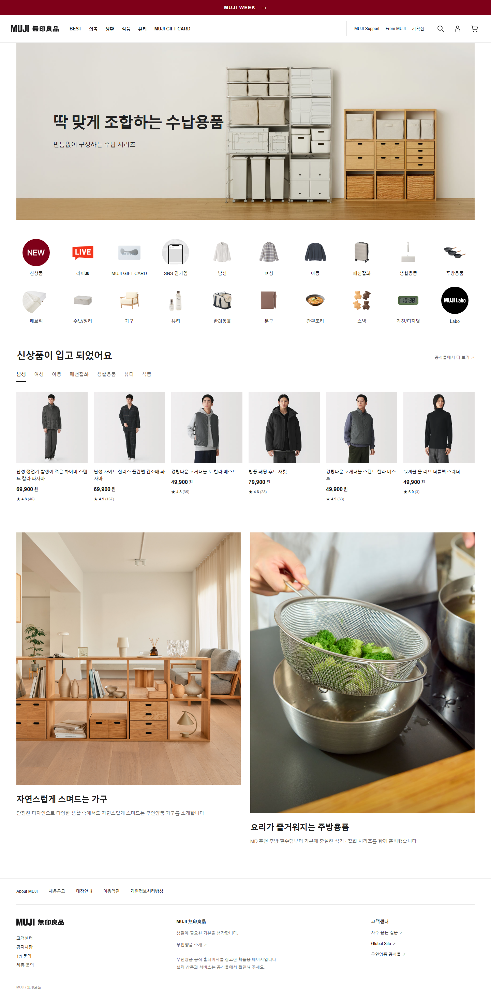
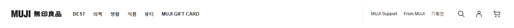
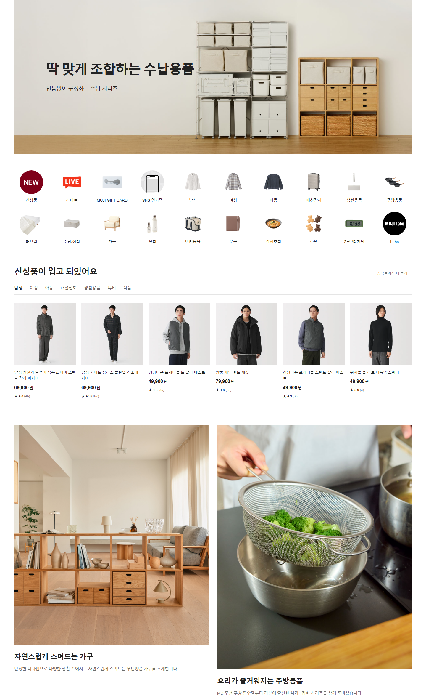
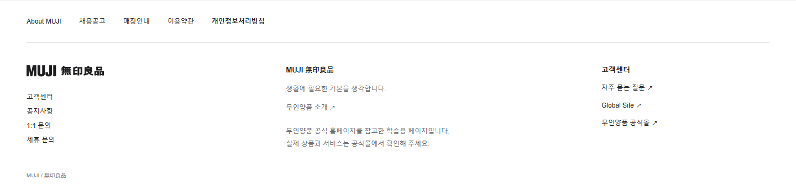
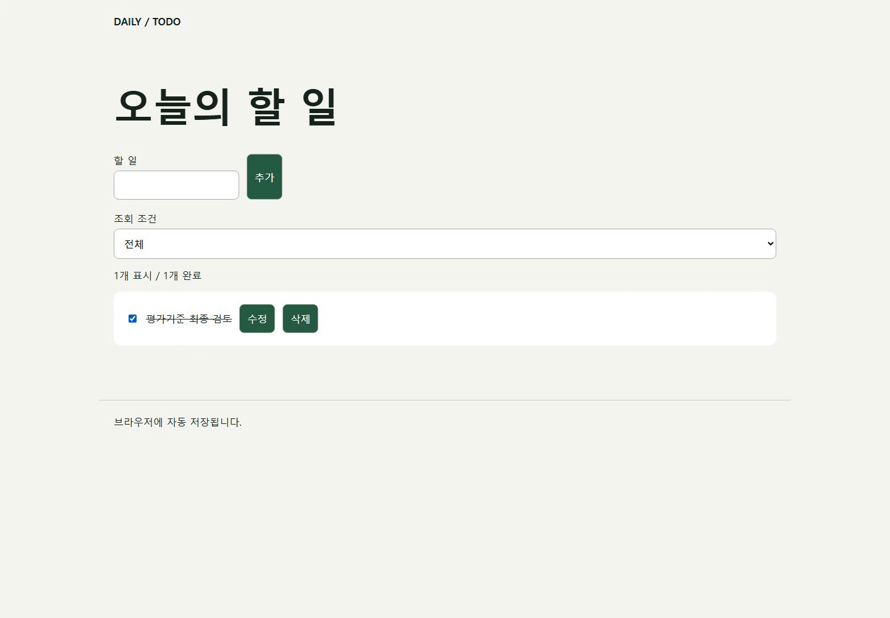

# 프론트엔드 개발 — 무인양품 클론과 JavaScript Todo

[무인양품 한국 공식몰](https://mujikorea.co.kr/)의 메인 화면을 HTML/CSS로 재구성하고, JavaScript Todo에서 생성·조회·수정·삭제를 구현했습니다.

## 무인양품 메인 화면

2026-11-16 공식몰에서 확인한 행사 안내, 로고와 메뉴, 수납용품 배너, 원형 카테고리 20개, 신상품 6개, 가구·주방 콘텐츠 2개, 푸터를 구현했습니다. 데스크톱의 가로 메뉴와 상품 6열은 화면 너비에 따라 접이식 메뉴와 상품 3열·2열로 바뀝니다.

검색은 공식몰의 공개 검색 경로에 `keyword`를 전달하는 GET 폼입니다. 본문 이동 링크는 페이지 안의 영역으로, 상품·기획전·고객 안내 링크는 공식몰로 연결됩니다. 대표 배너는 수납용품 장면 하나로 고정했습니다.

로고·사진·상품 문구의 출처는 무인양품 공식몰입니다. [출처와 구현 범위](clone/REFERENCE.md), [이미지 31개의 원본 URL·해상도·해시](clone/assets/muji/sources.json)를 함께 제공합니다. 사진은 원본 픽셀을 유지하고 배너 문구는 HTML 텍스트로 작성했으며, 글꼴은 시스템 글꼴을 사용합니다.

| 평가 항목 | 구현 내용 | 확인 결과 |
|---|---|---|
| 시맨틱 구조 | header/nav/main/section/form/footer, ul/li, 제목 위계 | 영역·제목·내비게이션 이름 확인 |
| 접근성 | 본문 바로가기, 입력 label, 이미지 alt, 초점 표시 | Tab·Enter 본문 이동, Enter·Space 메뉴·검색 개폐 통과 |
| 반응형 레이아웃 | CSS 변수, Flex·Grid, 모바일·태블릿·데스크톱 배치 | 320~1920px의 15개 너비에서 가로 넘침 없음 |
| 이미지·검색 | picture 모바일 배너, 로컬 이미지, 공식몰 검색 폼 | 375/768/1440px에서 이미지 로딩·MIME·배너 선택, 검색 입력 검증 통과 |

### 전체 화면



### 헤더·본문·푸터







반응형 화면: [375px](assets/clone-375.png) · [768px](assets/clone-768.png) · [1440px](assets/clone-1440.png)

## JavaScript Todo

실행 파일은 [HTML](todo/index.html), [CSS](todo/css/style.css), [JavaScript](todo/js/todo.js)입니다.

| 동작 | 데이터·화면 처리 | 예외 대응 |
|---|---|---|
| 생성 | submit 이벤트, UUID와 객체 배열 추가 | 공백·120자 초과 차단 |
| 조회 | 전체·진행 중·완료 필터와 빈 목록 표시 | 잘못된 저장 항목·중복 ID·빈 제목 필터링 |
| 수정 | find로 대상 확인, map으로 변경 | 취소·공백·길이 검사 |
| 완료 | checkbox와 map으로 상태 변경 | 재렌더 후에도 같은 위임 이벤트 사용 |
| 삭제 | filter로 제거, 목록과 개수 재계산 | 삭제 후 새로고침 보존 |
| 저장 | localStorage 저장·복원 | 손상된 JSON·읽기/쓰기 오류 표시 |

사용자 입력은 textContent로 표시합니다. DocumentFragment로 목록을 모아 교체하고 목록 컨테이너 하나에 이벤트를 위임합니다.

### Todo 시연 영상

[](assets/todo-demo.webm)

[Todo 추가 → 수정 → 새로고침 → 완료 → 필터 조회 → 삭제 시연 보기](assets/todo-demo.webm)

실제 브라우저에서 녹화한 WebM 영상입니다. 썸네일이나 링크를 클릭하면 원본 영상으로 이동하며, 재생하거나 내려받아 확인할 수 있습니다.

출처: [원본 영상 assets/todo-demo.webm](assets/todo-demo.webm)의 **00:02** 장면을 캡처했습니다. 썸네일 파일은 [assets/todo-demo-thumbnail.png](assets/todo-demo-thumbnail.png)입니다.

## 실행과 검증

Node.js가 설치된 PC에서 저장소 최상위 폴더를 기준으로 다음을 실행합니다. 화면을 여는 서버는 Node.js 내장 모듈만 사용하므로 별도 패키지 설치가 필요하지 않습니다.

```powershell
cd Assignment/lv.2/02-frontend
node serve.cjs
```

터미널을 실행한 상태로 두고 [무인양품 클론](http://127.0.0.1:8766/clone/) 또는 [Todo](http://127.0.0.1:8766/todo/)를 엽니다. 기본 주소 `http://127.0.0.1:8766`과 끝 슬래시가 없는 `/clone`, `/todo`도 해당 화면으로 이동합니다.

`127.0.0.1`은 서버를 실행한 PC에서만 사용하는 로컬 주소입니다. 서버를 종료하거나 PC를 재시작했다면 과제 폴더에서 `node serve.cjs`를 다시 실행합니다.

브라우저 회귀 검사는 다음과 같이 실행합니다.

```powershell
npm ci
npx playwright install chromium
npm test
```

개발 중 `npm run serve`를 실행해 둔 경우 `npm test`는 같은 주소의 서버를 재사용합니다. CI 환경에서는 기존 서버를 재사용하지 않고 테스트용 서버를 시작합니다. [Playwright 웹 서버 설정](https://playwright.dev/docs/test-webserver)

2026-11-16 Chromium에서 **6개 검사(무인양품 클론 2개·Todo 4개)가 모두 통과**했습니다. 클론은 15개 화면 너비, 이미지 로딩과 MIME, 모바일 배너 선택, 시맨틱 구조·라벨·키보드 이동·접이식 메뉴, 검색 폼의 입력 검증과 GET 경로를 확인했습니다. 검색의 실제 외부 이동과 공식몰의 회원·구매 동작은 검사 범위에 포함하지 않았습니다.

Todo는 CRUD·새로고침 보존·공백/HTML 입력·수정 취소·저장 복구·중복과 잘못된 저장 항목·120자 경계를 확인했습니다. 캡처는 위 구현을 실제 Chromium에서 렌더링한 결과입니다.

같은 날 개발 서버를 켜 둔 상태에서도 정식 `npm test`의 6개 검사가 통과했습니다. 추가 검사에서는 저장 공간 오류 안내, 기존 이미지·영상의 디코드, 루트와 클론·Todo 진입 주소 7개의 이동·응답을 확인했습니다. npm 의존성 감사에서 알려진 취약점은 발견되지 않았습니다.

[레벨별 과제 목록](../README.md) · [전체 과제 목록](../../README.md)
