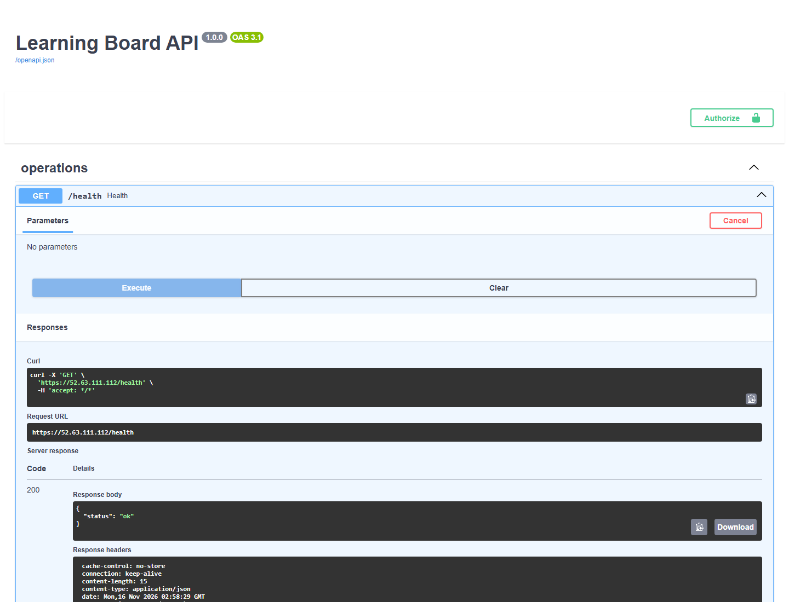

# PostgreSQL 게시판 API

FastAPI, SQLAlchemy, PostgreSQL, JWT로 구현한 게시판 API 학습 프로젝트입니다. 요청 검증부터 인증·권한 확인, 데이터 저장, 응답 직렬화까지 연결하고 자동화 테스트로 동작을 확인했습니다.

## 학습 내용과 구조

요청 → FastAPI 라우팅 → Pydantic 입력 검증 → JWT·권한 확인 → SQLAlchemy 세션 → PostgreSQL → 응답 모델 직렬화 순서로 처리합니다.

| 구성 | 구현 내용 |
|---|---|
| [API](app/main.py) | 게시글 CRUD, 페이지 조회, 입력 검증, 공통 오류 응답, 미들웨어 |
| [모델](app/models.py) | User와 Post의 양방향 관계, FK, 이메일 unique index, 작성자 index, role CHECK |
| [보안](app/security.py) | scrypt·무작위 salt, 상수시간 비교, JWT 설정 검사 |
| [명세](openapi.json) | 요청·응답 모델, Bearer 인증, 텍스트 업로드와 오류 응답 |

회원가입으로 관리자 권한을 지정할 수 없습니다. 게시글을 수정·삭제하려면 작성자 또는 관리자여야 합니다. 비밀번호 해시는 응답 모델에서 제외하며, 토큰은 30분 동안 유효합니다.

목록 조회는 최대 100개로 제한합니다. 100개 게시글을 준비한 검사에서 작은 페이지와 최대 페이지 모두 목록 SELECT와 전체 개수 SELECT, 총 2회만 실행했습니다.

## 실행

Python 3.11 이상과 신규 PostgreSQL 실습 DB를 준비하고 다음 실행 환경변수를 설정합니다.

| 환경변수 | 용도 |
|---|---|
| `DATABASE_URL` | SQLAlchemy의 `postgresql+psycopg` 연결 문자열 |
| `JWT_SECRET` | 무작위 32자 이상의 JWT 서명 비밀값 |
| `ALLOWED_ORIGINS` | 브라우저 접근을 허용할 origin 목록. 쉼표로 구분 |

```powershell
uv sync --locked --group dev
uv run --locked python -m app.init_db
uv run --locked uvicorn app.main:app --host 127.0.0.1 --port 8000
```

실행한 서버의 `/docs`에서 Swagger UI를 열고 `/auth/signup` → `/auth/login` → Authorize 순서로 인증한 뒤 API를 사용할 수 있습니다. 실행 중 명세는 `/openapi.json`에서 확인합니다.

## API

| 메서드 | 경로 | 인증·권한 | 정상 응답 |
|---|---|---|---|
| POST | `/auth/signup` | 불필요 | 201 회원 정보 |
| POST | `/auth/login` | 불필요 | 200 access token |
| GET | `/auth/me` | 인증 필요 | 200 본인 정보 |
| GET | `/posts?offset=0&limit=20` | 불필요 | 200 목록·전체 개수 |
| GET | `/posts/{post_id}` | 불필요 | 200 게시글 |
| POST | `/posts` | 인증 필요 | 201 게시글 |
| PUT | `/posts/{post_id}` | 작성자·관리자 | 200 수정 결과 |
| DELETE | `/posts/{post_id}` | 작성자·관리자 | 204 빈 응답 |
| POST | `/uploads/preview` | 인증 필요 | 200 텍스트 미리보기 |
| GET | `/meta` | 불필요 | 200 공개 메타데이터 |
| GET | `/health` | 불필요 | 200 DB 연결 상태 |

오류는 다음 형태로 반환합니다. 없는 경로의 404와 허용하지 않는 메서드의 405도 같은 구조를 사용하며, 405의 `Allow`와 401의 `WWW-Authenticate` 헤더를 유지합니다.

```json
{"error":{"code":"VALIDATION_ERROR","message":"입력 형식이 올바르지 않습니다"}}
```

제목·본문의 공백과 길이, 이메일 형식을 검증합니다. DB 세부 오류와 비밀번호 원문은 오류 응답에 넣지 않습니다.

업로드는 `text/plain` 요청 본문을 비동기로 읽어 최대 64KiB까지 받고 200자만 미리보기합니다. 파일을 영구 저장하지 않습니다. 크기 초과는 413, 지원하지 않는 MIME은 415, 잘못된 UTF-8은 422를 반환합니다.

공개 정적 메타데이터인 `/meta`에만 `Cache-Control: public, max-age=60`을 적용하고, 그 외 응답은 `no-store`로 처리합니다. 미들웨어는 처리 시간과 `nosniff` 헤더를 추가합니다.

## 테스트

```powershell
uv run --locked --group dev python -m pytest tests -q
```

PostgreSQL 검사는 폐기 가능한 전용 로컬 DB를 사용합니다. `BOARD_TEST_DATABASE_URL`에 `localhost` 또는 `127.0.0.1`의 `practice_board_validation_` 접두사 DB 연결 문자열을 설정한 뒤 실행합니다. 검사 중 해당 DB에 테스트 테이블을 생성하고 제거합니다.

```powershell
uv run --locked --group dev python -m pytest tests/test_api.py tests/test_contracts.py -q
```

별도 로컬 컨테이너와 테스트 DB를 기동한 뒤에는 실제 TCP HTTP 검사도 실행할 수 있습니다. 이 검사는 두 테스트 계정을 생성합니다.

```powershell
uv run --locked --group dev python tests/container_smoke.py http://127.0.0.1:8000
```

2026-11-16 실행 결과:

| 검사 | 결과 | 범위 |
|---|---|---|
| 기본 직접 함수·SQLite·ASGI HTTP | 24 passed, 1 skipped | PostgreSQL 전용 제약 검사 1개는 기본 실행에서 생략 |
| 실제 PostgreSQL 16 HTTP·계약 검사 | 15 passed | CRUD, 권한, FK·CHECK·관계, 쿼리 수, 입력·응답, 오류, JWT, 업로드 |
| Docker 이미지 빌드·Compose | PASS | Linux Python 3.12, PostgreSQL 16, API·DB healthy |
| 로컬 Docker 실제 TCP HTTP | 24 checks PASS | 두 계정 CRUD·인가, 404/405·Allow, Swagger, 업로드, 캐시 |
| EC2 외부 HTTPS 통합 검사 | 24 checks PASS | 인증서 검증을 켠 실제 PostgreSQL 연동·인증·CRUD·권한 검사 |
| 제출 명세와 배포 명세 | PASS | 배포 서버의 OpenAPI와 전체 JSON 구조 일치 |

제출 명세는 배포 서버의 Python 3.12 환경에서 제공하는 내용을 저장했습니다. Windows Python 3.13에서 생성하면 422의 기본 설명이 `Unprocessable Content`, 배포 명세에서는 `Unprocessable Entity`로 표시됩니다. 11개의 설명 문구를 제외한 요청·응답 스키마, 상태 코드, 보안 정의는 같습니다.

## Docker와 배포 상태

`POSTGRES_PASSWORD`와 `JWT_SECRET`을 실행 환경에 설정한 후 실행합니다. DB 비밀번호는 연결 문자열에 사용할 수 있는 영숫자 난수를 사용합니다.

```powershell
docker compose up -d --build --wait
docker compose exec api python -m app.init_db
```

Docker는 고정된 의존성과 패키지 해시를 확인하여 설치합니다. API는 일반 사용자로 실행하며, Compose는 DB·API 상태 검사와 재시작 정책을 제공합니다. PostgreSQL 데이터는 명명된 볼륨에 보관합니다.

위 Compose 실행은 로컬 API를 `127.0.0.1:8000`에 연결합니다. EC2 배포는 nginx의 HTTPS 리버스 프록시를 사용하며 PostgreSQL은 외부에 노출하지 않습니다.

## EC2 HTTPS 실행 결과

| 대상 | 주소 |
|---|---|
| API 기본 주소 | [https://52.63.111.112](https://52.63.111.112) |
| Swagger UI | [API 문서와 실행 화면](https://52.63.111.112/docs) |
| 상태 확인 | [health](https://52.63.111.112/health) |

브라우저에서는 Swagger UI에서 API를 실행할 수 있습니다. 2026-11-16 검증에서 공인 IP 인증서의 신뢰 체인·IP SAN을 확인했고, TLS 검증을 켠 외부 HTTPS 검사 24개를 통과했습니다. 인증서 자동 갱신 설정과 실제 갱신 시험, 갱신 후 nginx 재로드도 확인했습니다. HTTP 접근은 인증서 검증 경로를 제외하고 HTTPS로 이동합니다.

검증 중 생성한 게시글을 제거하고 테스트 계정 4개를 정리했습니다. 테스트 계정과 해당 게시글의 잔여 행은 0개로 확인했습니다.



[레벨별 과제 목록](../README.md) · [전체 과제 목록](../../README.md)
