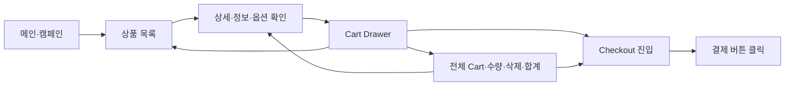

# ONEPIECE | 탐색의 충분성과 구매 연결을 설계한 쇼핑몰 프로젝트

> **ONE-PIECE is Master-piece.**
>
> 충분히 탐색하고, 결정한 뒤 편리하게 구매한다.

- **프로젝트 기간:** 2026.10.12 ~ 2026.10.23
- **팀:** ONEPIECE · AX 1기 프로젝트 1 · Team E
- **대상:** 브랜드를 이미 알고 있으며 구매 의도가 있는 20~30대 패션 중·고관여 남성
- **결과물:** 브랜드·고객 정의, 서비스 흐름과 데이터 설계, A·B·C 프로토타입, GA4 계측과 합성 회원 시나리오 검증
- **핵심 결론:** 구매 경로와 계측 동작은 확인했다. 다음 개선의 초점은 탐색을 무조건 줄이는 것보다 **구매 판단에 필요한 정보를 발견하고, 결정한 뒤 선택을 잃지 않고 이어가는 경험**이다. 실제 고객의 전환 개선은 추가 검증이 필요하다.

## 목차

1. [프로젝트와 테스트 사이트](#1-프로젝트와-테스트-사이트)
2. [최초 문제 정의와 레퍼런스 분석](#2-최초-문제-정의와-레퍼런스-분석)
3. [고객 조사와 가설의 변화](#3-고객-조사와-가설의-변화)
4. [브랜드·타깃·구매 여정](#4-브랜드타깃구매-여정)
5. [화면과 도메인 명세](#5-화면과-도메인-명세)
6. [데이터 구조와 구현](#6-데이터-구조와-구현)
7. [협업과 개발 과정](#7-협업과-개발-과정)
8. [실험과 측정 설계](#8-실험과-측정-설계)
9. [실행 결과와 GA 해석](#9-실행-결과와-ga-해석)
10. [결론과 다음 개선](#10-결론과-다음-개선)
11. [최종 코드와 회고](#11-최종-코드와-회고)

## 1. 프로젝트와 테스트 사이트

A는 레퍼런스를 분석하기 위한 클론, B는 아이디어를 빠르게 넓혀 구현한 버전, C는 팀이 도메인을 나누어 구현한 버전이다. **B·C의 UI와 구매 연결 방식을 비교하려 했으며, 바이브코딩과 손코딩 자체의 우열을 가리는 실험은 아니다.**

| 구분 | 역할 | 테스트 배포 주소 | 보관 코드 |
| --- | --- | --- | --- |
| A · SAN SAN GEAR 클론 | 레퍼런스의 탐색·Drawer·구매 진입 구조 해체 | [A 테스트 사이트](https://projecterefasite.jihyunkims495.chatgpt.site/) | [version_test_A](version_test_A/README.md) |
| B · ONEPIECE 바이브코딩 | 브랜드 UI와 구매 흐름의 빠른 구현·탐색 | [B 테스트 사이트](https://onepiece-b-test.vercel.app/) | [version_test_B](version_test_B/README.md) |
| C · ONEPIECE 팀 구현 | 도메인별 구현과 공유 상태 기반의 구매 흐름 | [C 테스트 사이트](https://onepiece-c-test.vercel.app/) | [version_test_C](version_test_C/README.md) |

**접속 상태 확인: 2026.10.26.** A는 인증을 요구하며, B·C는 Vercel 로그인으로 연결된다. 테스트 사이트는 접근 권한이 필요하고, 현재 주소의 배포와 분석 당시의 배포가 같은 빌드라고 가정하지 않는다.

### 프로젝트 흐름

| 시점 | 수행 내용 | 다음 설계에 남긴 것 |
| --- | --- | --- |
| 초기 설계 | 메인 정보량과 구매 단계 수를 문제로 설정 | 정보 절제·구매 경로 단축이라는 출발 가설 |
| 10/14 | 20대 고관여 고객의 평소 구매 경험 조사 | 깊은 탐색과 익숙한 채널의 결제 편의를 분리 |
| 10/16 | 30대 중관여 고객의 품목·판매량순 비교 경험 조사 | 후보를 좁히는 분류·정렬·정보 발견성 검토 |
| 10/19 | 기본 구매 흐름과 Cart·Checkout 연결 후보 정리 | 탐색 복귀와 구매 진입의 선택권 |
| 10/20~10/21 | 고객 유형·과업·예산·계측 기준 구체화 | 동일 합성 회원 180명으로 비교할 조건 정의 |
| 10/21 | A·B·C 본 실험 | 종점 도달·규칙 중단·기술 오류 구분 |
| 10/22 | 코드·GA 대조, B·C 각 6명 계측 파일럿 | 계측 오류 수정과 회원별 이벤트 수신 확인 |
| 10/23 | 프로젝트 종료, 팀 `dev`의 최종 `main` 반영 | 최종 코드와 실험 당시 버전을 구분해 보관 |

## 2. 최초 문제 정의와 레퍼런스 분석

### 출발 가설

1. 메인에 정보가 많으면 피로와 이탈이 커질 수 있다.
2. 구매 단계가 길면 전환이 낮아질 수 있다.

처음에는 화면 정보와 이동 단계를 줄이는 방향에서 시작했다. 그러나 패션 상품은 핏·실측·소재·관리법과 브랜드 디테일을 충분히 확인해야 구매를 결정할 수 있다. **필요한 탐색까지 줄이는 것이 고객의 문제를 해결하는지는 별도 질문**이었다.

### SAN SAN GEAR에서 살핀 것

- 캠페인·컬렉션·상품을 연결하는 브랜드 몰입 경험
- 절제된 메뉴, 그리드 밀도, 이미지 전환과 상품 정보의 발견성
- 상품 상세에서 사이즈·소재·관리 정보를 확인하는 방법
- 탐색 맥락을 유지하는 Cart Drawer와 전체 장바구니의 역할
- 작은 영문 메뉴·구매 컨트롤이 한국어 사용자에게 줄 수 있는 읽기·이해 부담

공식 상품에는 실측·소재·한글 설명이 존재했다. 문제를 “정보가 없다”로 일반화하지 않고, **구매 전에 필요한 설명이 충분한가, 사용자가 그 위치를 발견하는가**로 좁혔다. 관리 안내가 케어라벨 확인을 요구하는 경우에도 구매 전 판단에 충분한지는 실제 고객 과업으로 확인해야 한다.

의류·기능성 스타일·팬덤 소비의 확장은 브랜드 탐색의 배경으로 살폈다. 이를 전체 20~30대 남성의 시장 규모나 ONEPIECE의 수요로 환산하지 않았다. 기능 선택에는 다음 기준을 적용했다.

| 설계 기준 | 서비스 방향 |
| --- | --- |
| 브랜드 몰입 유지 | 캠페인과 디테일을 보존하면서 상품 탐색으로 연결 |
| 지출에 대한 확신 | 가격·핏·실측·소재·관리·재고를 판단할 수 있게 제공 |
| 결정 뒤 반복 이동 감소 | 계속 탐색, Cart 편집, Checkout 진입의 선택권 제공 |

## 3. 고객 조사와 가설의 변화

### FGI에서 얻은 두 가지 단서

두 사례는 고객의 평소 커머스 경험을 조사한 정성적 단서다. 전체 타깃의 행동 비율이나 특정 UI의 개선 효과를 의미하지 않는다.

| 조사 | 관찰한 경험 | 설계에 반영한 점 |
| --- | --- | --- |
| 10/14 · 20대 패션 고관여 | 웹에서 깊게 탐색하고 담은 뒤, 같은 서비스의 익숙한 앱 Cart를 열어 Checkout으로 이동 | 탐색의 충분성과 결제 채널의 편의를 구분. 이후 팀에서 3·4·6 그리드 방향 결정 |
| 10/16 · 30대 패션 중관여 | 필요한 품목을 찾고 판매량순으로 후보를 비교해 원하는 상품 구매 | 카테고리·정렬로 후보를 좁히는 과업 검토. 탐색 횟수가 많다는 이유만으로 성공 판정하지 않음 |

### 가설의 발전

| 단계 | 가설 | 확인 범위 |
| --- | --- | --- |
| 최초 | 정보량과 구매 단계를 줄이면 이탈이 줄어들 것이다 | 팀의 출발 가정 |
| FGI 이후 | 필요한 탐색을 충분히 마친 고객은 익숙한 채널에서 편리하게 구매하려 할 것이다 | 두 고객 사례로 방향성 단서 확보 |
| B·C 검증 질문 | 웹에서 탐색·담기를 마친 회원이 같은 서비스의 모바일 환경에서 Cart를 이어 열고 Checkout으로 이동하는가? | 회원·Cart 연속성과 자연스러운 채널 선택을 검증할 과제로 구체화 |
| 이번 실행 | 상세→담기→Cart→Checkout과 GA 수신이 연결되는가? | 데스크톱 합성 시나리오와 기술 파일럿으로 확인 |

설치형 앱 경험에서 출발했지만, B·C의 구현 범위는 **모바일 웹과 앱 형태의 웹 프리뷰**였다. `/app-preview`를 PC에서 열었다는 사실만으로 휴대폰 접속이나 PC→모바일 전환을 판정할 수 없다. 같은 회원 식별, 기기 간 Cart 복원, 실제 기기 구분과 자발적 채널 선택은 후속 검증에 남겼다.

## 4. 브랜드·타깃·구매 여정

- **브랜드명:** ONEPIECE
- **슬로건:** ONE-PIECE is Master-piece.
- **코어 타깃:** 브랜드를 이미 알고 좋아하며, 조건이 맞으면 구매하려는 20~30대 패션 중·고관여 회원
- **구매 판단:** 핏·실측·소재·관리법·브랜드 디테일을 확인해 지출에 대한 확신을 얻음
- **브랜드 가정:** 적은 SKU, 시즌 드롭, 소장 가치, FOMO

브랜드 호감·품질 기대·재구매 성향·혜택 선호는 설계 전제다. 실제 재구매 실적이나 검증된 수요로 제시하지 않는다. 캘린더·알림·추천·혜택 역시 전부 구현 완료한 기능으로 취급하지 않았다.

### 기준 구매 흐름

이 흐름은 설계 기준이다. 각 단계가 모든 안에서 같은 방식으로 구현되거나 동일 종점까지 검증되었다는 뜻은 아니다. 담기 뒤의 재탐색과 상세 재확인은 구매 판단 과정으로 허용했다.

## 5. 화면과 도메인 명세

필수 범위를 우선하여 **P0 메인·상품 목록·동적 상세 → P1 장바구니 → P2 인증·주문·결제** 순서로 확장했다.

| 화면·영역 | 고객 과업과 주요 동작 | 핵심 확인 기준 |
| --- | --- | --- |
| Shared · 헤더·푸터 | 메뉴·로그인·Cart 등 공통 진입, 페이지 간 이동 | 기능 발견, 키보드 초점, 닫기 후 복귀, 공통 레이아웃 영향 |
| 메인 `/` | 캠페인을 보고 상품 탐색 시작 | CTA 목적지 일치, 영상 실패·모션 감소 대체. C 캠페인 CTA는 상품 목록 연결 |
| 상품 목록 `/products` | 카테고리로 후보를 좁히고 3·4·6 밀도 선택 | 빈 결과, 분류·조건 유지, 실제 화면 크기에 따른 열 수 |
| 상품 상세 `/products/[id]` | 실측·소재·관리·배송·가격·재고·옵션 확인 후 담기 | 미선택·옵션 없음·품절 처리, 실제 옵션 ID, 공유 Cart 삽입 |
| Cart Drawer·`/cart` | 탐색 복귀, 같은 옵션 재담기, 수량·삭제·합계 확인 | Header·Drawer·Cart의 동일 상태, 최소 수량 1, 허용 수량 상한, 빈 Cart |
| 로그인·회원 | 인증 후 이전 과업과 선택 이어가기 | 성공·실패·세션 갱신·로그아웃·회원 전환·과업 복귀 |
| Checkout `/checkout` | 주문서·금액 확인, 테스트 결제 진입 | 화면·서버 금액 일치, 옵션·소유권 확인, 실패·중복 요청 처리 |

### 분석 시점과 최종 소스의 차이

분석 중 발견한 문제를 최종 코드에도 그대로 남아 있는 문제처럼 쓰지 않는다.

| 항목 | 분석·설계 과정의 점검 | 최종 C 소스에서 확인한 내용 |
| --- | --- | --- |
| 상세→Cart | 성공 안내와 실제 공유 상태 삽입이 달랐던 초기 구현 | `addProductToCart`와 공유 store를 통한 담기 코드 포함 |
| 상품 정보 발견 | 그리드·호버에 따른 정보 노출과 가격 발견성 점검 | 상품명·가격 상시 표시, 이미지 전환은 hover·키보드 초점 지원 |
| 수량 변경 | 버튼 비활성화만으로는 범위 보장 불충분 | 상태 변경에서도 최소 1과 수량 상한 적용 |
| 결제 종점 | 본 실험은 Checkout, 파일럿은 버튼 클릭까지 | 테스트 결제·주문 관련 소스와 설정 안내 포함. 과거 GA 결과가 승인·구매 결과로 바뀌지는 않음 |

확인할 코드: [상세](version_test_C/src/domains/products/components/ProductDetail.tsx), [담기 규칙](version_test_C/src/domains/cart/utils/addProductToCart.ts), [상품 카드](version_test_C/src/domains/products/components/ProductCard.tsx), [수량·삭제](version_test_C/src/domains/cart/components/useCartActions.ts), [테스트 결제 안내](version_test_C/docs/TOSS_TEST_PAYMENT.md).

## 6. 데이터 구조와 구현

### ERD의 발전 방향

회원·상품·선택 옵션·장바구니·주문·결제를 한 객체로 처리하지 않고 책임별로 분리했다. 최종 설계 대응 SQL은 **서비스 테이블 13개·컬럼 125개·외래 키 17개**이며, Supabase Auth 관리 영역은 별도다.

| 영역 | 주요 테이블 | 설계 의도 |
| --- | --- | --- |
| 회원·관심·이력 | `profiles`, `favorites`, `recent_product_views` | Auth 사용자와 서비스 프로필 연결, 관심·최근 조회 분리 |
| 카탈로그 | `categories`, `products`, `product_variants`, `product_images` | 분류 계층, 상품 설명, 선택 옵션·재고, 이미지 역할 분리 |
| 장바구니 | `carts`, `cart_items` | 회원 소유 Cart와 실제 상품 옵션·수량 연결 |
| 주문·결제 | `orders`, `order_items`, `payments`, `payment_transactions` | 주문 당시 값, 결제 시도, 승인·취소 거래 이력 분리 |

- `cart_items`는 현재 선택한 옵션과 수량을 연결한다. 최종 DB 설계에는 상품명·가격 스냅샷 컬럼이 없으므로 프론트의 표시용 Cart 타입과 매핑해야 한다.
- `order_items`는 주문 당시 상품명·옵션·단가·수량을 보존한다. 현재 상품 가격이 바뀌어도 과거 주문의 의미를 유지한다.
- 같은 옵션의 재담기는 수량 합산 규칙과 재고·수량 한도를 함께 확인한다.
- GA 이벤트는 별도 계측이다. 서비스 테이블이 존재한다고 클릭이 자동 수집되지는 않는다.
- 테이블·RLS·멱등키 설계와 실제 배포 DB 적용, 승인·취소·주문 저장의 실행 검증은 구분한다.

관련 구현: [설계 대응 SQL](version_test_B/db/schema.sql), [ERD 구현 기록](version_test_B/docs/ERD13-IMPLEMENTATION.md), [상세·Cart·DB 연결 명세](version_test_C/docs/04-task-specs/2026-10-22-product-detail-cart-db-compatibility.md).

### 기술 구성

| 영역 | 구성과 역할 |
| --- | --- |
| 프론트엔드 | Next.js App Router·React, B·C의 TypeScript 기반 화면·타입 계약 |
| UI | Tailwind CSS·SCSS, 공통 UI와 도메인 컴포넌트 |
| 상태 | C의 Zustand 기반 Header·Drawer·Cart 공유 상태 |
| 인증·데이터 | Supabase Auth·업무 테이블·Storage. B에는 로컬 PGlite 어댑터도 포함 |
| 계측 | GA4 이벤트·사이트·실행·회원 구분, 브라우저 동작과 수신 대조 |
| 테스트 배포 | A의 테스트 호스팅, B·C의 Vercel 배포 |

B는 `ShopRuntime`에 세션·Catalog·Cart·GA 연결이 집중되어 빠르게 범위를 확장할 수 있었지만 초기화와 계측 책임이 서로 영향을 주었다. C는 도메인 컴포넌트와 공유 상태로 책임을 나누었으며 도메인 사이의 실제 연결을 별도로 확인해야 했다. 이 차이를 코딩 방식과 전환율 사이의 인과 효과로 해석하지 않았다.

## 7. 협업과 개발 과정

### 기본 역할

| 팀원 | 주요 담당 |
| --- | --- |
| 최기혁 | 상품 상세·디자인·팀 리드 |
| 선병철 | 상품 목록·공통 UI·Checkout |
| 유상진 | 메인·인증 |
| 김지현 | Cart·서비스 기획·계측 |

기본 도메인 분담이며, 배포 연결 보완이나 공동 검증을 한 사람의 단독 구현 성과로 합치지 않는다.

### 협업 기준

- 컴포넌트·타입은 PascalCase, 일반 함수·유틸리티는 camelCase로 작성한다.
- 하나의 주요 책임, 명시적 Props, 공통 컴포넌트·유틸리티 재사용을 지향한다.
- 최신 `dev`에서 개인 작업을 시작하고 개인 PR의 base를 `dev`로 지정한다.
- 공용 스타일·레이아웃·데이터·타입·의존성 변경은 영향과 이유를 공유한다.
- 브라우저 정상·예외 흐름, TypeScript·lint·build, PR 리뷰와 통합을 완료 기준으로 삼는다.

### 연결 과정에서 다룬 문제

| 문제 | 직접 원인·수정 방향 | 확인한 범위 |
| --- | --- | --- |
| 담기 안내와 다음 화면의 선택이 달라짐 | 실제 옵션 ID와 공유 Cart 갱신 계약 연결 | 최종 C 소스에 담기 규칙·수량·공유 상태 연결 반영 |
| B의 일부 GA 요청 거절 | 큰 목록 payload가 HTTP 413 발생 → 표시 상품 중심·최대 24개 제한 | 수정 배포 파일럿의 수집 응답·GA 수신 대조 |
| Checkout 이벤트 누락 | 회원·Cart·태그 준비 전 전송 → 실제 초기화 이후 전송 | 회원별 `begin_checkout` 대조 |
| 결제 클릭 중복 | 공통 클릭과 전용 이벤트의 중복 책임 분리 | 최종 파일럿에서 회원당 클릭 1건 |
| 같은 경로의 계측 차이 | trailing slash와 수동·자동 페이지 조회 계약 정리 | 공통 8단계 수신 확인 |

수정 뒤 파일럿이 통과했다고 과거 본 실험 데이터까지 같은 계약으로 복구된 것은 아니다.

## 8. 실험과 측정 설계

### 동일한 합성 회원 180명

같은 회원 키 180개를 A·B·C에 각각 실행했다. **서로 다른 고객 540명을 모집한 실험이 아니며, 실제 고객 행동의 분포를 재현한다고 가정하지 않는다.**

| 배정 축 | 구성 |
| --- | --- |
| 연령 | 20~24·25~29·30~34·35~39세, 각 45명 |
| 진입 전 구매 경험 | 0회·1회·2회 이상, 각 60명 |
| 연령×경험 | 12개 셀, 셀당 15명 |
| 구매 결정 성향 | 6유형, 각 30명 |
| 예산 | 타이트·기준·여유, 각 60명 |
| 시작 조건 | 브랜드 인지·회원·데스크톱·메인 진입·빈 Cart |

구매 경험은 합성 시나리오의 설정값이다. 실제 승인 이력이나 GA 기본 인구통계 연령으로 대체하지 않는다.

| 결정 성향 | 진행·중단 규칙 |
| --- | --- |
| 실측·소재 엄격 확인형 | 필수 정보 조건 미충족 시 재탐색·중단 |
| 대체 정보 허용형 | 실제 제공된 다른 설명·사진으로 판단 가능한 범위 허용 |
| 예산 비교·정가 허용형 | 할인 없이도 예산·상품 조건이 맞으면 진행 |
| 익숙한 브랜드 재확인형 | 평소 사이즈를 알아도 새 상품의 실측·소재 재확인 |
| 코디·부분 구매 허용형 | 전체 조합이 안 맞으면 적합한 일부 품목만 구매 가능 |
| 코디 완성 필수형 | 요구한 조합 전체가 맞아야 진행 |

예산은 A의 카테고리 가격을 참고해 정한 상품 합계 상한이다. 배송비·할인 제외이며 B·C의 최신 평균가를 뜻하지 않는다.

| 과업 | 타이트 | 기준 | 여유 |
| --- | ---: | ---: | ---: |
| 아우터 단품 | 23만원 | 28만원 | 32만원 |
| 상의 단품 | 13만원 | 15만원 | 18만원 |
| 아우터+상의 | 37만원 | 42만원 | 48만원 |
| 아우터+상의+팬츠 | 55만원 | 61만원 | 70만원 |

### 계측 계약

공통 경로는 `page_view` → `view_item_list` → `select_item` → `view_item` → `add_to_cart` → `view_cart` → `begin_checkout` → `payment_button_click`으로 정의하고, 개별 단계의 의미와 실제 수신을 대조했다. 재탐색이 가능하므로 이벤트 나열 자체를 순서형 퍼널로 취급하지 않는다.

| 측정 대상 | 질문 | 분모·해석 기준 |
| --- | --- | --- |
| 그리드·카테고리 | 원하는 후보를 찾는 데 도움이 되는가? | 기능 노출 회원, 변경 후 상세 도달·되돌림 |
| Drawer | 탐색 유지와 구매 진입을 연결하는가? | 상품이 담긴 Drawer를 연 회원의 CTA 선택·다음 단계 도달 |
| Cart 편집 | 수량·삭제·재담기가 결정에 도움이 되는가? | 편집 가능한 회원의 행동과 이후 Checkout·오류 |
| 헤더·호버 | 필요한 기능·정보를 발견하는가? | 기능 노출·기기·키보드 접근·상품 선택. 자동 열림과 실제 클릭 구분 |

이 표에는 후속 계측 기준도 포함된다. 모든 UI 이벤트가 현재 배포에서 수신 검증된 것은 아니다. 사이트·호스트·실행 ID·파일럿/본 실행·회원·실행 화면을 구분하며, 이메일·비밀번호 등 직접 식별정보를 이벤트에 넣지 않는다.

## 9. 실행 결과와 GA 해석

### 9.1 본 실험의 회원별 결과 — 2026.10.21

| 항목 | A · 레퍼런스 클론 | B · 바이브코딩 | C · 팀 구현 |
| --- | ---: | ---: | ---: |
| 배정한 회원 키 | 180 | 180 | 180 |
| 종점 도달 | 83 | 150 | 149 |
| 배정 대비 종점 도달 비율 | 46.1% | 83.3% | 82.8% |
| 실행 규칙에 따른 중단 | 88 | 30 | 30 |
| 기술 중단·미확정 | 9 | 0 | 1 |
| 종점의 의미 | Checkout 시연 | 주문서 진입 | 주문서 진입 |

이 비율은 **합성 시나리오의 단계 도달 비율**이다. 결제 승인·구매·매출 전환율이 아니다. A와 B·C는 종점도 달라 단순 순위를 매길 수 없다.

- **A의 88명 중단:** 정보 조건 미충족 29명, 예산·재고·최대 5개 후보 안에서 과업 품목 확보 실패 59명이다. 가격만의 영향으로 해석하지 않는다.
- **B·C의 각 30명 중단:** 엄격 정보 확인 규칙이 정보 발견 조건을 충족하지 못했다. “정보가 존재하지 않는다”와 “실행기가 찾지 못했다”는 다른 원인이다.
- **B·C의 1명 차이:** C의 상품 선택 단계 시간 초과다. UI 때문에 구매를 포기한 고객 1명으로 바꾸어 쓰지 않는다.
- **Toss 클릭:** 이 본 실행은 B·C의 주문서 진입에서 끝났다. 버튼 클릭 미실행을 사용자 이탈로 집계하지 않는다.

### 9.2 GA 이벤트 집계 — 같은 이름이어도 의미가 다를 수 있다

당시 GA 비교 화면에서 다음 값이 관찰되었다. 활성 사용자·이벤트 수와 회원 키별 최종 판정은 집계 조건과 단위가 다르다.

| 이벤트 | B 활성 사용자 / 이벤트 수 | C 활성 사용자 / 이벤트 수 | 해석 |
| --- | ---: | ---: | --- |
| `view_item` | 180 / 361 | 180 / 343 | 반복 조회·상품 구성·계측 조건이 섞여 탐색 효과 비교에서 제외 |
| `add_to_cart` | 150 / 314 | 150 / 312 | 이벤트 횟수를 구매한 회원 수로 해석하지 않음 |
| `view_cart` | 0 / 0 | 180 / 407 | B 계측 누락과 C의 시작 빈 Cart 확인이 포함되어 동일한 전환 단계로 비교 불가 |
| `begin_checkout` | 150 / 150 | 149 / 149 | 주문서 진입 관찰값. 구매 승인이 아님 |

**B의 `view_cart=0`은 “아무도 장바구니를 사용하지 않았다”는 결론이 아니다.** 실제 화면의 Cart 확인과 이벤트 계약이 어긋난 계측 문제다. 반대로 C의 빈 Cart 조회도 구매 의도가 형성된 Cart 방문으로 계산하면 안 된다.

B에는 공통 19상품을 중복 진열한 366개 카탈로그 구성이 있었다. 목록 노출·상품 조회·조회수/상품수·CTR을 UI 개선 성과로 비교하지 않았다. 수치를 366으로 나누거나 19개에 맞춰 임의 보정하지 않고, 원본 값은 보존하되 효과 해석에서 제외했다.

### 9.3 GA 순서형 퍼널 — 분모를 다시 확인한다

| 안 | 해당 탐색의 단계 | 관찰값 | 읽을 수 있는 것 |
| --- | --- | --- | --- |
| A | 메인 → 목록 → 상세 → 담기 → Cart 확인 → Checkout 시연 클릭 | 169 → 167 → 167 → 110 → 110 → 81 | 상세→담기에서 57, Cart→시연 클릭에서 29가 다음 조건을 충족하지 못함 |
| B | 상세 → 담기 → Checkout 진입 | 164 → 137 → 137 | 상세→담기의 27, 16.46%를 추가로 점검할 구간으로 확인 |
| C | 순서 진단 탐색 | 해당 조회에서 데이터 없음 | 이 탐색으로 순서형 완료율을 확정하지 않음. 실행·수신 결과를 대신 0으로 만들지 않음 |

B의 **83.54%는 `137 ÷ 164`**, A의 최종 단계 **47.93%는 `81 ÷ 169`**다. 둘 다 180명 기준 본 실행과 분모가 다르다. 같은 결과표에 합치거나 가설 적중률·실구매율로 표시하지 않는다.

GA의 이탈 수는 해당 탐색의 기간·필터·순서 조건에서 다음 단계를 충족하지 못한 수다. 정보 부족인지, 과업 규칙 때문인지, 계측·기술 오류인지의 원인은 회원별 실행 결과와 함께 확인해야 한다.

### 9.4 수정 후 6명 파일럿 — 2026.10.22

B·C에서 동일한 기존 테스트 회원 6명씩을 실행해 공통 8단계 수신을 확인했다.

| 검증 항목 | B | C |
| --- | ---: | ---: |
| 로그인 후 경로를 수행한 파일럿 회원 | 6명 | 6명 |
| GA 공통 8단계가 확인된 회원 | 6/6 | 6/6 |
| 회원별 `begin_checkout` | 각 1건 | 각 1건 |
| 회원별 `payment_button_click` | 각 1건 | 각 1건 |

총 **6명 × 2개 사이트 × 8단계 = 96개 회원·사이트·단계 조합**을 확인했다. HTTP 수집 응답만으로 완료 처리하지 않고 GA 화면의 실행 구분값과 대조했다.

계측 기술 검증이며 실제 결제 승인·`purchase`·주문 저장·매출·기기 간 Cart 공유·고객 선호를 증명하지 않는다. 본 실험 180명에 6명을 더하거나 파일럿 성공률을 본 실험의 결제 전환율로 대체하지 않는다.

## 10. 결론과 다음 개선

### 최종 결론

**“필요한 탐색을 줄이기보다 구매 확신을 막는 요인을 줄이고, 결정한 뒤 선택을 보존해 연결한다.”**

| 검증 질문 | 이번에 얻은 답 | 남은 검증 |
| --- | --- | --- |
| 충분히 탐색한 뒤 익숙한 채널로 구매하는가? | FGI에서 방향성 단서 확보 | 실제 타깃의 자발적 기기·채널 선택 |
| 상세→Cart→Checkout을 연결할 수 있는가? | 합성 시나리오의 단계 도달과 파일럿 계측 동작 확인 | 실제 사용자 과업·재고·오류·회원 상태별 안정성 |
| C가 B보다 더 편리하거나 전환이 높은가? | 이번 데이터로 확정 불가 | 동일 상품·조건·계측 계약 아래 통제된 비교 |
| 앱·모바일 전환이 구매를 쉽게 만드는가? | 설치형 앱·기기 간 연속성을 검증한 결과는 없음 | 회원·Cart 복원, 자연스러운 채널 선택, 체감 편의 |

의미 있는 결과는 UI의 승패보다 **검증 가능한 구매 경로를 만들고, 고객 행동과 계측 실패를 구분하는 기준을 세운 것**이다. B 150명·C 149명만으로 한 안이 더 우수하다고 결론 내리지 않는다.

### 다음 실험과 MVP 전환 조건

1. **비교 조건 통일:** 공통 19상품의 가격·옵션·재고·구매 판단 정보·노출 위치와 이벤트 계약을 맞춘다.
2. **UI 한 가지 차이부터 검증:** Drawer의 View Cart와 Checkout 연결 등 하나의 차이로 좁힌다. 기간·표본·배정·핵심 지표·효과 기준을 실행 전에 정한다.
3. **실제 타깃 관찰:** 브랜드 인지와 패션 관여도를 확인한 참여자의 과업 완료·시간·오류·선택 이유·체감 편의를 측정한다.
4. **채널 연속성 확인:** 전환을 지시하지 않고 모바일 선택을 관찰한다. 같은 회원의 Cart·옵션·수량·금액이 이어지는지 확인한다.
5. **운영 종점 검증:** 서버 금액 계산·멱등성·테스트 승인·실패 복구·주문 저장을 확인하고 승인 주문과 GA `transaction_id`를 대조한다.

정렬·추천·혜택·알림 확장보다 핵심 경로의 안정성과 정보 발견성을 먼저 검증한다. AARRR 중 이번에 주로 확인한 범위는 Activation에 해당하는 경로 동작이다. 실제 획득 효율·자연 재방문·승인 매출·추천 효과에는 별도 데이터가 필요하다.

## 11. 최종 코드와 회고

### 프로젝트 종료 후 코드 기준본

| 안 | 원본 저장소 | 브랜치 | 최종 보관 커밋 |
| --- | --- | --- | --- |
| A | [tuski0/sansan_clone_site](https://github.com/tuski0/sansan_clone_site) | `main` | `5fb0017` |
| B | [Alexandros509/kant-ax1-project1-team-e-vibecoding-final](https://github.com/Alexandros509/kant-ax1-project1-team-e-vibecoding-final) | `main` | `607d5fa` |
| C | [Alexandros509/kant-ax1-project1-team-e](https://github.com/Alexandros509/kant-ax1-project1-team-e) | `main` | `17fd105` |

코드 기준 확인일은 2026.10.26이며 프로젝트 수행 기간과 구분한다. [전체 커밋 정보](final-versions.json)를 함께 보관한다.

**분석 당시와 최종 소스는 같은 버전이 아니다.** 10/22 코드 비교의 기준은 B `6b4c531`, C `466f4ad`였고 테스트 배포의 연결·계측 보완도 별도로 존재했다. 이후 소스에 기능이 추가됐다는 이유로 과거 실험이 그 기능의 효과까지 검증했다고 쓰지 않는다.

### 더 살펴보기

- [고객 분석·서비스 기획·지표 검증·Task 명세](version_test_C/docs/README.md)
- [Cart·서비스 기획·GA 계측을 중심으로 한 프로젝트 회고](retrospective.md)
- [프로젝트 STAR 회고 템플릿](../../templates/project-star-template.md)
- [프로젝트 목록](../README.md)

개인 회고는 프로젝트 전체 성과와 담당 역할을 구분하고, 실제 행동·문제 해결·검증 결과와 협업 과정에서의 배움을 연결해 작성했다.
