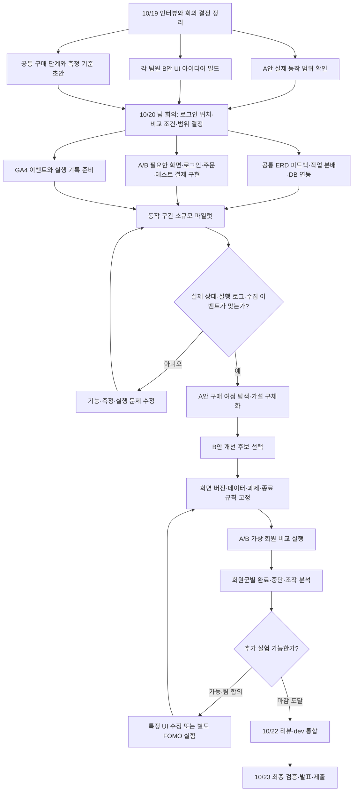
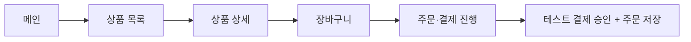
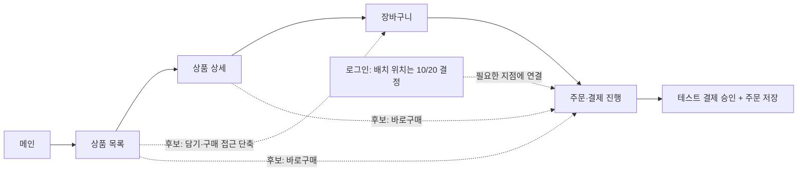

# ONEPIECE 프로젝트 흐름·Task·퍼널 명세

> v0.2 · 팀 공유용 초안 · 기준일 2026-10-19 · 일정 기준 Asia/Seoul
>
> 기준일에 기존 ERD 구조는 확인하지 못했다.
>
> **확정**은 논의에서 확인한 결정, **제안**은 검토할 설계, **미정**은 팀 결정이 필요한 항목이다. 구현·배포·GA4 수신 여부는 실제 검증 결과로 별도 갱신한다.

## 프로젝트 목적과 가설

ONEPIECE를 이미 인지하는 20~30대 패션 중·고관여 회원이 구매를 완료하는 과정을 관찰하고, 구매 경로와 조작을 개선한 결과를 비교한다. 브랜드 슬로건은 “ONE-PIECE is Master-piece.”이다.

| 구분 | 내용 |
|---|---|
| 핵심 가설 | 구매 여정의 단계·조작 부담을 줄이면 테스트 구매 완료 비율이 높아질 것이다. 아직 검증되지 않았다. |
| 별도 설계·검증 희망 | 구매 이력 0회·1회·2회 이상 회원에게 제공하는 FOMO 관련 정보·표현의 효과를 구분해 시험하고 싶다. 구체적인 표현·측정 방법과 이번 주 범위는 미정이다. |
| 기존 배경 가설 | 메인 정보량이 피로·이탈에 영향을 줄 수 있다. 이번 인터뷰에서는 구매 과정 단축을 우선 대상으로 좁혔다. 별도 검증 과제로 추가 확정하지 않았다. |

**성공의 공통 종점 [확정]: 테스트 결제 승인과 주문 저장이 모두 확인된 상태.** 결제 버튼 클릭·결제 화면 진입만으로 구매 완료를 판정하지 않는다.

실험 결과는 가상 회원의 과제 수행 결과다. 실제 고객의 구매 전환율·감정·브랜드 충성도를 입증한 결과로 바꾸어 표현하지 않는다.

## 확정 결정과 피벗

| 확정 내용 |
|---|
| 실험 대상은 ONEPIECE를 인지한 회원이다. 0회 구매자도 가입 회원이다. |
| 실제 서비스 구현에서 비회원 주문을 제외한다. 비회원 상품 탐색까지 금지하기로 합의한 것은 아니다. |
| 구매 이력 0회·1회·2회 이상 그룹을 구분해 구매 여정과 중단 구간을 살펴본다. |
| A안은 `@tuski0`이 작업 중인 산산기어 클론이다. 현재 동작 범위는 아직 확인되지 않았다. |
| B안은 ONEPIECE 개선안이다. 각 팀원이 10월 20일 회의 전까지 UI 아이디어를 빌드한다. 최종안은 미선정이다. |
| 실제 사용할 구매 퍼널을 기준으로 A/B가 함께 사용할 공통 데이터 모델과 ERD를 재구성한다. |
| `@tuski0`이 ERD에 우선 피드백하고, 공통 ERD·DB 작업은 10월 20일에 분배한다. |
| 구매 경로 단축과 회원군별 FOMO 표현을 구분해 시험하고 싶다. 이번 주 실행 가능 범위는 팀과 확인한다. |
| 로그인 페이지 구현은 `@yoosangjn-stack`, 주문·결제 페이지 구현은 `@tuski0`, GA4·실험 유저군 구성은 `@jihyunkims495-sys`이다. |
| 10월 22일 목요일에 리뷰·dev 통합, 10월 23일 금요일에 최종 검증·발표·제출한다. |

### UI 레퍼런스와 검토 아이디어

- **컬리 상세 페이지 레퍼런스:** 상품 이미지와 상품 정보·구매 영역의 좌우 배치. B안 적용은 미확정이다.
- 각 페이지에서 장바구니·결제로 이어지는 화살표는 구매를 빠르게 할 수 있을지 검토한 아이디어다. 모든 페이지에 해당 버튼을 구현하기로 확정한 요구사항이 아니다.
- `depth(스크롤)`의 구체적인 측정 목적·기준과 나머지 판독이 불명확한 메모는 확정 요구사항으로 옮기지 않았다.

## 전체 프로젝트 흐름 [제안]

아래 흐름은 확정된 역할·마감을 연결한 진행 제안이다. 200명 실행과 두 종류의 실험을 이번 주에 모두 끝낼 수 있다고 확정한 일정은 아니다.

### 실행 전 구분할 것

1. **초기 배포·파일럿:** 동작하는 구간을 확인하고 측정 오류·사용성 문제 후보를 찾는다. 결제 미구현으로 끝난 실행을 구매 이탈로 집계하지 않는다.
2. **A안 탐색:** 어떤 문제를 검증할지 구체화한다. 탐색하면서 바꾼 가설·조건을 기록한다.
3. **고정 조건 비교:** 비교에 사용할 화면 버전·과제·데이터·종료 규칙을 사전에 고정한다. 탐색 실행과 평가 실행을 구분한다.
4. **추가 개선 후 재시험:** 화면이 바뀌면 새 버전으로 구분한다. 여러 버전의 결과를 같은 B안 수치로 합치지 않는다.

GA4 설치 준비와 DB 작업은 병행할 수 있다. 다만 실제 기능이 필요한 단계의 정식 측정은 기능·상태 전이·이벤트 수신을 확인한 뒤 시작한다.

## 사용자 구매 흐름

### A안: 회의에서 그린 기준 경로 — 현재 동작은 미검증

### B안: 후보 경로 — 점선은 미확정 아이디어

로그인 위치는 A/B 비교 조건에도 영향을 준다. 단축 경로에서 장바구니 화면을 생략했다는 이유로 정상 구매를 실패로 계산하지 않는다. 공통 종점과 경로별 단계를 함께 관리한다.

## 페이지별 Task와 담당

담당은 팀에서 확인한 배정이며, 작업 내용과 완료 기준은 검토용 제안이다. 페이지 구현 담당이 정해지지 않은 부분은 임의로 배정하지 않았다.

| 페이지·영역 | 진행할 작업 | 담당·진행 방식 | 완료 기준·선행 조건 |
|---|---|---|---|
| A안 전체 화면 | 클론 작업과 실제 동작 범위 공유 | `@tuski0` | 접근 URL·버전, 동작 경로, 미구현·오류 구간 구분 |
| 메인 | 구매 흐름으로 연결하는 UI 아이디어 검토 | 각 팀원 아이디어 준비, 최종 구현 담당 미정 | 10/20 회의 전 빌드. 추가할 요소와 줄일 조작의 근거 설명 |
| 상품 목록 | 상품 탐색·선택과 구매 접근 방식 검토 | 각 팀원 아이디어 준비, 최종 구현 담당 미정 | 상세·장바구니·바로구매 중 허용할 경로를 합의. 목록에서 구매하는 기능은 아직 미확정 |
| 상품 상세 | 옵션 선택·구매 영역 배치와 단축 경로 검토 | 각 팀원 아이디어 준비, 최종 구현 담당 미정 | 컬리의 이미지·정보 좌우 배치는 참고 후보. 실제 담기 결과와 선택 정보 일치 |
| 장바구니 | 담긴 항목 확인·변경과 주문 연결 검토 | 구현 담당 미정 | 추가·변경·재조회 결과 일치, 주문에 선택한 항목·옵션·수량 전달 |
| 로그인 | 로그인 페이지 구현과 구매 흐름 연결 | `@yoosangjn-stack` | 로그인 위치는 10/20 결정. 성공·실패·선택 내용 유지·복귀 확인 |
| 주문·결제 | 주문·테스트 결제 구현 | `@tuski0` | 테스트 승인과 주문 저장, 취소·실패·중복 요청 처리 확인 |
| 주문 완료 | 승인·저장된 주문 결과 확인과 구매 이벤트 연결 | 주문·결제: `@tuski0` / 측정: `@jihyunkims495-sys` | 두 조건 확인 후 완료 판정. 새로고침·재시도로 중복 구매 집계 방지 |

### 페이지 공통 작업

| 공통 영역 | 진행할 작업 | 담당·시점 | 완료 기준·선행 조건 |
|---|---|---|---|
| 퍼널·구현 범위 | 로그인 위치·브랜드 조건·B안 선정·실험 범위 논의 | 팀, 10/20 | 결정·보류·담당·기한 기록 |
| 공통 ERD·DB | 구매 퍼널에 맞춘 데이터 관계 재구성·연동 | `@tuski0` 우선 피드백, 세부 담당 10/20 배분 | 회원·상품·옵션·장바구니·주문 상태의 연결과 변경 영향 검토 |
| 테스트 초기 데이터 | 구매 이력·상품 조건을 준비하고 A/B 초기 상태 관리 | 담당 10/20 배분 | 같은 의미의 데이터 사용, 초기화·복구 확인 |
| GA4 | 연결·이벤트 구현·수신 검증 | `@jihyunkims495-sys` | 실제 상태와 이벤트를 대조하고 누락·중복 확인 |
| 가상 회원군 | 구매 이력별 페르소나·과제·중단 규칙 구성 | `@jihyunkims495-sys`, 코치와 함께 구체화 | 회원 상태·시작 조건·실행 예산 명시 |
| 화면 기반 실행 | 실행기와 행동·종료 기록 준비 | 개발·운영 담당 미정 | 실제 화면에서 행동, 소규모 실행의 시간·비용·실패 복구 확인 |
| 파일럿·비교 분석 | 동작 구간 시험과 회원군별 A/B 분석 | `@jihyunkims495-sys` 중심, 기능 수정은 해당 담당과 협업 제안 | 실행 수·중단 이유·GA4 수집 차이와 UI 개선 근거 제시 |
| FOMO 별도 검증 | 회원군별 표현과 경로 단축 효과를 구분하는 실험 설계 | 담당·이번 주 범위 미정 | 비교할 표현·노출·평가 기준·일정 합의 |
| 리뷰·통합 | 구현·측정 검증, 리뷰와 dev 통합 | 팀, 통합 담당 미정 / 10/22 | PR에 확인 방법·실제 결과·공용 파일 영향 기록 |
| 최종 검증·제출 | 시연·발표·제출물 정리 | 팀 / 10/23 | 최종 버전·결과·한계·미완료 범위 일치 |

배포 실행 담당·실험 실행기 담당·최종 통합 담당은 추가 배분 대상이다.

## 일정

| 날짜 | 상태 | 내용 |
|---|---|---|
| 10/19 월 | 현재 진행 | 회의·인터뷰 정리, 각자 UI 아이디어 준비, A안 작업 진행 |
| 10/20 화 | 확정된 준비·회의 | 회의 전 각자 UI 빌드. 로그인 위치 결정, ERD·DB 작업 배분. 브랜드 조건·실험 범위도 확인 필요 |
| 10/21 수 | 계획 제안 | 기능·데이터·측정 연동과 파일럿. 실제 준비 상태를 보고 비교 규모·실험 범위 결정 |
| 10/22 목 | 팀 확정 마감 | 리뷰·dev 통합. 실험용 고정 버전과 최종 통합 버전을 구분 |
| 10/23 금 | 팀 확정 마감 | 최종 검증·발표·제출 |

1~2일 단위로 시험하려는 방향은 유지한다. 전체 구매 흐름이 준비되지 않으면 동작 구간의 결과만 보고하고, 결제 완료 비교나 FOMO 검증을 완료했다고 표현하지 않는다. 기존 강사 로드맵·평가 기준 유지 요구도 별도로 충족해야 하며, 본 실험 계획만으로 평가 항목 충족이 보장되지는 않는다.

## 가상 회원·과제·비교 조건 [제안]

### 회원군

| 실험 시작 전 ONEPIECE 구매 이력 | 공통 조건 |
|---|---|
| 0회 | 가입 회원, 브랜드 인지, 타깃 연령·패션 관여 조건 |
| 1회 | 동일 |
| 2회 이상 | 동일 |

- 그룹별 인원·페르소나 차이·총 실행 규모는 미정이다. 약 200개가 희망 규모이며, GA4 AU 200명 또는 1,200명 확보를 확정한 것은 아니다.
- 구매 이력과 로그인 상태·UI 숙련도·구매 의향은 별도 속성이다. 과거 주문 건수만으로 행동 차이가 생긴다고 가정하지 않는다.
- 그룹은 **실험 시작 전 이력**으로 고정하는 방안을 제안한다. A에서 새로 구매한 결과가 B 시작 상태를 바꾸지 않게 한다.
- 초기 이력용 주문 데이터와 이번 실험에서 발생한 신규 구매를 구분한다. 초기 데이터 입력을 새 구매 이벤트로 전송하지 않는다.

### 과제

구매 목표는 주되 해결 경로를 알려주지 않는 과제는 **검토 제안이며 아직 최종 채택되지 않았다.** 자유 탐색 과제와 지정 상품 구매 과제를 섞어 하나의 전환율로 계산하지 않는다.

예시: “이 상품의 M 사이즈 1개를 준비된 테스트 정보로 주문해 보세요.” 이 예시는 클릭 위치·장바구니 경유를 지시하지 않는다. 실제 과제 문구·허용 행동·중단 조건은 평가 실행 전에 고정한다.

### 동일 페르소나 A/B 비교

- 같은 구매 목표·상품 조건·회원 초기 상태를 적용한다. 브랜드·상품 조건 통일은 팀 합의 전이다.
- A 실행의 해결 경로·기억을 B 실행에 전달하지 않는 독립된 실행 맥락을 사용한다.
- 화면을 보고 행동하는 AI의 모델·도구·재시도 한도 등 실행 조건을 맞춘다. 구체적인 도구와 실행 예산은 아직 검증하지 않았다.
- 반복 실행은 새로운 독립 회원 수로 바꿔 세지 않는다. 200개 페르소나가 A/B 각 1회 실행하면 **200개 페르소나·400회 실행**이라는 식으로 구분한다.
- 이 설계는 우선 **대응되는 가상 회원의 A/B 비교**다. 실제 고객을 무작위 배정한 온라인 A/B 실험을 수행한 것으로 명명하지 않는다.

GA4 활성 사용자 수는 자체 집계 조건에 따르며, 알려진 봇 트래픽은 자동 제외된다. 따라서 페르소나 수·실행 수·GA4 사용자 수를 별도로 보고한다. 집계 수를 맞추려고 사용자 식별이나 트래픽 필터를 우회하는 방식은 이 설계에 포함하지 않는다.

## 구매 경로와 FOMO 효과 분리 [제안]

| 실험 후보 | 비교 시 바꾸려는 것 | 맞출 조건 | 상태 |
|---|---|---|---|
| 구매 경로 | 화면 연결·구매 접근·조작 부담 | 상품·가격·재고·과제·회원 상태·FOMO 관련 표현 | 우선 가설. 실제 변경 범위 미정 |
| FOMO | 구매 이력별 정보·표현·노출 방식 | 구매 경로·기능·상품 조건·과제·회원 상태 | 별도 검증 희망. 이번 주 범위 미정 |

경로와 표현을 동시에 바꾸고 결과가 달라졌다면 전체 개선안의 차이만 관찰한 것이다. 두 효과를 따로 입증했다고 하지 않는다. FOMO가 실제 사람에게 유발됐는지는 AI 구매 성공·자기 설명만으로 판정하지 않는다.

## 페이지별 퍼널·이벤트 초안

현재 수집 중이라고 확인한 목록이 아니라 구현·검증할 이벤트 제안이다. 각 페이지에서 ‘클릭했다’와 ‘실제 상태가 바뀌었다’를 구분한다.

| 페이지·단계 | 관찰할 행동 | 이벤트 후보 | 발생 기준·확인 사항 |
|---|---|---|---|
| 메인 | 메인 화면 조회·다음 화면으로 이동 | `page_view` | 실제 표시된 화면을 기록. 상품 탐색으로 이어지는 다음 행동 확인 |
| 상품 목록 | 목록 조회·상품 선택 | `page_view`, `view_item_list`, `select_item` | 실제 표시 목록과 선택 상품 기록. 상세 도달 성공과 선택 클릭을 구분 |
| 상품 상세 | 상세 조회·장바구니 담기 | `page_view`, `view_item`, `add_to_cart` | 유효 상품 표시와 실제 담기 반영을 확인. 성공 문구만으로 담기 성공 판정하지 않음 |
| 장바구니 | 내용 조회·주문 진행 | `page_view`, `view_cart` | 실제 항목·옵션·수량·합계 확인. 변경 결과와 주문 전달 내용 대조 |
| 로그인 | 로그인 화면 조회·인증 성공 | `page_view`, `login` | 성공은 인증 결과로 판정. 요구·실패·복귀는 별도 상태 기록. 배치 위치 미정 |
| 주문·결제 | 주문·결제 흐름 시작 | `page_view`, `begin_checkout` | 실제 진행 시작을 기록. 바로구매 버튼 클릭만으로 시작 판정하지 않음. 시작 지점은 합의 필요 |
| 주문 완료 | 테스트 구매 완료 | `purchase` | 테스트 승인과 유효한 주문 저장을 모두 확인. 거래 식별자 기준 중복 방지 |

`add_to_cart`는 특정 페이지에만 묶인 이벤트가 아니다. 상품 목록 등에서도 담기를 허용하기로 결정하면 실제 발생 페이지를 함께 기록한다. `begin_checkout`도 장바구니·상세·목록 등에서 시작할 수 있으므로 시작 위치와 결제 화면 도달을 구분한다.

배송·결제 정보 제출 이벤트는 실제 구현 단계에 존재할 때만 추가한다. 상세 스크롤 깊이 기준은 아직 미정이다. 화면 전환과 자동·수동 이벤트 중복도 검증한다.

### 모든 페이지에 공통으로 연결할 분석 정보

- A/B 구분, 화면 버전, 실험 구분, 실험 시작 전 구매 이력 그룹, 테스트 트래픽 표시.
- 해당 행동의 상품·옵션 식별자·수량, 구매 완료 시 거래 식별자.
- 실행 식별자·초기 상태·개별 행동·종료 이유는 별도 실행 기록에서 관리한다. 고유 실행 식별자를 GA4 보고서 차원으로 무분별하게 등록하지 않는다.
- 실행 시작은 실행 기록에 `run_started` 등으로 남긴다. 이를 GA4 자동 이벤트로 간주하지 않는다.
- 커스텀 파라미터의 등록·수신·집계를 확인한다. 계정의 실제 설정은 아직 미확인이다.
- 이름·이메일·주소·비밀번호·토큰·실제 결제 정보, 민감한 URL 값은 전송하지 않는다.

## 공통 퍼널과 경로별 퍼널 [제안]

**공통 과제 완료 기준:** 실행 시작 → 실제 결제 진행 시작 → 테스트 승인·주문 저장.

**경로별 진단:** 목록·상세·장바구니·로그인 등 실제 통과한 구간을 살펴본다. A/B에서 모든 단계를 동일하게 통과하도록 강제하지 않는다.

GA4 순차 퍼널은 지정한 단계를 건너뛰면 이후 단계에서 제외될 수 있다. 따라서 `상세 → 장바구니 → 결제` 하나만으로 B안 전체 구매 완료율을 판단하지 않는다. 로그인 위치와 허용 경로를 결정한 뒤 경로별 퍼널을 설정한다.

GA4의 사용자 단위 퍼널 집계와 실행 기록의 run 단위 집계는 다를 수 있다. 같은 회원의 반복 과제는 실행 기록에서 구분하고, 두 집계가 자동으로 일치한다고 가정하지 않는다.

## 페이지별 지표와 정의

지표·계산 기준은 제안이며 개선 목표 수치는 아직 미정이다. 모든 결과는 **구매 이력 0회·1회·2회 이상 × A/B × 화면 버전**으로 나눠 본다. 실행은 동일한 과제·시작 조건·종료 규칙으로 비교한다.

| 페이지 | 우선 확인할 지표 | 계산·관찰 기준 | UI 개선에 연결할 질문 |
|---|---|---|---|
| 메인 | 상품 탐색 진입률, 메인에서 종료된 실행 비율 | 메인 방문 실행 중 상품 목록 또는 상세에 도달한 비율 / 메인에서 최종 종료된 비율 | 다음 행동과 구매 접근을 쉽게 찾는가? |
| 상품 목록 | 상품 선택률·상세 도달률, 목록에서 종료된 실행 비율 | 목록 방문 실행 중 상품 선택·실제 상세 도달을 각각 집계. 바로구매가 허용되면 별도 경로로 집계 | 상품과 다음 행동을 쉽게 찾는가? 선택 클릭 후 정상 도달하는가? |
| 상품 상세 | 담기 성공률, 결제 시작률, 상세에서 종료된 실행 비율 | 상세 방문 실행 중 실제 담기 성공 또는 결제 진행 시작 비율. 두 행동은 별도 집계 | 옵션·수량·구매 버튼을 찾고 결과를 확인할 수 있는가? |
| 장바구니 | 결제 진행률, 수정 성공, 장바구니에서 종료된 실행 비율 | 장바구니 방문 실행 중 실제 결제 진행 시작 비율. 수정 과제는 시도·성공을 구분 | 항목과 합계를 이해하고 수정·주문을 진행할 수 있는가? |
| 로그인 | 로그인 성공률, 구매 흐름 복귀율, 로그인에서 종료된 실행 비율 | 로그인 요구 실행 중 인증 성공 비율 / 인증 성공 실행 중 원래 구매 흐름에 복귀한 비율 | 로그인 때문에 진행이 끊기거나 선택 내용이 사라지는가? |
| 주문·결제 | 구매 완료율, 승인·저장 실패, 중복 처리 | 결제 진행 시작 실행 중 테스트 승인·주문 저장을 모두 완료한 비율 | 입력·결제 결과를 이해하고 오류에서 복구할 수 있는가? |
| 주문 완료 | 승인·주문·이벤트 일치, 중복 구매 집계 | 승인된 거래·저장된 주문·구매 이벤트를 대조 | 완료 상태가 정확하고 재방문·새로고침에도 중복되지 않는가? |

### 전체 구매 여정과 공통 진단 지표

| 지표 | 정의·해석 |
|---|---|
| 전체 과제 완료율 | 테스트 승인·주문 저장에 성공한 실행 / 실행 시작 기록이 있는 전체 실행. 실행 환경 실패도 별도 건수와 함께 공개 |
| 경로별 단계 진행률 | 특정 경로의 이전 단계를 충족한 실행 중 정해진 시간·순서 안에 다음 단계를 충족한 비율. 허용된 바로구매·우회는 실패로 세지 않음 |
| 페이지에서 종료된 실행 비율 | 해당 페이지에서 최종 종료된 실행 / 해당 페이지를 방문한 실행. 프로젝트 정의이며 GA4 기본 이탈률과 동일하다고 하지 않음 |
| 조작 부담 | 실행별 클릭·화면 이동·되돌아가기·반복 입력. 완료·미완료를 구분하고 분포를 함께 제시 |
| 오류와 복구 | 오류 발생 실행 비율, 반복 오류와 복구 성공 여부. 복구한 오류도 기록 |
| 기술적 수행 시간 | 실행·단계 타임스탬프 차이. AI 추론·도구 대기 영향이 있어 사람의 구매 시간·피로로 해석하지 않음 |
| 수집 일치 | 실제 상태·실행 기록과 GA4 이벤트의 누락·중복·차이 |

같은 페이지를 반복 방문해도 위 비율의 분모에서는 해당 실행을 한 번만 센다. 페이지별 수치는 서로 합산하는 지표가 아니다. 그룹 구성비는 A/B에서 맞추거나 사전 합의한 가중치로 요약한다. 약 200개만으로 충분한 표본이라고 확정하지 않는다.

### 중단 원인을 구분하는 기준

| 종료 상태 | 의미 |
|---|---|
| 성공 | 테스트 결제 승인과 주문 저장 확인 |
| 과제 중단 | 기능을 사용할 수 있는 상태에서 과제 진행을 중단. 관찰 행동과 AI의 설명은 구분 |
| 서비스 오류 종료 | 사이트·저장·결제 오류로 진행 불가 |
| 실행 환경 오류 종료 | AI·브라우저 도구·실행기 문제로 종료 |
| 한도 도달 | 미리 정한 시간·행동·재시도 한도 도달 |
| 관찰 범위 종료 | 파일럿의 미구현 후속 단계 또는 정해진 관찰 끝에 도달 |

종료 한도는 실행 전에 정하고 미완료 실행을 임의로 제외하지 않는다. 다음 GA4 이벤트가 없다는 사실만으로 중단 이유·FOMO를 확정하지 않는다. 위 페이지 종료·단계 미진행 지표는 GA4 bounce rate와 구분한다.

## 퍼널 기준 공통 ERD 재구성 검토표 [제안]

기존 ERD를 읽고 도출한 수정안이 아니다. 새 ERD 검토 때 확인할 데이터 책임의 후보이며, 실제 테이블 이름·관계·타입·정책은 팀이 정한다.

| 행동 | 필요한 데이터·상태 후보 | 검토할 관계·불변 조건 |
|---|---|---|
| 회원 인식·로그인 | 인증 식별자, 회원, 실험 시작 전 구매 이력 | 인증 주체와 회원·주문 연결. 분석용 정보와 개인정보 경계 |
| 상품 탐색·옵션 선택 | 상품, 카테고리, 이미지, 옵션·재고 | 화면 표시 옵션과 실제 주문 가능 옵션의 일치 |
| 담기·수량 변경 | 회원 장바구니, 장바구니 항목 | 회원·옵션·수량 연결, 재조회·중복 추가 결과 일치 |
| 주문 시작 | 주문 항목·가격·수량·합계 | 합의한 주문 생성 시점과 계산 기준 |
| 결제·주문 확정 | 주문 상태, 테스트 결제 결과, 주문 시점의 항목 정보 | 승인·주문 연결, 중복 요청, 실패·취소 상태, 금액 일치 |
| 실험 비교 | 페르소나·초기 상태·화면 버전·행동·종료 상태 | A의 실행 결과가 B 초기 상태를 바꾸지 않게 관리 |

공통 데이터 모델이 곧 같은 장바구니·주문 상태를 공유한다는 뜻은 아니다. 같은 스키마의 격리 데이터 사용, 초기 상태 복원 등 구체적인 운영 방식은 미정이다. 실험 기록을 서비스 DB에 둘지 별도로 둘지도 미정이다.

SAN SAN GEAR의 실제 ERD·DB 구조는 확인하지 않았다. 기존 공유 ERD와 재구성할 공통 모델을 원본 브랜드 DB의 검증된 복제본으로 표현하지 않는다.

## 완료 기준과 확인 방법 [제안]

### 측정 시작 전

- [ ] A/B의 실제 URL·화면 버전·동작 범위 확인.
- [ ] 로그인 위치·비회원 주문 제외·구매 종점·허용 경로 결정.
- [ ] 브랜드·상품·가격·옵션·재고·회원 초기 상태 비교 조건 결정.
- [ ] 이벤트를 클릭 의도가 아니라 실제 상태와 대조. 수집 누락·중복 확인.
- [ ] 파일럿 범위 종료와 과제 중단을 구분.
- [ ] 실행 시간·비용·동시성·실패 복구를 소규모로 확인한 뒤 확대 규모 결정.
- [ ] 평가 과제·종료 규칙·그룹 구성·버전 고정, 탐색 실행과 평가 실행 구분.

### 리뷰·통합

- [ ] 브라우저 정상·예외 흐름, 잘못된 상품·옵션, 담기·변경·재조회 확인.
- [ ] 로그인 실패·성공·복귀, 주문·결제 승인·취소·실패·중복 처리 확인.
- [ ] TypeScript 오류 없음, `npm run lint`, `npm run build` 결과 기록.
- [ ] 변경 범위·공용 파일 영향·화면·확인 방법·실제 결과를 PR에 기록.
- [ ] 개인 작업은 최신 dev 기반, 개인 PR의 base는 dev. 최소 1명 리뷰·수정 반영 후 통합.
- [ ] dev→main 최종 반영은 별도 PR 규칙 적용. 배포 버전과 비교 실험 버전을 구분.

공용 파일 수정은 사전 팀 공유 대상이다: `src/app/globals.css`, `src/app/layout.tsx`, `src/app/(shop)/layout.tsx`, `src/shared/mocks/mockData.ts`, `src/domains/products/types/product.types.ts`, `package.json`, `package-lock.json`, `tsconfig.json`, `next.config.ts`.

위 항목은 앞으로 확인할 기준이다. 이번 문서 작성에서 테스트·리뷰·통합이 통과한 것은 아니다. 현재 브랜치·최신 dev 분기 여부도 별도 확인이 필요하다.

## 회의에서 결정할 사항

| 페이지·논의 주제 | 결정할 내용 | 담당·시점 | 결정이 필요한 이유 |
|---|---|---|---|
| 로그인 | 로그인 필수 시점, 실험 시작 시 로그인 상태 | 팀 / 10/20 결정 예정 | 구매 경로·회원 초기 상태·과제에 영향 |
| 전체 화면·브랜드 | A/B 브랜드·상품·가격·옵션·재고 조건 통일 여부 | 팀 확인 대기 | 결과를 UI 차이로 해석할 수 있는 범위 결정 |
| 메인·상품 목록·상품 상세 | 최종 B안, 구매 접근 단축, 컬리 좌우 배치 적용 여부 | 각자 아이디어 후 팀 선정 | 실제 구현 작업과 허용 경로 결정 |
| 상품 상세 | 스크롤 깊이 메모의 목적과 측정 필요성 | 팀 | 부가 측정 범위 결정 |
| 장바구니·주문·결제 | A안에서 현재 동작하는 구간과 미구현·오류 | `@tuski0` 확인 필요 | 파일럿 가능한 구간과 공통 성공 조건 확인 |
| 공통 ERD·DB | 세부 담당, 실행 데이터 격리·초기화·복구 방식 | 팀 / 10/20 작업 분배 | A/B 시작 조건 재현 |
| 가상 회원·과제 | 총 페르소나 수, 그룹 배분, 반복 수, 과제 문구·중단 규칙·실행 예산 | `@jihyunkims495-sys`·팀 / 파일럿 결과 참고 제안 | 실행 가능 규모·비교 조건·종료 판정 결정 |
| 구매 경로·FOMO | 두 효과의 분리 방식과 이번 주 실행 범위 | 팀 확인 대기 | 스프린트와 결과 해석 범위 결정 |
| 배포·실험 운영·통합 | 테스트 서버와 배포 담당, 실행기 개발·운영 담당, 최종 통합 담당 | 팀 | 실행 준비와 마감 책임 구체화 |
| 최종 제출 | 기존 강사 로드맵·평가 항목과 이번 변경의 충돌·누락 | 팀·필요 시 강사 확인 | 최종 제출 범위 확인 |

## 검토 의견 남기는 방법

페이지나 주제 이름으로 의견을 남긴다. 예: “로그인 — 장바구니 담기 직전에 배치”, “공통 ERD·DB — 담당 변경”, “상품 상세 — 컬리 좌우 배치 적용”, “FOMO — 이번 주 실험에서 제외”.
