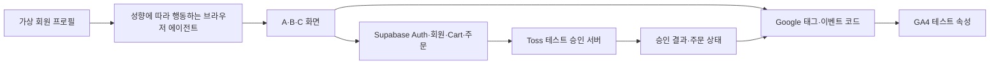

# A·B·C안 GA4 설정·검증 프로세스 명세

- 버전: v1.0
- 작성일: 2026-10-21, Asia/Seoul
- 대상 기간: 2026-10-20~2026-10-21
- 목적: 실제 설정·수신 검증과 앞으로 수행할 연결 작업을 분리해 재현 가능하게 기록
- 관련 문서: [지표 정의](./2026-10-21-03-abc-ga4-metrics-spec.md), [180명 회원 정의](../01-customer-analysis/2026-10-21-04-virtual-members-180-spec.md)

## 1. 현재 결론

공통 GA4 테스트 스트림에 A 로컬 방문, B 배포본의 일부 구매 여정, A/B/C 배포본의 결제 버튼 클릭이 실제 수신된 기록이 있다. A 로컬에서는 회원 6명의 기능·계측 파일럿도 수행했다.

팀 Supabase에는 파일럿 6명을 생성했고 API 로그인·본인 profiles 조회를 확인했다. **팀 회원으로 B/C 브라우저 구매 여정과 Toss 테스트 승인을 완료한 상태는 아니다.** 전체 180명 행동 실험도 아직 시작하지 않았다.

설정·관찰 결과와 미완료 범위는 2026-10-21 작성 시점을 기준으로 구분한다.

현재 실험의 합의된 종료점은 `payment_button_click`이며 Toss API는 연결하지 않는다. 아래 Toss 승인·purchase 내용은 후속 설계로 읽고 이번 완료·전환 집계에서 제외한다.

## 2. 구성과 역할



도식은 목표 구조다. A 로컬 Cart는 브라우저 저장이고 B 정적 배포에는 서버 DB가 연결되지 않았으므로 모든 화살표가 현재 완성됐다는 뜻은 아니다.

- Google 태그: 브라우저에서 GA4로 방문·행동 이벤트를 보내는 수집 코드. 웹 스트림 생성만으로 사이트에 설치되지는 않는다.
- Supabase: 로그인과 서비스 데이터의 근거. 계정 생성만으로 GA 행동을 발생시키지 않는다.
- Toss 테스트 승인: 최종 결제 상태의 근거. 버튼 클릭과 구분한다.
- GA4: 수신한 행동을 조회·비교한다. DB의 주문·구매 이력을 자동 조회하거나 ERD를 자동 수집하지 않는다.

## 3. 설정 대상

| 항목 | 설정값·상태 |
| --- | --- |
| GA 계정 | ONEPIECE 테스트 계정 |
| GA4 속성 | ONEPIECE 테스트 웹 속성 |
| 공통 웹 스트림 | A·B·C 공통 테스트 웹 스트림 |
| 최종 사용 측정 ID | G-JWBDB2MZHF |
| B용으로 별도 생성했던 스트림 | 별도 B 테스트 스트림. 최종 배포는 이 스트림을 사용하지 않음 |
| 이벤트 비교 보고서 | ONEPIECE A·B·C 행동 비교 |
| 메뉴 | ONEPIECE 테스트 → A·B·C 비교 → 위 보고서 |

| 안 | 주소 | site_variant |
| --- | --- | --- |
| A 로컬 | http://127.0.0.1:3001 | sansan_clone |
| A 배포 | A 레퍼런스 테스트 배포 | sansan_clone |
| B 배포 | B 테스트 배포 | onepiece_b |
| C 배포 | C 테스트 배포 | onepiece_c |

site_variant만으로 A 로컬과 A 배포를 구분할 수 없다. hostname·환경·실행 ID를 함께 사용한다. Supabase 프로젝트를 바꾸어도 기존 GA4 속성을 새로 만들 필요는 없다.

## 4. 10/20 설정·검증

1. GA 테스트 계정·속성에서 웹 스트림을 설정했다. localhost URL 입력이 거절돼 같은 PC의 루프백 주소인 http://127.0.0.1로 스트림을 생성했다.
2. 측정 ID G-JWBDB2MZHF를 A 로컬 Google 태그에 연결했다. Google 태그를 한 번 로딩하고 향상된 측정으로 페이지 조회를 수집했다.
3. A 클론을 로컬 3001 포트에서 실행하고 메인·TOP 목록을 실제로 열었다.
4. DebugView에서 first_visit 1건, session_start 1건, user_engagement 1건, page_view 3건이 보인 검증 기록이 있다. page_location의 로컬 주소도 대조했다. 이는 당시 QA 관찰값이며 현재 누적값이 아니다.
5. 이 단계는 기본 방문 수집 확인이다. 상품 담기·회원·승인 결제까지 검증한 결과가 아니다.

## 5. 10/21 보강·설정

### 5.1 B 및 C 배포본의 수집

- B 배포본을 공통 A 스트림에 연결하고 site_variant=onepiece_b, environment=team_test, is_test=true로 구분했다.
- B/C는 기존 분석 동의를 수락한 뒤 태그·이벤트를 전송한다. A의 기존 태그 로딩 정책은 동일하게 변경했다고 주장하지 않는다. 비교 시 동의·태그 활성 조건을 맞춰야 한다.
- B에서 SPA 경로 이동에 향상된 페이지 조회와 수동 page_view가 중복되는 문제를 발견했다. 최초 조회만 수동 전송하고 이후는 향상된 측정에 맡기도록 수정했다. C 배포본에도 최초 조회·이후 경로 수집을 나누는 코드가 있다.
- 실제 UI QA에서 B의 담기·삭제·Cart·주문 진입·그리드 변경 이벤트를 확인했다. C는 상세→실제 Cart 삽입 미완료 상태를 add_to_cart_attempt로 구분했다.
- A/B/C에 Toss 버튼 클릭 시연을 연결했다. 승인 API 연결 없이 payment_button_click을 측정한다. B/C 테스트 승인·purchase는 후속 설계 항목이며, 현재 실험에는 포함하지 않는다.

### 5.2 A 실제 로그인·회원 성향 연결

- A 검증 환경의 Supabase Auth를 개발 환경에 연결하고 로그인·회원가입 경로를 구현했다. 이메일 확인 후 로그인하고 새로고침해도 인증 상태가 유지됨을 확인했다.
- 가상 회원의 성향은 서버 관리 app_metadata.onepiece_fixture에서 검증한다. URL의 임의 성향이나 사용자가 바꿀 수 있는 user_metadata를 회원 근거로 신뢰하지 않는다.
- 로그인 회원 ID는 GA4 전용 user_id에 설정하고 로그아웃 시 해제한다. 이메일·비밀번호·인증 토큰을 보내지 않는다.
- 첫 파일럿 중 인증 복원보다 view_item이 빨라 성향이 누락되는 문제를 확인했다. 인증 확인 이후 초기 GA·보류 이벤트를 전송하도록 수정했고 후속 4명 조회 로그에서 성향을 확인했다. 초기 오류 기록은 보존했다.

### 5.3 보고서·비교 설정

처음 만든 A·B 보고서를 기존 보고서 그대로 확장해 A·B·C 행동 비교로 저장했다. C안 비교를 추가하고 보고서 메뉴·필터를 보강했다.

A·B·C 테스트 배포 호스트만 포함하도록 보고서를 설정했다. 전체 문자열과 일치하는 호스트 필터의 형식 예시는 다음과 같다.

```regex
^(a-test|b-test|c-test)\.example\.com$
```

- 주요 측정기준: 이벤트 이름, 호스트 이름.
- 주요 측정항목: 이벤트 수, 총 사용자, 사용자당 이벤트 수.
- A/B/C 비교와 비교 스위치가 켜진 상태를 당일 재로딩해 확인한 기록이 있다.
- localhost/127.0.0.1은 이 보고서 필터에 포함하지 않았다. A 로컬 파일럿이 이 보고서에 안 보이는 것은 별도 범위 문제다.
- C 비교가 메뉴에 보이는 것과 C 데이터가 집계된 것은 다르다. 마지막 보고서 UI 검증 기록에서 A/C는 0 또는 데이터 없음, B는 47이벤트/1사용자였다. 당시 관찰값으로만 보존하며 현재 수치·6명 또는 180명 결과로 해석하지 않는다.

### 5.4 팀 Supabase 전환 준비

| 구분 | 프로젝트 | 현재 근거 |
| --- | --- | --- |
| A 검증 환경 | A 인증 프로젝트 | Auth 180명 준비, A 로컬 6명 브라우저 파일럿 |
| 팀 테스트 | B·C 공통 인증 프로젝트 | Auth 6명 생성·API 인증·본인 profiles 조회 |

C 개발 환경의 브라우저용 Supabase 설정 로딩을 확인했다. 당시 배포 반영은 하지 않았다. B는 정적 프런트 시연 모드여서 Supabase Auth·Cart·주문 연결 구현이 필요하다.

같은 설계 회원을 환경별 인증 계정으로 구분한다. 한 환경의 키·세션·인증 ID를 다른 환경에서 재사용하지 않으며, 설계 키가 같다는 이유로 인증 신원을 같은 것으로 처리하지 않는다.

## 6. 실제 검증 기록

| 검증 | 관찰 결과 | 완료로 볼 수 있는 범위 |
| --- | --- | --- |
| 10/20 A 로컬 방문 | 기본 방문 이벤트 수신·로컬 주소 대조 | Google 태그 기본 연결 |
| 10/21 B 배포 UI QA | 담기 2·삭제 1·view_cart 2·checkout_click 1·begin_checkout 1·grid_change 1 등의 수신 대조 기록 | 해당 UI QA. 고유 고객 수가 아님 |
| 10/21 A/B/C Toss 버튼 | 각 안 실제 버튼 클릭 1회씩, GA 실행 ID·variant·주소 대조 | click_only 3건. 승인 API·실제 구매 아님 |
| A Auth | 180개 고유 회원 키 생성·재조회 완료 | 계정 준비 |
| A 로컬 회원 파일럿 | 6명 로그인·메인 빈 Cart·상품 확인·담기·Checkout 시연 | 같은 브라우저에서 계정 전환한 기능 QA |
| A 파일럿 GA | checkout_mock_click 6건 관찰, 043/077/140 실행 ID 상세 대조 | 전부 6건의 개별 GA 상세를 열어 검증한 상태는 아님 |
| 팀 Auth | 6명 생성·재조회, 실제 API 인증 6명, 본인 profiles id 6명 | B/C 브라우저·GA 확인과 별도 |

파일럿 회원은 043/180/021/140/028/077이며 각 1개 정책을 대표한다. A 파일럿 당시 원시 DebugView login은 7건이었으나 브라우저 실행 로그의 로그인은 6건이었다. 추가 1건은 귀속을 확인하지 않았다. 이벤트 수를 고유 회원 수로 치환하지 않는다.

기능 QA의 6명 Checkout은 자연 전환율 100%를 뜻하지 않는다. 첫 실행의 사이즈 입력 교정·불필요 상품 제거도 자동화 입력 수정이며 고객의 자연스러운 구매 망설임으로 분석하지 않는다.


## 7. 공통 이벤트 문맥

| 필드 | 의미·처리 |
| --- | --- |
| site_variant | A/B/C 구분. 호스트도 함께 대조 |
| environment / is_test | 배포 QA에서는 team_test / true. A 로컬 기존 문맥과 구분 |
| is_synthetic | 가상 회원 행동 구분. 일반 사람 QA와 구분 |
| cohort_id | 실행 집단과 인증 환경 구분 |
| experiment_id / hypothesis_id | 실험·가설 버전 |
| test_run_id | 회원·안·회차별 실행 대조. 고유값을 모두 보고서용 맞춤 정의로 만들지 않음 |
| user_id | 실제 인증 회원의 전용 GA4 User-ID. 로그아웃 때 해제 |
| age_band / decision_policy / purchase_stage_at_entry | 가상 회원의 배정 조건. 실제 고객 추정값이 아님 |
| budget_band / shopping_mission | 예산·구매 과업 차이를 구분 |
| surface | Drawer/Cart 페이지/주문서 등의 위치. 기존 cart_surface와 매핑 필요 |
| payment_provider / payment_mode | 기존 toss / click_only와 향후 테스트 승인 범위 분리 |

`?synthetic_run=<실행ID>&debug_mode=1`은 B/C 시연용 실행을 구분하는 시작 방법이다. A도 synthetic_run을 사용하지만 세부 디버그 처리는 코드와 대조한다. URL에 회원 이메일·비밀번호·토큰을 넣지 않는다.

A에서 구현한 회원 메타데이터 계측이 B/C에도 자동 적용되는 것은 아니다. 팀 계정의 새 cohort_id를 포함해 검증된 문맥이 B/C 이벤트에 실리는지 새로 확인해야 한다.

## 8. 팀원이 GA4에서 확인하는 절차

1. A·B·C가 사용하는 공통 GA4 테스트 웹 속성을 연다.
2. 파일럿은 관리자 → 데이터 표시 → DebugView에서 해당 브라우저의 DEBUG DEVICE를 선택한다.
3. 실제 행동 1개를 수행하고 이벤트 이름·test_run_id·site_variant·page_location을 대조한다. 여러 장치가 비슷한 이름으로 표시되면 실행 ID로 구분한다.
4. 상품 이벤트는 상품·옵션·수량·금액을 확인하고, 팀 회원은 정책·진입 전 구매 이력을 대조한다.
5. 처리 후 보고서 → ONEPIECE 테스트 → A·B·C 비교 → ONEPIECE A·B·C 행동 비교로 이동한다. 날짜·비교 스위치·호스트를 확인한다.
6. 순서 기반 퍼널은 별도 탐색을 만든다. 이벤트 비교 보고서의 건수만으로 한 회원의 전체 여정을 재구성했다고 판단하지 않는다.

개인별 분석에는 일관된 User-ID와 기기·세션 분리 검증이 필요하다. 현재 A 6명은 같은 브라우저에서 계정 전환했으므로 GA4 고유 사용자 6명으로 정확히 집계됐다고 확정하지 않는다.

## 9. 일반 보고서 반영 전 점검

- 낮은 범주 수의 site_variant·성향·초기 구매 이력 등 맞춤 정의 등록 상태를 확인한다. 작성 시점에는 전체 등록 완료가 미검증이었다.
- 개발자 트래픽 제외 필터가 Active면 debug 데이터가 일반 보고서에서 제외될 수 있다. 내부 트래픽·호스트·날짜 필터와 활성 상태를 별도로 확인한다.
- DebugView 수신과 일반 보고서 처리를 분리한다. 일반 보고서·맞춤 정의는 보통 24~48시간이 걸릴 수 있으나 정확히 24시간 뒤의 집계를 보장하지 않는다.
- 기존 이벤트가 누락됐다면 시간 경과만 기다리지 말고 분석 동의·태그·전송·필터·집계 설정을 순서대로 확인한다.
- GA4 세션·사용자와 실험 실행은 다른 단위다. 테스트 태그만 붙였다고 180명의 독립 사용자·세션이 보장되지 않는다.

## 10. 미완료 작업과 다음 실행 순서

아래 표는 작성 당시 정리한 후속 작업안이다. 3·4번 승인 연동·구매 계측은 이번 실험 범위에서 제외하며, 현재 파일럿에서는 실제 Cart·Checkout 도달과 `payment_button_click` 수신을 대조한다.

| 순서 | 작업 | 완료 기준 |
| --- | --- | --- |
| 1 | B/C 팀 Auth·프로필 연결 | 브라우저 로그인·새로고침·회원 전환 시 식별 혼입 없음 |
| 2 | 실제 상품→Cart→주문 연결 | 상품·옵션·수량·금액이 서버와 일치, 샘플 Cart 혼입 없음 |
| 3 | Toss 테스트 승인 | 서버의 요청·금액 검증, 승인·실패·취소 구분, 주문 상태와 일치 |
| 4 | 승인 구매 계측 | 확인된 승인만 purchase, transaction_id 중복 억제, 테스트 금액 분리 |
| 5 | UI 계측·보고서 | 호버·노출 분모·버튼·성향 정의와 안별 명칭 통일, 필터 확인 |
| 6 | 팀 6명 B/C 파일럿 | 같은 고객 조건으로 각 안 실행, DB·Toss·GA 결과 대조 |
| 7 | 본 실험 조건 확정 | 동일 카탈로그·배포 버전·순서·반복·종료·기기 격리 조건 명시 |
| 8 | 180명 확대 | 팀 계정 확대와 실제 에이전트 행동 실행을 별도 기록 |

Toss 서버 승인 기능은 당시 연결되지 않았다. 서버 승인에는 실행 가능한 서버 또는 별도 백엔드가 필요하다. 서버 키를 정적 프런트에 넣지 않으며, 성공 URL 도착만으로 paid/purchase를 확정하지 않는다.

기기 간 Cart 공유는 별도 선행 작업이다. 동일 회원의 PC Cart가 실제 모바일 웹에 복원돼야 웹→모바일 구매 가설을 검증할 수 있다.

## 11. 접근 권한과 계측 보안

- 사이트 접속 권한과 GA4 조회 권한은 별개이므로 각각 접근 가능 여부를 확인한다.
- 측정 ID는 태그 식별값이다. Supabase·Toss 서버 Secret Key, 로그인 비밀번호·토큰은 공유 문서·GA·Git에 넣지 않는다.

## 10/21 추가 설정 — Vercel·모바일·화면 경로

B/C 검증 주소는 https://onepiece-b-test.vercel.app / https://onepiece-c-test.vercel.app이며, B 모바일 버전은 휴대폰 브라우저용 모바일 웹이다. 모바일 진입은 같은 도메인의 /app-preview로 확인됐다. 실제 Vercel B /app-preview가 열리고 iframe 내부 상품·Cart와 프레임 밖 Checkout이 동작하는 것을 추가 검증했다.

- 실제 B/C Vercel 화면에서 분석 동의를 수락한 뒤 두 페이지 모두 G-JWBDB2MZHF Google 태그가 로딩됨을 확인했다. 이번 확인만으로 휴대폰 이벤트 수신·기기 분류나 180명 여정이 검증된 것은 아니다.
- 기존 비교 보고서에는 새 Vercel B/C 호스트를 포함한 필터가 있었다. 해당 호스트 조건을 유지했다.
- 기존 보고서에 기기 카테고리, 국가, 시/군/구, 세션 소스/매체를 추가해 저장하고 다시 불러와 선택 목록에 남는 것을 확인했다. 이어서 페이지 경로 및 화면 클래스, 페이지 경로 + 쿼리 문자열을 추가했다.
- 모바일 웹에는 기존 웹 스트림을 사용한다. 실제 기기는 device category, 화면 버전은 경로·쿼리로 따로 구분한다. 같은 경로를 PC로 열면 mobile로 자동 바뀌지 않는다. 같은 회원의 기기 간 여정은 일관된 User-ID와 서버 Cart가 별도로 필요하다.
- device=desktop과 continuation_channel=mobile_web는 계획 조건이다. 실제 device category·지역·유입을 계획값으로 대체하지 않는다. 실행 단계별 target_url·실제 기기·실행 ID를 기록한다.
- 경로만으로 전체 앱 흐름을 묶지 않는다. execution_surface=app_preview / flow_id=onepiece_app_flow_v1과 ui_target·screen_path를 이벤트 범위 맞춤 정의로 등록·보존 확인했다. B의 실제 ui_click 수신 값도 대조했다. 모든 자동 page_view와 실제 휴대폰 분류는 별도 검증이다.
- 팀 Auth 180명 계정 준비와 브라우저 행동 실행은 별도로 검증한다. 작성 시점에는 팀 파일럿 6명의 API 인증과 본인 프로필 조회를 확인한 상태였으며, 전체 계정 확대와 180명 행동 실행은 완료로 판단하지 않았다.

추가 확인한 보고서 호스트 범위는 A·B·C 관련 테스트 배포와 Vercel B/C였다. 공개 B/C 호스트를 정확히 포함하는 패턴은 다음과 같다.

```regex
^onepiece-[bc]-test\.vercel\.app$
```

기기 카테고리·페이지 경로 차원으로 접속 기기와 화면 이동을 구분한다. 페이지 경로 또는 쿼리가 바뀌는 SPA 화면도 실제 page_view와 현재 주소가 올바르게 수집되는지 확인해야 한다.


10/21 배포본의 실제 오류·앱 GA 수신 결과는 [B/C Vercel 검증](./2026-10-21-06-bc-vercel-validation.md)을 따른다. B 비활성 로그인·C 배포 환경변수 누락·C 실제 담기 미반영·Toss click_only를 확인했으며 회원 구매 파일럿은 통과하지 않았다.
