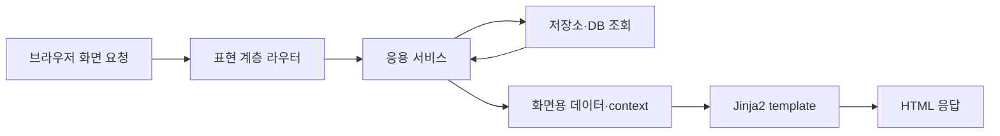
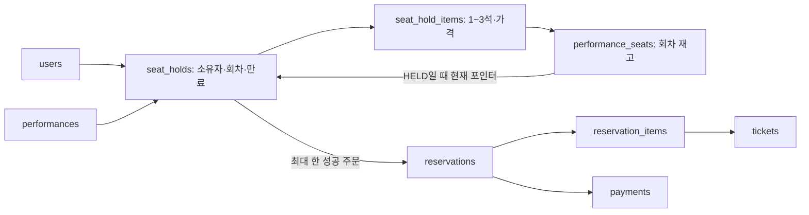
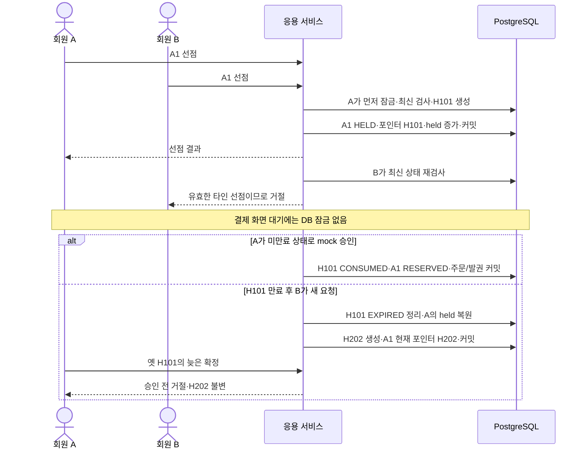

# AsyncTicket HELD ERD와 Jinja2 연결 설계

작성일: 2026-10-28 · 단계 1: ERD 구성 정리 · 검토용 설계 문서

현재 설계는 **16개 테이블·108개 컬럼**을 기준으로 공연 예매의 HELD 선점과 Jinja2 화면 흐름을 연결한다. 실제 DB 적용과 동시성 시험은 아직 수행하지 않았다.

팀 자료에 기록된 내용과 팀 전체의 최종 합의는 구분한다. API 경로와 세부 정책은 검토 제안이며, 설계도에 나타난 내용이 곧 팀 정책 승인이나 DB 제약 적용을 뜻하지 않는다.

## 1. 근거와 결정 상태를 읽는 방법

| 표시 | 뜻 | 예 |
| --- | --- | --- |
| `TEAM_SOURCE` | 팀 자료·초안에 기록된 내용. 최종 합의 여부는 별도 | Jinja2의 context→HTML, 화면 선택 후 서버 재검사 |
| `USER_REQUEST` | 요구사항으로 선택한 방향 | HELD 포함, 취소하면 한도 복원, 공연 A/B/C |
| `DESIGN_PROPOSAL` | 자료를 연결하거나 구현 범위를 구체화한 추가 설계 제안 | 두 선점 테이블, 그룹 전체 해제, 180초, 회차 선행 잠금 |
| `OPEN` | 다음 단계에서 팀이 선택하거나 구현 전에 확인해야 하는 부분 | 쿠키 인증/CSRF의 구체 방식, 관리자 기능의 권한·범위 |
| `COURSE_REQUIREMENT` | 발제 문서에서 요구·제외·도전 범위로 구분한 기준 | 기능별 4계층, OAuth2/JWT 블랙리스트, Jinja2 웹 화면 |

정책별 근거와 상태는 [정책 등록부](design-policies.json)에 P01부터 식별자로 기록한다. API의 구체적인 URL·오류 코드·입출력 계약도 자료에 있는 예시와 새 제안을 구분해야 한다. 팀원 자료의 예시 코드를 최종 API 계약으로 그대로 복사하지 않는다.

| 내용 | 출처 구분 | 현재 해석 |
| --- | --- | --- |
| 비회원 조회, 예매는 로그인, 회차 3매, 주문 전체 취소 | `TEAM_SOURCE` P01–P04 | 초기 플로우에 기록됨. 팀 최종 승인으로 단정하지 않음 |
| 취소한 주문의 매수는 복원 | `USER_REQUEST` P05 | 취소 주문의 매수는 복원하는 요구사항을 적용 |
| 결제 전 HELD를 포함 | `USER_REQUEST` P06 | 이전 no-hold 안에서 변경된 요구 |
| 공연 A/B/C 예상 수요 분류 | `USER_REQUEST` P07 | 좌석 등급과 별개. 자동 서버 증설을 뜻하지 않음 |
| ERD→API 명세→스키마→라우터→main.py | `USER_REQUEST` P08 | ERD와 입출력 계약을 먼저 정리하는 진행 순서 |
| 서버 데이터→context→Jinja2→HTML | `TEAM_SOURCE` P09 | 팀원 Jinja2 자료의 핵심 흐름 |
| 폼 제출 후 303 이동·HTML 조회 | `TEAM_SOURCE` P10 | 화면용 흐름 예시. JSON API와 전달 형식을 구분 |
| 선점 그룹 1~3석, 전체 확정·전체 해제 | `DESIGN_PROPOSAL` P13 | 기존 1~3석 주문 흐름을 HELD에 연결한 제안. 팀 확정 사항이 아님 |
| 180초·ACTIVE 1개·연장 제외·선점 가격 고정 | `DESIGN_PROPOSAL` P14–P17 | 구현을 단순화하는 기본안. 값과 정책은 팀 검토 대상 |

## 2. Jinja2를 반영해도 저장 테이블을 새로 만들 필요는 없다

Jinja2는 DB에 저장된 데이터를 받아 HTML로 보여주는 도구다. `templates`, `base.html`, `context`, `static`은 화면 코드와 전달 방식이며 테이블 이름이 아니다. 이번 Jinja2 연결 때문에 17번째 테이블을 추가하지 않는다.

팀원 자료와 현재 ERD는 용어가 다르다. 이 문서와 다음 API 명세는 **현재 ERD의 이름**을 기준으로 통일한다.

| 팀원 Jinja2 예시 | 예시에서의 뜻 | 현재 ERD 이름 |
| --- | --- | --- |
| `Performance` | 공연 제목·콘텐츠 | `shows` |
| `Session` | 개별 공연 회차 | `performances` |
| `SessionSeat` | 회차별 좌석 | `performance_seats` |
| `Reservation`의 `session_seat_id` | 단일 좌석 직접 예약 모형 | 현재는 선점→주문→주문 상세 관계로 확장 |
| `seat.is_reserved` | 예약 완료 여부의 단순 표시 | 실제 재고의 `AVAILABLE/HELD/RESERVED/BLOCKED`를 구분해 화면용 데이터로 전달 |

SQLAlchemy의 DB `session`과 공연 회차 `Session`도 서로 다른 개념이다. 회차는 코드에서 `performance`, DB 연결 작업 단위는 `db_session`처럼 구별하는 것이 읽기 쉽다. 이는 명칭 제안 P26이다.

이 흐름에서 Jinja2가 선점을 생성하거나 잠금을 잡지 않는다. Jinja2가 보여준 좌석 상태는 조회 시점의 값이다. 선점 폼을 제출하면 서버가 인증·소유권·현재 재고·매수를 다시 검사한다.

## 3. 현재 16개 테이블의 구조와 역할

| 영역 | 테이블 | 저장하는 것과 연결 |
| --- | --- | --- |
| 회원 | `users` | 로그인 회원. 선점·주문·회원 회차 한도의 소유자 |
| 공연 분류 | `traffic_profiles` | A/B/C 코드와 설명. `shows.demand_tier`가 참조 |
| 공연 콘텐츠 | `shows` | 제목·출연자·종류·포스터·예상 수요 등급 |
| 시설 | `venues` | 공연장 주소·이름. 공연관의 부모 |
| 시설 | `stages` | 공연장 안의 공연관. 물리 좌석과 실제 회차의 부모 |
| 물리 좌석 | `stage_seats` | 공연관의 구역·좌석 번호. 회차가 바뀌어도 같은 물리 좌석 |
| 판매 회차 | `performances` | 공연·공연관·시작/종료·판매기간·취소기한·회원 매수 한도 |
| 회차 재고 | `performance_seats` | 회차별 좌석 등급·가격·상태·현재 선점 포인터 |
| 회원 한도 | `member_performance_limits` | 회원·회차의 `active_quantity`, `held_quantity` 집계와 잠금 기준 |
| 선점 | `seat_holds` | 회원·회차·수량·요청키·상태·생성/만료/종료 시각 |
| 선점 상세 | `seat_hold_items` | 선점에 포함된 회차 좌석과 선점 당시 가격 |
| 주문 | `reservations` | 확정 주문번호·회원·회차·선점 ID·수량·총액·확정/취소 시각 |
| 주문 상세 | `reservation_items` | 주문의 개별 좌석과 확정 당시 가격·상태 |
| 결제 | `payments` | 성공 mock 결제·거래 식별자·환불 진행 상태 |
| 발권 | `tickets` | 주문 상세별 티켓 코드·수령 방식·발행/취소 상태 |
| 인증 | `token_blacklist` | 로그아웃 토큰 식별자와 만료 시각 |

### 원래 팀안과 추가 제안의 차이

기존 팀 11개에도 공연/회차, 물리 좌석/회차 재고, 주문/주문 상세가 나뉘어 있었다. 이 분리는 기존 구조의 일부다.

| 단계 | 변화 | 출처와 성격 |
| --- | --- | --- |
| 팀 종합 11개 | 회원·공연·시설·회차·재고·주문·상세·결제·토큰 차단 | 제공된 팀 종합 자료의 구조 |
| 이전 14개 안 | `member_performance_limits`, `tickets`, `traffic_profiles` 추가 | 추가 설계 제안 P11. 현재 구조에 포함 |
| HELD 16개 안 | `seat_holds`, `seat_hold_items` 추가 | HELD 요구를 구체화한 추가 설계 제안 P12. 현재 구조에 포함 |

`traffic_profiles`는 단순한 A/B/C 구분만 필요하면 `shows`의 컬럼과 CHECK로도 표현할 수 있다. 현재 구조에 포함하지만 필수 테이블이라고 단정하지 않는다. `tickets`는 발권 정보를 별도로 관리하는 선택이며 중복 판매를 막는 장치 자체가 아니다. 집계 테이블은 빠른 한도 검사와 잠금 기준을 제공하지만 주문/선점 합계와 동기화해야 한다.

## 4. 선점 그룹과 상세를 분리한 이유

선점 H101은 A가 어느 회차에서 언제까지 좌석을 확보하는지 나타낸다. 그 상세는 A1·A2처럼 어떤 좌석을 얼마에 확보했는지 나타낸다. 그룹에 공통인 소유자·만료·상태를 좌석마다 반복하지 않고, 주문과 연결할 그룹 식별자를 하나로 유지하는 구조다. 하나의 테이블로도 설계할 수 있으며, 이 분리가 팀에서 최종 합의한 유일한 방식은 아니다.

**현재 제안은 그룹 1개에 1~3석을 넣어 전부 선점하거나 전부 실패시키고, 그룹 단위로 확정·해제한다.** 부분 해제를 지원하려면 상태와 금액·수량·집계 전이를 추가로 설계할 수 있다. 두 테이블로 나눴다는 이유만으로 부분 해제가 원천적으로 불가능한 것은 아니다.

과거 만료·해제 상세도 이력으로 남는다. 같은 좌석이 H101과 H202의 상세에 모두 나타나도 현재 주인은 `performance_seats.current_hold_id` 하나로 판단한다. 그래서 상세의 좌석 ID 전체에 무조건 UNIQUE를 걸면 재선점이 막힌다.

## 5. 상태와 원자적으로 함께 바뀌는 데이터

| 대상 | 상태와 전이 | 함께 바뀌는 값 |
| --- | --- | --- |
| 회차 좌석 | `AVAILABLE → HELD → RESERVED` | HELD일 때만 `current_hold_id` 존재 |
| 회차 좌석 반환 | `HELD → AVAILABLE`, `RESERVED → AVAILABLE` | 선점 해제/만료 또는 주문 취소 시 포인터 NULL |
| 선점 그룹 | `ACTIVE → CONSUMED / RELEASED / EXPIRED` | 종료 시각·사유 기록. 종료 그룹 재활성화 금지 |
| 주문·상세 | `CONFIRMED → CANCELED` | 주문 전체 취소 이력·취소 시각 |
| 티켓 | `ISSUED → CANCELED` | 발권/취소 시각 |
| 결제 | `PAID / REFUNDED`, 환불 진행 `NONE/PENDING/COMPLETED/FAILED` | 실제 PG 결과와 mock 상태를 구분 |

유효한 선점이 끝난 뒤의 내역은 삭제하지 않는다. 결제 성공 후 좌석이 `RESERVED`이고 포인터가 NULL인 것은 정상이다. 소유권이 선점 단계에서 확정 주문 단계로 넘어간 것이다.

| 처리 | 같은 트랜잭션에서 반영할 데이터 |
| --- | --- |
| 선점 성공 | ACTIVE 그룹·상세·가격 스냅샷 생성, 좌석 HELD·현재 포인터, held 집계 증가 |
| 확정 성공 | 선점 CONSUMED, 좌석 RESERVED·포인터 NULL, held 감소·active 증가, 주문·상세·성공 mock 결제·티켓 생성 |
| 명시 해제·만료 | ACTIVE 그룹만 한 번 종료, 자기 포인터 좌석만 반환, held 집계 한 번 감소 |
| 예상 mock 거절 | RELEASED·좌석 반환·held 감소를 커밋한 뒤 거절 결과 반환. 성공 주문·티켓 없음 |
| 주문 전체 취소 | 주문·상세·티켓 취소, 좌석 반환, active 감소, 환불 진행 기록. 소비된 옛 선점은 CONSUMED 유지 |
| 예상치 못한 DB 오류 | 해당 트랜잭션 전체 롤백. 이전에 커밋한 ACTIVE 선점은 재시도·해제·만료 정리로 복구 가능 |

만료 시각이 되었다고 행이 자동으로 EXPIRED로 바뀌지는 않는다. 주기 작업 또는 새 요청 시 정리가 필요하다. 만료 정리만 수행한 뒤 새 요청이 한도 초과라면 정리 결과를 유지할지 응용 트랜잭션 규약으로 정한다. 현재 기본안은 정리만 커밋한 뒤 업무 거절을 응답하는 방식이다.

## 6. A와 B의 경쟁에서 현재 소유권을 보호하는 규칙

먼저 클릭한 사용자가 반드시 이기는 것은 아니다. 이 그림은 A가 먼저 필요한 잠금을 획득하고 성공 커밋한 가정이다. A가 롤백하면 B가 성공할 수도 있다. B는 자동 대기열에 들어가 다음 차례를 보장받는 것이 아니라 거절 후 새 요청이 필요하다.

잠금·시간 판정의 기본 제안 P18은 회차 → 관련 회원 한도 ID순 → 선점 ID순 → 필요한 주문 → 좌석 ID순이다. 각 요청은 독립 DB 세션을 사용한다. 만료 작업과 취소도 같은 순서를 따른다. 필요한 잠금을 모두 획득한 뒤 `clock_timestamp()`를 한 번 읽어 `t_decision < expires_at`인지 확인한다. 잠금 대기 전의 시간이나 트랜잭션 시작 시간만으로 판정하지 않는다. 이 최종 판정은 논리적 승패 시점이며 실제 COMMIT 시각까지 만료 전이라는 약속은 아니다.

회차 행 선행 잠금은 정합성을 설명하기 쉬운 MVP 선택이지만 같은 회차의 서로 다른 좌석 쓰기도 짧게 직렬화한다. 공연을 A로 분류하거나 앱 서버를 늘리는 것만으로 이 DB 병목이 없어지지 않는다. A/B/C를 운영 코드·풀·유입 제어·서버 준비와 연결하고 측정하는 단계는 별도다.

## 7. 매수·가격·재시도 기본안

`active_quantity + held_quantity + 새 요청 수량 ≤ performances.max_tickets_per_user`를 검사한다. 기본 상한은 3이며 만료 정리를 마친 집계를 사용한다. 확정은 held에서 active로 이동, 해제/만료는 held 감소, 취소는 active 감소다. 취소 시 매수 복원은 요구사항 P05이고, 선점도 한도에 포함시키는 구체 모델은 제안 P19다.

가격은 선점 당시 서버가 읽어 `seat_hold_items.price_at_hold`에 저장한다. 유효한 선점의 확정 주문·결제 총액은 그 합계를 사용한다. 클라이언트가 보낸 금액과 회원 ID로 소유권·가격을 결정하지 않는다. 가격 고정 P17은 팀 검토 대상이다.

선점 생성과 결제 확정은 각각 `(인증 회원, request_key)`로 기존 결과를 찾고 `request_hash`로 정규화한 요청 본문을 비교하는 제안 P20을 사용한다. 같은 생성키·본문은 같은 그룹과 같은 만료를 반환하며 시간을 늘리지 않는다. 같은 키의 다른 본문은 충돌이다. 선점당 주문 최대 하나와 별개로 확정 키도 중복을 방지한다. 소비된 선점을 원래 확정 키·해시로 재시도하면 기존 주문의 현재 상태를 반환하고, 다른 키는 기존 주문 참조를 포함한 충돌로 처리하는 P21 기본안이다. 취소된 주문도 재결제·재발권하지 않는다.

## 8. 표시용 ERD와 실제 DB 제약의 차이

현재 ERD와 전체 SQL 제안은 16개 테이블·108개 컬럼으로 구성한다. ERD의 관계 표시만으로 복합 FK, 부분 UNIQUE 인덱스, CHECK가 DB에 적용되지는 않는다. 아래 항목은 전체 SQL의 제안이며 실제 DB 생성·검증이 필요하다.

- `UNIQUE(reservations.hold_id)`: 한 선점의 성공 주문 최대 1개.
- 회원·요청키 UNIQUE와 본문 해시 비교: 중복 결과 재사용과 충돌 구분.
- 확정 상세의 좌석 부분 UNIQUE: 같은 좌석에 CONFIRMED 상세가 두 개 존재하지 않음.
- 같은 회원·회차 ACTIVE 선점 그룹 부분 UNIQUE: P15의 구체 제약.
- 복합 FK: 좌석의 공연관·회차 혼입, 주문과 선점 소유자·회차 불일치, 현재 포인터가 실제 선점 상세가 아닌 경우 방지.
- HELD/포인터 NULL 일치와 금액·수량 범위 CHECK.
- 회원 회차 집계의 기본키·집계 범위와 서비스 집계 일치.

**구현 전 보완할 제약:** `member_performance_limits`는 회원·회차 조합당 집계 행 하나가 필요하다. 컬럼과 FK를 표시하는 것에 더해 `PRIMARY KEY (user_id, performance_id)`를 실제 DB에 명시해야 한다. 복합 기본키는 전체 SQL 제안에 포함하며 보완·검증 항목 P25로 관리한다.

상세 개수=그룹 수량, 상세 가격 합=총액, 집계=유효 주문/선점 합, 소유권의 현재 유효성, 모든 상태 전이의 원자성은 DDL만으로 전부 보장되지 않는다. 응용 서비스·저장소·도메인 규칙을 함께 구현해야 한다.

## 9. Jinja2 화면에서 필요한 데이터와 4계층

| 화면 | 현재 ERD에서 읽는 것 | 표시·동작의 책임 |
| --- | --- | --- |
| 공연 목록·상세 | shows, traffic_profiles | 제목·종류·포스터·예상 수요 표시 |
| 회차 선택 | performances, stages, venues | 판매기간·시작 시각·공연관 표시 |
| 좌석 선택 | performance_seats, stage_seats | 좌석 이름·등급·가격·현재 표시 상태. 서버 재검사와 별개 |
| 선점·결제 대기 | 본인 seat_holds와 seat_hold_items | 유효기간·확보 좌석·가격·해제 안내. 타인 ID·토큰·해시 노출 금지 |
| 주문·티켓·마이페이지 | 본인 reservations/items, payments, tickets | 확정/취소·환불 상태·티켓 표시. 소유권 검사는 서버에서 수행 |

개인화된 선점·주문 화면의 GET 조회가 예매 상태를 바꾸도록 만들지 않는다. 만료 여부의 계산 표시와 DB의 만료 정리 작업을 구분한다. 이미 만료됐지만 ACTIVE가 남을 수 있으므로 `status` 하나만 믿고 결제 가능 버튼을 활성화하면 안 된다. 버튼 상태도 서버 검증을 대신하지 않는다.

| 계층 | 맡는 일 | Jinja2 자료와 연결 |
| --- | --- | --- |
| 표현 presentation | 라우터·인증 연결·입력/출력·오류·HTML context | routers, schemas, templates, static |
| 응용 application | 조회/선점/확정/해제/취소의 조율·트랜잭션 | services. JSON과 HTML 어댑터가 같은 업무 서비스를 호출 |
| 도메인 domain | 순수 Python의 소유권·만료·상태·매수·가격 규칙 | 팀원 폴더 예시에는 명시적으로 생략됨. 발제의 4계층과 연결해 추가할 책임 |
| 인프라 infrastructure | SQLAlchemy 모델·AsyncSession·저장소·DB 잠금·ORM 변환 | models, repositories |

Jinja2 폴더 예시의 함수는 학습용 개략 코드다. 동기 함수와 메모리 리스트 예시가 실제 AsyncSession 구현이라는 뜻은 아니다. 또한 BaseModel 예시만으로 Form 파싱이 완성된 것도 아니다. API 명세에서 HTML Form과 JSON의 전달 방식을 정한 뒤, 다음 단계의 Pydantic 스키마와 라우터에서 연결한다.

로그인 HTML을 위한 쿠키/JWT 전달, CSRF 방어, 리다이렉트 대상 검사, API의 Bearer 인증과의 결합은 ERD 단계에서 열어 둔 항목이다. 후속 화면 명세에서는 P28의 검토 후보를 구체화하며 팀 확정과 구분한다. 기존 users에 관리자 role 컬럼이 없으므로 관리자 CRUD의 인증·권한 범위도 별도 정책 결정이 필요하다. 이 문서가 새로운 관리자 권한을 자동으로 확정하지 않는다.

## 10. 다음 단계로 전달할 사항

이번 단계에서 현재 ERD의 테이블·컬럼·명칭·상태와 Jinja2의 표현 역할, 정책별 출처를 정리했다. 다음 단계는 API 명세이며 요청·응답 필드, 인증, 성공·실패·재시도·리다이렉트를 정의한다. 이때도 미확정 정책은 `DESIGN_PROPOSAL` 또는 `OPEN`으로 유지한다.

이후 단계는 요청·응답 스키마 → 라우터 → main.py 등록이다. API 계약에 데이터 형식을 적는 것과 실제 Pydantic/Python 파일을 작성하는 것은 다르다. 이번 ERD 문서에서는 구현 코드를 생성하지 않는다.
