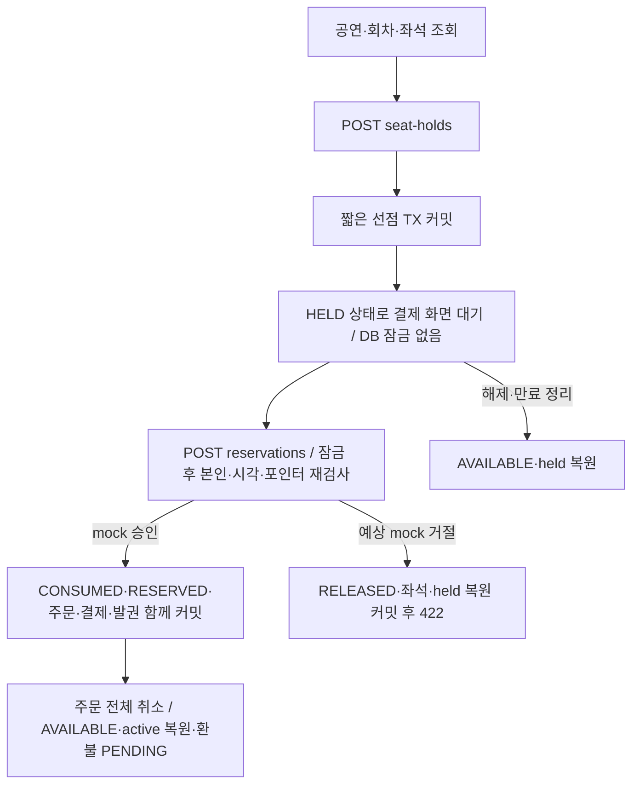

# AsyncTicket HELD API 명세 — 검토 초안 v4

작성일: 2026-10-28 · 강사 순서의 **2단계 API 명세**. [1단계 ERD·Jinja2 설계](01-erd-jinja-design.md)를 먼저 정리한 뒤 작성했다. 실제 Pydantic 스키마·라우터·main.py·DB 구현은 작성하지 않았다.

현재 기준은 16개 테이블·108개 컬럼의 HELD ERD다. 이 문서는 API 계약을 정의하며 실제 서버 구현·DB 적용·HTTP 테스트 완료를 뜻하지 않는다.

## 1. 근거·범위·제안 상태

- `TEAM_SOURCE`: 팀 자료에 존재하는 비회원 조회·로그인 예매·3매·주문 전체 취소·Jinja2 context/폼→303 예시. 자료에 있다는 것과 팀 최종 합의는 다르다.
- `USER_REQUEST`: 요구사항인 HELD 포함, 주문 취소 후 가능 매수 복원, 공연 A/B/C, 강사 진행 순서.
- `DESIGN_PROPOSAL`: 이 문서의 구체 URL·입출력 필드·HTTP 오류·재시도·그룹 정책·180초·ACTIVE1개·가격 고정·잠금·토큰 수명 등. 기존 ERD 메모의 URL도 `[API 제안]`으로 읽는다.
- `OPEN`: 관리자 역할/권한과 CRUD 범위(P29), 쿠키/CSRF 전달 후보(P28)의 팀 선택. [정책 등록부](design-policies.json)에서 팀 자료·요구사항·추가 제안·발제 요구를 함께 읽는다.

이 명세는 사용자 예매 핵심 MVP의 JSON API 19개 작업이다. 관리자 공연·시설·좌석 준비 CRUD, 권한 role 추가, 외부 PG, 대기열, 자동 서버 증설, 이메일/SMS, 비밀번호 변경/재설정, 입장 스캔은 포함하지 않는다. 발제의 모든 필수 기능이 완료됐다는 뜻은 아니며, 관리자/운영 준비 방식은 구현 전 별도 결정해야 한다.

Jinja2 HTML/Form 경로는 [화면·폼 전달 명세](03-jinja-http-contract.md)에 별도로 연결한다. 이 JSON API에 HTML 본문이나 인증 쿠키를 임의 혼용하지 않는다. 두 표현 계층은 같은 응용 서비스를 직접 호출한다.

## 2. 공통 계약

| 항목 | 계약 기본안 |
| --- | --- |
| 기본 주소 | 개발 예시 `http://localhost:8000`, 경로에 `/api` 접두어 없음. 실제 실행 확인 아님 |
| 인증 | 보호 API는 `Authorization: Bearer <JWT>`만 사용. 쿠키를 대체 인증으로 받지 않음. 서명·sub·exp·jti·블랙리스트를 매번 검사 |
| 입력 | 기본 JSON. 로그인만 OAuth2의 URL 인코딩 Form. 알 수 없는 Body 필드 거절. 회원 ID·가격·상태·총액을 입력받아 신뢰하지 않음 |
| 식별자 | 1~9223372036854775807 범위의 int64. 화면 예시의 H101 같은 표기는 설명용이고 실제 JSON ID는 숫자 |
| 금액 | `"100000.00"` 형태의 십진 문자열. 부동소수점 오차 방지 |
| 시각 | UTC `Z` 표기 ISO8601. Jinja2 화면은 Asia/Seoul 표시 가능 |
| 페이징 | page 기본1, size 기본20·최대100, items/page/size/total. 정렬은 각 API에 명시 |
| 최신성 | 기본 응답 `Cache-Control: no-store`. 조회는 스냅샷이며 확보 성공 보장 아님 |
| 재시도 | 503 DB_BUSY일 때 Retry-After 기본1초 제안. 같은 성공 요청키 재사용. 대기열·선점 순서 보장 없음 |
| 요청 제한 | 현재 숫자로 정한 rate limit/429 동작은 구현·측정하지 않음. A/B/C가 자동 제한을 수행하지 않음 |
| 실패 | JSON error envelope와 공개 코드 사용. SQL·stack trace·비밀번호·해시·타인 소유자 정보 노출 금지 |

GET은 상태를 변경하거나 만료 정리를 커밋하지 않는다. GET 선점은 ACTIVE와 is_expired=true가 동시에 보일 수 있다. 변경 요청과 내부 worker가 같은 만료 절차를 사용한다. `server_time`, `can_confirm`, `remaining_quantity`, `cleanup_pending`, 좌석 이름은 화면/응답용 계산·조합 값이며 ERD 컬럼 추가를 의미하지 않는다.

## 3. API 목록

| Method | 경로 | 인증 | 성공 | 기능 |
| --- | --- | --- | --- | --- |
| POST | `/auth/signup` | 비회원 가능 | 201 | 회원 가입 |
| POST | `/auth/login` | 비회원 가능 | 200 | OAuth2 형식 로그인 |
| POST | `/auth/logout` | 회원 | 200 | 현재 토큰 로그아웃 |
| GET | `/users/me` | 회원 | 200 | 내 회원 정보 조회 |
| PATCH | `/users/me` | 회원 | 200 | 내 이름·전화번호 수정 |
| GET | `/shows` | 비회원 가능 | 200 | 공연 목록·검색 |
| GET | `/shows/{show_id}` | 비회원 가능 | 200 | 공연 상세 |
| GET | `/shows/{show_id}/performances` | 비회원 가능 | 200 | 공연의 회차 목록 |
| GET | `/performances/{performance_id}` | 비회원 가능 | 200 | 회차 상세 |
| GET | `/performances/{performance_id}/seats` | 비회원 가능 | 200 | 회차 좌석 상태 조회 |
| GET | `/performances/{performance_id}/my-limit` | 회원 | 200 | 내 회차 매수 한도 조회 |
| POST | `/seat-holds` | 회원 | 201, 200 | 좌석 1~3개 선점 |
| GET | `/seat-holds/{hold_id}` | 회원 | 200 | 내 선점 상세 조회 |
| DELETE | `/seat-holds/{hold_id}` | 회원 | 200 | 내 선점 그룹 전체 해제 |
| POST | `/reservations` | 회원 | 201, 200 | mock 결제·주문 확정 |
| GET | `/reservations` | 회원 | 200 | 내 주문 목록 |
| GET | `/reservations/{reservation_id}` | 회원 | 200 | 내 주문 상세 |
| GET | `/reservations/{reservation_id}/tickets` | 회원 | 200 | 내 주문의 티켓 조회 |
| POST | `/reservations/{reservation_id}/cancel` | 회원 | 200 | 내 주문 전체 취소 |

## 4. 엔드포인트별 계약

모든 예시 값·토큰·티켓은 설명용이다. 이 문서의 예시와 `openapi.json`은 같은 입출력 계약을 사용한다. 실제 거래·로그인 결과가 아니다.

### 01. POST /auth/signup — 회원 가입

- 인증: 불필요. 출처: `DESIGN_PROPOSAL`; 연결 정책: P02.
- 읽는 테이블: 없음.
- 쓰는 테이블: `users`.

이메일은 앞뒤 공백 제거 후 소문자로 정규화한다는 제안이다. 이름은 공백만 입력할 수 없다. 전화번호는 선택값이다.

password는 해시로 저장하고 응답·로그에 원문이나 해시를 내보내지 않는다. 비밀번호 길이 8~128은 새 제안이며 팀 자료의 확정 기준이 아니다. 가입 후 자동 로그인하지 않는다.

8~128은 문자 수 계약이다. 직접 bcrypt의 UTF-8 바이트 제한과 충돌하지 않도록 bcrypt_sha256 같은 길이 대응 해시 전략을 구현 제안으로 검토해야 한다. 해시 전략은 구현 전 결정하며, 원문을 임의로 잘라 저장하는 방식은 금지한다.

요청 Body: `application/json`, 계약 `SignupInput`.

```json
{
  "email": "member-a@example.test",
  "password": "ExampleOnly123!",
  "name": "회원 A",
  "phone_number": null
}
```

성공 예시 `201`:

```json
{
  "id": 1,
  "email": "member-a@example.test",
  "name": "회원 A",
  "phone_number": null,
  "created_at": "2026-10-28T05:00:00Z"
}
```

거절/오류: `409 EMAIL_ALREADY_EXISTS`, `422 VALIDATION_ERROR`, `503 DB_BUSY`, `500 INTERNAL_ERROR`.

### 02. POST /auth/login — OAuth2 형식 로그인

- 인증: 불필요. 출처: `DESIGN_PROPOSAL`; 연결 정책: P02, P36, P38.
- 읽는 테이블: `users`.
- 쓰는 테이블: 없음.

username 필드에 이메일을 보내는 application/x-www-form-urlencoded 요청이다. 그 외 JSON API는 JSON 본문을 사용한다.

JWT에는 검증 가능한 sub·exp·jti를 포함한다. 예시 expires_in=1800은 제안값이다. 이 경로는 인증 쿠키를 설정하지 않으며 응답 토큰을 Bearer로 전달한다.

요청 Body: `application/x-www-form-urlencoded`, 계약 `LoginForm`.

```json
{
  "username": "member-a@example.test",
  "password": "ExampleOnly123!",
  "grant_type": "password",
  "scope": ""
}
```

성공 예시 `200`:

```json
{
  "access_token": "EXAMPLE_JWT_NOT_A_VALID_TOKEN",
  "token_type": "bearer",
  "expires_in": 1800
}
```

거절/오류: `401 INVALID_CREDENTIALS`, `422 VALIDATION_ERROR`, `503 DB_BUSY`, `500 INTERNAL_ERROR`.

### 03. POST /auth/logout — 현재 토큰 로그아웃

- 인증: 회원 Bearer JWT. 출처: `DESIGN_PROPOSAL`; 연결 정책: P02.
- 읽는 테이블: 없음.
- 쓰는 테이블: `token_blacklist`.

현재 JWT의 jti와 exp를 블랙리스트에 저장한다. 다른 모든 기기 로그아웃 기능은 아니다.

블랙리스트에 오른 같은 토큰의 재요청은 인증 단계에서 401이다. 이미 블랙리스트인 토큰에도 무조건 200을 약속하지 않는다.

요청 Body 없음. 임의 회원 ID·가격·상태를 추가하지 않는다.

성공 예시 `200`:

```json
{
  "logged_out": true
}
```

거절/오류: `401 AUTHENTICATION_REQUIRED`, `503 DB_BUSY`, `500 INTERNAL_ERROR`.

### 04. GET /users/me — 내 회원 정보 조회

- 인증: 회원 Bearer JWT. 출처: `DESIGN_PROPOSAL`; 연결 정책: P02.
- 읽는 테이블: `users`.
- 쓰는 테이블: 없음.

인증한 회원의 공개 응답 필드만 반환한다. password_hash, 토큰, 내부 요청 해시는 반환하지 않는다.

요청 Body 없음. 임의 회원 ID·가격·상태를 추가하지 않는다.

성공 예시 `200`:

```json
{
  "id": 1,
  "email": "member-a@example.test",
  "name": "회원 A",
  "phone_number": null,
  "created_at": "2026-10-28T05:00:00Z"
}
```

거절/오류: `401 AUTHENTICATION_REQUIRED`, `503 DB_BUSY`, `500 INTERNAL_ERROR`.

### 05. PATCH /users/me — 내 이름·전화번호 수정

- 인증: 회원 Bearer JWT. 출처: `DESIGN_PROPOSAL`; 연결 정책: P02.
- 읽는 테이블: `users`.
- 쓰는 테이블: `users`.

전달한 필드만 변경한다. phone_number=null은 삭제, 필드 생략은 유지이다. 이름은 공백만 입력할 수 없다.

이메일·비밀번호·권한 수정은 이 명세 범위 밖이다. 최소 한 필드를 보내야 한다.

요청 Body: `application/json`, 계약 `ProfilePatch`.

```json
{
  "name": "변경한 이름",
  "phone_number": null
}
```

성공 예시 `200`:

```json
{
  "id": 1,
  "email": "member-a@example.test",
  "name": "변경한 이름",
  "phone_number": null,
  "created_at": "2026-10-28T05:00:00Z"
}
```

거절/오류: `401 AUTHENTICATION_REQUIRED`, `422 VALIDATION_ERROR`, `503 DB_BUSY`, `500 INTERNAL_ERROR`.

### 06. GET /shows — 공연 목록·검색

- 인증: 불필요. 출처: `DESIGN_PROPOSAL`; 연결 정책: P01, P07.
- 읽는 테이블: `shows`, `traffic_profiles`.
- 쓰는 테이블: 없음.

비회원 조회 가능. id 오름차순으로 정렬한다. page는 1부터 시작하며 size 기본20·최대100이다.

A/B/C는 예상 수요 분류이며 자동 증설·대기열 또는 VIP/R/S 좌석 등급이 아니다.

| 위치 | 이름 | 필수 | 형식·제한 |
| --- | --- | --- | --- |
| query | `page` | 아니오 | `{"type": "integer", "minimum": 1, "default": 1}` |
| query | `size` | 아니오 | `{"type": "integer", "minimum": 1, "maximum": 100, "default": 20}` |
| query | `q` | 아니오 | `{"type": "string", "maxLength": 100}` |
| query | `type` | 아니오 | `{"type": "string", "maxLength": 50}` |
| query | `demand_tier` | 아니오 | `{"type": "string", "enum": ["A", "B", "C"]}` |

요청 Body 없음. 임의 회원 ID·가격·상태를 추가하지 않는다.

성공 예시 `200`:

```json
{
  "items": [
    {
      "id": 10,
      "title": "봄 콘서트",
      "description": "설명용 공연",
      "performer": "예시 아티스트",
      "performance_type": "CONCERT",
      "running_time_minutes": 120,
      "poster_url": null,
      "demand_tier": "A",
      "tier_reason": "오픈 집중 수요 실험군",
      "tier_assessed_at": "2026-10-28T04:00:00Z"
    }
  ],
  "page": 1,
  "size": 20,
  "total": 1
}
```

거절/오류: `422 VALIDATION_ERROR`, `503 DB_BUSY`, `500 INTERNAL_ERROR`.

### 07. GET /shows/{show_id} — 공연 상세

- 인증: 불필요. 출처: `DESIGN_PROPOSAL`; 연결 정책: P01, P07.
- 읽는 테이블: `shows`, `traffic_profiles`.
- 쓰는 테이블: 없음.

공연 콘텐츠를 반환한다. 공연 회차는 별도 목록으로 조회한다.

| 위치 | 이름 | 필수 | 형식·제한 |
| --- | --- | --- | --- |
| path | `show_id` | 예 | `{"type": "integer", "format": "int64", "minimum": 1, "maximum": 9223372036854775807}` |

요청 Body 없음. 임의 회원 ID·가격·상태를 추가하지 않는다.

성공 예시 `200`:

```json
{
  "id": 10,
  "title": "봄 콘서트",
  "description": "설명용 공연",
  "performer": "예시 아티스트",
  "performance_type": "CONCERT",
  "running_time_minutes": 120,
  "poster_url": null,
  "demand_tier": "A",
  "tier_reason": "오픈 집중 수요 실험군",
  "tier_assessed_at": "2026-10-28T04:00:00Z"
}
```

거절/오류: `404 RESOURCE_NOT_FOUND`, `422 VALIDATION_ERROR`, `503 DB_BUSY`, `500 INTERNAL_ERROR`.

### 08. GET /shows/{show_id}/performances — 공연의 회차 목록

- 인증: 불필요. 출처: `DESIGN_PROPOSAL`; 연결 정책: P01, P26.
- 읽는 테이블: `shows`, `performances`.
- 쓰는 테이블: 없음.

shows는 콘텐츠, performances는 판매 회차이다. starts_at 오름차순·id 오름차순으로 정렬한다. 공연은 있으나 회차가 없으면 items=[]로 200이다.

| 위치 | 이름 | 필수 | 형식·제한 |
| --- | --- | --- | --- |
| path | `show_id` | 예 | `{"type": "integer", "format": "int64", "minimum": 1, "maximum": 9223372036854775807}` |
| query | `page` | 아니오 | `{"type": "integer", "minimum": 1, "default": 1}` |
| query | `size` | 아니오 | `{"type": "integer", "minimum": 1, "maximum": 100, "default": 20}` |

요청 Body 없음. 임의 회원 ID·가격·상태를 추가하지 않는다.

성공 예시 `200`:

```json
{
  "items": [
    {
      "id": 7,
      "show_id": 10,
      "stage_id": 3,
      "round_number": 1,
      "starts_at": "2026-11-01T10:00:00Z",
      "ends_at": "2026-11-01T12:00:00Z",
      "reservation_opens_at": "2026-10-28T00:00:00Z",
      "reservation_closes_at": "2026-11-01T09:00:00Z",
      "cancel_deadline_at": "2026-10-31T09:00:00Z",
      "max_tickets_per_user": 3,
      "status": "OPEN"
    }
  ],
  "page": 1,
  "size": 20,
  "total": 1
}
```

거절/오류: `404 RESOURCE_NOT_FOUND`, `422 VALIDATION_ERROR`, `503 DB_BUSY`, `500 INTERNAL_ERROR`.

### 09. GET /performances/{performance_id} — 회차 상세

- 인증: 불필요. 출처: `DESIGN_PROPOSAL`; 연결 정책: P01.
- 읽는 테이블: `performances`.
- 쓰는 테이블: 없음.

판매 기간·취소 기한·회차 한도를 반환한다. OPEN 상태만으로 판매 가능하다고 확정하지 않고 변경 요청 때 서버 시각과 함께 검사한다.

| 위치 | 이름 | 필수 | 형식·제한 |
| --- | --- | --- | --- |
| path | `performance_id` | 예 | `{"type": "integer", "format": "int64", "minimum": 1, "maximum": 9223372036854775807}` |

요청 Body 없음. 임의 회원 ID·가격·상태를 추가하지 않는다.

성공 예시 `200`:

```json
{
  "id": 7,
  "show_id": 10,
  "stage_id": 3,
  "round_number": 1,
  "starts_at": "2026-11-01T10:00:00Z",
  "ends_at": "2026-11-01T12:00:00Z",
  "reservation_opens_at": "2026-10-28T00:00:00Z",
  "reservation_closes_at": "2026-11-01T09:00:00Z",
  "cancel_deadline_at": "2026-10-31T09:00:00Z",
  "max_tickets_per_user": 3,
  "status": "OPEN"
}
```

거절/오류: `404 RESOURCE_NOT_FOUND`, `422 VALIDATION_ERROR`, `503 DB_BUSY`, `500 INTERNAL_ERROR`.

### 10. GET /performances/{performance_id}/seats — 회차 좌석 상태 조회

- 인증: 불필요. 출처: `DESIGN_PROPOSAL`; 연결 정책: P01, P09, P22.
- 읽는 테이블: `performance_seats`, `stage_seats`.
- 쓰는 테이블: 없음.

좌석 id 오름차순으로 반환한다. 현재 MVP는 좌석도 전체를 한 응답으로 조회하며 대형 공연장 전송량은 별도 최적화 대상이다.

공개 응답에는 타인의 user_id·hold_id·current_hold_id·선점 상세·티켓 코드를 넣지 않는다. status는 저장 상태의 조회 스냅샷이다.

GET은 만료 정리를 수행하지 않는다. 정리 전에는 만료된 그룹의 HELD 표시가 잠시 남을 수 있다. 최종 확보 가능 여부는 POST에서 재검사한다.

| 위치 | 이름 | 필수 | 형식·제한 |
| --- | --- | --- | --- |
| path | `performance_id` | 예 | `{"type": "integer", "format": "int64", "minimum": 1, "maximum": 9223372036854775807}` |

요청 Body 없음. 임의 회원 ID·가격·상태를 추가하지 않는다.

성공 예시 `200`:

```json
{
  "performance_id": 7,
  "as_of": "2026-10-28T05:00:00Z",
  "items": [
    {
      "id": 501,
      "stage_seat_id": 31,
      "section_name": "1층",
      "seat_number": "A1",
      "seat_grade": "R",
      "price": "100000.00",
      "status": "AVAILABLE"
    }
  ]
}
```

거절/오류: `404 RESOURCE_NOT_FOUND`, `422 VALIDATION_ERROR`, `503 DB_BUSY`, `500 INTERNAL_ERROR`.

### 11. GET /performances/{performance_id}/my-limit — 내 회차 매수 한도 조회

- 인증: 회원 Bearer JWT. 출처: `DESIGN_PROPOSAL`; 연결 정책: P03, P19.
- 읽는 테이블: `member_performance_limits`, `seat_holds`, `performances`.
- 쓰는 테이블: 없음.

자신의 집계만 반환한다. 한도행이 아직 없으면 0으로 표시하고 GET에서 행을 생성하지 않는다.

held_quantity는 저장된 ACTIVE 그룹 집계이다. 만료됐으나 정리 전인 그룹이 있으면 cleanup_pending=true이고 remaining_quantity는 보수적으로 계산한다.

remaining_quantity=max(0,max_tickets_per_user-active_quantity-held_quantity). 실제 변경 요청은 관련 만료를 정리한 뒤 다시 검사한다. active_hold_id는 본인 그룹에만 제공한다.

| 위치 | 이름 | 필수 | 형식·제한 |
| --- | --- | --- | --- |
| path | `performance_id` | 예 | `{"type": "integer", "format": "int64", "minimum": 1, "maximum": 9223372036854775807}` |

요청 Body 없음. 임의 회원 ID·가격·상태를 추가하지 않는다.

성공 예시 `200`:

```json
{
  "performance_id": 7,
  "max_tickets_per_user": 3,
  "active_quantity": 0,
  "held_quantity": 0,
  "remaining_quantity": 3,
  "cleanup_pending": false,
  "active_hold_id": null,
  "as_of": "2026-10-28T05:00:00Z"
}
```

거절/오류: `401 AUTHENTICATION_REQUIRED`, `404 RESOURCE_NOT_FOUND`, `422 VALIDATION_ERROR`, `503 DB_BUSY`, `500 INTERNAL_ERROR`.

### 12. POST /seat-holds — 좌석 1~3개 선점

- 인증: 회원 Bearer JWT. 출처: `DESIGN_PROPOSAL`; 연결 정책: P02, P03, P06, P12, P13, P14, P15, P16, P17, P18, P19, P20.
- 읽는 테이블: `performances`, `performance_seats`, `seat_holds`, `member_performance_limits`.
- 쓰는 테이블: `seat_holds`, `seat_hold_items`, `performance_seats`, `member_performance_limits`.

seat_ids는 performance_seats.id이며 물리 좌석 ID가 아니다. 중복 ID, 다른 회차 좌석, 0·음수는 422이다. 회원·가격·총액·상태는 서버가 결정한다.

공통 잠금 후 관련 만료 그룹을 전체 정리하고 OPEN 및 판매기간, 전 좌석 AVAILABLE/회수 가능, active+held+요청<=회차한도, 다른 유효 ACTIVE 그룹 부재를 검사한다.

그룹 ACTIVE·상세 가격·좌석 HELD/current_hold_id·held 증가를 함께 커밋한다. 일부 좌석 충돌이면 요청 전체 실패다. cleanup 뒤 예상 업무 거절이면 cleanup만 커밋한다.

expires_at=min(잠금 후 DB현재시각+180초,판매마감,공연시작). 180초·그룹1개·전체해제·연장제외·선점가격고정·회차행잠금은 모두 제안이다.

같은 회원·생성키·정규화 본문이면 200으로 같은 그룹의 현재 상태·같은 만료 시각을 반환한다. 종료 그룹도 재생성/연장하지 않는다. 신규만 201이다.

요청 Body: `application/json`, 계약 `HoldCreate`.

```json
{
  "performance_id": 7,
  "seat_ids": [
    501
  ],
  "request_key": "hold-a-001"
}
```

성공 예시 `201`:

```json
{
  "id": 101,
  "performance_id": 7,
  "request_key": "hold-a-001",
  "quantity": 1,
  "status": "ACTIVE",
  "created_at": "2026-10-28T05:00:00Z",
  "expires_at": "2026-10-28T05:03:00Z",
  "closed_at": null,
  "close_reason": null,
  "server_time": "2026-10-28T05:00:00Z",
  "is_expired": false,
  "can_confirm": true,
  "total_amount": "100000.00",
  "items": [
    {
      "performance_seat_id": 501,
      "seat_number": "A1",
      "price_at_hold": "100000.00"
    }
  ]
}
```

거절/오류: `401 AUTHENTICATION_REQUIRED`, `404 RESOURCE_NOT_FOUND`, `409 SALE_UNAVAILABLE`, `409 SEAT_UNAVAILABLE`, `409 TICKET_LIMIT_EXCEEDED`, `409 ACTIVE_HOLD_EXISTS`, `409 IDEMPOTENCY_KEY_REUSED`, `422 VALIDATION_ERROR`, `503 DB_BUSY`, `500 INTERNAL_ERROR`.

### 13. GET /seat-holds/{hold_id} — 내 선점 상세 조회

- 인증: 회원 Bearer JWT. 출처: `DESIGN_PROPOSAL`; 연결 정책: P02, P09, P22.
- 읽는 테이블: `seat_holds`, `seat_hold_items`, `performance_seats`, `performances`.
- 쓰는 테이블: 없음.

본인 선점만 조회하며 DB 상태를 변경하지 않는다. server_time·expires_at으로 is_expired를 계산하고, ACTIVE·미만료·판매가능·현재 포인터 일치 때만 can_confirm=true이다.

정리 전에는 status=ACTIVE와 is_expired=true가 함께 나올 수 있다. can_confirm은 조회 시점 안내이며 결제 확정 보장이 아니다.

| 위치 | 이름 | 필수 | 형식·제한 |
| --- | --- | --- | --- |
| path | `hold_id` | 예 | `{"type": "integer", "format": "int64", "minimum": 1, "maximum": 9223372036854775807}` |

요청 Body 없음. 임의 회원 ID·가격·상태를 추가하지 않는다.

성공 예시 `200`:

```json
{
  "id": 101,
  "performance_id": 7,
  "request_key": "hold-a-001",
  "quantity": 1,
  "status": "ACTIVE",
  "created_at": "2026-10-28T05:00:00Z",
  "expires_at": "2026-10-28T05:03:00Z",
  "closed_at": null,
  "close_reason": null,
  "server_time": "2026-10-28T05:00:00Z",
  "is_expired": false,
  "can_confirm": true,
  "total_amount": "100000.00",
  "items": [
    {
      "performance_seat_id": 501,
      "seat_number": "A1",
      "price_at_hold": "100000.00"
    }
  ]
}
```

거절/오류: `401 AUTHENTICATION_REQUIRED`, `404 RESOURCE_NOT_FOUND`, `403 FORBIDDEN`, `422 VALIDATION_ERROR`, `503 DB_BUSY`, `500 INTERNAL_ERROR`.

### 14. DELETE /seat-holds/{hold_id} — 내 선점 그룹 전체 해제

- 인증: 회원 Bearer JWT. 출처: `DESIGN_PROPOSAL`; 연결 정책: P02, P13, P18, P19.
- 읽는 테이블: `seat_holds`, `seat_hold_items`, `performance_seats`.
- 쓰는 테이블: `seat_holds`, `performance_seats`, `member_performance_limits`.

행을 물리 삭제하지 않고 그룹 전체를 RELEASED로 종료한다. 이미 만료됐다면 EXPIRED로 정리해 반환한다. 자기 current_hold_id 좌석만 AVAILABLE/NULL로 돌리고 held를 한 번 감소시킨다.

RELEASED 또는 EXPIRED에 반복 요청하면 현재 결과 200이며 이중 차감하지 않는다. CONSUMED면 409와 본인 기존 주문 참조를 반환한다. 타인 그룹은 변경하지 않는다.

| 위치 | 이름 | 필수 | 형식·제한 |
| --- | --- | --- | --- |
| path | `hold_id` | 예 | `{"type": "integer", "format": "int64", "minimum": 1, "maximum": 9223372036854775807}` |

요청 Body 없음. 임의 회원 ID·가격·상태를 추가하지 않는다.

성공 예시 `200`:

```json
{
  "id": 101,
  "performance_id": 7,
  "request_key": "hold-a-001",
  "quantity": 1,
  "status": "RELEASED",
  "created_at": "2026-10-28T05:00:00Z",
  "expires_at": "2026-10-28T05:03:00Z",
  "closed_at": "2026-10-28T05:01:00Z",
  "close_reason": "USER_RELEASE",
  "server_time": "2026-10-28T05:01:00Z",
  "is_expired": false,
  "can_confirm": false,
  "total_amount": "100000.00",
  "items": [
    {
      "performance_seat_id": 501,
      "seat_number": "A1",
      "price_at_hold": "100000.00"
    }
  ]
}
```

거절/오류: `401 AUTHENTICATION_REQUIRED`, `404 RESOURCE_NOT_FOUND`, `403 FORBIDDEN`, `409 HOLD_ALREADY_CONSUMED`, `422 VALIDATION_ERROR`, `503 DB_BUSY`, `500 INTERNAL_ERROR`.

### 15. POST /reservations — mock 결제·주문 확정

- 인증: 회원 Bearer JWT. 출처: `DESIGN_PROPOSAL`; 연결 정책: P02, P06, P13, P17, P18, P19, P20, P21, P23.
- 읽는 테이블: `seat_holds`, `seat_hold_items`, `performance_seats`, `performances`, `reservations`.
- 쓰는 테이블: `seat_holds`, `performance_seats`, `member_performance_limits`, `reservations`, `reservation_items`, `payments`, `tickets`.

확정키/해시와 기존 주문을 먼저 검사한다. 같은 원래 키·본문은 기존 주문 현재 상태를 200으로 반환한다. 취소된 주문도 재결제·재발권하지 않는다.

신규 확정은 본인 소유·ACTIVE·잠금 후 decision_at<expires_at·모든 좌석 포인터 일치·판매기간·한도를 검사한 뒤 mock을 즉시 처리한다. 외부 PG 호출과 사용자 대기를 TX 안에 넣지 않는다.

APPROVE면 CONSUMED·RESERVED/NULL·held→active·주문·상세·PAID 결제·ISSUED 티켓을 함께 커밋하고 201이다. 총액은 선점 상세 합계이다.

DECLINE은 테스트용 예상 거절이다. RELEASED·좌석 반환·held 감소를 커밋하고 422 MOCK_PAYMENT_DECLINED, 성공 주문/결제/티켓 0개이다.

DB 예외는 전체 롤백이므로 이전에 커밋한 ACTIVE 선점이 남을 수 있다. 만료 거절은 EXPIRED 정리를 커밋하고 409이다. 실패 응답 전체를 저장하지 않으므로 거절 재시도의 코드가 달라질 수 있다.

요청 Body: `application/json`, 계약 `ReservationCreate`.

```json
{
  "hold_id": 101,
  "request_key": "confirm-a-001",
  "mock_payment": {
    "result": "APPROVE"
  }
}
```

성공 예시 `201`:

```json
{
  "id": 201,
  "order_number": "AT-EXAMPLE-000201",
  "performance_id": 7,
  "hold_id": 101,
  "quantity": 1,
  "total_amount": "100000.00",
  "status": "CONFIRMED",
  "created_at": "2026-10-28T05:01:00Z",
  "confirmed_at": "2026-10-28T05:01:00Z",
  "canceled_at": null,
  "items": [
    {
      "id": 401,
      "performance_seat_id": 501,
      "seat_number": "A1",
      "price_at_reservation": "100000.00",
      "status": "CONFIRMED"
    }
  ],
  "payment": {
    "id": 301,
    "method": "MOCK",
    "amount": "100000.00",
    "status": "PAID",
    "paid_at": "2026-10-28T05:01:00Z",
    "refund_status": "NONE",
    "refunded_amount": "0.00",
    "refunded_at": null
  }
}
```

거절/오류: `401 AUTHENTICATION_REQUIRED`, `404 RESOURCE_NOT_FOUND`, `403 FORBIDDEN`, `409 SALE_UNAVAILABLE`, `409 HOLD_EXPIRED`, `409 HOLD_NOT_ACTIVE`, `409 HOLD_ALREADY_CONSUMED`, `409 IDEMPOTENCY_KEY_REUSED`, `409 TICKET_LIMIT_EXCEEDED`, `422 MOCK_PAYMENT_DECLINED`, `422 VALIDATION_ERROR`, `503 DB_BUSY`, `500 INTERNAL_ERROR`.

### 16. GET /reservations — 내 주문 목록

- 인증: 회원 Bearer JWT. 출처: `DESIGN_PROPOSAL`; 연결 정책: P02.
- 읽는 테이블: `reservations`, `reservation_items`, `payments`, `stage_seats`.
- 쓰는 테이블: 없음.

인증한 회원 소유 주문만 반환한다. user_id 쿼리로 다른 회원을 지정할 수 없다. created_at 내림차순·id 내림차순으로 정렬한다.

| 위치 | 이름 | 필수 | 형식·제한 |
| --- | --- | --- | --- |
| query | `page` | 아니오 | `{"type": "integer", "minimum": 1, "default": 1}` |
| query | `size` | 아니오 | `{"type": "integer", "minimum": 1, "maximum": 100, "default": 20}` |
| query | `status` | 아니오 | `{"type": "string", "enum": ["CONFIRMED", "CANCELED"]}` |

요청 Body 없음. 임의 회원 ID·가격·상태를 추가하지 않는다.

성공 예시 `200`:

```json
{
  "items": [
    {
      "id": 201,
      "order_number": "AT-EXAMPLE-000201",
      "performance_id": 7,
      "hold_id": 101,
      "quantity": 1,
      "total_amount": "100000.00",
      "status": "CONFIRMED",
      "created_at": "2026-10-28T05:01:00Z",
      "confirmed_at": "2026-10-28T05:01:00Z",
      "canceled_at": null,
      "items": [
        {
          "id": 401,
          "performance_seat_id": 501,
          "seat_number": "A1",
          "price_at_reservation": "100000.00",
          "status": "CONFIRMED"
        }
      ],
      "payment": {
        "id": 301,
        "method": "MOCK",
        "amount": "100000.00",
        "status": "PAID",
        "paid_at": "2026-10-28T05:01:00Z",
        "refund_status": "NONE",
        "refunded_amount": "0.00",
        "refunded_at": null
      }
    }
  ],
  "page": 1,
  "size": 20,
  "total": 1
}
```

거절/오류: `401 AUTHENTICATION_REQUIRED`, `422 VALIDATION_ERROR`, `503 DB_BUSY`, `500 INTERNAL_ERROR`.

### 17. GET /reservations/{reservation_id} — 내 주문 상세

- 인증: 회원 Bearer JWT. 출처: `DESIGN_PROPOSAL`; 연결 정책: P02.
- 읽는 테이블: `reservations`, `reservation_items`, `payments`, `stage_seats`.
- 쓰는 테이블: 없음.

본인 주문의 좌석·가격·결제/환불 현재 상태를 반환한다. 취소 이력도 조회할 수 있다. 티켓 코드는 별도 본인 티켓 조회를 사용한다.

| 위치 | 이름 | 필수 | 형식·제한 |
| --- | --- | --- | --- |
| path | `reservation_id` | 예 | `{"type": "integer", "format": "int64", "minimum": 1, "maximum": 9223372036854775807}` |

요청 Body 없음. 임의 회원 ID·가격·상태를 추가하지 않는다.

성공 예시 `200`:

```json
{
  "id": 201,
  "order_number": "AT-EXAMPLE-000201",
  "performance_id": 7,
  "hold_id": 101,
  "quantity": 1,
  "total_amount": "100000.00",
  "status": "CONFIRMED",
  "created_at": "2026-10-28T05:01:00Z",
  "confirmed_at": "2026-10-28T05:01:00Z",
  "canceled_at": null,
  "items": [
    {
      "id": 401,
      "performance_seat_id": 501,
      "seat_number": "A1",
      "price_at_reservation": "100000.00",
      "status": "CONFIRMED"
    }
  ],
  "payment": {
    "id": 301,
    "method": "MOCK",
    "amount": "100000.00",
    "status": "PAID",
    "paid_at": "2026-10-28T05:01:00Z",
    "refund_status": "NONE",
    "refunded_amount": "0.00",
    "refunded_at": null
  }
}
```

거절/오류: `401 AUTHENTICATION_REQUIRED`, `404 RESOURCE_NOT_FOUND`, `403 FORBIDDEN`, `422 VALIDATION_ERROR`, `503 DB_BUSY`, `500 INTERNAL_ERROR`.

### 18. GET /reservations/{reservation_id}/tickets — 내 주문의 티켓 조회

- 인증: 회원 Bearer JWT. 출처: `DESIGN_PROPOSAL`; 연결 정책: P02, P11.
- 읽는 테이블: `reservations`, `reservation_items`, `tickets`.
- 쓰는 테이블: 없음.

본인 주문의 티켓만 반환한다. 취소 주문에는 CANCELED 티켓을 반환한다. 티켓 발행은 좌석 선점이나 입장 검증 구현 완료를 뜻하지 않는다.

| 위치 | 이름 | 필수 | 형식·제한 |
| --- | --- | --- | --- |
| path | `reservation_id` | 예 | `{"type": "integer", "format": "int64", "minimum": 1, "maximum": 9223372036854775807}` |

요청 Body 없음. 임의 회원 ID·가격·상태를 추가하지 않는다.

성공 예시 `200`:

```json
{
  "reservation_id": 201,
  "items": [
    {
      "id": 601,
      "reservation_item_id": 401,
      "ticket_code": "EXAMPLE-TICKET-000601",
      "receive_method": "ON_SITE",
      "status": "ISSUED",
      "issued_at": "2026-10-28T05:01:00Z",
      "canceled_at": null
    }
  ]
}
```

거절/오류: `401 AUTHENTICATION_REQUIRED`, `404 RESOURCE_NOT_FOUND`, `403 FORBIDDEN`, `422 VALIDATION_ERROR`, `503 DB_BUSY`, `500 INTERNAL_ERROR`.

### 19. POST /reservations/{reservation_id}/cancel — 내 주문 전체 취소

- 인증: 회원 Bearer JWT. 출처: `DESIGN_PROPOSAL`; 연결 정책: P02, P04, P05, P18, P19.
- 읽는 테이블: `reservations`, `reservation_items`, `performances`, `payments`, `tickets`, `performance_seats`.
- 쓰는 테이블: `reservations`, `reservation_items`, `tickets`, `performance_seats`, `member_performance_limits`, `payments`.

추가 본문 없이 본인 주문 전체를 취소한다. 처음 취소할 때 잠금 후 DB 시각<cancel_deadline_at인지 검사한다. 경계 시각과 같으면 불가이다.

주문/상세/티켓 CANCELED·좌석 AVAILABLE·active 감소·환불 PENDING을 함께 커밋한다. 소비된 선점은 CONSUMED 이력으로 남는다.

반복 취소는 이미 CANCELED이면 기한을 다시 거절하지 않고 현재 결과 200을 반환한다는 제안이다. 집계 이중 차감하지 않는다.

취소 직후 payment.status=PAID, refund_status=PENDING이다. 내부 mock 환불 작업의 성공 후 REFUNDED/COMPLETED로 전이한다. 실제 PG 환불 완료를 뜻하지 않는다.

| 위치 | 이름 | 필수 | 형식·제한 |
| --- | --- | --- | --- |
| path | `reservation_id` | 예 | `{"type": "integer", "format": "int64", "minimum": 1, "maximum": 9223372036854775807}` |

요청 Body 없음. 임의 회원 ID·가격·상태를 추가하지 않는다.

성공 예시 `200`:

```json
{
  "id": 201,
  "order_number": "AT-EXAMPLE-000201",
  "performance_id": 7,
  "hold_id": 101,
  "quantity": 1,
  "total_amount": "100000.00",
  "status": "CANCELED",
  "created_at": "2026-10-28T05:01:00Z",
  "confirmed_at": "2026-10-28T05:01:00Z",
  "canceled_at": "2026-10-28T05:02:00Z",
  "items": [
    {
      "id": 401,
      "performance_seat_id": 501,
      "seat_number": "A1",
      "price_at_reservation": "100000.00",
      "status": "CANCELED"
    }
  ],
  "payment": {
    "id": 301,
    "method": "MOCK",
    "amount": "100000.00",
    "status": "PAID",
    "paid_at": "2026-10-28T05:01:00Z",
    "refund_status": "PENDING",
    "refunded_amount": "0.00",
    "refunded_at": null
  }
}
```

거절/오류: `401 AUTHENTICATION_REQUIRED`, `404 RESOURCE_NOT_FOUND`, `403 FORBIDDEN`, `409 CANCELLATION_UNAVAILABLE`, `422 VALIDATION_ERROR`, `503 DB_BUSY`, `500 INTERNAL_ERROR`.

## 5. 오류 코드와 부작용

발제의 ValueError→HTTP 400은 예시 매핑이다. 이 명세는 팀 검토 초안의 상태 충돌 구분을 따라 좌석·선점·한도 충돌에 409를 제안한다. 강사의 400 예시와 동일한 확정 기준이라고 설명하지 않으며, 구현 전에 오류 매핑을 팀이 통일해야 한다.

공통 실패 예시:

```json
{
  "error": {
    "code": "SEAT_UNAVAILABLE",
    "message": "선택 좌석을 확보할 수 없습니다.",
    "details": {},
    "request_id": "example-request-001"
  }
}
```

| HTTP | 코드 | 의미 |
| --- | --- | --- |
| 401 | `AUTHENTICATION_REQUIRED` | 토큰 누락·만료·서명 오류·블랙리스트 차단 |
| 401 | `INVALID_CREDENTIALS` | 이메일 또는 비밀번호 불일치 |
| 403 | `FORBIDDEN` | 타인의 선점·주문 접근 |
| 404 | `RESOURCE_NOT_FOUND` | 공연·회차·좌석·선점·주문 없음 |
| 409 | `EMAIL_ALREADY_EXISTS` | 가입 이메일 중복 |
| 409 | `SALE_UNAVAILABLE` | OPEN 상태/판매기간/시작시각 조건 불충족 |
| 409 | `SEAT_UNAVAILABLE` | 유효 타인 HELD 또는 RESERVED/BLOCKED 좌석 포함 |
| 409 | `TICKET_LIMIT_EXCEEDED` | 확정+선점+요청 매수가 회차 한도 초과 |
| 409 | `ACTIVE_HOLD_EXISTS` | 같은 회원·회차의 다른 유효 ACTIVE 그룹 존재 |
| 409 | `IDEMPOTENCY_KEY_REUSED` | 같은 회원·키에 다른 정규화 본문/선점 |
| 409 | `HOLD_EXPIRED` | 잠금 획득 후 DB 시각이 선점 만료 이상 |
| 409 | `HOLD_NOT_ACTIVE` | 해제·만료 등 종료한 선점으로 신규 확정 요청 |
| 409 | `HOLD_ALREADY_CONSUMED` | 소비된 선점에 다른 확정키 또는 해제 요청 |
| 409 | `CANCELLATION_UNAVAILABLE` | 첫 취소 요청이 취소기한 이후 또는 취소할 수 없는 상태 |
| 422 | `VALIDATION_ERROR` | 형식·범위·중복 좌석·알 수 없는 필드·회차 혼입 입력 |
| 422 | `MOCK_PAYMENT_DECLINED` | 예상 mock 거절; RELEASED·좌석·held 복원 커밋됨 |
| 503 | `DB_BUSY` | 잠금/DB 연결 대기시간 한도 초과; 짧게 재시도 |
| 500 | `INTERNAL_ERROR` | 예상하지 못한 오류; 해당 TX 롤백 |

422의 입력 검증 실패와 MOCK_PAYMENT_DECLINED는 다르다. 후자는 형식 검사가 끝난 뒤 mock이 거절한 결과이며 선점 반환이 커밋됐다. 402는 쓰지 않는다. 409 HOLD_EXPIRED는 만료 정리를 유지하고 응답한다. 예상치 못한 500/503은 해당 TX를 롤백하므로 기존 ACTIVE가 남을 수 있다.

## 6. 상태·동시성·재시도 계약



공통 잠금 순서는 회차→관련 회원 한도 ID순→선점 ID순→필요 주문→좌석 ID순이다. 모든 잠금 뒤 DB `clock_timestamp()`를 캡처한 판정 시각이 만료보다 이른 경우만 유효하다. 이는 COMMIT 시각까지 반드시 만료 전이라는 약속이 아니다. 같은 회차 쓰기를 짧게 직렬화하는 기본안이므로 DB 병목을 측정해야 한다.

A의 H101 만료 뒤 B가 H202로 A1을 선점하면, A의 늦은 확정은 승인 전에 거절한다. 옛 정리도 current_hold_id=H101에만 적용해 H202를 지우지 않는다. 조회·화면 클릭만으로 소유권을 인정하지 않는다.

| 재시도 상황 | 기본 결과와 보장 한계 |
| --- | --- |
| 선점 생성의 같은 회원·키·본문 | 같은 그룹 현재 상태·같은 만료, 200. 종료 그룹 재생성/연장 없음 |
| 같은 회원·키에 다른 본문 | 409 IDEMPOTENCY_KEY_REUSED. 좌석 배열은 중복을 거절한 뒤 정렬해 해시 |
| 확정의 원래 회원·키·본문 | 기존 주문 현재 상태 200. CANCELED여도 재결제·재발권 없음 |
| CONSUMED 선점의 다른 확정키 | 409 HOLD_ALREADY_CONSUMED + 본인 기존 reservation_id |
| 실패한 선점 생성 | 성공 그룹 행이 없으면 키를 영구 예약하지 않음. 같은 실패 응답 재생 보장 없음 |
| mock 거절 후 같은 확정 재요청 | 확정 성공키가 저장되지 않으므로 첫 422 대신 RELEASED에 대한 409가 될 수 있음 |
| 반복 해제·취소 | 종료 결과 반환, 집계는 한 번만 차감 |

요청키 공간은 선점 생성과 확정이 서로 별개이며 각 공간에서 회원 전체 회차에 걸쳐 고유하다. 서로 다른 회차에서 같은 키가 동시에 들어오면 UNIQUE 충돌 후 롤백·기존 키/해시 재조회로 재응답 또는 충돌을 구분한다. 실패 응답까지 완전히 저장·재생하려면 별도 멱등성 기록 설계가 필요하며 이번 16테이블에는 없다.

만료 cleanup 이후 새 요청이 좌석 충돌·한도 초과로 거절되면 새 변경 없이 cleanup만 커밋한 뒤 실패 결과를 반환하는 규약을 제안한다. 예상 업무 오류를 즉시 예외로 던져 cleanup까지 되돌리지 않도록 응용 계층에서 구분한다.

## 7. 검증 계획과 다음 단계

| 항목 | 구현 후 검사할 조건 |
| --- | --- |
| 동시 선점 | 독립 세션으로 A/B 같은 좌석 동시 요청, 성공 최대1 및 최종 포인터1 |
| 한도 | 서로 다른 좌석 2+2, 확정2+선점2, 반복 만료에서도 합계≤회차 한도·음수 없음 |
| 만료 경쟁 | 잠금 대기 중 만료·만료와 확정 경합·옛 H101 정리가 새 H202 불변 |
| 재전송 | 같은 성공키 결과 재사용, 다른 본문 충돌, 실패 재생 한계와 추가 결제0 |
| 원자성 | 확정 DB 실패는 새 주문/티켓/집계 일부 저장 없음, mock 거절은 반환 커밋 |
| 소유권 | 타인 선점/주문/티켓/취소 거절, 공개 좌석에 타인 선점 정보 없음 |
| 취소/환불 | 취소 시 active 복원·재판매, 반복 취소 이중 차감0, 환불 진행과 완료 구분 |
| HTML 연결 | Form·CSRF·쿠키→공통 서비스, 성공303·실패4xx, GET 부작용0 |

이 표는 실행 전 계획이다. OpenAPI 문법/예시 정적 검증은 실제 API·DB·다중 워커 동작 검증을 대신하지 않는다. 관리자·공연 준비 CRUD와 역할 정책 등 미정 범위를 합의하고, **3단계 요청·응답 Pydantic 스키마 → 4단계 라우터 → 5단계 main.py 등록**으로 넘어간다. 그 뒤 내부 도메인·응용·저장소·DB·UI를 구현하고 시나리오를 검증한다.

## 8. 공식 참고

- [FastAPI Templates](https://fastapi.tiangolo.com/advanced/templates/): 서버의 context와 Jinja2 화면 연결.
- [FastAPI Form Data](https://fastapi.tiangolo.com/tutorial/request-forms/): Form과 JSON의 전달 방식 구분.
- [RFC 9110 HTTP Semantics](https://www.rfc-editor.org/rfc/rfc9110.html): 303 이동과 HTTP 상태의 의미.
- [PostgreSQL Explicit Locking](https://www.postgresql.org/docs/current/explicit-locking.html): 잠금과 트랜잭션 종료, 일관된 잠금 순서.

- [Passlib bcrypt_sha256](https://passlib.readthedocs.io/en/stable/lib/passlib.hash.bcrypt_sha256.html): 비밀번호 문자 수 계약과 bcrypt 바이트 제한을 구분하는 구현 검토 참고. 해시 알고리즘 실행 검증은 아직 하지 않았다.

[OpenAPI 계약 JSON](openapi.json) · [ERD·Jinja2 설계](01-erd-jinja-design.md) · [HTML 전달 명세](03-jinja-http-contract.md) · [정책별 근거](design-policies.json)
