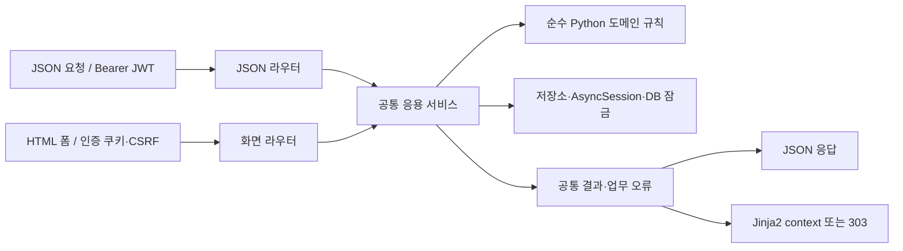

# Jinja2 화면과 HTTP 계약

작성일: 2026-10-28 · 단계 2 API 명세의 HTML 화면 계약 · 구현 전 검토안

이 문서는 [ERD·Jinja2 정리](01-erd-jinja-design.md)를 먼저 작성한 뒤 정리한 화면 입출력 계약이다. HELD ERD와 팀원의 Jinja2 화면 예시를 연결한다. 실제 FastAPI 라우터, Pydantic 클래스, 템플릿, `main.py`를 구현했다는 뜻은 아니다. 모든 17개 화면 경로는 API 단계에서 제안한 이름이며 팀의 최종 합의·운영 중 경로로 표시하지 않는다.

## 1. 팀 자료에서 가져온 내용과 이번 제안을 구분한다

| 구분 | 이 문서에 연결한 내용 | 정책 출처 |
| --- | --- | --- |
| TEAM_SOURCE | 요청 → 서버 조회·가공 → context → Jinja2 → HTML 응답 | 팀원 Jinja2 자료 |
| TEAM_SOURCE | `base.html`, `extends`, `include`, `partials/header.html`, 정적 CSS·JS | 팀원 Jinja2 자료 |
| TEAM_SOURCE | 폼 입력 → 서버 검증·저장 → 303 이동 → 내 예약 화면 | 팀원 Jinja2 자료의 화면 예시 |
| TEAM_SOURCE | 중복 예약 방지·권한 검사는 Python 서버와 DB 책임 | 팀원 Jinja2 자료 |
| USER_REQUEST | HELD 선점 포함, 취소 후 예매 가능 매수 복원 | 선택한 요구사항 |
| DESIGN_PROPOSAL / P26 | 자료의 Performance→`shows`, Session→`performances`, SessionSeat→`performance_seats`로 명칭 대응 | ERD 용어와 자료 의미를 맞춘 선택 |
| DESIGN_PROPOSAL / P28 | JSON Bearer와 Jinja2 쿠키 인증 분리, CSRF, 안전한 로그인 복귀, 화면 경로 | 자료에 없던 구체 HTTP·인증 전달 계약 |
| DESIGN_PROPOSAL | 묶음 선점·전체 해제·TTL 180초·회원/회차 ACTIVE 한 그룹·선점 가격 고정 | ERD 메모에도 제안값으로 표시된 정책; 팀 검토 필요 |

자료의 `Reservation(id, user_id, session_seat_id, status)`와 `is_reserved`는 학습용 단순 예시다. 그것을 현재 ERD의 최종 예약 구조나 HELD 정책 합의로 해석하지 않는다. 이 계약에서는 선점/선점 상세, 주문/주문 상세를 사용한다. Jinja2를 채택한다고 별도 DB 테이블이 추가되지는 않는다.

## 2. JSON과 HTML의 공통 실행 흐름



두 라우터가 같은 서비스를 직접 호출한다. Jinja2 서버가 자신의 JSON API를 다시 HTTP로 호출하지 않는다. HTML 폼과 JSON의 인코딩 차이를 표현 계층에서 변환한 뒤, 같은 선점·소유권·한도·만료·재시도 검사를 적용한다.

- 표현 계층: Form/Path/Query 파싱, 인증·CSRF 검사, 서비스 호출, context·JSON·오류 변환.
- 응용 계층: 공통 잠금 순서와 트랜잭션, 선점·확정·해제·취소 흐름 조율.
- 도메인 계층: 소유권·기한·수량·상태 전이 규칙. 팀 자료 폴더 예시에 생략된 `domain/`을 이후 구현에서 연결한다.
- 인프라 계층: DB 조회·잠금·저장, ORM↔도메인 변환. 요청별 독립 AsyncSession을 사용한다.

## 3. 인증·CSRF 계약 — DESIGN_PROPOSAL / P28

JSON API는 `Authorization: Bearer <access_token>`만 인증 수단으로 사용한다. 화면용 쿠키를 JSON API의 자동 대체 인증으로 사용하지 않는다. 화면 경로는 아래 쿠키 인증을 사용하며, 두 경로는 같은 JWT 서명·만료·`jti`·`token_blacklist` 검사를 적용한다.

| 항목 | 제안 계약 |
| --- | --- |
| 인증 쿠키 | `access_token`; 배포 환경 `HttpOnly`, `Secure`, `SameSite=Lax`, `Path=/pages`, Domain 생략으로 호스트 한정 |
| JWT | 서명 검증 후 회원 식별, 만료 검사, jti 블랙리스트 확인. 유효기간 예시 30분은 팀 확정값이 아님 |
| 토큰 노출 | JWT를 HTML context·숨김 입력·JavaScript 변수·URL에 넣지 않음 |
| CSRF 적용 | 로그인·회원 가입을 포함한 모든 화면 POST에 `csrf_token` 숨김 필드와 검증용 쿠키 사용 |
| 인증 후 CSRF | 현재 JWT의 `jti`에 명시적으로 결합한 HMAC 서명 토큰. 쿠키·폼 값 비교와 서명·결합 대상 검증을 함께 수행 |
| 로그인 전 CSRF | 서버가 발급한 익명 nonce에 결합한 서명 토큰으로 로그인·가입 폼 검증. 인증 성공 후 JWT jti에 결합한 토큰으로 교체 |
| 추가 DB 테이블 | 위 CSRF 방식은 서명과 쿠키를 사용하므로 별도 CSRF 저장 테이블을 추가하지 않는 안 |
| Origin | 변경 요청의 Origin, 없으면 Referer의 출처를 허용한 동일 출처와 비교하는 보조 검사. CORS 설정으로 CSRF 검사를 대체하지 않음 |
| 로그아웃 | 블랙리스트에 jti·만료를 기록하고 인증·CSRF 쿠키 제거. 이미 차단되거나 만료된 토큰은 일반 인증 정책에 따라 401 |
| 개발 환경 | localhost HTTP에서는 Secure 쿠키의 별도 개발 설정이 필요하다. 배포 설정에서 Secure를 끄는 것으로 해결하지 않음 |

위 방식은 **제안 계약**이며 구현·보안 시험 완료를 뜻하지 않는다. 단순히 서명만 하고 인증 세션 식별자에 결합하지 않은 CSRF 토큰은 이 계약에 해당하지 않는다. [OWASP의 세션 결합 signed double-submit 지침](https://cheatsheetseries.owasp.org/cheatsheets/Cross-Site_Request_Forgery_Prevention_Cheat_Sheet.html)

로그인 복귀용 `next`는 같은 서비스의 허용된 GET 화면 경로만 받는다. 외부 URL, `//`로 시작하는 주소, 역슬래시·제어문자·인코딩 우회 경로는 거절하고 기본 `/pages/shows`로 복귀한다. 로그인 성공이 이전의 선점·확정 POST를 자동 실행하지는 않는다. 본인이 화면을 확인한 뒤 다시 제출한다.

CSRF 토큰과 `request_key`의 목적은 다르다. CSRF는 다른 사이트가 몰래 변경 요청을 보내는 것을 방지하고, `request_key`는 같은 업무 요청의 중복 처리를 구분한다. 서로 대신 사용할 수 없다.

## 4. 모든 화면에 공통으로 적용할 규칙

| 항목 | 계약 |
| --- | --- |
| URL ID | 양의 정수. 예시의 `101`, `501`은 가상 값 |
| 화면 GET | DB 업무 상태를 변경하지 않음. 폼용 토큰·요청키 발급은 가능하지만 선점 생성·만료 정리·결제·취소는 수행하지 않음 |
| 변경 Form | `application/x-www-form-urlencoded`. 반복 `seat_ids`는 배열로 파싱. 파일 업로드 없음 |
| 로그인 필요 GET | 유효 인증이 없으면 303 `/pages/login?next=<URL인코딩한 안전한 내부 GET 경로>` |
| 로그인 만료 POST | 401 HTML, 업무 변경 없음. 로그인 링크와 복귀 경로 안내. 실패한 POST를 자동 재실행하지 않음 |
| 성공 POST | 303 + Location으로 결과 GET 화면 이동. 새로고침은 GET만 반복 |
| 입력 오류 | 422 HTML + 필드별 오류. 비밀번호·JWT는 재출력하지 않음 |
| CSRF 오류 | 403 HTML, 서비스 호출·업무 변경 없음. 안전한 GET에서 폼을 다시 받도록 안내 |
| 소유권 오류 | 타인의 선점·주문은 403 HTML. 존재하지 않는 ID는 404; 타인 내용은 context에 포함하지 않음 |
| 상태 충돌 | 409 HTML + 동일한 업무 오류 코드. 화면 버튼 상태와 관계없이 서버에서 최신 상태 재검사 |
| 예상 밖 오류 | 500 HTML. 트랜잭션 롤백, 민감한 내부 예외 내용은 응답에 포함하지 않음 |
| DB 일시 과부하 | DB를 사용하는 화면에서 공통 서비스의 잠금/연결 풀 대기 제한을 넘기면 503 HTML / `DB_BUSY`, `Retry-After: 1` 제안. 서비스 대기열에 등록됐다는 뜻은 아님 |
| 최신 정보 | 좌석·선점·내 예약·인증 관련 HTML은 `Cache-Control: no-store` 기본안 |
| 인코딩·표시 | HTML은 UTF-8. 금액은 서버의 Decimal 문자열을 표시용으로 변환. 사용자 입력은 HTML 이스케이프하고 임의 `safe` 처리하지 않음 |
| 페이지네이션 | `page` 기본 1, `size` 기본 20·최대 100. 목록 응답/화면의 필터와 페이지 링크에 동일하게 적용 |

303은 POST의 결과를 별도 GET 화면으로 확인하는 데 사용하는 상태다. 307은 같은 메서드를 유지하므로 이 성공 이동 계약과 다르다. [RFC 9110의 303 정의](https://www.rfc-editor.org/rfc/rfc9110.html#name-303-see-other)

## 5. 공통 context와 상태 표시

기본 context는 `request`, `viewer`, `error`, `field_errors`를 사용한다. `viewer`는 표시용 본인 ID·이름·로그인 여부만 포함하고 토큰·비밀번호 해시·요청 해시를 담지 않는다. 폼이 있는 화면에는 유효한 `csrf_token`을 전달한다. `base.html`이 공통 스타일과 헤더를 구성하고 `partials/header.html`을 include한다.

| 화면 데이터 | 필요한 context와 의미 |
| --- | --- |
| 공연 목록 | `shows`, `pagination`, `filters`, `viewer` |
| 공연 상세 | `show`, `performances`, `viewer` |
| 좌석 목록 | `show`, `performance`, `seats`, `server_time`, `viewer`; 로그인 상태면 `csrf_token`, `request_key` |
| 선점 상세 | `hold`, `hold_items`, `server_time`, `is_expired`, `can_confirm`, `can_release`, `reservation`(성공 주문이 있을 때), `csrf_token`, `request_key`(확정 가능할 때) |
| 예약 목록 | `reservations`, `pagination`, `filters`, `viewer` |
| 예약 상세 | `reservation`, `items`, `payment`, `tickets`, `can_cancel`, `viewer`, `csrf_token` |
| 프로필 | `user`의 이름·이메일·전화번호, `csrf_token`, `field_errors`; 이메일은 이 수정 계약에서 읽기 전용 |
| 로그인·가입 | `csrf_token`, 안전한 `next`, 허용된 안내 메시지와 필드 오류. 비밀번호 보존 없음 |

좌석에는 `AVAILABLE / HELD / RESERVED / BLOCKED`를 구분해 표시한다. 공개 화면에는 타인의 `user_id`, `current_hold_id`, 선점 상세·요청키를 보내지 않는다. 본인 선점 여부 같은 화면용 파생 정보는 인증한 사용자 기준으로 계산한다. 좌석 표시가 조회 시점의 값이라는 안내를 제공하고, 실제 확보 가능 여부는 제출 시 다시 검사한다.

선점 GET에서 저장 상태가 ACTIVE여도 `server_time >= expires_at`이면 `is_expired=true`, `can_confirm=false`다. GET만으로 EXPIRED를 저장하지 않는다. 카운트다운은 서버 시각과 만료 시각을 기준으로 표시하는 보조 기능이며, 시간이 줄거나 탭을 닫는 것만으로 선점 연장·해제·재선점이 자동 실행되지 않는다. 새로고침도 만료를 연장하지 않는다.

## 6. GET 화면 9개

모든 경로·템플릿 이름은 현재 계약의 DESIGN_PROPOSAL이다. Jinja2 자료의 디렉터리 예시는 역할을 참고한 것이며 그대로 복사한 최종 파일 구조가 아니다.

| GET 경로 | 인증 | 입력 | 템플릿 / 데이터 | 정상 결과 |
| --- | --- | --- | --- | --- |
| `/pages/shows` | 공개·인증 선택 | Query `q`, `type`, `demand_tier`, `page`, `size` | `shows/list.html`; 공연 목록·페이지·검색 조건 | 200 HTML |
| `/pages/shows/{show_id}` | 공개·인증 선택 | Path `show_id` | `shows/detail.html`; 공연·회차 목록 | 200 HTML |
| `/pages/performances/{performance_id}/seats` | 공개·인증 선택 | Path `performance_id` | `seats/list.html`; 회차 좌석 상태·가격·서버 시각 | 200 HTML |
| `/pages/login` | 공개 | Query `next` | `auth/login.html`; 로그인 폼·익명 CSRF | 200 HTML |
| `/pages/signup` | 공개 | Query `next` | `auth/signup.html`; 회원 가입 폼·익명 CSRF | 200 HTML |
| `/pages/holds/{hold_id}` | 로그인·본인 | Path `hold_id` | `holds/detail.html`; 선점 상세·유효 여부·확정/해제 폼 | 200 HTML |
| `/pages/reservations` | 로그인·본인 | Query `status`, `page`, `size` | `reservations/list.html`; 본인 예약 목록 | 200 HTML |
| `/pages/reservations/{reservation_id}` | 로그인·본인 | Path `reservation_id` | `reservations/detail.html`; 주문·상세·결제·티켓 | 200 HTML |
| `/pages/profile` | 로그인·본인 | 없음 | `users/profile.html`; 본인 정보·수정 폼 | 200 HTML |

공개 화면에서 선택 인증 쿠키가 만료·차단되었다면 비로그인 화면으로 표시하고 쿠키를 정리할 수 있다. 본인 정보나 선점 내용을 추정해 복원하지 않는다. 본인 화면은 인증 검사에 실패하면 위의 로그인 이동 규칙을 따른다.

예: 미로그인 회원이 선점 101 화면을 요청하면 `Location: /pages/login?next=%2Fpages%2Fholds%2F101`로 303 이동한다. 로그인 성공 후 선점이 이미 만료되었다면 만료 화면을 보여주며 과거 선점을 되살리지 않는다.

## 7. POST Form 동작 8개

별도 표시가 없어도 모든 POST에는 `csrf_token`이 필수다. 로그인 후 변경 동작은 인증 쿠키도 필수다. 클라이언트가 회원 ID·가격·총액·최종 상태를 보내 서버 결정값을 대체할 수 없다.

| POST 경로 | Form 입력 | 공통 서비스 / 대응 JSON | 성공 Location |
| --- | --- | --- | --- |
| `/pages/actions/signup` | `email`, `password`, `name`, 선택 `phone_number`, `csrf_token` | 회원 생성 / `POST /auth/signup` | 303 `/pages/login?signup=success`; 자동 로그인 없음 |
| `/pages/actions/login` | `username`(이메일), `password`, `csrf_token`, 선택 `next` | 로그인 / `POST /auth/login` | 303 검증된 `next`, 기본 `/pages/shows`; 인증·CSRF 쿠키 발급 |
| `/pages/actions/logout` | `csrf_token` | jti 차단 / `POST /auth/logout` | 303 `/pages/shows`; 인증·CSRF 쿠키 제거 |
| `/pages/actions/seat-holds` | `performance_id`, 반복 `seat_ids`, `request_key`, `csrf_token` | 선점 생성 / `POST /seat-holds` | 303 `/pages/holds/{생성되거나 재사용한 hold_id}` |
| `/pages/actions/holds/{hold_id}/release` | Path `hold_id`, `csrf_token` | 본인 선점 전체 해제 / `DELETE /seat-holds/{hold_id}` | 303 `/pages/holds/{hold_id}`; 종료 상태를 표시 |
| `/pages/actions/reservations` | `hold_id`, `request_key`, `mock_result`, `csrf_token` | 선점 확정 / `POST /reservations` | 303 `/pages/reservations/{reservation_id}` |
| `/pages/actions/reservations/{reservation_id}/cancel` | Path `reservation_id`, `csrf_token` | 본인 주문 전체 취소 / `POST /reservations/{reservation_id}/cancel` | 303 `/pages/reservations/{reservation_id}` |
| `/pages/actions/profile` | `name`, `phone_number`, `csrf_token` | 본인 정보 수정 / `PATCH /users/me` | 303 `/pages/profile` |

프로필 폼은 `name`, `phone_number`만 변경한다. 전화번호의 빈 문자열은 null로 변환해 지운다. 이메일·비밀번호 변경은 이 계약에 포함하지 않는다. 이름·전화번호는 JSON API와 동일한 길이·유효성 검사를 적용한다.

폼 `seat_ids`는 양의 정수 1~3개이며 중복 값을 허용하지 않는다. `quantity`는 배열에서 계산한다. Form의 `request_key`는 1~100자이며 새 업무 요청에는 새 값을 사용한다. 생성과 확정은 별도 키 공간이다. HTML 표준 폼의 POST로 선점을 해제하지만, 연결되는 JSON 작업은 DELETE이며 업무 동작은 같다.

### 폼 직렬화 예시

아래 값은 설명용이다. 실제 CSRF 토큰과 인증 쿠키는 로그·문서·URL에 기록하지 않는다.

```http
POST /pages/actions/seat-holds HTTP/1.1
Content-Type: application/x-www-form-urlencoded

performance_id=7&seat_ids=501&seat_ids=502&request_key=hold-example-001&csrf_token=EXAMPLE_CSRF_TOKEN
```

표현 계층은 반복된 `seat_ids`를 `[501, 502]`로 파싱해 선점 생성 서비스에 전달한다. 정상 결과는 다음과 같다.

```http
HTTP/1.1 303 See Other
Location: /pages/holds/101
Cache-Control: no-store
```

결제 폼의 평평한 `mock_result`는 다음처럼 공통 입력으로 변환한다. 실제 카드번호·결제사 토큰을 받는 계약이 아니다.

```text
Form:
hold_id=101
request_key=confirm-example-001
mock_result=APPROVE     # APPROVE 또는 DECLINE
csrf_token=EXAMPLE_CSRF_TOKEN

공통 업무 입력:
hold_id: 101
request_key: confirm-example-001
mock_payment: {result: "APPROVE"}
```

## 8. 오류와 실패 후 화면

| 상황 | 상태 / 코드 | 화면과 저장 결과 |
| --- | --- | --- |
| Form 형식·범위·좌석 중복 오류 | 422 / `VALIDATION_ERROR` | 해당 폼을 필드 오류와 함께 렌더링. 업무 변경 없음 |
| 로그인 불일치 | 401 / `INVALID_CREDENTIALS` | 로그인 화면. 비밀번호 재출력 없음 |
| 변경 요청 인증 만료·차단 | 401 / `AUTHENTICATION_REQUIRED` | 로그인 안내 HTML. 업무 변경 없음 |
| CSRF 실패 | 403 / `CSRF_FAILED` | 오류 HTML·안전한 GET 재시도 안내. 서비스 호출 없음 |
| 타인 선점·주문 | 403 / `FORBIDDEN` | 타인의 데이터가 없는 오류 HTML |
| 없는 대상 | 404 / `RESOURCE_NOT_FOUND` | 공통 오류 HTML |
| 타인 유효 선점·이미 판매된 좌석 | 409 / `SEAT_UNAVAILABLE` | 좌석 화면에 충돌 안내. B의 성공 선점 행 생성 없음 |
| 판매 기간·상태 불가 | 409 / `SALE_UNAVAILABLE` | 선점 또는 확정을 거절하고 회차 판매 상태 안내 |
| 선점 그룹 제한·매수 한도 | 409 / `ACTIVE_HOLD_EXISTS`, `TICKET_LIMIT_EXCEEDED` | 현재 상황을 보여주고 추가 선점 거절 |
| 같은 요청키의 다른 본문 | 409 / `IDEMPOTENCY_KEY_REUSED` | 기존 결과를 변경하지 않고 충돌 안내 |
| 종료·만료 선점 확정 | 409 / `HOLD_NOT_ACTIVE`, `HOLD_EXPIRED` | 종료 선점 화면. mock 승인·발권 없음 |
| 소비된 선점에 다른 확정 키 | 409 / `HOLD_ALREADY_CONSUMED` | 본인의 기존 주문 링크. 새 주문·결제·티켓 없음 |
| 예상 mock 승인 거절 | 422 / `MOCK_PAYMENT_DECLINED` | **선점 해제와 좌석·held 집계 반환을 커밋한 후** 선점 상세를 오류와 함께 표시. `can_confirm=false` |
| 취소 기한·상태 불가 | 409 / `CANCELLATION_UNAVAILABLE` | 본인 예약 상세에 취소 불가 이유 표시 |
| DB 잠금·연결 풀 대기 제한 초과 | 503 / `DB_BUSY` + `Retry-After: 1` | 과부하 안내 HTML. 해당 업무 변경은 롤백하며 이전에 커밋한 ACTIVE 선점은 남을 수 있음. 실패가 선점 자동 해제나 대기열 등록을 뜻하지 않음 |
| 예상 밖 DB 예외 | 500 / `INTERNAL_ERROR` | 전체 롤백. 이전에 커밋한 ACTIVE가 남을 수 있어 본인 선점 조회로 복구 안내 |

오류 이름과 상태 매핑은 API 명세의 제안 계약이다. HTML에서는 같은 코드와 사용자용 메시지를 `error.code`, `error.message`, `field_errors`로 전달한다. 알 수 없는 대상/권한 오류/예상 밖 오류는 `errors/error.html`을 사용하고, 안전하게 본인 문맥을 읽을 수 있는 검증·업무 오류는 해당 폼 템플릿을 사용한다.

503은 DB를 조회·변경하는 목록·상세·본인 화면과 모든 POST에 적용한다. 정적 폼만 준비하는 로그인·가입 GET에는 DB를 조회하지 않는다는 기본안에서 503을 별도로 선언하지 않았다. `Retry-After: 1`은 재시도까지 최소 1초 기다리라는 제안값이며, 그 뒤 성공 보장이나 자동 재제출 지시가 아니다. 변경 요청의 재시도는 원래 요청키를 유지하고 최신 본인 선점·주문 상태를 확인한다.

`402 Payment Required`는 RFC에서 향후 사용을 위해 남겨 둔 상태이므로 이 mock 거절 계약에서는 사용하지 않는다. 422 코드 선택은 우리 서비스의 제안이며, 선점 반환이 이미 커밋되었다는 응답 의미를 반드시 함께 명세한다. [RFC 9110의 402 정의](https://www.rfc-editor.org/rfc/rfc9110.html#name-402-payment-required)

## 9. 재시도·만료·늦은 요청

성공한 선점 생성에 같은 키·같은 본문을 보내면 기존 그룹과 같은 만료 시각으로 이동한다. 이미 종료된 그룹을 ACTIVE로 되살리거나 만료를 늘리지 않는다. 성공한 확정의 원래 키·해시를 다시 보내면 기존 주문의 현재 상태로 이동한다. 이미 취소된 주문도 재결제·재발권하지 않는다.

현재 16테이블에는 모든 실패 응답을 영구 재생하는 멱등성 저장소가 없다. 생성키는 성공 그룹, 확정키는 성공 주문에 남는다. 따라서 mock 거절 후 같은 확정 요청을 다시 보내면 최초의 422 대신 이미 RELEASED라는 409가 될 수 있다. 보장하는 것은 성공 결과 재사용과 중복 업무 효과 방지이며, 모든 실패 응답의 바이트 단위 재생이 아니다.

만료 정리와 새 선점은 같은 공통 잠금·집계 규칙을 따른다. B의 H202가 현재 주인인데 A의 옛 H101 요청이 도착하면 mock 승인 전에 거절한다. 오래된 정리 작업도 `current_hold_id=H101`인 좌석에만 적용한다. B의 선점 ID·집계·좌석 상태는 바꾸지 않는다. 선점에 실패한 B를 자동 승격하는 서비스 대기열은 없으며, B는 새 요청으로 재시도한다.

## 10. 다음 구현 단계와 검증 계획

이 문서와 [JSON API 명세](02-api-spec.md), [기계 판독용 화면 계약](html-routes.json)을 검토한 뒤 다음 순서를 적용한다.

```text
ERD·정책 구분 완료
→ API 명세(JSON + HTML Form) 검토
→ 요청·응답 스키마 작성
→ 라우터 작성
→ main.py에 라우터 등록
```

이 계약만으로 실제 로그인·CSRF·선점 기능이 구현되지는 않는다. 구현 후에는 정상/만료/차단 JWT, 가입·로그인 CSRF, 외부 `next` 차단, 폼의 반복 좌석 ID 파싱, HTML·JSON의 동일 업무 결과, 성공 303 이후 새로고침, 권한 오류의 데이터 비노출, mock 거절 후 해제 상태, 네트워크 재전송과 만료 경합을 실제 HTTP·DB로 검증한다. 관리자 역할이나 관리 CRUD는 최신 ERD와 자료에서 확정되지 않아 여기서 추가하지 않았다.
