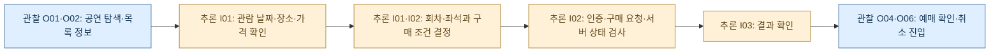
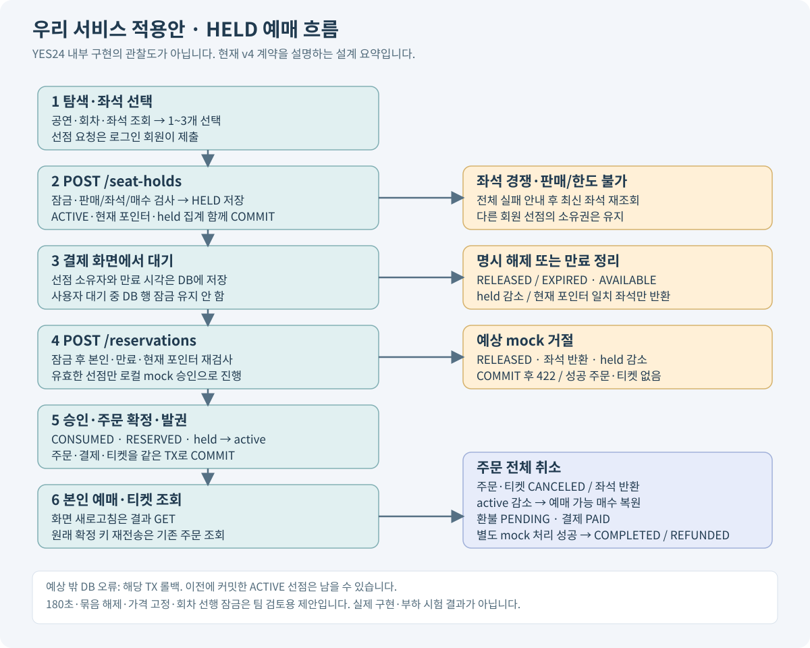
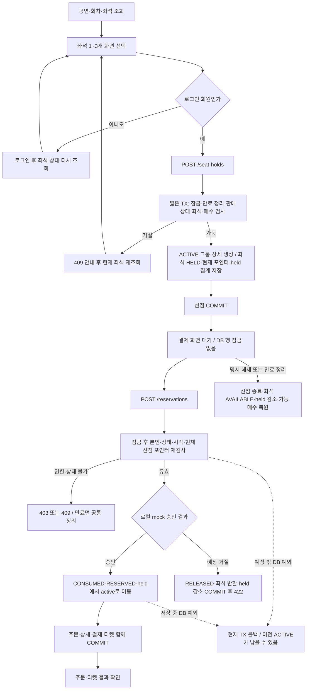
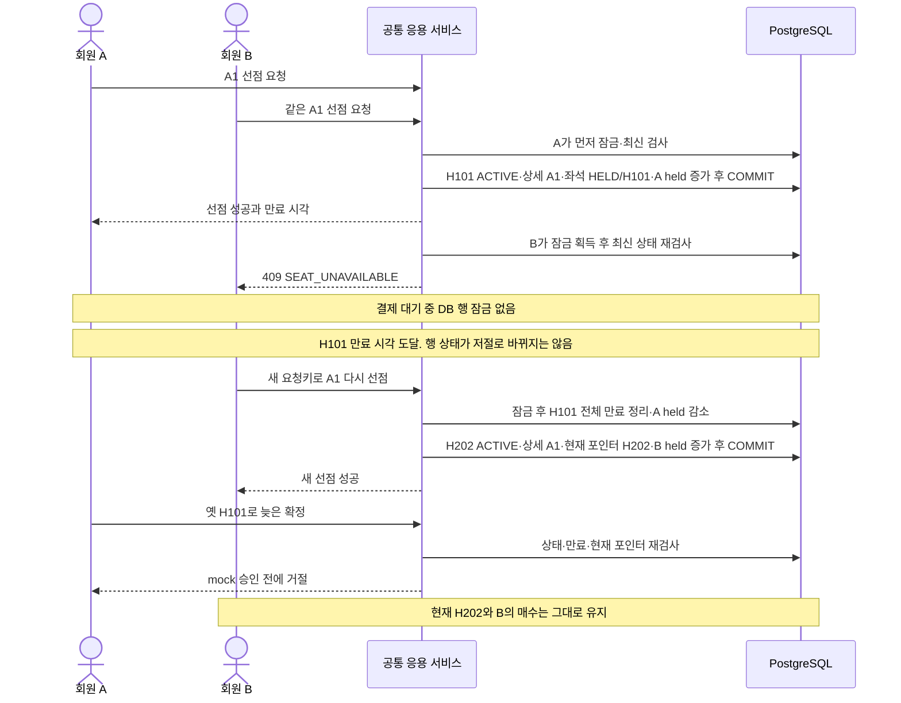
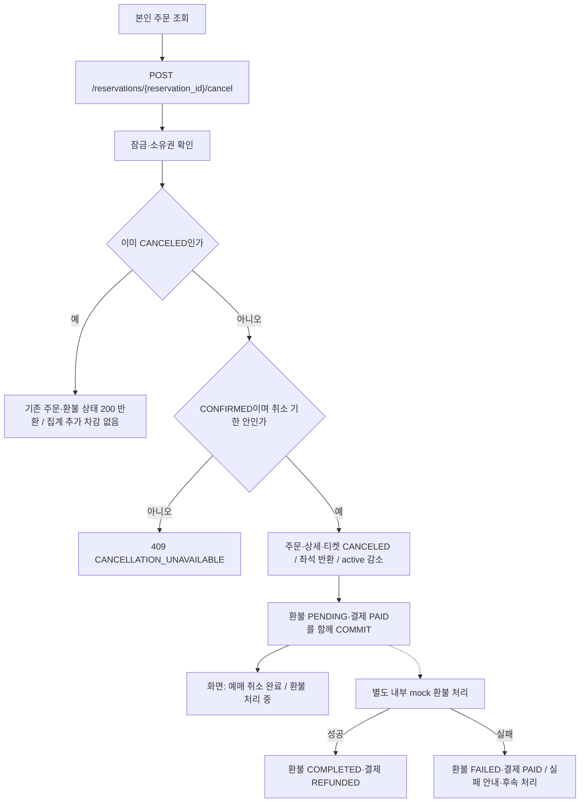

# YES24 레퍼런스 분석과 AsyncTicket HELD 적용안

작성일·공개 페이지 확인일: 2026-10-28 · 현재 HELD v4 설계에 연결한 분석

이 문서는 공연 탐색과 구매 후 관리에서 참고할 패턴을 분석하고, AsyncTicket의 HELD·Jinja2·API 설계에 연결한다. **실제 관찰, 내부 동작에 대한 추론, 우리 서비스 적용안은 서로 다른 근거 수준**이다. YES24의 DB·좌석 선점 구현·대기열·서버 증설 방식을 재현한 문서가 아니다. 우리 서비스의 구현·동시성·성능 시험 결과도 아니다.

## 1. 세 가지 표시의 의미

| 표시 | 포함하는 내용 | 해석할 때의 기준 |
| --- | --- | --- |
| **관찰 O** | 공개 페이지 응답에서 읽은 탐색 메뉴·정보 항목·안내 문구 | 출처와 확인 범위를 함께 표시 |
| **추론 I** | 그 기능을 제공할 때 필요할 것으로 생각한 사용자 흐름과 시스템의 성질 | 가능한 설명이며 YES24의 실제 구현으로 단정하지 않음 |
| **우리 적용 A** | 현재 AsyncTicket ERD·API·Jinja2 계약에 연결한 설계 | 요구사항과 추가 제안을 구분하고 구현 후 검증 |

공개 안내에서 어떤 기능이 보인다는 사실만으로 로그인 위치, 선점 시간, 결제 팝업 순서, DB 제품이나 잠금 종류까지 알 수는 없다. 아래의 선점 그룹·현재 포인터·180초는 **우리 설계의 개념과 제안값**이다.

## 2. 실제로 관찰한 공개 정보

다음은 공개 페이지의 텍스트와 탐색 진입점에 대한 관찰이다. 로그인한 회원의 실제 주문을 조회하거나 거래를 실행한 결과는 아니다.

| ID | 실제 관찰 | 관찰에서 확정할 수 없는 것 | 출처 |
| --- | --- | --- | --- |
| O01 | 콘서트를 세부 장르로 나누고 지역·공연장별 탐색을 제공한다. | 검색 쿼리와 DB 인덱스, 추천 알고리즘 | [콘서트 목록](https://ticket.yes24.com/Genre/Concert?Gcode=009_202_001) |
| O02 | 공연 항목에 제목·기간·장소가 함께 나타난다. | 콘텐츠·회차·시설을 실제로 어떤 테이블에 저장하는지 | [콘서트 목록](https://ticket.yes24.com/Genre/Concert?Gcode=009_202_001) |
| O03 | 인기 공연 순위와 지역 추천 영역이 있다. | 실제 동시 접속 수, 서버 규모, 순위의 산식 | [콘서트 목록](https://ticket.yes24.com/Genre/Concert?Gcode=009_202_001) |
| O04 | 구매 후 예매를 확인하고 취소할 수 있는 진입점이 있다. | 로그인 분기의 정확한 시점과 실제 취소 처리 결과 | [콘서트 목록](https://ticket.yes24.com/Genre/Concert?Gcode=009_202_001) |
| O05 | 이용안내가 예매·결제·수수료·취소/환불·수령 등의 주제로 나뉜다. | 개별 공연의 현재 수수료와 취소 가능 기한 | [공식 이용안내](https://ticket.yes24.com/UserGuide/Guide) |
| O06 | 예매 관리 공개 응답에 기간·주문일 조회, 예매와 취소 구분, 상세에서 확인·취소하는 안내가 있다. | 인증한 회원에게 실제 표시되는 주문 목록 | [예매 관리](https://ticket.yes24.com/Pages/MyPage/MyOrder.aspx?Gcode=009_106_001) |
| O07 | 같은 안내문이 결제 수단·수령 상태 등에 따른 취소 조건과 환급 시점의 차이를 설명한다. | 특정 주문의 환불액·완료 시점, 실제 환급 성공 | [예매 관리](https://ticket.yes24.com/Pages/MyPage/MyOrder.aspx?Gcode=009_106_001) |

개별 공연의 거래 화면과 좌석·결제 상호작용은 이번 직접 관찰 범위에 포함되지 않는다. 공연별 정책은 달라질 수 있으므로 일반 안내를 모든 공연에 동일하게 적용되는 약속으로 옮기지 않는다.

## 3. 관찰을 바탕으로 한 추론

| ID | 출발한 관찰 | 가능한 해석 | 검증이 더 필요한 부분 |
| --- | --- | --- | --- |
| I01 | O01·O02 | 이용자는 공연을 찾은 뒤 관람 날짜·장소·가격·구매 조건을 결정해야 할 것이다. | 실제 화면 순서와 회차·좌석 선택 방식 |
| I02 | O02·O04 | 조회 결과와 구매 완료 사이에 재고가 바뀔 수 있으므로, 거래를 확정하는 서버는 최신 상태를 검사해야 할 것이다. | 선점 유무·시작 시점·만료 시간·경쟁 처리 구현 |
| I03 | O04·O06 | 구매 후에는 목록에서 본인 거래를 찾고 상세에서 확인·취소하는 경로가 필요할 것이다. | 권한 검사·상태 전이·재시도 처리의 내부 방식 |
| I04 | O05·O07 | 예매 취소의 업무 결과와 결제 수단의 환급 결과는 이용자에게 구분해 안내할 필요가 있을 것이다. | 실제 환불 연동과 내부 상태 저장 방식 |
| I05 | O03 | 관심이 높은 공연은 특정 시점에 요청이 몰릴 수 있으므로 부하 집중을 고려한 운영이 필요할 수 있다. | 수요 예측·유입 제어·대기열·증설 정책 전체 |

이 표의 ‘필요할 것이다’는 설계 관점의 해석이다. 예를 들어 I02는 **최종 재고 정합성이 필요하다는 판단**이지, YES24가 `seat_holds`라는 테이블이나 PostgreSQL `FOR UPDATE`를 사용한다는 증거가 아니다.

### 사용자 여정 가설 — 중간 단계는 추론

인증이 어느 화면보다 먼저 나오는지는 이 가설로 확정하지 않는다. 다음 장부터는 YES24 화면 순서를 설명하는 것이 아니라 **우리 서비스에 적용할 현재 계약**을 설명한다.

## 4. 현재 HELD 설계에 맞춰 바꾼 적용 범위

| 항목 | 현재 적용안 | 성격 |
| --- | --- | --- |
| 결제 전 좌석 확보 | 선점 요청이 커밋되면 HELD로 관리 | HELD를 포함하는 프로젝트 요구 |
| 선점 모델 | `seat_holds`와 `seat_hold_items`, 현재 좌석의 `current_hold_id` | ERD의 추가 설계 선택 |
| 선점 시간·단위 | 기본 180초, 1~3석 그룹 전체 성공/실패·전체 해제, 회원·회차 ACTIVE 하나 | 팀 검토용 기본값. YES24 정책이 아님 |
| 사용자 결제 대기 | 선점 정보는 저장하지만 DB 잠금은 유지하지 않음 | 우리 동시성 구현안 |
| 결제 확정 | 본인·미만료·현재 포인터를 재검사하고 mock 승인·주문·발권을 함께 커밋 | 우리 API·트랜잭션 계약 |
| 취소와 환불 | 주문 취소·좌석/한도 복원과 환불 PENDING 이후 mock 결과를 구분 | 현재 v4 적용안 |
| A/B/C | 우리 공연의 예상 수요 분류와 실험 조건 | YES24 순위나 내부 운영 등급을 복사한 것이 아님 |

**HELD는 현재 설계에 포함한다.** 다만 그룹 전체 해제·180초·ACTIVE 하나·선점 가격 고정·회차 선행 잠금은 팀 최종 합의로 단정하지 않는다. 요구사항과 추가 정책의 구분은 [ERD·Jinja2 설계](01-erd-jinja-design.md)와 [정책 구분](design-policies.json)을 함께 따른다.

## 5. 우리 서비스의 화면·데이터·API 연결

이 요약과 아래 세부 도식은 우리 서비스 적용안이다. YES24의 내부 거래 흐름을 관찰한 그림이 아니다.

**이 절의 흐름은 AsyncTicket의 설계 제안이다. YES24의 선점 시간·DB 상태·잠금·API를 확인한 결과로 해석하지 않는다.** 현재 [ERD·Jinja2 설계](01-erd-jinja-design.md), [JSON API 명세](02-api-spec.md), [Jinja2 화면·폼 계약](03-jinja-http-contract.md)에 맞춰 적용 지점을 설명한다.

현재 안은 화면에서 좌석을 고르는 단계와 서버가 좌석을 잠시 확보하는 단계를 분리한다. 사용자는 선점 요청이 성공한 뒤 결제 화면으로 이동한다. 결제 화면을 읽는 동안 DB 행 잠금을 계속 잡아두지 않고, 선점 소유자와 만료 시각을 저장한 HELD 상태로 보호한다. 최종 확정 때 서버가 현재 소유권과 유효기간을 다시 검사한다.

### 화면에서 필요한 정보와 ERD·API 연결

| 사용자에게 필요한 정보·행동 | 현재 모델과 JSON API | Jinja2 화면·표시 | 정책의 성격 |
| --- | --- | --- | --- |
| 공연을 찾고 상세를 읽기 | `shows`, `GET /shows`, `GET /shows/{show_id}` | `/pages/shows`, `/pages/shows/{show_id}` | 비회원 탐색 방향에 연결한 적용안 |
| 관람할 회차와 장소 선택 | `performances`, 시설 테이블, `GET /shows/{show_id}/performances` | 공연 상세에 회차·판매기간·장소 표시 | 현재 ERD와 API 계약 |
| 좌석의 위치·가격·현재 상태 확인 | `performance_seats`, `stage_seats`, `GET /performances/{performance_id}/seats` | `/pages/performances/{performance_id}/seats`; AVAILABLE·HELD·RESERVED·BLOCKED 구분 | 조회 결과는 확보 보장이 아님 |
| 선택한 좌석의 선점 요청 | `seat_holds`, `seat_hold_items`, `POST /seat-holds` | 폼을 제출하고 성공하면 303으로 `/pages/holds/{hold_id}` 이동 | HELD 포함은 요구사항, 묶음 정책은 추가 제안 |
| 선점 중인 좌석·금액·남은 시간 확인 | `GET /seat-holds/{hold_id}`; `expires_at`, `server_time`, `can_confirm` | 선점 상세·만료 안내·확정/해제 폼 | 카운트다운은 표시 보조이며 만료 판정은 서버 책임 |
| mock 결제·주문 확정 | `POST /reservations`; 주문·상세·성공 결제·티켓 | 성공 후 303으로 본인 주문 상세 이동 | 실제 PG 대신 mock을 사용하는 현재 범위 |
| 본인 주문과 티켓 확인 | `GET /reservations`, 주문 상세와 티켓 GET | `/pages/reservations`, `/pages/reservations/{reservation_id}` | 소유권 검사 뒤 본인 데이터 표시 |
| 주문 취소와 환불 진행 확인 | `POST /reservations/{reservation_id}/cancel`; 주문·티켓·환불 상태 | 취소 상태와 환불 진행 상태를 함께 표시 | 주문 전체 취소·매수 복원과 환불 후처리를 구분 |

팀원 Jinja2 예시의 공연 콘텐츠 `Performance`는 현재 `shows`, 회차 `Session`은 `performances`, `SessionSeat`는 `performance_seats`에 대응한다. Jinja2는 context를 받아 HTML을 조립하며, 좌석 확보·매수 한도·소유권 검사는 서버와 DB에서 수행한다. Jinja2 연결을 위해 별도 테이블이나 새 예매 API를 추가하지 않는다.

공개 좌석 화면에는 타인의 회원 ID·선점 ID·티켓 코드를 전달하지 않는다. 좌석을 눌렀다는 이유로 ‘확보 완료’라고 표시하지 않고, 선점 성공 응답 후 확보 좌석과 만료 시각을 보여준다. 만료된 선점 화면에서는 이전 선택을 되살리는 대신 현재 상태를 조회하고 새 요청을 시작할 경로를 제공한다.

### 우리 서비스의 전체 HELD 흐름

선점 생성 입력은 `performance_id`, `seat_ids`, `request_key`다. 회원 ID와 가격은 서버가 결정한다. 확정 입력은 `hold_id`, 확정용 `request_key`, `mock_payment.result`다. 선점 생성과 확정은 서로 다른 요청키 공간을 사용한다. Jinja2 폼은 같은 업무 입력으로 변환하고 성공 결과를 303 뒤 GET 화면으로 확인한다.

결제 성공 결과가 저장됐는지 불확실해 재전송하는 경우에는 원래 확정 키·본문으로 기존 주문을 찾는다. 이미 취소된 주문도 재결제하지 않는다. 반면 실패 응답까지 완전히 저장·재생하는 별도 기록은 없으므로, mock 거절 뒤 같은 요청을 보내면 최초 422 대신 종료된 선점에 대한 409가 나올 수 있다.

### A와 B의 경쟁: 만료 뒤 새 선점을 보호한다

아래는 A가 먼저 필요한 잠금을 얻고 성공 커밋한 가상 사례다. 화면 클릭 순서나 대기열의 선착순을 보장한다는 뜻은 아니다.

`seat_holds`에는 H101 EXPIRED와 H202 ACTIVE가 함께 남고, `seat_hold_items`에는 같은 A1의 과거·현재 선점 상세가 각각 남는다. 현재 소유권의 기준은 좌석 행의 `current_hold_id=H202`다. H101을 정리하는 늦은 작업도 `current_hold_id=H101`인 좌석만 반환해야 하므로 H202를 지울 수 없다.

만료 판단에는 필요한 잠금을 모두 얻은 뒤 DB 현재 시각을 사용한다. 요청이 만료 전에 도착했더라도 잠금을 얻었을 때 만료됐다면 거절한다. 이 규칙은 최종 판정 시점에 대한 약속이며 실제 COMMIT 시각까지 만료 전이라는 보장은 아니다. 조회 GET은 만료 여부를 계산해 표시할 뿐 DB의 만료 정리를 저장하지 않는다.

### 취소 화면은 주문 취소와 환불 진행을 구분한다

이 흐름은 v4 계약의 mock 상태 관리다. 실제 결제사 승인·입금·환불 완료를 관찰하거나 실행했다는 의미가 아니다. 좌석 반환과 매수 복원은 취소 트랜잭션이 성공하면 반영하고, 이후 조회에서 환불 상태를 별도로 보여준다. 판매가 마감되거나 회차가 취소됐다면 좌석을 반환해도 새 선점 요청은 판매 조건 검사에서 거절한다.

### 구현 후 확인할 적용 검증

아래는 실행 전 검증 계획이다. 현재 서비스가 통과한 결과로 발표하지 않는다.

| 검증 상황 | 확인할 결과 |
| --- | --- |
| A와 B가 같은 좌석 동시 선점 | 유효 선점 성공 최대 1개, 현재 포인터 하나 |
| 확정 2매와 신규 선점 2매 | 회차 한도 초과 거절, 기존 확정 매수 유지 |
| 선점 묶음의 일부 좌석 충돌 | 요청 전체 실패, 나머지를 일부 확보하지 않음 |
| A 만료 후 B 재선점과 A의 늦은 확정·정리 | B의 선점·매수 불변, A 승인 전 거절 |
| 같은 성공 요청키 재전송 | 추가 선점·연장·주문·결제·발권 없음 |
| 예상 mock 거절과 예상 밖 저장 예외 | 전자는 선점 반환 커밋, 후자는 해당 TX 롤백으로 구분 |
| 반복 해제·취소 | 매수 집계 한 번만 감소, 이전 선점 재활성화 없음 |
| 주문 취소 후 환불 PENDING 조회 | 취소 완료와 환불 처리 중을 함께 표시 |
| Jinja2 폼 성공 후 새로고침 | 결과 GET만 반복, POST로 추가 확정하지 않음 |
| 공개 좌석 조회 | 타인 선점 ID·회원 ID·티켓 정보 비노출, GET의 업무 상태 변경 없음 |

정확한 입력·오류·상태 규약은 [JSON API 명세](02-api-spec.md), [화면·폼 계약](03-jinja-http-contract.md), [구현·검증 계획](04-implementation-and-validation.md)을 따른다. 제약은 [전체 SQL 제안](held-postgresql.sql)과 [OpenAPI 계약](openapi.json)에 연결한다. 이 분석을 이유로 기존 API나 SQL에 새로운 상태·경로·테이블을 추가하지 않는다.

## 6. A/B/C와 트래픽 실험에 가져올 관점

**관찰 O03:** 공연을 탐색할 때 인기 순위와 추천을 볼 수 있다. 그 순위를 실제 동시 접속 수나 서버 수로 바꾸어 읽지는 않는다.

**추론 I05:** 오픈 시점의 요청 집중은 평균 방문 수와 다를 수 있다. 좌석이 여러 개여도 같은 인기 좌석에 요청이 집중되면 충돌이 커질 수 있다.

**우리 적용안:** `shows.demand_tier`와 `traffic_profiles`는 예상 수요를 분류한다. `seat_grade`의 R/VIP 같은 위치·가격 등급과는 다르다. A로 저장하는 것만으로 서버 증설이나 대기열이 실행되지는 않는다. 운영 설정과 측정 도구를 연결하는 단계가 별도로 필요하다.

| 실험 조건 | 확인할 성질 | 기록할 지표 |
| --- | --- | --- |
| 여러 회원이 같은 좌석 요청 | 유효 선점 최대 1개, 포인터 하나 | 성공·정상 충돌·서버 오류, 최종 좌석/선점 상태 |
| 여러 회원이 서로 다른 좌석 요청 | 처리량과 회차 선행 잠금 병목 | p95 지연, 락 대기, DB 풀 대기·연결 수 |
| 같은 회원이 다른 좌석에 2+2 요청 | ACTIVE 그룹·확정+선점 매수 제한 | 한도 초과·이중 집계 여부 |
| 서버/워커 수만 바꿔 같은 부하 실행 | 앱 확장으로 개선되는 구간과 DB 병목 구간 | 처리량·지연·오류와 DB 정합성 |

회차 행을 먼저 잠그는 기본안은 다른 좌석의 짧은 쓰기도 차례로 처리한다. 앱 서버를 더 확보해도 이 병목은 남을 수 있다. 먼저 정합성을 구현한 뒤 측정 결과에 따라 잠금 범위와 유입 제어를 조정한다. 표의 지표는 **실험 계획**이며 처리량이나 안전성을 입증한 수치가 아니다.

## 7. 적용 우선순위와 확인 기준

| 우선순위 | 가져올 부분 | 적용 후 확인 |
| --- | --- | --- |
| 현재 설계 | 공연·회차·좌석 탐색, 본인 선점·예매 관리, 상태별 안내 | Jinja2와 JSON이 같은 업무 규칙을 사용 |
| 현재 설계 | HELD 소유권·만료·재시도·mock 확정·발권·취소 | 경쟁·실패·반복 요청의 DB 상태가 계약과 일치 |
| 팀 검토 | 묶음 선점·180초·전체 해제·가격 고정 등 기본값 | 합의 후 ERD·API·화면 설명을 함께 통일 |
| 후속 범위 | 정교한 추천·선예매·배송·부분 취소·유입 제어·자동 증설 | 각 기능의 권한·데이터·운영·실험 명세부터 추가 |

참고 서비스의 포스터·브랜드·문구를 복제하는 것이 목적은 아니다. 탐색 정보, 거래 상태, 실패 후 복구 경로를 연결하는 원리를 가져오고, 구현 범위는 현재 프로젝트의 계약으로 정의한다.

## 8. 출처와 읽는 순서

공개 정보는 [YES24 콘서트 목록](https://ticket.yes24.com/Genre/Concert?Gcode=009_202_001), [공식 이용안내](https://ticket.yes24.com/UserGuide/Guide), [예매 관리 공개 응답](https://ticket.yes24.com/Pages/MyPage/MyOrder.aspx?Gcode=009_106_001)을 기준으로 확인했다. 특정 회원의 주문·실제 결제·취소·환급 결과나 내부 시스템은 관찰하지 않았다.

우리 적용안의 구체 계약은 다음 문서가 기준이다.

- [ERD·Jinja2 연결 설계](01-erd-jinja-design.md)
- [JSON API 명세](02-api-spec.md)
- [Jinja2 화면·폼 계약](03-jinja-http-contract.md)
- [구현 순서와 검증 계획](04-implementation-and-validation.md)

이 레퍼런스 분석은 위 계약을 설명하고 검증할 관점을 추가한다. 기존 19개 JSON 동작·17개 화면 동작을 변경하거나 실제 구현 완료를 선언하지 않는다.
