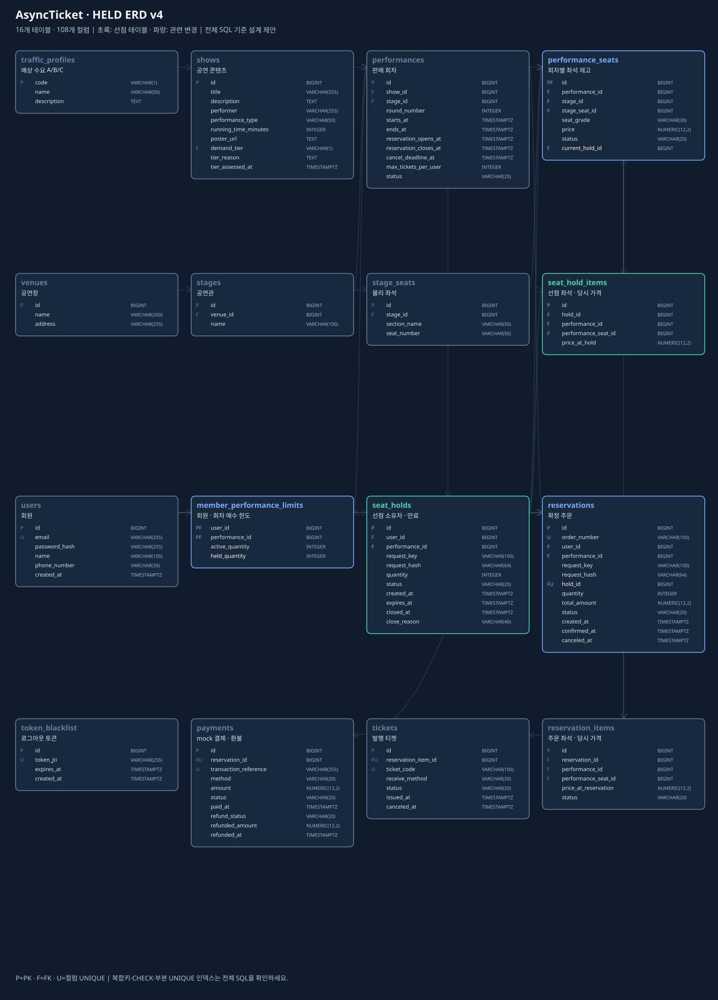

# Project 2 · AsyncTicket

좌석 선점부터 mock 결제·주문 확정, 자동 발권, 주문 전체 취소까지의 API 설계를 정리합니다. v4는 HELD ERD에 Jinja2 화면 흐름을 연결하고, JSON API와 HTML 폼의 계약을 구분한 검토안입니다.

## 문서

명세·설계·참고 자료는 [docs](docs/)에 모았습니다.

### 공연·공연 회차 API 명세 (2026-10-29)

- [공연·공연 회차 API 명세 초안](docs/shows-performances-notion-template.md): 수정 ERD 기준 10개 기능의 요청·응답, 필드 설명, 오류·정책 검토사항
- [공연·공연 회차 API 명세 구성 요약](docs/notion-write-report.md): 기능 목록, 명세의 여섯 항목과 공통 계약을 읽는 기준

### 2026-10-29 API 분석

- [카카오 공식 API 문서 해체 분석](docs/kakao-official-api-document-analysis.md): 공식 문서 구성, 코드·토큰·사용자 정보 조회, 요청·응답과 오류 읽기
- [팀 전체 API 서비스 흐름 분석](docs/team-api-flow-analysis.md): 9테이블 기준 27개 API 검토안, 사용자 흐름과 시스템 처리의 상하 도식, 필드별 설명

아래 v4 자료는 HELD를 포함한 이전 설계 검토안입니다. 새 흐름 분석과의 구조·정책 차이는 구현 전 하나의 계약으로 정리해야 합니다.

### 기존 HELD 설계 자료

- [ERD·Jinja2 설계](docs/01-erd-jinja-design.md): 16개 테이블의 역할, 상태·관계·한도·동시성 규칙
- [JSON API 명세](docs/02-api-spec.md): 인증·공연·회차·선점·확정·주문·취소 19개 동작
- [Jinja2 화면·폼 계약](docs/03-jinja-http-contract.md): 화면 GET 9개와 변경 폼 POST 8개
- [구현 순서·검증 계획](docs/04-implementation-and-validation.md): 스키마 → 라우터 → main.py 연결과 시나리오
- [YES24 레퍼런스·HELD 적용 분석](docs/05-yes24-reference-analysis.md): 공개 페이지 관찰·추론·우리 적용안을 구분하고 선점 경쟁·만료·취소/환불 흐름에 연결
- [통합 HTML 자료](docs/guide.html): 정책 분류와 HTTP 경로 검색. `Project/project2/docs` 폴더를 함께 내려받은 뒤 브라우저에서 열어 탐색할 수 있습니다.
- [OpenAPI 3.1 계약](docs/openapi.json) · [HTML 경로 목록](docs/html-routes.json) · [정책 구분](docs/design-policies.json)
- [예매 동시성 가이드 PDF](docs/ticket-booking-concurrency-guide.pdf)
- [전체 제약 SQL 제안](docs/held-postgresql.sql) · [Mermaid ERD](docs/held-erd.mmd)

현재 문서는 구현 전 설계 초안입니다. API 경로와 기본 정책은 검토 대상이며, 서버 구현이나 실행 검증 완료를 의미하지 않습니다.

## 자료의 성격과 정책 구분

| 구분 | 내용 |
| --- | --- |
| 제공자료 기반 | 비회원 조회·로그인 예매·회차 3매·주문 전체 취소, Jinja2 context와 폼 제출 흐름 |
| 요구사항 | HELD 포함, 주문 취소 후 가능 매수 복원, 공연 A/B/C 예상 수요 분류 |
| 추가 설계 제안 | 묶음 선점·전체 해제·180초·ACTIVE 그룹 하나·선점 가격 고정·회차 선행 잠금·재시도·구체 HTTP 계약 |
| 미결정 | 제안 정책의 최종 채택, 관리자 기능의 범위와 권한 |

제공자료에 기록된 내용과 팀 전체의 최종 합의는 구분합니다. Jinja2는 화면을 조립하고, 선점·소유권·만료·중복 예매 방지는 공통 응용 서비스와 DB에서 처리합니다. Jinja2 연결을 위해 테이블을 추가하지 않았습니다.

## 전체 ERD

<details>
<summary>16테이블·108컬럼 관계도 펼치기</summary>



</details>

회원·회차 한도에는 `(user_id, performance_id)` 복합 기본키가 필요합니다. 전체 SQL은 이 제약과 복합 FK·부분 고유 인덱스·상태 CHECK를 포함한 제안이며 실제 DB 적용 결과를 뜻하지 않습니다.

## v3와 v4의 계약 차이

[v3 API 명세](docs/held-api-spec.md)는 이전 검토 기록으로 보존합니다. 두 버전의 정책은 모두 검토 대상이며 구현 시 하나의 계약으로 통일해야 합니다.

| 항목 | v3 기록 | v4 검토안 |
| --- | --- | --- |
| JSON ID | 양의 정수 문자열 | 양의 int64 숫자 |
| 타인 선점·주문 접근 | 미존재와 동일한 404 | 인증 후 소유권 위반 403, 미존재 404 |
| 취소와 환불 | mock 즉시 전액 환불 완료 | 주문 취소·좌석 반환 후 환불 PENDING, mock 후처리 완료 구분 |
| API 범위 | 선점·확정·티켓·취소 중심 | 회원·인증·공연·회차·검색·페이지네이션 포함 |
| 화면 전달 | JSON 중심 | JSON Bearer와 Jinja2 쿠키·CSRF·303 계약 구분 |

## 검증과 다음 단계

OpenAPI 형식과 요청·응답 예시를 정적으로 검사했습니다. 실제 HTTP 호출·DB 적용·동시성·성능 시험은 이후 구현 단계에서 수행합니다.

```text
ERD 구성 → API 명세 → 요청·응답 스키마 → 라우터 → main.py 등록
```

현재 공개 자료는 ERD와 API 명세 단계입니다. 실행 가능한 서비스 코드는 아직 포함하지 않습니다.
