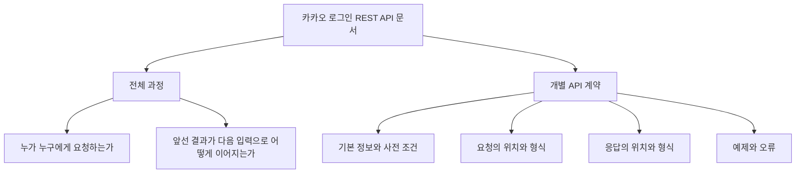
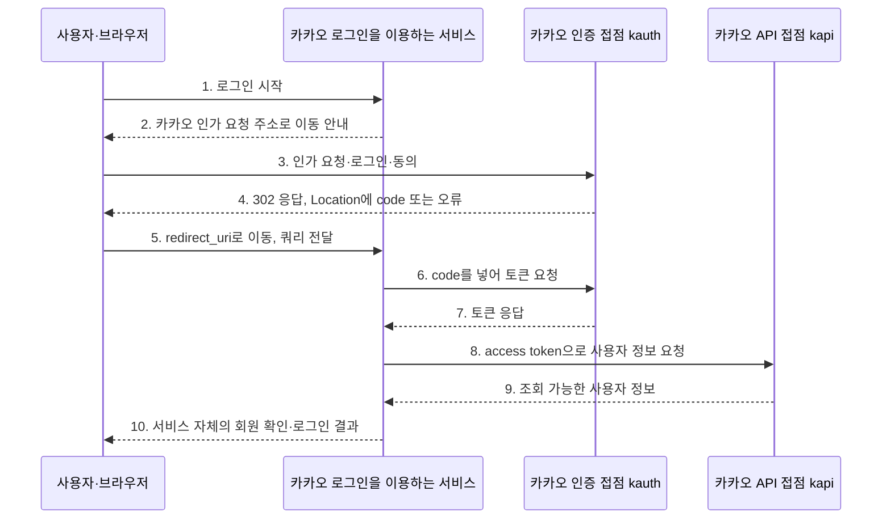
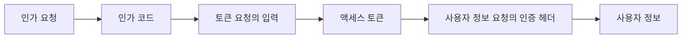
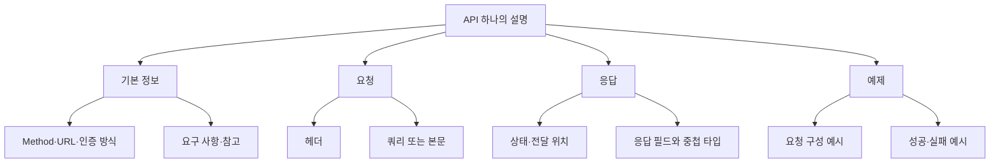
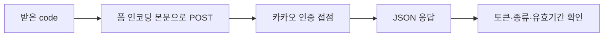
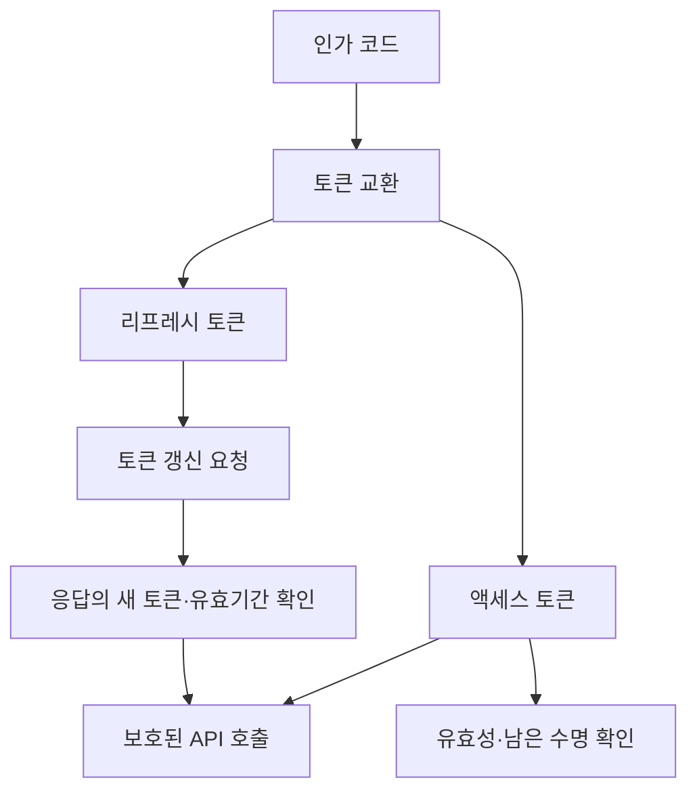
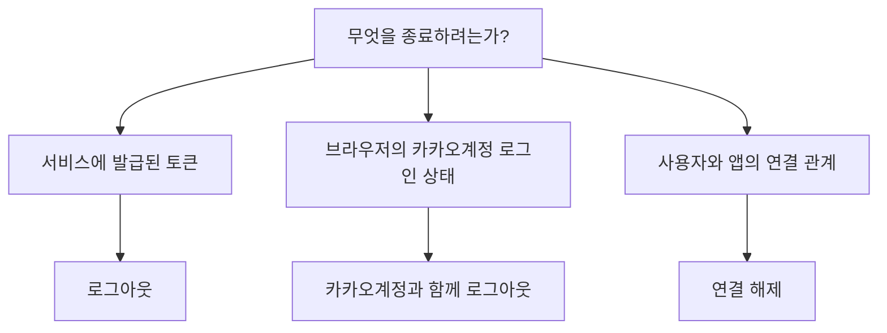
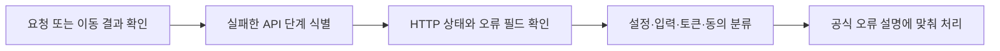

# 카카오 로그인 REST API 공식 문서 해체 분석

작성일: 2026-10-29

분석 대상: [카카오 로그인 REST API 공식 문서](https://developers.kakao.com/docs/ko/kakaologin/rest-api)

이 문서는 카카오 공식 명세의 구성과 읽는 방법을 비전공 학습자 관점에서 설명한다. 원문 전체를 옮기는 대신, 핵심 호출을 비교하고 각 항목이 문서에서 어떤 일을 하는지 분석한다. API를 실제 호출하거나 로그인·토큰 발급을 실행한 결과는 아니다.

## 1. 이 문서는 무엇에 대한 설명서인가?

카카오 로그인 REST API 문서는 **카카오 로그인을 사용하는 서비스가 카카오와 어떤 요청·응답을 주고받는지** 설명한다.

읽을 때는 다음 두 질문을 구분해야 한다.

1. **전체 흐름:** 어떤 호출을 먼저 하고, 그 결과를 다음 호출에 어떻게 사용하는가?
2. **개별 명세:** 요청 하나를 어느 주소에 어떤 형식으로 보내고, 결과를 어디에서 확인하는가?

전체 흐름만 보면 실제 요청을 작성할 수 없고, 개별 필드 표만 보면 호출 순서를 놓치기 쉽다. 공식 문서가 앞부분에 로그인 과정을 두고 뒤에서 각 API를 설명하는 구성을 이렇게 읽을 수 있다.



위 도식은 공식 페이지의 스크린샷이 아니라, 문서를 읽기 위한 분석 도식이다.

## 2. 공식 문서의 목차는 왜 이렇게 나뉘어 있나?

공식 페이지의 항목을 학습 목적에 따라 묶으면 다음과 같다. 아래 묶음 이름은 해설을 위한 분류이며 공식 목차를 그대로 복제한 것이 아니다.

| 읽기 묶음 | 원문에서 찾아볼 주요 항목 | 이 묶음이 답하는 질문 |
| --- | --- | --- |
| 로그인 진입 | 시작하기 전에, 인가 코드 요청, 토큰 요청 | 로그인을 어떤 순서로 시작하는가? |
| 로그인 동작 조정 | 추가 기능 | 기본 동작을 어떤 조건으로 바꿀 수 있는가? |
| 토큰 유지·확인 | 액세스 토큰 정보 조회, 토큰 갱신 | 받은 증표를 어떻게 확인하고 이어 쓰는가? |
| 사용자 데이터 | 사용자 정보 조회, 여러 사용자 정보 조회, 사용자 목록 조회, 사용자 프로퍼티 저장, 배송지 조회 | 무엇을 조회·저장하며 어떤 권한이 필요한가? |
| 동의·관계 관리 | 로그아웃, 카카오계정과 함께 로그아웃, 연결 해제, 동의항목·서비스 약관 관련 항목 | 사용 종료·동의 철회는 각각 어떤 범위인가? |
| 확장 주제 | OpenID Connect, 고급: 수동 연결 | 기본 흐름 외에 어떤 별도 조건·개념이 있는가? |

**읽는 순서 제안:** 처음부터 모든 항목을 같은 깊이로 읽기보다, 핵심 로그인 세 단계의 입출력을 먼저 연결하고 토큰·로그아웃·확장 기능으로 넓히면 문서의 구조를 파악하기 쉽다.

출처: [분석 대상의 공식 목차와 API별 안내](https://developers.kakao.com/docs/ko/kakaologin/rest-api). 항목별 제공 조건과 종료 예정 안내는 원문을 함께 확인해야 한다.

## 3. 도식에 등장하는 참여자는 누구인가?

여기서 **서비스**는 카카오 로그인을 이용하는 일반적인 웹사이트나 앱을 뜻한다. 특정 팀 프로젝트를 가리키지 않는다.

| 참여자 | 쉬운 설명 | 도식에서 하는 일 |
| --- | --- | --- |
| 사용자·브라우저 | 로그인 버튼을 누르고 화면을 이동하는 쪽 | 로그인·동의 화면을 보고, 리다이렉트 주소로 이동한다. |
| 서비스 서버 | 카카오 로그인을 이용하는 서비스의 처리 주체 | 코드를 전달받아 토큰을 요청하고 서비스의 회원·로그인을 처리한다. |
| 카카오 인증 접점 `kauth.kakao.com` | 로그인·인가 및 토큰 교환을 다루는 쪽 | 인가 코드와 토큰에 관련된 요청을 처리한다. |
| 카카오 API 접점 `kapi.kakao.com` | 사용자 정보 등의 API를 제공하는 쪽 | 전달받은 인증 정보를 바탕으로 해당 API 요청을 처리한다. |

카카오 쪽을 두 접점으로 나눈 것은 **역할과 호스트를 구별하기 위해서**다. 실제 물리 컴퓨터가 두 대라는 의미가 아니다. 서비스 서버 역시 카카오 로그인 흐름의 참여자이지, 카카오가 대신 운영해 주는 해당 서비스의 백엔드라는 뜻이 아니다.

개념 근거: [카카오 로그인 이해하기](https://developers.kakao.com/docs/ko/kakaologin/common), [카카오 REST API의 Host·URL 설명](https://developers.kakao.com/docs/ko/rest-api/reference).

## 4. 전체 로그인 흐름을 화살표 하나씩 읽기



설명을 위해 재구성한 기본 흐름이다. 브라우저를 통한 이동과 서버 간 요청을 분리해서 그렸다. 서비스 내부 주소나 마지막 로그인 응답 형태는 이 그림이 새로 정하는 카카오 API가 아니다.

### 4-1. 화살표는 서로 다른 통신이다

- **2~5번:** 사용자의 브라우저가 이동한다. 리다이렉트 응답을 읽고 다음 주소를 요청하는 주체가 브라우저다.
- **6~9번:** 서비스가 카카오에 요청하고 결과를 받는다. 브라우저 화면 이동과 구별된다.
- **10번:** 카카오에서 받은 결과를 사용한 뒤 서비스가 수행하는 자체 처리다.

### 4-2. 앞 단계의 출력이 다음 단계의 입력이다



이 그림을 읽을 때 중요한 점은 코드·토큰·사용자 정보를 모두 같은 “로그인 결과”로 뭉뚱그리지 않는 것이다. 각각 다음 요청에서 쓰이는 위치가 다르다.

절차 근거: [공식 로그인 이해하기의 서비스 로그인 과정](https://developers.kakao.com/docs/ko/kakaologin/common), [공식 로그인 구현 튜토리얼](https://developers.kakao.com/docs/ko/tutorial/login).

## 5. 개별 API 설명의 구조를 해체하기



### 5-1. 기본 정보: 호출 가능한 조건부터 확인한다

| 항목 | 읽는 방법 | 이 항목이 없으면 생기는 혼란 |
| --- | --- | --- |
| Method | 어떤 HTTP 메서드로 호출하는가? | 주소만 같으면 같은 요청이라고 오해할 수 있다. |
| URL | 요청을 어느 호스트·경로로 보내는가? | 인증 접점과 데이터 API 접점을 혼동할 수 있다. |
| 인증 방식 | 어떤 증표나 키를 제시하는가? | 액세스 토큰과 앱 키를 바꾸어 넣을 수 있다. |
| 요구 사항 | 호출 전에 필요한 설정은 무엇인가? | 요청 문법이 맞아도 설정 문제로 실패할 수 있다. |
| 참고 | 관련 설정·오류 설명은 어디에 있는가? | 해당 절만 보고 중요한 조건을 놓칠 수 있다. |

### 5-2. 요청: 값뿐 아니라 전달 위치도 계약이다

“필드 이름을 안다”와 “올바른 요청을 만들 수 있다”는 다르다. 같은 키·값이라도 URL 쿼리, 헤더, 본문 중 어디에 넣는지까지 맞춰야 한다.

### 5-3. 응답: 본문만 읽지 않는다

응답이 302라면 `Location`을 봐야 할 수 있고, JSON 응답이라면 본문의 필드를 읽는다. 성공했을 때와 실패했을 때의 데이터 모양도 구분한다.

### 5-4. 예제: 표를 실제 모양으로 펼친 것이다

표가 “설계 규칙”이라면 예제는 “그 규칙을 만족하는 요청 한 개”다. 예시에 나온 값이나 필드가 모든 상황을 대표한다고 단정하지 않는다.

표의 의미와 표기 근거: [공식 문서 표기 안내](https://developers.kakao.com/docs/ko/documentation-guideline/notation).

## 6. 핵심 API 세 개의 실제 차이

| 구분 | 인가 코드 요청 | 토큰 요청 | 사용자 정보 조회 |
| --- | --- | --- | --- |
| 접점 | `kauth.kakao.com` | `kauth.kakao.com` | `kapi.kakao.com` |
| 경로 | `/oauth/authorize` | `/oauth/token` | `/v2/user/me` |
| Method | GET | POST | GET / POST |
| 읽을 요청 부분 | Query | 폼 본문 | 인증 Header와 조회 조건 |
| 결과를 읽을 곳 | 302의 Location 쿼리 | JSON 본문 | JSON 본문 |
| 결과의 역할 | 다음 교환에 쓸 코드 | API 호출 증표 | 허용된 사용자 데이터 |

핵심 비교 근거: [카카오 로그인 REST API](https://developers.kakao.com/docs/ko/kakaologin/rest-api). 표는 비교용 요약이다. 아래에서는 프로토콜상의 역할을 풀어 설명한다.

### 6-1. 인가 코드 요청: 왜 코드부터 받나?

이 호출은 로그인 화면·동의를 거쳐 다음 단계로 넘어가는 진입점이다. 처음부터 사용자 정보 JSON을 돌려받는 조회와는 다르다.

주요 파라미터를 역할 중심으로 읽으면 다음과 같다.

| 파라미터 | 읽을 질문 | 역할 해설 |
| --- | --- | --- |
| `response_type` | 어떤 종류의 결과를 요청하는가? | 코드 발급 흐름을 선택하는 값이다. |
| `client_id` | 어느 앱이 요청하는가? | 사용자의 회원번호와 구분되는 요청 앱 식별값이다. |
| `redirect_uri` | 결과를 어디로 돌려보낼 것인가? | 코드가 돌아오는 수신 주소를 나타낸다. |
| `state` | 돌아온 결과가 시작한 요청과 이어지는가? | 요청과 응답을 연결해 확인할 값이다. |

카카오에서 앱을 식별할 때 사용하는 키·등록 주소 조건은 공식 설정을 따라야 한다. `scope`, `prompt`, `nonce` 등은 각각 별도 목적을 가진 옵션이므로 기본값·조건 설명을 함께 읽는다.

**축약한 전달 모양 — 실행용 전체 요청이 아니다.**

```http
GET /oauth/authorize?response_type=code&client_id=APP_KEY&redirect_uri=ENCODED_CALLBACK&state=REQUEST_STATE
Host: kauth.kakao.com
```

이후 결과가 전달되는 모양은 다음과 같이 읽는다.

```http
HTTP/1.1 302 Found
Location: https://service.example/callback?code=ONE_TIME_CODE&state=REQUEST_STATE
```

여기서 `service.example`은 설명을 위한 가상 주소다. 카카오 API 주소가 아니며 실제 등록값으로 사용할 수 있다는 뜻도 아니다.

**302는 “JSON을 여기서 읽으라”가 아니라 “이 주소로 이동하라”는 응답이다.** 성공의 `code`와 취소·실패의 `error`를 구별해 다음 처리를 판단한다. 리다이렉트 자체가 됐다는 이유만으로 로그인 성공이라고 판단하지 않는다.

코드·리다이렉트·state의 프로토콜상 역할: [OAuth 2.0 RFC 6749, Authorization Code Grant](https://www.rfc-editor.org/rfc/rfc6749.html#section-4.1). 카카오의 실제 전달 방식: [카카오 REST API](https://developers.kakao.com/docs/ko/kakaologin/rest-api).

### 6-2. 토큰 요청: 코드를 API 호출 증표로 교환한다

앞서 받은 코드를 사용해 토큰을 요청한다. 이 요청은 서비스가 인증 접점에 보내는 POST이며, 요청 본문과 응답 본문의 형식이 서로 다를 수 있다는 좋은 예다.



| 파라미터 | 왜 구분해서 읽는가? |
| --- | --- |
| `grant_type` | 어떤 토큰 교환 절차인지 나타낸다. 코드 교환과 갱신을 구별한다. |
| `client_id` | 토큰을 요청하는 앱을 식별한다. |
| `redirect_uri` | 코드가 발급된 요청의 수신 주소와 연결해 검증할 값이다. |
| `code` | 직전 단계의 결과이며, 계속 재사용하는 로그인 비밀번호가 아니다. |
| `client_secret` | 앱 확인에 사용하는 별도 값이다. 사용자 비밀번호와 다르다. |

폼 본문의 모양은 `키=값&키=값`이다. 중괄호로 묶인 JSON 객체와 다르며, 특수문자는 전송 규칙에 맞게 인코딩해야 한다.

```text
요청 Header의 형식 선언
Content-Type: application/x-www-form-urlencoded;charset=utf-8

요청 Body의 구성 개념
grant_type=authorization_code
&client_id=APP_KEY
&redirect_uri=ENCODED_CALLBACK
&code=ONE_TIME_CODE
&client_secret=APP_SECRET
```

위 줄바꿈은 읽기 위한 것이다. 실제 전송에서는 올바른 폼 인코더로 본문을 구성한다. 실제 앱 키·코드·시크릿을 학습 문서에 기록하지 않는다.

**조건을 읽는 사례:** 현재 카카오 문서는 클라이언트 시크릿 기본 활성화를 안내한다. 활성화 상태라면 `client_secret`이 필요하므로, 필수 표에서 X만 보고 항상 생략 가능하다고 해석하면 안 된다.

응답에서는 `access_token`·`token_type`·`expires_in`을 함께 읽는다. 갱신용 토큰과 그 유효기간, 제공 조건에 따른 `id_token` 등은 각각의 필드 설명을 따른다. 예제의 만료 숫자를 영구적인 상수로 사용하지 않는다.

입력 역할 설명 근거: [OAuth 2.0 코드 교환](https://www.rfc-editor.org/rfc/rfc6749.html#section-4.1.3). 카카오의 요청 구성 예시: [공식 로그인 구현 튜토리얼](https://developers.kakao.com/docs/ko/tutorial/login). 카카오의 시크릿 조건·응답은 [REST API 토큰 요청 절](https://developers.kakao.com/docs/ko/kakaologin/rest-api)을 기준으로 한다.

### 6-3. 사용자 정보 조회: 증표를 제시하고 데이터를 받는다

여기서는 앞 단계에서 발급받은 액세스 토큰을 인증 헤더에 제시한다.

```http
GET /v2/user/me
Host: kapi.kakao.com
Authorization: Bearer ACCESS_TOKEN
Content-Type: application/x-www-form-urlencoded;charset=utf-8
```

사용자 정보 조회 원문은 해당 요청의 Content-Type도 명시한다. “GET에는 무조건 Content-Type이 없다”라는 일반화보다 **이 API의 표에 적힌 요구를 읽는 것**이 우선이다.

인증 헤더를 분해하면 다음과 같다.

```text
Authorization     인증 정보를 넣는 헤더 이름
Bearer            제시하는 증표의 사용 방식
ACCESS_TOKEN      이전 토큰 응답에서 받은 실제 값
```

앱 식별용 키나 인가 코드를 액세스 토큰 자리에 넣는 것은 같은 의미가 아니다. 어드민 키 방식은 원문에 별도로 설명되어 있으므로 해당 방식의 추가 파라미터·권한 조건을 함께 읽어야 한다.

응답은 중첩 구조를 가진다. 아래는 구조를 읽기 위한 **일부 필드만 재구성한 예시**이며 항상 이 정보가 반환된다는 뜻은 아니다.

```json
{
  "id": 123456789,
  "kakao_account": {
    "profile": {
      "nickname": "예시 닉네임"
    }
  }
}
```

`kakao_account.profile.nickname`이라는 표기는 바깥 객체 → 안쪽 객체 → 필드 순서로 내려가 읽는 경로다. 이 경로 전체가 하나의 JSON 키라는 뜻은 아니다.

원문에서 `KakaoAccount`, `Profile` 같은 타입 이름이 나오면 **그 안쪽 구조를 설명하는 표로 이어진다**고 읽으면 된다. 응답 필드는 동의·설정·제공 조건을 확인하며, 예시의 이메일·프로필이 항상 존재한다고 가정하지 않는다.

사용자 정보 호출·헤더 근거: [공식 로그인 구현 튜토리얼](https://developers.kakao.com/docs/ko/tutorial/login). 필드와 제공 조건: [사용자 정보 조회 명세](https://developers.kakao.com/docs/ko/kakaologin/rest-api), [사용자 정보·동의 개념](https://developers.kakao.com/docs/ko/kakaologin/common).

## 7. 공식 필드 표의 “이름·타입·설명·필수” 읽기

| 열 | 실제로 확인하는 내용 | 자주 생기는 오해 |
| --- | --- | --- |
| 이름 | 코드에서 사용할 정확한 키 | 비슷한 단어면 임의로 바꾸어도 된다고 생각한다. |
| 타입 | 문자열·숫자·배열·객체 등 값의 형태 | 숫자로 보이는 문자열을 곧바로 숫자로 바꾼다. |
| 설명 | 용도·고정값·기본값·설정 조건 | 짧은 정의만 읽고 아래 조건을 건너뛴다. |
| 필수 | 어떤 조건에서 반드시 전달·제공되는가 | X라면 조건 없이 생략하거나 무시해도 된다고 생각한다. |

### 7-1. 입력 필수와 응답 필수는 읽는 방향이 다르다

- 요청 표는 **호출하는 쪽이 무엇을 보내야 하는지** 읽는다.
- 응답 표는 **받는 쪽이 어떤 필드를 기대할 수 있는지** 읽는다.
- 조건부 필드는 해당 조건이 충족됐는지를 먼저 확인한다.

### 7-2. 자리표시자와 예시 값을 구별한다

`${ACCESS_TOKEN}` 같은 표기는 실제 값으로 바꾸라는 자리표시자다. `${...}` 문자열을 그대로 보내라는 의미가 아니다.

예제에 `// ...`나 설명 주석이 포함되었다면 문서 표현과 실제 JSON 데이터를 구분해야 한다. JSON 문자열 안의 내용이 아닌 주석을 그대로 복사하면 JSON 파싱이 실패할 수 있다.

### 7-3. 없음과 null은 다르다

```json
{}
```

```json
{"some_field": null}
```

첫 번째는 키가 없고, 두 번째는 키가 존재하지만 값이 null이다. 위 `some_field`는 개념 설명용 이름이며 카카오 필드가 아니다. 카카오의 실제 선택 필드는 원문의 반환 조건을 확인해서 처리한다.

표기·표의 의미 근거: [공식 문서 표기 안내](https://developers.kakao.com/docs/ko/documentation-guideline/notation).

## 8. curl 예제는 어떻게 해체해서 읽나?

아래는 특정 API의 전체 예제가 아니라, 명령을 읽기 위한 구성도다.

```text
curl -v -X POST "https://호스트/경로" \
  -H "헤더이름: 값" \
  -d "키=값" \
  --data-urlencode "다른키=인코딩이 필요한 값"
```

| 조각 | 읽는 방법 |
| --- | --- |
| `curl` | HTTP 요청을 보내는 명령 도구 |
| `-v` | 요청·응답의 상세 정보를 보면서 확인하기 위한 옵션 |
| `-X POST` | 사용할 Method를 지정 |
| 따옴표 안 URL | 요청을 받을 호스트·경로 |
| `-H` | Header 하나를 추가 |
| `-d` | 전송할 데이터 지정. 실제 형식은 API 계약과 함께 읽어야 함 |
| `--data-urlencode` | 값을 URL 인코딩해 전달 |
| 줄 끝 `\` | 예제에서 긴 명령을 다음 줄에 이어 쓰는 셸 표현 |

마지막 항목은 셸 문법이다. 운영체제나 터미널 종류가 달라지면 줄 연결 문법도 달라질 수 있다. HTTP 계약과 명령어 표기법을 구별해서 읽는다.

읽을 때는 **URL → Method → Header → 데이터 → 응답** 순서로 표시해 보면 표와 예제가 어떻게 대응되는지 확인하기 쉽다.

공식 예제의 맥락: [카카오 REST API](https://developers.kakao.com/docs/ko/kakaologin/rest-api). 위 옵션 설명은 예제를 읽기 위한 일반적인 해설이다.

## 9. 코드·토큰·앱 키를 한 묶음으로 외우지 않기

| 값 | 중심 질문 | 구별할 점 |
| --- | --- | --- |
| 앱 식별값 | 어느 앱인가? | 어느 사용자인지를 나타내는 값과 다르다. |
| 인가 코드 | 어떤 인가 결과를 교환할 것인가? | API를 계속 호출하는 증표가 아니다. |
| 액세스 토큰 | 이 요청에서 무엇으로 접근 권한을 제시하는가? | 사용자 정보 자체가 아니다. |
| 리프레시 토큰 | 액세스 토큰을 어떻게 갱신할 것인가? | 일반 데이터 API에 대신 넣는 값이 아니다. |
| ID 토큰 | 인증 결과를 어떤 표준 정보로 전달하는가? | 액세스 토큰과 동일한 용도로 가정하지 않는다. |



OpenID Connect의 ID 토큰은 기본 흐름과 관련된 별도 확장이다. 모든 토큰 응답에 항상 존재한다고 생각하지 말고, 원문의 활성화·발급·검증 조건을 함께 읽는다. 갱신 응답의 선택 필드 역시 항상 온다고 가정하지 않는다.

개념 근거: [카카오 로그인 이해하기의 토큰·OpenID Connect 설명](https://developers.kakao.com/docs/ko/kakaologin/common), [OAuth 2.0 토큰 역할](https://www.rfc-editor.org/rfc/rfc6749.html).

## 10. 로그아웃·계정 로그아웃·연결 해제를 나눈 이유

이 이름들은 모두 “끝내기”처럼 보이지만 종료하는 관계가 다르다.



| 공식 기능 | 핵심적으로 구별할 대상 | 문서에서 주의할 부분 |
| --- | --- | --- |
| 로그아웃 | 발급 토큰의 폐기 | 인증 방식에 따른 범위를 읽는다. |
| 카카오계정과 함께 로그아웃 | 계정 세션과 서비스 로그아웃 동선 | 브라우저 이동 후 서비스가 수행할 처리를 읽는다. |
| 연결 해제 | 앱과 사용자의 동의·연결 | 단순 토큰 종료와 구분한다. |

“로그아웃 API 호출 성공”과 “서비스가 가진 로그인 상태 정리 완료”를 동일시하지 않는다. 공식 문서가 카카오 측 동작과 서비스 측 후속 처리를 나누는 이유다.

개념 및 동작 범위 근거: [카카오 로그인 이해하기의 로그아웃·연결 해제](https://developers.kakao.com/docs/ko/kakaologin/common). 구체적인 Method·URL·인증 방식은 [각 REST API 절](https://developers.kakao.com/docs/ko/kakaologin/rest-api)을 확인한다.

## 11. 오류 문서도 명세의 일부다

오류를 읽는 관점은 “안 된다”에서 끝나는 것이 아니라 **어느 단계에서 어떤 종류의 계약을 만족하지 못했는지** 찾는 것이다.



| 확인 대상 | 왜 확인하나? |
| --- | --- |
| 실패한 API | 인가 단계와 사용자 정보 단계는 같은 원인으로 단정할 수 없다. |
| HTTP 상태 | 응답 결과의 큰 분류를 확인한다. |
| 오류 코드 | 구체 원인을 식별한다. 숫자·문자열 등 형태도 원문에 맞춰 읽는다. |
| 설명 메시지 | 사람이 원인을 파악하는 데 참고한다. 문구만으로 분기하지 않는다. |
| 앱 설정·동의 | 요청 문법 외에 필요한 조건이 있는지 확인한다. |

카카오의 일반 REST 안내는 호스트에 따라 오류 필드가 다름을 설명한다. 인가 리다이렉트의 오류는 주소 쿼리에서도 전달되므로 모든 오류를 동일한 JSON 처리기로 읽으려 하지 않는다.

공식 로그인 오류 문서는 인가·토큰 등 단계별 원인과 해결 방법을 제공한다. 예를 들어 리다이렉트 주소 설정 문제와 사용자 동의 부족 문제를 같은 “로그인 실패”로 묶어 반복 요청만 보내면 원인을 해결하기 어렵다.

출처: [카카오 REST API의 응답·오류 규격](https://developers.kakao.com/docs/ko/rest-api/reference), [카카오 로그인 에러 코드](https://developers.kakao.com/docs/ko/kakaologin/trouble-shooting).

## 12. 이 문서에서 배울 수 있는 명세 작성의 구조

다음은 카카오의 별도 정책을 주장하는 내용이 아니라, 문서 구성에 대한 분석이다.

| 문서가 해 주는 일 | 독자가 얻는 것 |
| --- | --- |
| 전체 과정을 먼저 설명 | 호출 순서와 데이터 의존 관계를 이해한다. |
| API마다 기본 정보를 둠 | 주소·행동·인증·사전 조건을 먼저 확인한다. |
| 전달 위치를 나눔 | 같은 값이라도 어디에 넣을지 알 수 있다. |
| 타입·조건을 명시 | 예시 하나를 일반 규칙으로 오해하지 않는다. |
| 중첩 타입을 분리 | 복잡한 JSON의 내부 구조를 따라간다. |
| 인증 방식별 설명을 나눔 | 서로 다른 증표·추가 입력을 혼용하지 않는다. |
| 성공·실패 예제를 제시 | 표를 실제 통신 모양과 연결한다. |
| 설정·오류 문서로 연결 | 요청 한 절 바깥의 조건을 찾아갈 수 있다. |

읽을 API를 하나 골랐다면 다음 순서로 표시하며 읽는다.

**기능 목적 → Method·URL → 인증·사전 설정 → 입력 위치·필드 → 결과 위치·필드 → 다음 호출 → 실패 분기**

## 13. 참고한 공식 자료와 분석 범위

- [카카오 로그인 REST API](https://developers.kakao.com/docs/ko/kakaologin/rest-api): 분석 대상 페이지. 목차·핵심 호출·입출력 차이와 조건 확인.
- [카카오 로그인 이해하기](https://developers.kakao.com/docs/ko/kakaologin/common): 참여자·로그인·토큰·로그아웃·연결 개념 보완.
- [카카오 로그인 구현 튜토리얼](https://developers.kakao.com/docs/ko/tutorial/login): 코드 교환·사용자 정보 호출의 연결 보완.
- [카카오 REST API 레퍼런스](https://developers.kakao.com/docs/ko/rest-api/reference): 요청 구성 요소와 응답·오류 설명.
- [카카오 문서 표기 안내](https://developers.kakao.com/docs/ko/documentation-guideline/notation): 기본 정보·필드 표·자리표시자 읽기.
- [카카오 로그인 에러 코드](https://developers.kakao.com/docs/ko/kakaologin/trouble-shooting): 단계별 실패 원인 확인.
- [OAuth 2.0 RFC 6749](https://www.rfc-editor.org/rfc/rfc6749.html): 코드·토큰 교환 필드의 프로토콜상 역할 보완. 카카오의 구체 규격을 대체하지 않는다.

공식 페이지의 표·예제를 전부 복제한 구현 레퍼런스가 아니라 학습용 해설이다. 그림은 Mermaid로 재구성했으며, 렌더링을 지원하지 않는 Markdown 뷰어에서는 도식 소스로 표시된다. 선택 기능은 구조와 위치를 소개하고 핵심 세 호출을 중심으로 분석했다. 실제 연동 시에는 최신 공식 필수값·조건·보안 안내를 다시 확인해야 한다.
