# 팀 전체 API, 서비스 흐름으로 분석하기

작성일: 2026-10-29

9테이블 구조를 기준으로 27개 API 초안의 요청·응답·필드와 서비스 흐름을 분석한다. 사용자 여정 A~G는 **위쪽 사용자 행동 → 바로 아래 클라이언트·브라우저·서버·DB 처리**를 한 쌍으로 배치했다. 전체 도식은 52개이며 Mermaid를 지원하는 뷰어에서 그림으로 표시된다.

이 문서는 2026-10-29 기준의 별도 검토안이다. 앞선 HELD 설계 문서와 테이블·상태·API 경계가 다르므로 하나의 확정 계약처럼 혼용하지 않는다. HELD 유지 여부와 필요한 저장 구조는 합의 대상이다.

- [사용자 여정 상세 분석](#user-journey-detailed)
- [전체 흐름](#journey) · [ERD 역할](#erd) · [공통 계약](#contract)
- [판매 준비](#prepare) · [공연 탐색](#browse) · [회원·인증](#auth) · [예매](#book) · [취소](#cancel) · [관리](#manage)
- [경쟁·상태 변화](#races) · [공연·회차 구현 순서](#coaching) · [회의 안건](#decisions)

공연 탐색부터 예매·취소까지 · 27개 API의 요청/응답 원문 + 필드별 이유 + 관여 테이블 + 회의 확인 사항 · 공연·회차 기능 설명 포함

<a id="basis"></a>

## 현재 기준과 읽는 순서

**9테이블을 기반으로 작성한 API 초안의 해설**이다. API 경로·상태·인증·트랜잭션 경계는 검토 대상이며 구현 완료를 뜻하지 않는다.

- 27 전체 API · 전부 초안
- 10 공연·회차 담당 API
- 9 확정 ERD 테이블

| 표시 | 의미 |
| --- | --- |
| 확인된 구조 | 테이블·컬럼과 도메인별 범위 |
| 제안 | Path·응답 형태·권한·상태·TX 경계 |
| 팀 합의 필요 | 선점/결제/환불·관리 기능·상태값·제약 |
| 미실시 | 실제 HTTP·DB·인증·동시성 시험 |

현재 ERD에 HELD 소유권·만료 테이블이 없다는 사실은 “HELD 요구 철회”라는 뜻이 아니다. 기존 v4의 16테이블 제안을 현재 팀 확정안으로 섞지 않는다.

<a id="journey"></a>

## 전체 사용자 흐름과 API 연결

**관람자의 서비스 여정**

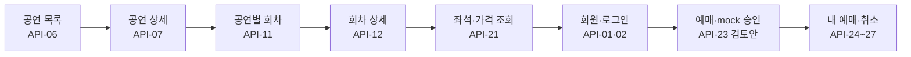

관람자의 서비스 여정 · 분석을 위한 설명 도식. 실제 실행 결과가 아니다.

각 번호를 아래 목록에서 찾으면 사용자 행동, 입출력, 관여 테이블, 거절 조건과 회의 질문을 함께 볼 수 있다. GET 조회는 예매 성공을 예약하지 않는다. 좌석 조회 뒤 다른 사람이 먼저 예매할 수 있으므로 생성 TX에서 재검사가 필요하다.

<a id="user-journey-detailed"></a>

## 추가 분석: 사용자가 서비스를 타고 가는 상세 흐름

아래는 현재 27개 API 초안을 사용자의 화면·행동 순서로 연결한 **서비스 동선 제안**이다. 화면 이름은 이해를 위한 이름이며, 구현된 화면이나 확정된 Jinja2 HTML 라우트가 아니다. 조회·입력 검증·오류 처리를 어느 지점에서 만나는지 보여 주기 위한 분석이다.

특히 예매·결제·환불 도식은 원본 초안의 “단일 예매 요청에서 mock 승인·확정 / 동기 mock 환불” 검토안을 따른다. HELD 유지 여부와 저장 구조가 확정되면 해당 구간을 함께 수정해야 한다. 선점·결제 대기·티켓 발급 API를 현재 구현된 기능처럼 추가하지 않았다.

### 상하 도식 읽는 방법

각 A~G 단계는 **위쪽 사용자 동선 → 바로 아래 시스템 처리 순서**로 배치했다. 위쪽은 화면에서 무엇을 보고 선택하는지, 아래쪽은 그 행동이 요청·조회·저장·응답으로 어떻게 이어지는지를 보여 준다. 아래쪽의 번호는 통신 순서이며 위쪽의 노드 수와 일대일 대응을 뜻하지 않는다.

| 시스템 도식의 참여자 | 뜻 |
| --- | --- |
| 클라이언트 UI 코드 | 사용자가 보는 화면·폼·이벤트 처리. 브라우저 안의 논리적 역할이다. |
| 브라우저 HTTP 실행 | 폼 제출·이동·요청 전송·응답 수신을 실행하는 브라우저의 역할이다. 클라이언트와 별도 물리 장비가 아니다. |
| FastAPI 서버 | 인증·입력·업무 규칙을 검사하고 조회·TX를 조율한다. 내부에는 presentation/application/domain/infrastructure 책임이 있다. |
| DB | 서버 요청에 따라 조회·잠금·저장·커밋/롤백을 처리한다. 브라우저가 직접 접속하지 않는다. |

아래 도식은 기존 JSON API 초안 기준이다. Jinja2의 서버 렌더링 화면·폼 라우트나 fetch 사용 여부는 별도 화면 계약으로 정해야 한다. “서버 → 브라우저 → UI”를 모든 경우에 JSON 클라이언트 렌더링 구현으로 확정한 뜻은 아니다.

### A. 처음 방문부터 예매 확인·취소까지

**위쪽 · 사용자 행동과 화면 흐름**

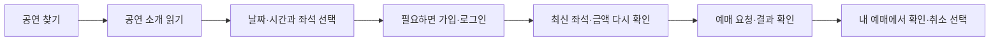

**아래쪽 · 클라이언트 → 브라우저 → 서버 → DB 처리 흐름**

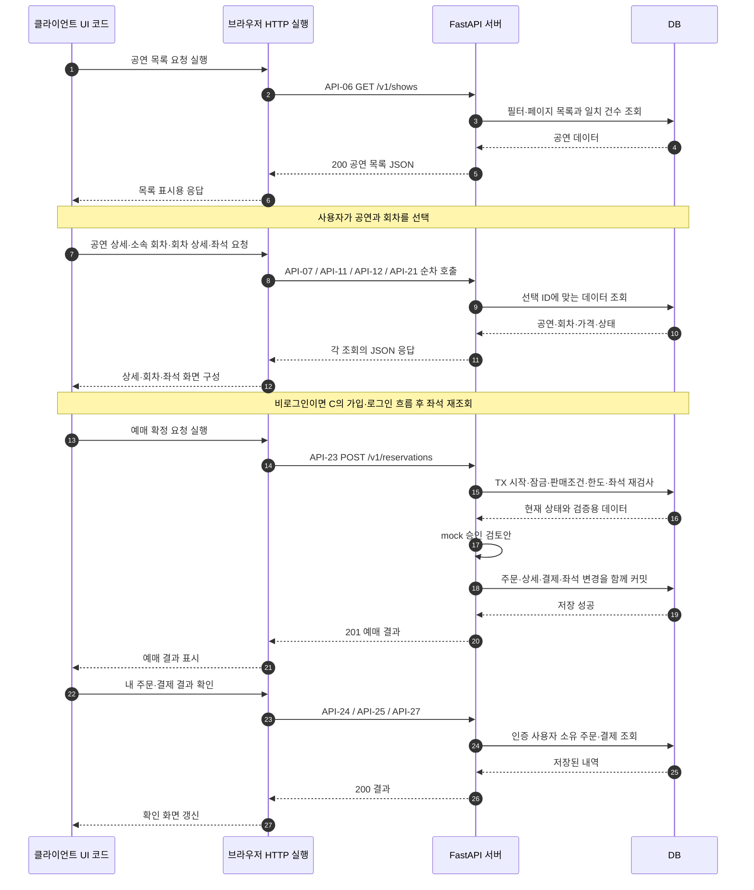

이 흐름의 중심은 “다음 버튼”보다 **직전 결과에서 받은 ID를 다음 요청에 전달하는 것**이다.

| 사용자가 고른 것 | 이어지는 값 | 다음에 필요한 이유 |
| --- | --- | --- |
| 공연 카드 | `show_id` | 공연 상세와 해당 공연의 회차를 찾는다. |
| 공연 날짜·시간 | `perf_id` | 그 회차의 예매 기간·한도·좌석을 찾는다. |
| 좌석 | `perf_seat_id`들의 배열 | 실제 예매할 회차별 좌석 재고를 지정한다. 기본 좌석의 `seat_id`와 다르다. |
| 확정된 주문 | `reserv_id` | 예매 상세·결제·취소 대상을 찾는다. |

### B. 비회원이 공연을 탐색할 때 만나는 분기

**위쪽 · 사용자 행동과 화면 흐름**

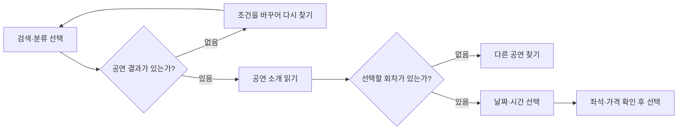

**아래쪽 · 클라이언트 → 브라우저 → 서버 → DB 처리 흐름**

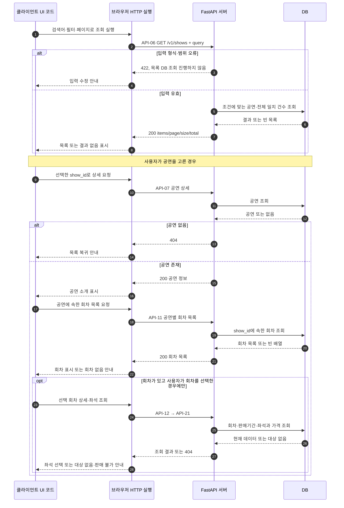

화면이 예매 가능 여부를 미리 알려 주어도, **서버는 최종 예매 요청 때 다시 검사**해야 한다. 여기서 매진 여부를 보여 주는 방식이나 판매 전·종료 회차를 숨길지는 팀의 화면·정책 합의가 필요하다. 이미 고른 회차가 삭제·변경된 경우의 404도 상세 재조회 단계에서 안내해야 한다.

### C. 로그인 때문에 예매 흐름이 끊겼다가 돌아오는 경우

**위쪽 · 사용자 행동과 화면 흐름**

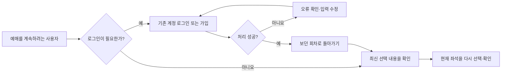

**아래쪽 · 클라이언트 → 브라우저 → 서버 → DB 처리 흐름**

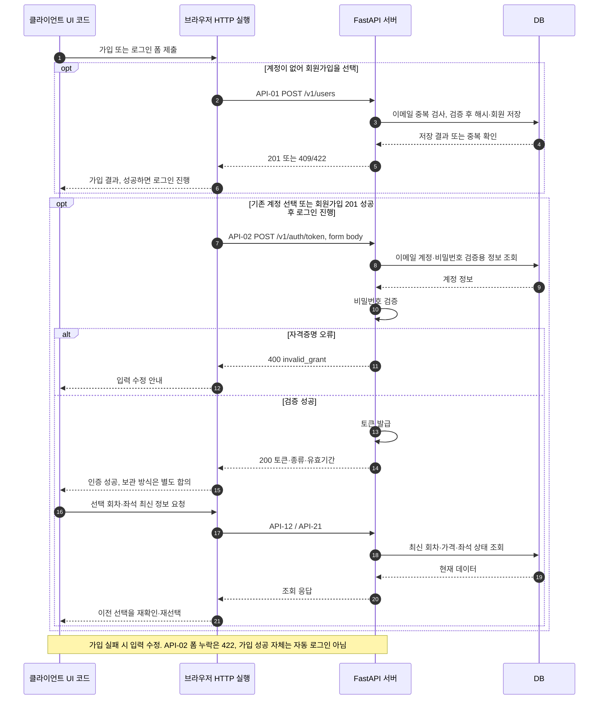

선택 회차로 복귀하는 방식, 로그인 전 선택값의 보관 위치·기간은 아직 이 API 명세가 확정하지 않은 화면 계약이다. 로그인 성공이 이전 좌석의 소유권을 만들어 주지는 않는다. 회원가입 성공 응답도 이 초안에서는 자동 로그인 토큰을 포함하지 않으므로 로그인 요청을 별도로 연결했다.

### D. 예매 버튼 이후: 성공·좌석 충돌·한도·결제 실패

**위쪽 · 사용자 행동과 화면 흐름**

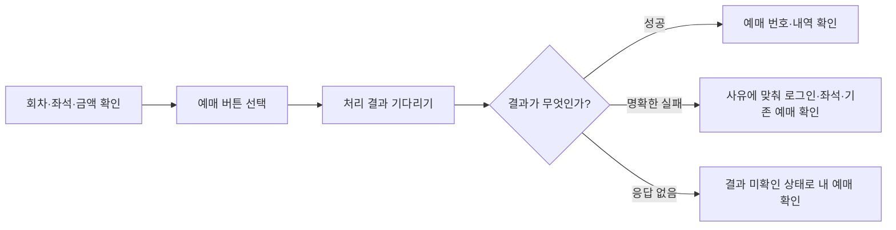

**아래쪽 · 클라이언트 → 브라우저 → 서버 → DB 처리 흐름**

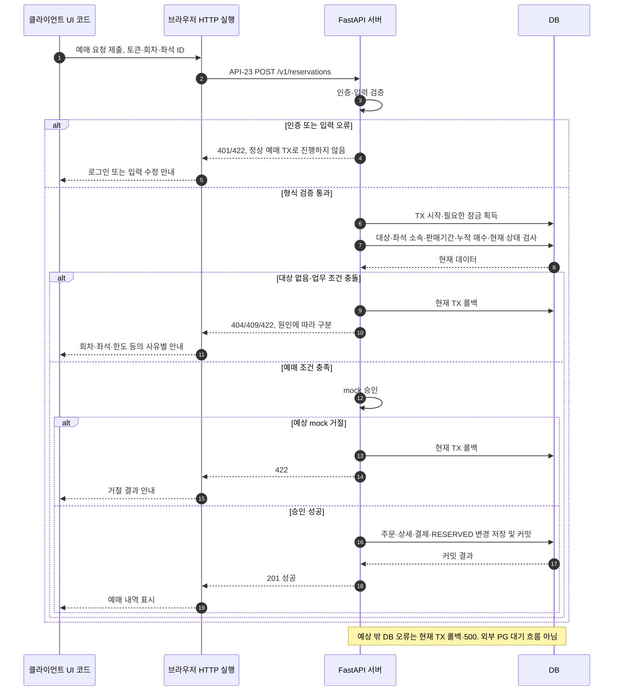

이 그림은 현재 **단일 TX의 mock 승인·확정 검토안**을 설명한다. 외부 PG 결제나 결제 화면에서 기다리는 동안 DB 잠금을 유지하는 흐름이 아니다. HELD가 유지된다면 소유자·만료·선점 해제·결제 확정 절차를 별도로 설계해야 한다.

한도 초과를 단순한 “다른 좌석 선택”으로 안내하면 같은 문제가 반복될 수 있다. 좌석 충돌이면 재조회·재선택, 매수 한도면 기존 유효 예매 확인, 판매 종료면 다른 회차 선택 등 **409의 업무 원인별 화면 안내**를 나누는 것이 좋다.

### E. 내 예매에서 전체 취소·환불 결과를 확인하는 경우

**위쪽 · 사용자 행동과 화면 흐름**

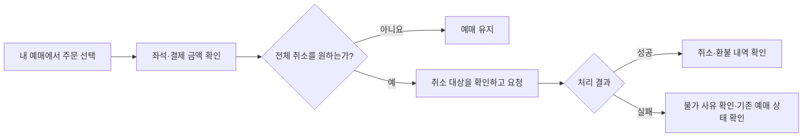

**아래쪽 · 클라이언트 → 브라우저 → 서버 → DB 처리 흐름**

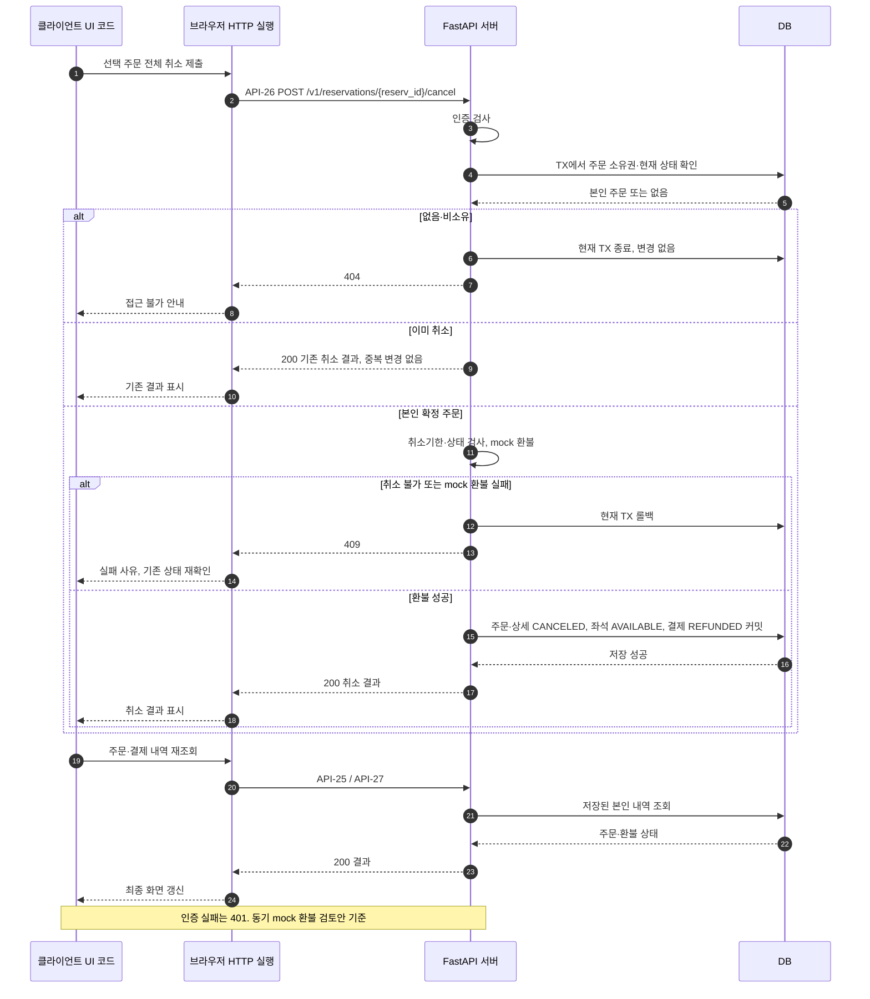

현재 초안은 동기 mock 환불안이므로 이 그림에서 “환불 대기 PENDING” 화면을 임의로 확정하지 않았다. 비동기 환불을 택한다면 실패·재시도와 환불 상태를 보존하는 구조부터 보완해야 한다. 예매 가능 매수는 취소된 주문을 유효 확정 매수 합계에서 제외하는 방향이며, 별도 한도 테이블이 이미 있다고 가정하지 않는다.

### F. 예매 요청 뒤 통신이 끊겨 성공 여부를 모르는 경우

**위쪽 · 사용자 행동과 화면 흐름**

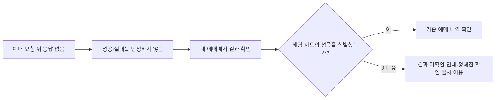

**아래쪽 · 클라이언트 → 브라우저 → 서버 → DB 처리 흐름**

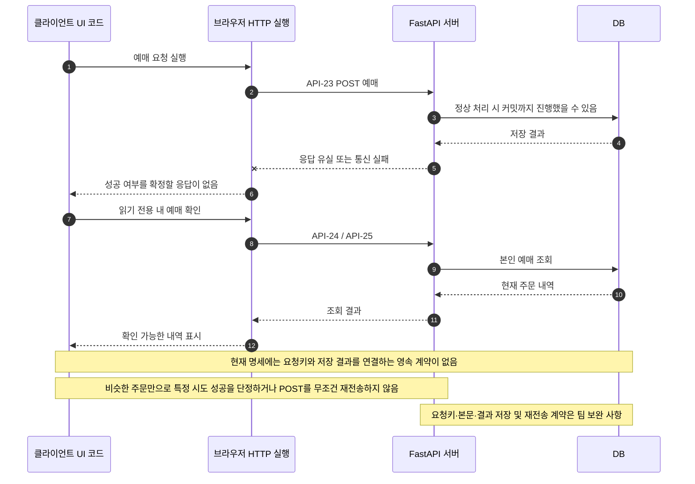

현재 ERD·초안만으로는 요청키와 성공 결과를 연결해 보존하는 장치가 확인되지 않았다. **내 예매 목록에 비슷한 주문이 있다는 것만으로 특정 요청의 성공을 확정하면 안 된다.** 무조건 POST를 다시 보내는 대신, 성공 결과 식별과 안전한 재시도 계약을 팀이 보완해야 한다.

### G. 내 정보 확인과 로그아웃으로 서비스를 나가는 경우

**위쪽 · 사용자 행동과 화면 흐름**

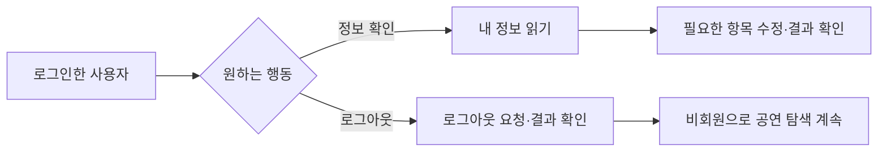

**아래쪽 · 클라이언트 → 브라우저 → 서버 → DB 처리 흐름**

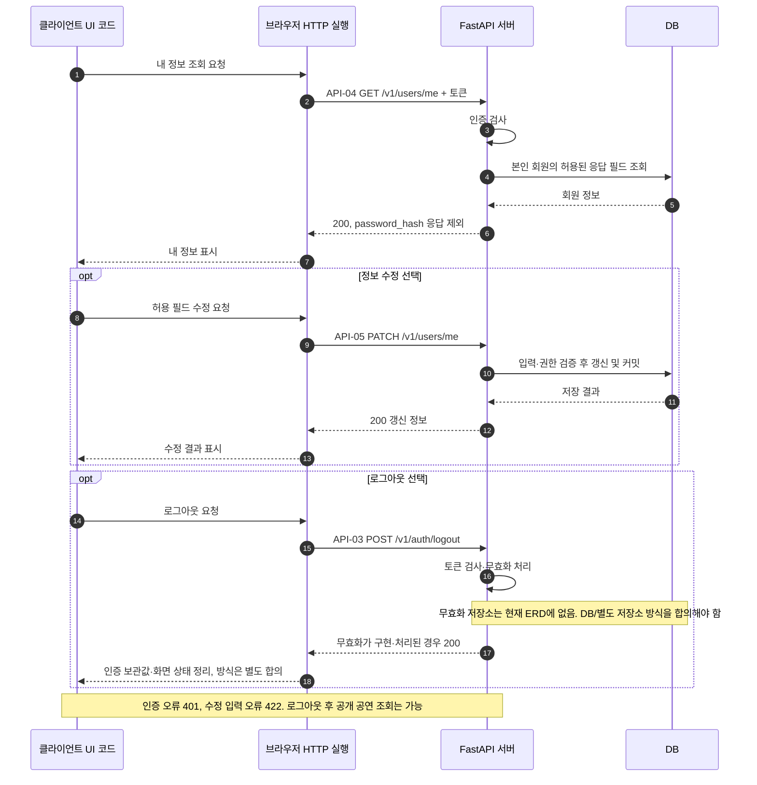

클라이언트에서 토큰을 지웠다는 사실만으로 이미 발급된 토큰의 서버 측 무효화가 완료되지는 않는다. 화면 이동·인증 보관 방식은 별도 계약이며, 현재 ERD에 없는 블랙리스트 저장소의 동작을 구현 완료로 표시하지 않는다.

### 사용자 동선에 대해 회의에서 맞출 부분

| 시점 | 회의에서 확인할 내용 |
| --- | --- |
| 첫 진입·목록 | 포스터·공연장 이름·검색·정렬·페이지와 판매 전/종료 공연 노출 |
| 회차 선택 | 날짜·판매시간 표시, 회차 없음·매진 안내, 다른 회차로 돌아가기 |
| 로그인 전후 | 로그인 필요 시점, 가입 후 로그인, 선택값 보관·복귀·재조회 |
| 예매 확정 | HELD 유지 여부, 최종 금액 확인, mock 승인·확정의 TX 경계 |
| 실패·응답 유실 | 오류별 재진입 위치, 성공 결과 식별, 중복 클릭·안전한 재시도 |
| 취소·환불 | 전체 취소 확인 UI, 취소기한, 동기/비동기 환불, 실패 안내 |
| 로그아웃 | 인증 상태 정리, 토큰 무효화 저장소, 로그아웃 후 공개 화면 이동 |

<a id="erd"></a>

## 9테이블을 서비스 역할로 읽기

**판매 데이터 연결**

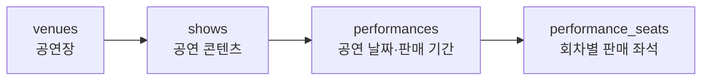

판매 데이터 연결 · 분석을 위한 설명 도식. 실제 실행 결과가 아니다.

**기본 좌석과 주문의 연결**

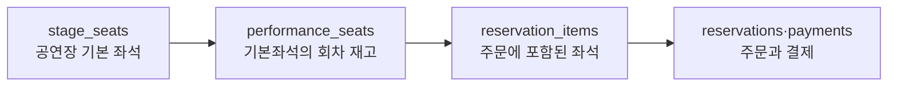

기본 좌석과 주문의 연결 · 분석을 위한 설명 도식. 실제 실행 결과가 아니다.

| 테이블 | 역할 | 핵심 연결 | API에서 주의 |
| --- | --- | --- | --- |
| users | 회원·역할·인증 정보 | reservations.user_id | password_hash 응답 제외, 현재 사용자로 소유권 검사 |
| venues | 공연장 위치 | shows.venues_id / stage_seats.venues_id | 공연장 ID와 공연명은 다른 정보 |
| stage_seats | 공연장 기본 좌석 | seat_id ← performance_seats.stage_seat_id | 좌석 배치이고 그 자체가 회차 재고는 아님 |
| shows | 공연 콘텐츠 | show_id ← performances.show_id | 공연일과 좌석 가격을 직접 가진 테이블이 아님 |
| performances | 공연 회차·판매 기간·한도 | perf_id ← performance_seats / reservations | 타임존·기간 경계·누적 한도 |
| performance_seats | 회차별 가격·상태 | perf_seat_id ← reservation_items | 동시성 제어와 최종 재검사 필요 |
| reservations | 주문 묶음 | reserv_id ← 상세·결제 | 수량·총액은 서버 계산 |
| reservation_items | 주문의 좌석별 내역 | reserv_id + perf_seat_id | 예매 당시 가격과 취소 내역 보존 |
| payments | 결제·환불 기록 | reserv_id | 단수 결제 조회는 1건 제약 합의 필요 |

관계의 역할을 설명한 표다. ERD 선이나 화면상 PK 확인이 실제 PostgreSQL의 FK/UNIQUE 적용을 증명하지는 않는다. shows에 SELLER 소유자 컬럼, 별도 tickets·hold·blacklist 테이블은 현재 기준에서 확인되지 않았다.

<a id="contract"></a>

## 전체 API에 공통인 계약

| 항목 | 초안 제안 | 설명 |
| --- | --- | --- |
| URL | /v1 + 복수 자원명 | Method와 Path를 한 쌍으로 식별 |
| Header | Accept / Content-Type / Authorization | 본문 형식·수신 형식·접근 증표 구분 |
| 인증 | 공개 / 회원 / ADMIN | SELLER별 소유권은 별도 설계 필요 |
| 시간 | 오프셋 포함 ISO 8601 | 날짜 필터는 Asia/Seoul 기준 제안 |
| 금액 | NUMERIC에 대응한 문자열 | 예: "100000.00". 통화·소수점 정책 합의 |
| 페이지 | page=1, size=20, total | total은 같은 필터 조건 전체 건수 |
| ID | show_id / perf_id / reserv_id 등 | 기존 다른 별칭과 혼용 금지 |
| 오류 | 401·403·404·409·422 | 토큰 실패·권한·없음·충돌·검증 구분 |
| 응답 검증 | 명시적 Pydantic response_model | DB 모델 전체를 자동 노출하지 않음 |

```text
오류 형식 제안
{"detail":{"code":"SHOW_NOT_FOUND","message":"공연을 찾을 수 없습니다."}}

401 보호 API 오류 헤더 제안
WWW-Authenticate: Bearer
```

FastAPI의 기본 검증 오류 detail 배열과 위 공통 객체는 다르다. 전역 핸들러로 통일할지 기본값을 둘지 결정해야 한다. 각 응답 예시는 현재 초안의 예상 결과이며 실측 결과가 아니다.

<a id="prepare"></a>

## 01 판매 데이터 준비

데이터를 판매 가능한 상태로 준비한다. 공연장과 기본 좌석을 만들고, 공연·회차를 등록한 뒤 해당 회차의 판매 좌석을 구성한다. 관리자 API를 구현하지 않으면 시드 데이터로 준비하는 범위도 가능하다.

**01 판매 데이터 준비**

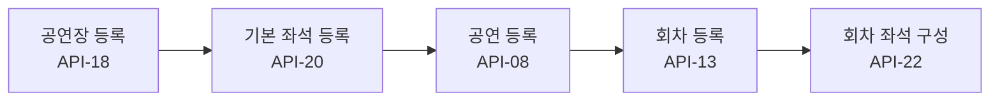

01 판매 데이터 준비 · 분석을 위한 설명 도식. 실제 실행 결과가 아니다.

| ID | 기능 | Method | Path | 담당 |
| --- | --- | --- | --- | --- |
| [API-08](#api-08) | 공연 등록 | POST | `/v1/shows` | 공연·회차 담당 |
| [API-13](#api-13) | 회차 등록 | POST | `/v1/shows/{show_id}/performances` | 공연·회차 담당 |
| [API-18](#api-18) | 공연장 등록 | POST | `/v1/venues` | 미정 |
| [API-20](#api-20) | 기본 좌석 등록 | POST | `/v1/venues/{venues_id}/seats` | 미정 |
| [API-22](#api-22) | 회차 판매 좌석 구성 | POST | `/v1/performances/{perf_id}/seats` | 미정 |

<a id="api-18"></a>

POST`/v1/venues`

#### API-18 · 공연장 등록

미정 · 관리 기능·팀 범위 합의 · 테스트 미실시

**이 호출의 역할:** 관리자 검사 → 필수 주소·이름 검사 → 저장

**관여 데이터:** venues

**공연장 등록 처리 순서**


공연장 등록 처리 순서 · 분석을 위한 설명 도식. 실제 실행 결과가 아니다.

#### 요청 상세 · 원본 계약

```text
header
{
  "Accept": "application/json",
  "Content-Type": "application/json",
  "Authorization": "Bearer <access_token>"
}

path / query
없음

body
{
  "name": "예시 공연장",
  "address": "예시 주소",
  "address_detail": null,
  "post_no": null
}
```

#### 응답 상세 · 예상 예시

```text
HTTP 201
header
{
  "Content-Type": "application/json",
  "Location": "/v1/venues/1"
}

body
{
  "venues_id": 1,
  "name": "예시 공연장",
  "address": "예시 주소",
  "address_detail": null,
  "post_no": null
}

실패
401/403 인증·권한; 422 입력 오류
```

#### 요청을 이렇게 나눈 이유

별도 Path/Query 입력 없음.

| Body 필드 | 예시 타입 | 의미 | 왜 필요한가 / 확인 사항 | 예시 |
| --- | --- | --- | --- | --- |
| `name` | string | 이름 | 회원 표시 이름 또는 공연장/구역 이름. 테이블 맥락에 따라 길이와 의미가 다르다. | `"예시 공연장"` |
| `address` | string | 주소 | 공연장 위치 또는 회원 선택 정보. 대상에 따라 필요 범위가 다르다. | `"예시 주소"` |
| `address_detail` | null 허용 값 | 상세 주소 | 선택 보충 정보로 null 허용. | `null` |
| `post_no` | null 허용 값 | 우편번호 | 주소 정보 보완. 선택값. | `null` |

Authorization으로 현재 사용자를 확인한다. ADMIN 역할도 검사한다. Body가 있으면 그 전송 형식을 Content-Type에 적고, Accept에는 받고 싶은 응답 형식을 적는다.

#### 응답의 각 필드: 왜 돌려주는가?

| 필드 경로 | 예시 타입 | 의미 | 포함한 이유 / 확인 사항 | 예시 |
| --- | --- | --- | --- | --- |
| `venues_id` | integer | 공연장 ID | 공연과 실제 장소, 기본 좌석 구성을 연결한다. 이름 표시에는 조인이 필요하다. | `1` |
| `name` | string | 이름 | 회원 표시 이름 또는 공연장/구역 이름. 테이블 맥락에 따라 길이와 의미가 다르다. | `"예시 공연장"` |
| `address` | string | 주소 | 공연장 위치 또는 회원 선택 정보. 대상에 따라 필요 범위가 다르다. | `"예시 주소"` |
| `address_detail` | null 허용 값 | 상세 주소 | 선택 보충 정보로 null 허용. | `null` |
| `post_no` | null 허용 값 | 우편번호 | 주소 정보 보완. 선택값. | `null` |

#### 실패 조건과 데이터 보호

401/403 인증·권한; 422 입력 오류

name/address 필수. name<=200, address/address_detail<=255, post_no<=20. ID 서버 생성.

#### 팀 회의에서 확인할 것

현재 화면에서 필요한 기능인지, 입력 한도·중복 제약, 조회 없음과 상태 충돌 응답, 담당과 구현 순서를 확정한다. 관리 생성이 시드로 대체되는지도 확인한다.

<a id="api-20"></a>

POST`/v1/venues/{venues_id}/seats`

#### API-20 · 기본 좌석 등록

미정 · 관리 기능·팀 범위 합의 · 테스트 미실시

**이 호출의 역할:** 공연장 존재 → 좌석번호 중복 검사 → 기본 좌석 생성

**관여 데이터:** venues + stage_seats

**기본 좌석 등록 처리 순서**


기본 좌석 등록 처리 순서 · 분석을 위한 설명 도식. 실제 실행 결과가 아니다.

#### 요청 상세 · 원본 계약

```text
header
{
  "Accept": "application/json",
  "Content-Type": "application/json",
  "Authorization": "Bearer <access_token>"
}

path / query
path: venues_id:int >0

body
{
  "seat_number": "A-01",
  "seat_grade": "R",
  "name": "1층 A구역"
}
```

#### 응답 상세 · 예상 예시

```text
HTTP 201
header
{
  "Content-Type": "application/json",
  "Location": "/v1/venues/1/seats"
}

body
{
  "seat_id": 101,
  "venues_id": 1,
  "seat_number": "A-01",
  "seat_grade": "R",
  "name": "1층 A구역"
}

실패
401/403 인증·권한; 404 공연장 없음; 409 좌석번호 중복; 422 입력 오류
```

#### 요청을 이렇게 나눈 이유

| 필드 | 전달 위치 | 필요한 이유 |
| --- | --- | --- |
| venues_id | Path / 필수 | 공연과 실제 장소, 기본 좌석 구성을 연결한다. 이름 표시에는 조인이 필요하다. |

| Body 필드 | 예시 타입 | 의미 | 왜 필요한가 / 확인 사항 | 예시 |
| --- | --- | --- | --- | --- |
| `seat_number` | string | 좌석 번호 | 사용자가 볼 A-01 같은 표시값. 공연장 내 중복 금지 제안. | `"A-01"` |
| `seat_grade` | string | 좌석 등급 | 좌석의 R/VIP 등 분류. 공연 예상 수요 A/B/C와 다르다. | `"R"` |
| `name` | string | 이름 | 회원 표시 이름 또는 공연장/구역 이름. 테이블 맥락에 따라 길이와 의미가 다르다. | `"1층 A구역"` |

Authorization으로 현재 사용자를 확인한다. ADMIN 역할도 검사한다. Body가 있으면 그 전송 형식을 Content-Type에 적고, Accept에는 받고 싶은 응답 형식을 적는다.

#### 응답의 각 필드: 왜 돌려주는가?

| 필드 경로 | 예시 타입 | 의미 | 포함한 이유 / 확인 사항 | 예시 |
| --- | --- | --- | --- | --- |
| `seat_id` | integer | 기본 좌석 ID | stage_seats의 PK. 회차별 판매 좌석 ID와 구분한다. | `101` |
| `venues_id` | integer | 공연장 ID | 공연과 실제 장소, 기본 좌석 구성을 연결한다. 이름 표시에는 조인이 필요하다. | `1` |
| `seat_number` | string | 좌석 번호 | 사용자가 볼 A-01 같은 표시값. 공연장 내 중복 금지 제안. | `"A-01"` |
| `seat_grade` | string | 좌석 등급 | 좌석의 R/VIP 등 분류. 공연 예상 수요 A/B/C와 다르다. | `"R"` |
| `name` | string | 이름 | 회원 표시 이름 또는 공연장/구역 이름. 테이블 맥락에 따라 길이와 의미가 다르다. | `"1층 A구역"` |

#### 실패 조건과 데이터 보호

401/403 인증·권한; 404 공연장 없음; 409 좌석번호 중복; 422 입력 오류

name/seat_number 필수. 공연장 안 좌석번호 중복 금지 제안. 기본 좌석은 판매 재고가 아님.

#### 팀 회의에서 확인할 것

현재 화면에서 필요한 기능인지, 입력 한도·중복 제약, 조회 없음과 상태 충돌 응답, 담당과 구현 순서를 확정한다. 관리 생성이 시드로 대체되는지도 확인한다.

<a id="api-08"></a>

POST`/v1/shows`

#### API-08 · 공연 등록

공연·회차 담당 · 관리 기능·팀 범위 합의 · 테스트 미실시

**이 호출의 역할:** 관리자 검사 → 공연장 존재·입력 검증 → 공연 생성

**관여 데이터:** shows + venues

**공연 등록 처리 순서**

```mermaid
flowchart LR
    N0["요청 수신<br/>POST"]
    N1["인증·입력 검증<br/>ADMIN"]
    N2["규칙 검사·변경 TX"]
    N3["201 응답<br/>계약 필드로 구성"]
    N0 --> N1
    N1 --> N2
    N2 --> N3
```

공연 등록 처리 순서 · 분석을 위한 설명 도식. 실제 실행 결과가 아니다.

#### 요청 상세 · 원본 계약

```text
header
{
  "Accept": "application/json",
  "Content-Type": "application/json",
  "Authorization": "Bearer <access_token>"
}

path / query
없음

body
{
  "venues_id": 1,
  "title": "AsyncTicket 콘서트",
  "description": "공연 소개",
  "performer": "예시 아티스트",
  "type": "CONCERT",
  "runtime": 120
}
```

#### 응답 상세 · 예상 예시

```text
HTTP 201
header
{
  "Content-Type": "application/json",
  "Location": "/v1/shows/1"
}

body
{
  "show_id": 1,
  "venues_id": 1,
  "title": "AsyncTicket 콘서트",
  "description": "공연 소개",
  "performer": "예시 아티스트",
  "type": "CONCERT",
  "runtime": 120,
  "created_at": "2026-10-29T09:00:00+09:00",
  "updated_at": null
}

실패
401 인증 실패; 403 관리자 아님; 404 공연장 없음; 422 입력 오류
```

#### 요청을 이렇게 나눈 이유

별도 Path/Query 입력 없음.

| Body 필드 | 예시 타입 | 의미 | 왜 필요한가 / 확인 사항 | 예시 |
| --- | --- | --- | --- | --- |
| `venues_id` | integer | 공연장 ID | 공연과 실제 장소, 기본 좌석 구성을 연결한다. 이름 표시에는 조인이 필요하다. | `1` |
| `title` | string | 공연명 | 목록·상세의 핵심 표시값. 공백 금지·255자 이하. | `"AsyncTicket 콘서트"` |
| `description` | string | 공연 소개 | 상세 설명. 목록에 긴 소개를 모두 포함할지는 검토한다. | `"공연 소개"` |
| `performer` | string | 출연자 | 누구의 공연인지 보여 준다. 선택값·255자 이하. | `"예시 아티스트"` |
| `type` | string | 공연 종류 | 분류 표시·필터링. CONCERT 등 값 목록은 팀 합의 전. | `"CONCERT"` |
| `runtime` | integer | 러닝타임 | 관람 소요 시간. 분 단위·양수 제안, null 가능. | `120` |

Authorization으로 현재 사용자를 확인한다. ADMIN 역할도 검사한다. Body가 있으면 그 전송 형식을 Content-Type에 적고, Accept에는 받고 싶은 응답 형식을 적는다.

#### 응답의 각 필드: 왜 돌려주는가?

| 필드 경로 | 예시 타입 | 의미 | 포함한 이유 / 확인 사항 | 예시 |
| --- | --- | --- | --- | --- |
| `show_id` | integer | 공연 ID | 공연 자체를 식별하고 상세·회차 조회로 연결한다. | `1` |
| `venues_id` | integer | 공연장 ID | 공연과 실제 장소, 기본 좌석 구성을 연결한다. 이름 표시에는 조인이 필요하다. | `1` |
| `title` | string | 공연명 | 목록·상세의 핵심 표시값. 공백 금지·255자 이하. | `"AsyncTicket 콘서트"` |
| `description` | string | 공연 소개 | 상세 설명. 목록에 긴 소개를 모두 포함할지는 검토한다. | `"공연 소개"` |
| `performer` | string | 출연자 | 누구의 공연인지 보여 준다. 선택값·255자 이하. | `"예시 아티스트"` |
| `type` | string | 공연 종류 | 분류 표시·필터링. CONCERT 등 값 목록은 팀 합의 전. | `"CONCERT"` |
| `runtime` | integer | 러닝타임 | 관람 소요 시간. 분 단위·양수 제안, null 가능. | `120` |
| `created_at` | string | 생성시각 | 서버가 기록하는 생성 정보. 클라이언트 입력 제외, 목록 필요성 검토. | `"2026-10-29T09:00:00+09:00"` |
| `updated_at` | null 허용 값 | 수정시각 | 서버가 기록하는 수정 정보. 미수정이면 null 가능. | `null` |

#### 실패 조건과 데이터 보호

401 인증 실패; 403 관리자 아님; 404 공연장 없음; 422 입력 오류

관리자 쓰기 권한 제안. SELLER 소유자 컬럼이 없어 판매자별 소유권 제한은 현재 ERD로 확인 불가. title 1~255, type 1~50, runtime null 또는 양수(분), venues_id 기존 공연장. created_at/show_id 서버 생성.

#### 팀 회의에서 확인할 것

관리 CRUD가 필수 범위인지, ADMIN/SELLER 권한과 소유권, 이미 판매·예매된 데이터 수정/삭제 금지 범위, 회차번호 유일성·시간순서·최대 매수를 합의한다. 삭제와 공연 취소는 다른 시나리오다.

<a id="api-13"></a>

POST`/v1/shows/{show_id}/performances`

#### API-13 · 회차 등록

공연·회차 담당 · 관리 기능·팀 범위 합의 · 테스트 미실시

**이 호출의 역할:** 공연 존재 → 시간·번호·한도 검사 → 회차 저장. 좌석 구성은 별도

**관여 데이터:** shows + performances

**회차 등록 처리 순서**

```mermaid
flowchart LR
    N0["요청 수신<br/>POST"]
    N1["인증·입력 검증<br/>ADMIN"]
    N2["규칙 검사·변경 TX"]
    N3["201 응답<br/>계약 필드로 구성"]
    N0 --> N1
    N1 --> N2
    N2 --> N3
```

회차 등록 처리 순서 · 분석을 위한 설명 도식. 실제 실행 결과가 아니다.

#### 요청 상세 · 원본 계약

```text
header
{
  "Accept": "application/json",
  "Content-Type": "application/json",
  "Authorization": "Bearer <access_token>"
}

path / query
path: show_id:int >0

body
{
  "round_number": 1,
  "starts_at": "2026-11-07T19:00:00+09:00",
  "ends_at": "2026-11-07T21:00:00+09:00",
  "booking_opens_at": "2026-11-01T10:00:00+09:00",
  "booking_closes_at": "2026-11-07T18:00:00+09:00",
  "max_tickets_per_user": 3,
  "status": "SCHEDULED"
}
```

#### 응답 상세 · 예상 예시

```text
HTTP 201
header
{
  "Content-Type": "application/json",
  "Location": "/v1/performances/10"
}

body
{
  "perf_id": 10,
  "show_id": 1,
  "round_number": 1,
  "starts_at": "2026-11-07T19:00:00+09:00",
  "ends_at": "2026-11-07T21:00:00+09:00",
  "booking_opens_at": "2026-11-01T10:00:00+09:00",
  "booking_closes_at": "2026-11-07T18:00:00+09:00",
  "max_tickets_per_user": 3,
  "status": "SCHEDULED"
}

실패
401/403 인증·권한; 404 공연 없음; 409 회차번호 중복; 422 시간순서/필수값 오류
```

#### 요청을 이렇게 나눈 이유

| 필드 | 전달 위치 | 필요한 이유 |
| --- | --- | --- |
| show_id | Path / 필수 | 공연 자체를 식별하고 상세·회차 조회로 연결한다. |

| Body 필드 | 예시 타입 | 의미 | 왜 필요한가 / 확인 사항 | 예시 |
| --- | --- | --- | --- | --- |
| `round_number` | integer | 회차 번호 | 공연 안 회차를 구분. 양수와 공연 내 중복 금지 제안. | `1` |
| `starts_at` | string | 시작 시각 | 회차 관람 시각. 시간대가 포함된 값을 사용한다. | `"2026-11-07T19:00:00+09:00"` |
| `ends_at` | string | 종료 시각 | 종료 예상 시각. starts_at보다 뒤인지 검사한다. | `"2026-11-07T21:00:00+09:00"` |
| `booking_opens_at` | string | 판매 시작 | 이 시각 이후 예매할 수 있는지 검사한다. | `"2026-11-01T10:00:00+09:00"` |
| `booking_closes_at` | string | 판매 종료 | 판매 종료 경계를 판단. closes <= starts 제안. | `"2026-11-07T18:00:00+09:00"` |
| `max_tickets_per_user` | integer | 회원별 회차 한도 | 누적 유효 확정 매수 제한. 기본 3과 고정 3 중 어느 정책인지 합의. | `3` |
| `status` | string | 업무 상태 | 좌석·예매·회차·결제마다 의미가 다르다. 문자열 컬럼만으로 허용 상태가 확정되지 않는다. | `"SCHEDULED"` |

Authorization으로 현재 사용자를 확인한다. ADMIN 역할도 검사한다. Body가 있으면 그 전송 형식을 Content-Type에 적고, Accept에는 받고 싶은 응답 형식을 적는다.

#### 응답의 각 필드: 왜 돌려주는가?

| 필드 경로 | 예시 타입 | 의미 | 포함한 이유 / 확인 사항 | 예시 |
| --- | --- | --- | --- | --- |
| `perf_id` | integer | 회차 ID | 같은 공연의 특정 날짜·시간 회차를 식별한다. | `10` |
| `show_id` | integer | 공연 ID | 공연 자체를 식별하고 상세·회차 조회로 연결한다. | `1` |
| `round_number` | integer | 회차 번호 | 공연 안 회차를 구분. 양수와 공연 내 중복 금지 제안. | `1` |
| `starts_at` | string | 시작 시각 | 회차 관람 시각. 시간대가 포함된 값을 사용한다. | `"2026-11-07T19:00:00+09:00"` |
| `ends_at` | string | 종료 시각 | 종료 예상 시각. starts_at보다 뒤인지 검사한다. | `"2026-11-07T21:00:00+09:00"` |
| `booking_opens_at` | string | 판매 시작 | 이 시각 이후 예매할 수 있는지 검사한다. | `"2026-11-01T10:00:00+09:00"` |
| `booking_closes_at` | string | 판매 종료 | 판매 종료 경계를 판단. closes <= starts 제안. | `"2026-11-07T18:00:00+09:00"` |
| `max_tickets_per_user` | integer | 회원별 회차 한도 | 누적 유효 확정 매수 제한. 기본 3과 고정 3 중 어느 정책인지 합의. | `3` |
| `status` | string | 업무 상태 | 좌석·예매·회차·결제마다 의미가 다르다. 문자열 컬럼만으로 허용 상태가 확정되지 않는다. | `"SCHEDULED"` |

#### 실패 조건과 데이터 보호

401/403 인증·권한; 404 공연 없음; 409 회차번호 중복; 422 시간순서/필수값 오류

show_id는 경로에서 받음. perf_id 서버 생성. round_number 양수, max_tickets_per_user 기본 3. booking_opens_at < booking_closes_at <= starts_at < ends_at 제안. 동일 공연 round_number 중복 금지와 DB unique 보완 검토. 좌석 생성은 좌석 담당과 별도 계약.

#### 팀 회의에서 확인할 것

관리 CRUD가 필수 범위인지, ADMIN/SELLER 권한과 소유권, 이미 판매·예매된 데이터 수정/삭제 금지 범위, 회차번호 유일성·시간순서·최대 매수를 합의한다. 삭제와 공연 취소는 다른 시나리오다.

<a id="api-22"></a>

POST`/v1/performances/{perf_id}/seats`

#### API-22 · 회차 판매 좌석 구성

미정 · 관리 기능·팀 범위 합의 · 테스트 미실시

**이 호출의 역할:** 관리자 검사 → 공연장 소속·중복·판매전 상태 검사 → 일괄 생성

**관여 데이터:** performances + shows + stage_seats + performance_seats

**회차 판매 좌석 구성 처리 순서**

```mermaid
flowchart LR
    N0["요청 수신<br/>POST"]
    N1["인증·입력 검증<br/>ADMIN"]
    N2["규칙 검사·변경 TX"]
    N3["201 응답<br/>계약 필드로 구성"]
    N0 --> N1
    N1 --> N2
    N2 --> N3
```

회차 판매 좌석 구성 처리 순서 · 분석을 위한 설명 도식. 실제 실행 결과가 아니다.

#### 요청 상세 · 원본 계약

```text
header
{
  "Accept": "application/json",
  "Content-Type": "application/json",
  "Authorization": "Bearer <access_token>"
}

path / query
path: perf_id:int >0

body
{
  "seats": [
    {
      "stage_seat_id": 101,
      "seat_grade": "R",
      "price": "100000.00",
      "status": "AVAILABLE"
    }
  ]
}
```

#### 응답 상세 · 예상 예시

```text
HTTP 201
header
{
  "Content-Type": "application/json",
  "Location": "/v1/performances/10/seats"
}

body
{
  "items": [
    {
      "perf_seat_id": 1001,
      "perf_id": 10,
      "stage_seat_id": 101,
      "seat_grade": "R",
      "price": "100000.00",
      "status": "AVAILABLE"
    }
  ]
}

실패
401/403 인증·권한; 404 회차/기본좌석 없음; 409 중복/판매개시; 422 금액/소속 오류
```

#### 요청을 이렇게 나눈 이유

| 필드 | 전달 위치 | 필요한 이유 |
| --- | --- | --- |
| perf_id | Path / 필수 | 같은 공연의 특정 날짜·시간 회차를 식별한다. |

| Body 필드 | 예시 타입 | 의미 | 왜 필요한가 / 확인 사항 | 예시 |
| --- | --- | --- | --- | --- |
| `seats` | array | 회차 좌석 생성 목록 | 여러 판매 좌석을 한 번에 구성. 전체 성공/실패 제안. | `아래 하위 필드 참조` |
| `seats[].stage_seat_id` | integer | 기본 좌석 참조 | 회차 좌석을 공연장의 seat_id에 연결한다. | `101` |
| `seats[].seat_grade` | string | 좌석 등급 | 좌석의 R/VIP 등 분류. 공연 예상 수요 A/B/C와 다르다. | `"R"` |
| `seats[].price` | string | 좌석 금액 | 기본 판매 가격 또는 예매 당시 가격. 응답은 Decimal 손실 방지를 위한 문자열 제안. | `"100000.00"` |
| `seats[].status` | string | 업무 상태 | 좌석·예매·회차·결제마다 의미가 다르다. 문자열 컬럼만으로 허용 상태가 확정되지 않는다. | `"AVAILABLE"` |

Authorization으로 현재 사용자를 확인한다. ADMIN 역할도 검사한다. Body가 있으면 그 전송 형식을 Content-Type에 적고, Accept에는 받고 싶은 응답 형식을 적는다.

#### 응답의 각 필드: 왜 돌려주는가?

| 필드 경로 | 예시 타입 | 의미 | 포함한 이유 / 확인 사항 | 예시 |
| --- | --- | --- | --- | --- |
| `items` | array | 결과/상세 배열 | 목록이면 여러 자원, 예매 상세면 주문 좌석 내역. 안쪽 타입을 함께 명시해야 한다. | `아래 하위 필드 참조` |
| `items[].perf_seat_id` | integer | 회차 좌석 ID | 실제로 예매할 회차의 좌석 재고를 식별한다. | `1001` |
| `items[].perf_id` | integer | 회차 ID | 같은 공연의 특정 날짜·시간 회차를 식별한다. | `10` |
| `items[].stage_seat_id` | integer | 기본 좌석 참조 | 회차 좌석을 공연장의 seat_id에 연결한다. | `101` |
| `items[].seat_grade` | string | 좌석 등급 | 좌석의 R/VIP 등 분류. 공연 예상 수요 A/B/C와 다르다. | `"R"` |
| `items[].price` | string | 좌석 금액 | 기본 판매 가격 또는 예매 당시 가격. 응답은 Decimal 손실 방지를 위한 문자열 제안. | `"100000.00"` |
| `items[].status` | string | 업무 상태 | 좌석·예매·회차·결제마다 의미가 다르다. 문자열 컬럼만으로 허용 상태가 확정되지 않는다. | `"AVAILABLE"` |

#### 실패 조건과 데이터 보호

401/403 인증·권한; 404 회차/기본좌석 없음; 409 중복/판매개시; 422 금액/소속 오류

좌석 일괄 생성 제안. 전부 성공/실패. 좌석이 회차 공연의 공연장 소속인지 검사. perf_id+stage_seat_id 중복 금지. 예매 오픈 전만 허용. 좌석 최대 일괄 수 팀 합의.

#### 팀 회의에서 확인할 것

현재 화면에서 필요한 기능인지, 입력 한도·중복 제약, 조회 없음과 상태 충돌 응답, 담당과 구현 순서를 확정한다. 관리 생성이 시드로 대체되는지도 확인한다.

<a id="browse"></a>

## 02 비회원 공연 탐색

로그인 없이 공연·회차·좌석을 둘러본다. 공연·회차의 기본 조회는 공연 목록·상세와 회차 목록·상세의 네 API다. 나머지 장소·좌석 조회는 화면에서 필요한 정보를 보완한다.

**02 비회원 공연 탐색**

```mermaid
flowchart LR
    N0["공연 목록·상세<br/>API-06·07"]
    N1["회차 목록·상세<br/>API-11·12"]
    N2["장소·기본 좌석<br/>API-16·17·19"]
    N3["회차 판매 좌석<br/>API-21"]
    N0 --> N1
    N1 --> N2
    N2 --> N3
```

02 비회원 공연 탐색 · 분석을 위한 설명 도식. 실제 실행 결과가 아니다.

| ID | 기능 | Method | Path | 담당 |
| --- | --- | --- | --- | --- |
| [API-06](#api-06) | 공연 목록 조회 | GET | `/v1/shows` | 공연·회차 담당 |
| [API-07](#api-07) | 공연 상세 조회 | GET | `/v1/shows/{show_id}` | 공연·회차 담당 |
| [API-11](#api-11) | 공연별 회차 목록 조회 | GET | `/v1/shows/{show_id}/performances` | 공연·회차 담당 |
| [API-12](#api-12) | 회차 상세 조회 | GET | `/v1/performances/{perf_id}` | 공연·회차 담당 |
| [API-16](#api-16) | 공연장 목록 | GET | `/v1/venues` | 미정 |
| [API-17](#api-17) | 공연장 상세 | GET | `/v1/venues/{venues_id}` | 미정 |
| [API-19](#api-19) | 공연장 기본 좌석 조회 | GET | `/v1/venues/{venues_id}/seats` | 미정 |
| [API-21](#api-21) | 회차 좌석·가격·상태 조회 | GET | `/v1/performances/{perf_id}/seats` | 미정 |

<a id="api-06"></a>

GET`/v1/shows`

#### API-06 · 공연 목록 조회

공연·회차 담당 · 기본 초안 · 테스트 미실시

**이 호출의 역할:** 검색·필터 검증 → 목록·전체 일치 건수 조회 → 응답 구성

**관여 데이터:** shows (필요 시 venues/performances 조인)

**공연 목록 조회 처리 순서**

```mermaid
flowchart LR
    N0["요청 수신<br/>GET"]
    N1["인증·입력 검증<br/>공개"]
    N2["읽기 전용 조회"]
    N3["200 응답<br/>계약 필드로 구성"]
    N0 --> N1
    N1 --> N2
    N2 --> N3
```

공연 목록 조회 처리 순서 · 분석을 위한 설명 도식. 실제 실행 결과가 아니다.

#### 요청 상세 · 원본 계약

```text
header
{
  "Accept": "application/json"
}

path / query
query: page:int=1 (>=1), size:int=20 (1~100), keyword:str? (title 검색), type:str?, venues_id:int? (>0)

body
없음
```

#### 응답 상세 · 예상 예시

```text
HTTP 200
header
{
  "Content-Type": "application/json"
}

body
{
  "items": [
    {
      "show_id": 1,
      "venues_id": 1,
      "title": "AsyncTicket 콘서트",
      "description": "공연 소개",
      "performer": "예시 아티스트",
      "type": "CONCERT",
      "runtime": 120,
      "created_at": "2026-10-29T09:00:00+09:00",
      "updated_at": null
    }
  ],
  "page": 1,
  "size": 20,
  "total": 1
}

실패
422 입력 형식 오류
```

#### 요청을 이렇게 나눈 이유

| 필드 | 전달 위치 | 필요한 이유 |
| --- | --- | --- |
| page | Query / 선택 | DB 컬럼이 아닌 목록 처리 계약. 생략 시 1, 양수 제안. |
| size | Query / 선택 | 반환할 최대 개수. 기본 20, 범위 1~100 제안. |
| keyword | Query / 선택 | DB 컬럼이 아니라 검색 조건. 제목만/출연자 포함 여부 결정 필요. |
| type | Query / 선택 | 분류 표시·필터링. CONCERT 등 값 목록은 팀 합의 전. |
| venues_id | Query / 선택 | 공연과 실제 장소, 기본 좌석 구성을 연결한다. 이름 표시에는 조인이 필요하다. |

요청 Body 없음. 경로·쿼리 조건과 인증 정보만 전달한다.

로그인 증표 없이 접근하는 공개 API 제안이다. Body가 있으면 그 전송 형식을 Content-Type에 적고, Accept에는 받고 싶은 응답 형식을 적는다.

#### 응답의 각 필드: 왜 돌려주는가?

| 필드 경로 | 예시 타입 | 의미 | 포함한 이유 / 확인 사항 | 예시 |
| --- | --- | --- | --- | --- |
| `items` | array | 결과/상세 배열 | 목록이면 여러 자원, 예매 상세면 주문 좌석 내역. 안쪽 타입을 함께 명시해야 한다. | `아래 하위 필드 참조` |
| `items[].show_id` | integer | 공연 ID | 공연 자체를 식별하고 상세·회차 조회로 연결한다. | `1` |
| `items[].venues_id` | integer | 공연장 ID | 공연과 실제 장소, 기본 좌석 구성을 연결한다. 이름 표시에는 조인이 필요하다. | `1` |
| `items[].title` | string | 공연명 | 목록·상세의 핵심 표시값. 공백 금지·255자 이하. | `"AsyncTicket 콘서트"` |
| `items[].description` | string | 공연 소개 | 상세 설명. 목록에 긴 소개를 모두 포함할지는 검토한다. | `"공연 소개"` |
| `items[].performer` | string | 출연자 | 누구의 공연인지 보여 준다. 선택값·255자 이하. | `"예시 아티스트"` |
| `items[].type` | string | 공연 종류 | 분류 표시·필터링. CONCERT 등 값 목록은 팀 합의 전. | `"CONCERT"` |
| `items[].runtime` | integer | 러닝타임 | 관람 소요 시간. 분 단위·양수 제안, null 가능. | `120` |
| `items[].created_at` | string | 생성시각 | 서버가 기록하는 생성 정보. 클라이언트 입력 제외, 목록 필요성 검토. | `"2026-10-29T09:00:00+09:00"` |
| `items[].updated_at` | null 허용 값 | 수정시각 | 서버가 기록하는 수정 정보. 미수정이면 null 가능. | `null` |
| `page` | integer | 현재 페이지 | DB 컬럼이 아닌 목록 처리 계약. 생략 시 1, 양수 제안. | `1` |
| `size` | integer | 페이지 크기 | 반환할 최대 개수. 기본 20, 범위 1~100 제안. | `20` |
| `total` | integer | 전체 일치 개수 | 현재 검색·필터 조건에 맞는 전체 건수. items 길이와 다를 수 있다. | `1` |

#### 실패 조건과 데이터 보호

422 입력 형식 오류

show_id 오름차순 기본 정렬 제안. 목록 없음은 items:[]와 total:0. type 허용값은 팀 합의.

#### 팀 회의에서 확인할 것

카드에 필요한 값(포스터·공연장 이름·첫 공연일), 제목/출연자 검색 범위, 필터·정렬, page/size/total, 회차 없는 공연·종료 공연 공개 여부를 합의한다. 존재하지 않는 venues_id 필터는 빈 목록/404 중 정책 미정.

<a id="api-07"></a>

GET`/v1/shows/{show_id}`

#### API-07 · 공연 상세 조회

공연·회차 담당 · 기본 초안 · 테스트 미실시

**이 호출의 역할:** show_id 조회 → 없으면 404 → 응답 구성

**관여 데이터:** shows

**공연 상세 조회 처리 순서**

```mermaid
flowchart LR
    N0["요청 수신<br/>GET"]
    N1["인증·입력 검증<br/>공개"]
    N2["읽기 전용 조회"]
    N3["200 응답<br/>계약 필드로 구성"]
    N0 --> N1
    N1 --> N2
    N2 --> N3
```

공연 상세 조회 처리 순서 · 분석을 위한 설명 도식. 실제 실행 결과가 아니다.

#### 요청 상세 · 원본 계약

```text
header
{
  "Accept": "application/json"
}

path / query
path: show_id:int >0

body
없음
```

#### 응답 상세 · 예상 예시

```text
HTTP 200
header
{
  "Content-Type": "application/json"
}

body
{
  "show_id": 1,
  "venues_id": 1,
  "title": "AsyncTicket 콘서트",
  "description": "공연 소개",
  "performer": "예시 아티스트",
  "type": "CONCERT",
  "runtime": 120,
  "created_at": "2026-10-29T09:00:00+09:00",
  "updated_at": null
}

실패
404 공연 없음; 422 ID 형식 오류
```

#### 요청을 이렇게 나눈 이유

| 필드 | 전달 위치 | 필요한 이유 |
| --- | --- | --- |
| show_id | Path / 필수 | 공연 자체를 식별하고 상세·회차 조회로 연결한다. |

요청 Body 없음. 경로·쿼리 조건과 인증 정보만 전달한다.

로그인 증표 없이 접근하는 공개 API 제안이다. Body가 있으면 그 전송 형식을 Content-Type에 적고, Accept에는 받고 싶은 응답 형식을 적는다.

#### 응답의 각 필드: 왜 돌려주는가?

| 필드 경로 | 예시 타입 | 의미 | 포함한 이유 / 확인 사항 | 예시 |
| --- | --- | --- | --- | --- |
| `show_id` | integer | 공연 ID | 공연 자체를 식별하고 상세·회차 조회로 연결한다. | `1` |
| `venues_id` | integer | 공연장 ID | 공연과 실제 장소, 기본 좌석 구성을 연결한다. 이름 표시에는 조인이 필요하다. | `1` |
| `title` | string | 공연명 | 목록·상세의 핵심 표시값. 공백 금지·255자 이하. | `"AsyncTicket 콘서트"` |
| `description` | string | 공연 소개 | 상세 설명. 목록에 긴 소개를 모두 포함할지는 검토한다. | `"공연 소개"` |
| `performer` | string | 출연자 | 누구의 공연인지 보여 준다. 선택값·255자 이하. | `"예시 아티스트"` |
| `type` | string | 공연 종류 | 분류 표시·필터링. CONCERT 등 값 목록은 팀 합의 전. | `"CONCERT"` |
| `runtime` | integer | 러닝타임 | 관람 소요 시간. 분 단위·양수 제안, null 가능. | `120` |
| `created_at` | string | 생성시각 | 서버가 기록하는 생성 정보. 클라이언트 입력 제외, 목록 필요성 검토. | `"2026-10-29T09:00:00+09:00"` |
| `updated_at` | null 허용 값 | 수정시각 | 서버가 기록하는 수정 정보. 미수정이면 null 가능. | `null` |

#### 실패 조건과 데이터 보호

404 공연 없음; 422 ID 형식 오류

공통 계약을 적용한다.

#### 팀 회의에서 확인할 것

목록과 상세의 필드 차이, 공연/회차 없음의 404, 회차가 없는 공연은 200 빈 배열, 날짜 필터 시간대, 중첩 조회와 별도 조회 경계를 확인한다.

<a id="api-11"></a>

GET`/v1/shows/{show_id}/performances`

#### API-11 · 공연별 회차 목록 조회

공연·회차 담당 · 기본 초안 · 테스트 미실시

**이 호출의 역할:** 공연 존재 확인 → 소속 회차 조회 → 시작시각·ID 순 정렬

**관여 데이터:** shows + performances

**공연별 회차 목록 조회 처리 순서**

```mermaid
flowchart LR
    N0["요청 수신<br/>GET"]
    N1["인증·입력 검증<br/>공개"]
    N2["읽기 전용 조회"]
    N3["200 응답<br/>계약 필드로 구성"]
    N0 --> N1
    N1 --> N2
    N2 --> N3
```

공연별 회차 목록 조회 처리 순서 · 분석을 위한 설명 도식. 실제 실행 결과가 아니다.

#### 요청 상세 · 원본 계약

```text
header
{
  "Accept": "application/json"
}

path / query
path: show_id:int >0; query: date:YYYY-MM-DD? (Asia/Seoul의 starts_at 날짜)

body
없음
```

#### 응답 상세 · 예상 예시

```text
HTTP 200
header
{
  "Content-Type": "application/json"
}

body
{
  "items": [
    {
      "perf_id": 10,
      "show_id": 1,
      "round_number": 1,
      "starts_at": "2026-11-07T19:00:00+09:00",
      "ends_at": "2026-11-07T21:00:00+09:00",
      "booking_opens_at": "2026-11-01T10:00:00+09:00",
      "booking_closes_at": "2026-11-07T18:00:00+09:00",
      "max_tickets_per_user": 3,
      "status": "SCHEDULED"
    }
  ]
}

실패
404 공연 없음; 422 ID/날짜 오류
```

#### 요청을 이렇게 나눈 이유

| 필드 | 전달 위치 | 필요한 이유 |
| --- | --- | --- |
| show_id | Path / 필수 | 공연 자체를 식별하고 상세·회차 조회로 연결한다. |
| date | Query / 선택 | starts_at의 한국 날짜 기준 제안. 시각·날짜 변환 기준 합의 필요. |

요청 Body 없음. 경로·쿼리 조건과 인증 정보만 전달한다.

로그인 증표 없이 접근하는 공개 API 제안이다. Body가 있으면 그 전송 형식을 Content-Type에 적고, Accept에는 받고 싶은 응답 형식을 적는다.

#### 응답의 각 필드: 왜 돌려주는가?

| 필드 경로 | 예시 타입 | 의미 | 포함한 이유 / 확인 사항 | 예시 |
| --- | --- | --- | --- | --- |
| `items` | array | 결과/상세 배열 | 목록이면 여러 자원, 예매 상세면 주문 좌석 내역. 안쪽 타입을 함께 명시해야 한다. | `아래 하위 필드 참조` |
| `items[].perf_id` | integer | 회차 ID | 같은 공연의 특정 날짜·시간 회차를 식별한다. | `10` |
| `items[].show_id` | integer | 공연 ID | 공연 자체를 식별하고 상세·회차 조회로 연결한다. | `1` |
| `items[].round_number` | integer | 회차 번호 | 공연 안 회차를 구분. 양수와 공연 내 중복 금지 제안. | `1` |
| `items[].starts_at` | string | 시작 시각 | 회차 관람 시각. 시간대가 포함된 값을 사용한다. | `"2026-11-07T19:00:00+09:00"` |
| `items[].ends_at` | string | 종료 시각 | 종료 예상 시각. starts_at보다 뒤인지 검사한다. | `"2026-11-07T21:00:00+09:00"` |
| `items[].booking_opens_at` | string | 판매 시작 | 이 시각 이후 예매할 수 있는지 검사한다. | `"2026-11-01T10:00:00+09:00"` |
| `items[].booking_closes_at` | string | 판매 종료 | 판매 종료 경계를 판단. closes <= starts 제안. | `"2026-11-07T18:00:00+09:00"` |
| `items[].max_tickets_per_user` | integer | 회원별 회차 한도 | 누적 유효 확정 매수 제한. 기본 3과 고정 3 중 어느 정책인지 합의. | `3` |
| `items[].status` | string | 업무 상태 | 좌석·예매·회차·결제마다 의미가 다르다. 문자열 컬럼만으로 허용 상태가 확정되지 않는다. | `"SCHEDULED"` |

#### 실패 조건과 데이터 보호

404 공연 없음; 422 ID/날짜 오류

starts_at, perf_id 오름차순. 공연 없음 404, 공연에 회차 없음 200 items:[].

#### 팀 회의에서 확인할 것

목록과 상세의 필드 차이, 공연/회차 없음의 404, 회차가 없는 공연은 200 빈 배열, 날짜 필터 시간대, 중첩 조회와 별도 조회 경계를 확인한다.

<a id="api-12"></a>

GET`/v1/performances/{perf_id}`

#### API-12 · 회차 상세 조회

공연·회차 담당 · 기본 초안 · 테스트 미실시

**이 호출의 역할:** perf_id 조회 → 없으면 404 → 회차 응답 구성

**관여 데이터:** performances

**회차 상세 조회 처리 순서**

```mermaid
flowchart LR
    N0["요청 수신<br/>GET"]
    N1["인증·입력 검증<br/>공개"]
    N2["읽기 전용 조회"]
    N3["200 응답<br/>계약 필드로 구성"]
    N0 --> N1
    N1 --> N2
    N2 --> N3
```

회차 상세 조회 처리 순서 · 분석을 위한 설명 도식. 실제 실행 결과가 아니다.

#### 요청 상세 · 원본 계약

```text
header
{
  "Accept": "application/json"
}

path / query
path: perf_id:int >0

body
없음
```

#### 응답 상세 · 예상 예시

```text
HTTP 200
header
{
  "Content-Type": "application/json"
}

body
{
  "perf_id": 10,
  "show_id": 1,
  "round_number": 1,
  "starts_at": "2026-11-07T19:00:00+09:00",
  "ends_at": "2026-11-07T21:00:00+09:00",
  "booking_opens_at": "2026-11-01T10:00:00+09:00",
  "booking_closes_at": "2026-11-07T18:00:00+09:00",
  "max_tickets_per_user": 3,
  "status": "SCHEDULED"
}

실패
404 회차 없음; 422 ID 오류
```

#### 요청을 이렇게 나눈 이유

| 필드 | 전달 위치 | 필요한 이유 |
| --- | --- | --- |
| perf_id | Path / 필수 | 같은 공연의 특정 날짜·시간 회차를 식별한다. |

요청 Body 없음. 경로·쿼리 조건과 인증 정보만 전달한다.

로그인 증표 없이 접근하는 공개 API 제안이다. Body가 있으면 그 전송 형식을 Content-Type에 적고, Accept에는 받고 싶은 응답 형식을 적는다.

#### 응답의 각 필드: 왜 돌려주는가?

| 필드 경로 | 예시 타입 | 의미 | 포함한 이유 / 확인 사항 | 예시 |
| --- | --- | --- | --- | --- |
| `perf_id` | integer | 회차 ID | 같은 공연의 특정 날짜·시간 회차를 식별한다. | `10` |
| `show_id` | integer | 공연 ID | 공연 자체를 식별하고 상세·회차 조회로 연결한다. | `1` |
| `round_number` | integer | 회차 번호 | 공연 안 회차를 구분. 양수와 공연 내 중복 금지 제안. | `1` |
| `starts_at` | string | 시작 시각 | 회차 관람 시각. 시간대가 포함된 값을 사용한다. | `"2026-11-07T19:00:00+09:00"` |
| `ends_at` | string | 종료 시각 | 종료 예상 시각. starts_at보다 뒤인지 검사한다. | `"2026-11-07T21:00:00+09:00"` |
| `booking_opens_at` | string | 판매 시작 | 이 시각 이후 예매할 수 있는지 검사한다. | `"2026-11-01T10:00:00+09:00"` |
| `booking_closes_at` | string | 판매 종료 | 판매 종료 경계를 판단. closes <= starts 제안. | `"2026-11-07T18:00:00+09:00"` |
| `max_tickets_per_user` | integer | 회원별 회차 한도 | 누적 유효 확정 매수 제한. 기본 3과 고정 3 중 어느 정책인지 합의. | `3` |
| `status` | string | 업무 상태 | 좌석·예매·회차·결제마다 의미가 다르다. 문자열 컬럼만으로 허용 상태가 확정되지 않는다. | `"SCHEDULED"` |

#### 실패 조건과 데이터 보호

404 회차 없음; 422 ID 오류

회차는 날짜·판매기간·예매한도 담당. 가격은 performance_seats에 있고 공연 회차 컬럼이 아니다.

#### 팀 회의에서 확인할 것

목록과 상세의 필드 차이, 공연/회차 없음의 404, 회차가 없는 공연은 200 빈 배열, 날짜 필터 시간대, 중첩 조회와 별도 조회 경계를 확인한다.

<a id="api-16"></a>

GET`/v1/venues`

#### API-16 · 공연장 목록

미정 · 지원 조회 · 테스트 미실시

**이 호출의 역할:** 공연장 목록·일치 건수 조회

**관여 데이터:** venues

**공연장 목록 처리 순서**

```mermaid
flowchart LR
    N0["요청 수신<br/>GET"]
    N1["인증·입력 검증<br/>공개"]
    N2["읽기 전용 조회"]
    N3["200 응답<br/>계약 필드로 구성"]
    N0 --> N1
    N1 --> N2
    N2 --> N3
```

공연장 목록 처리 순서 · 분석을 위한 설명 도식. 실제 실행 결과가 아니다.

#### 요청 상세 · 원본 계약

```text
header
{
  "Accept": "application/json"
}

path / query
query: page:int=1, size:int=20 (1~100)

body
없음
```

#### 응답 상세 · 예상 예시

```text
HTTP 200
header
{
  "Content-Type": "application/json"
}

body
{
  "items": [
    {
      "venues_id": 1,
      "name": "예시 공연장",
      "address": "예시 주소",
      "address_detail": null,
      "post_no": null
    }
  ],
  "page": 1,
  "size": 20,
  "total": 1
}

실패
422 입력 형식 오류
```

#### 요청을 이렇게 나눈 이유

| 필드 | 전달 위치 | 필요한 이유 |
| --- | --- | --- |
| page | Query / 선택 | DB 컬럼이 아닌 목록 처리 계약. 생략 시 1, 양수 제안. |
| size | Query / 선택 | 반환할 최대 개수. 기본 20, 범위 1~100 제안. |

요청 Body 없음. 경로·쿼리 조건과 인증 정보만 전달한다.

로그인 증표 없이 접근하는 공개 API 제안이다. Body가 있으면 그 전송 형식을 Content-Type에 적고, Accept에는 받고 싶은 응답 형식을 적는다.

#### 응답의 각 필드: 왜 돌려주는가?

| 필드 경로 | 예시 타입 | 의미 | 포함한 이유 / 확인 사항 | 예시 |
| --- | --- | --- | --- | --- |
| `items` | array | 결과/상세 배열 | 목록이면 여러 자원, 예매 상세면 주문 좌석 내역. 안쪽 타입을 함께 명시해야 한다. | `아래 하위 필드 참조` |
| `items[].venues_id` | integer | 공연장 ID | 공연과 실제 장소, 기본 좌석 구성을 연결한다. 이름 표시에는 조인이 필요하다. | `1` |
| `items[].name` | string | 이름 | 회원 표시 이름 또는 공연장/구역 이름. 테이블 맥락에 따라 길이와 의미가 다르다. | `"예시 공연장"` |
| `items[].address` | string | 주소 | 공연장 위치 또는 회원 선택 정보. 대상에 따라 필요 범위가 다르다. | `"예시 주소"` |
| `items[].address_detail` | null 허용 값 | 상세 주소 | 선택 보충 정보로 null 허용. | `null` |
| `items[].post_no` | null 허용 값 | 우편번호 | 주소 정보 보완. 선택값. | `null` |
| `page` | integer | 현재 페이지 | DB 컬럼이 아닌 목록 처리 계약. 생략 시 1, 양수 제안. | `1` |
| `size` | integer | 페이지 크기 | 반환할 최대 개수. 기본 20, 범위 1~100 제안. | `20` |
| `total` | integer | 전체 일치 개수 | 현재 검색·필터 조건에 맞는 전체 건수. items 길이와 다를 수 있다. | `1` |

#### 실패 조건과 데이터 보호

422 입력 형식 오류

공통 계약을 적용한다.

#### 팀 회의에서 확인할 것

현재 화면에서 필요한 기능인지, 입력 한도·중복 제약, 조회 없음과 상태 충돌 응답, 담당과 구현 순서를 확정한다. 관리 생성이 시드로 대체되는지도 확인한다.

<a id="api-17"></a>

GET`/v1/venues/{venues_id}`

#### API-17 · 공연장 상세

미정 · 지원 조회 · 테스트 미실시

**이 호출의 역할:** venues_id로 공연장 조회

**관여 데이터:** venues

**공연장 상세 처리 순서**

```mermaid
flowchart LR
    N0["요청 수신<br/>GET"]
    N1["인증·입력 검증<br/>공개"]
    N2["읽기 전용 조회"]
    N3["200 응답<br/>계약 필드로 구성"]
    N0 --> N1
    N1 --> N2
    N2 --> N3
```

공연장 상세 처리 순서 · 분석을 위한 설명 도식. 실제 실행 결과가 아니다.

#### 요청 상세 · 원본 계약

```text
header
{
  "Accept": "application/json"
}

path / query
path: venues_id:int >0

body
없음
```

#### 응답 상세 · 예상 예시

```text
HTTP 200
header
{
  "Content-Type": "application/json"
}

body
{
  "venues_id": 1,
  "name": "예시 공연장",
  "address": "예시 주소",
  "address_detail": null,
  "post_no": null
}

실패
404 공연장 없음; 422 ID 오류
```

#### 요청을 이렇게 나눈 이유

| 필드 | 전달 위치 | 필요한 이유 |
| --- | --- | --- |
| venues_id | Path / 필수 | 공연과 실제 장소, 기본 좌석 구성을 연결한다. 이름 표시에는 조인이 필요하다. |

요청 Body 없음. 경로·쿼리 조건과 인증 정보만 전달한다.

로그인 증표 없이 접근하는 공개 API 제안이다. Body가 있으면 그 전송 형식을 Content-Type에 적고, Accept에는 받고 싶은 응답 형식을 적는다.

#### 응답의 각 필드: 왜 돌려주는가?

| 필드 경로 | 예시 타입 | 의미 | 포함한 이유 / 확인 사항 | 예시 |
| --- | --- | --- | --- | --- |
| `venues_id` | integer | 공연장 ID | 공연과 실제 장소, 기본 좌석 구성을 연결한다. 이름 표시에는 조인이 필요하다. | `1` |
| `name` | string | 이름 | 회원 표시 이름 또는 공연장/구역 이름. 테이블 맥락에 따라 길이와 의미가 다르다. | `"예시 공연장"` |
| `address` | string | 주소 | 공연장 위치 또는 회원 선택 정보. 대상에 따라 필요 범위가 다르다. | `"예시 주소"` |
| `address_detail` | null 허용 값 | 상세 주소 | 선택 보충 정보로 null 허용. | `null` |
| `post_no` | null 허용 값 | 우편번호 | 주소 정보 보완. 선택값. | `null` |

#### 실패 조건과 데이터 보호

404 공연장 없음; 422 ID 오류

공통 계약을 적용한다.

#### 팀 회의에서 확인할 것

현재 화면에서 필요한 기능인지, 입력 한도·중복 제약, 조회 없음과 상태 충돌 응답, 담당과 구현 순서를 확정한다. 관리 생성이 시드로 대체되는지도 확인한다.

<a id="api-19"></a>

GET`/v1/venues/{venues_id}/seats`

#### API-19 · 공연장 기본 좌석 조회

미정 · 지원 조회 · 테스트 미실시

**이 호출의 역할:** 공연장 존재 → 기본 좌석 목록 조회

**관여 데이터:** venues + stage_seats

**공연장 기본 좌석 조회 처리 순서**

```mermaid
flowchart LR
    N0["요청 수신<br/>GET"]
    N1["인증·입력 검증<br/>공개"]
    N2["읽기 전용 조회"]
    N3["200 응답<br/>계약 필드로 구성"]
    N0 --> N1
    N1 --> N2
    N2 --> N3
```

공연장 기본 좌석 조회 처리 순서 · 분석을 위한 설명 도식. 실제 실행 결과가 아니다.

#### 요청 상세 · 원본 계약

```text
header
{
  "Accept": "application/json"
}

path / query
path: venues_id:int >0

body
없음
```

#### 응답 상세 · 예상 예시

```text
HTTP 200
header
{
  "Content-Type": "application/json"
}

body
{
  "items": [
    {
      "seat_id": 101,
      "venues_id": 1,
      "seat_number": "A-01",
      "seat_grade": "R",
      "name": "1층 A구역"
    }
  ]
}

실패
404 공연장 없음; 422 ID 오류
```

#### 요청을 이렇게 나눈 이유

| 필드 | 전달 위치 | 필요한 이유 |
| --- | --- | --- |
| venues_id | Path / 필수 | 공연과 실제 장소, 기본 좌석 구성을 연결한다. 이름 표시에는 조인이 필요하다. |

요청 Body 없음. 경로·쿼리 조건과 인증 정보만 전달한다.

로그인 증표 없이 접근하는 공개 API 제안이다. Body가 있으면 그 전송 형식을 Content-Type에 적고, Accept에는 받고 싶은 응답 형식을 적는다.

#### 응답의 각 필드: 왜 돌려주는가?

| 필드 경로 | 예시 타입 | 의미 | 포함한 이유 / 확인 사항 | 예시 |
| --- | --- | --- | --- | --- |
| `items` | array | 결과/상세 배열 | 목록이면 여러 자원, 예매 상세면 주문 좌석 내역. 안쪽 타입을 함께 명시해야 한다. | `아래 하위 필드 참조` |
| `items[].seat_id` | integer | 기본 좌석 ID | stage_seats의 PK. 회차별 판매 좌석 ID와 구분한다. | `101` |
| `items[].venues_id` | integer | 공연장 ID | 공연과 실제 장소, 기본 좌석 구성을 연결한다. 이름 표시에는 조인이 필요하다. | `1` |
| `items[].seat_number` | string | 좌석 번호 | 사용자가 볼 A-01 같은 표시값. 공연장 내 중복 금지 제안. | `"A-01"` |
| `items[].seat_grade` | string | 좌석 등급 | 좌석의 R/VIP 등 분류. 공연 예상 수요 A/B/C와 다르다. | `"R"` |
| `items[].name` | string | 이름 | 회원 표시 이름 또는 공연장/구역 이름. 테이블 맥락에 따라 길이와 의미가 다르다. | `"1층 A구역"` |

#### 실패 조건과 데이터 보호

404 공연장 없음; 422 ID 오류

stage_seats 조회. 기본 좌석 ID는 seat_id이며 회차 좌석 ID와 다름.

#### 팀 회의에서 확인할 것

현재 화면에서 필요한 기능인지, 입력 한도·중복 제약, 조회 없음과 상태 충돌 응답, 담당과 구현 순서를 확정한다. 관리 생성이 시드로 대체되는지도 확인한다.

<a id="api-21"></a>

GET`/v1/performances/{perf_id}/seats`

#### API-21 · 회차 좌석·가격·상태 조회

미정 · 기본 초안 · 테스트 미실시

**이 호출의 역할:** 회차 존재 → 필터 → 좌석 표시번호 조인 → 가격·상태 조회

**관여 데이터:** performances + performance_seats + stage_seats

**회차 좌석·가격·상태 조회 처리 순서**

```mermaid
flowchart LR
    N0["요청 수신<br/>GET"]
    N1["인증·입력 검증<br/>공개"]
    N2["읽기 전용 조회"]
    N3["200 응답<br/>계약 필드로 구성"]
    N0 --> N1
    N1 --> N2
    N2 --> N3
```

회차 좌석·가격·상태 조회 처리 순서 · 분석을 위한 설명 도식. 실제 실행 결과가 아니다.

#### 요청 상세 · 원본 계약

```text
header
{
  "Accept": "application/json"
}

path / query
path: perf_id:int >0; query: status:str?, seat_grade:str?

body
없음
```

#### 응답 상세 · 예상 예시

```text
HTTP 200
header
{
  "Content-Type": "application/json"
}

body
{
  "items": [
    {
      "perf_seat_id": 1001,
      "perf_id": 10,
      "stage_seat_id": 101,
      "seat_grade": "R",
      "price": "100000.00",
      "status": "AVAILABLE",
      "seat_number": "A-01"
    }
  ]
}

실패
404 회차 없음; 422 ID/필터 오류
```

#### 요청을 이렇게 나눈 이유

| 필드 | 전달 위치 | 필요한 이유 |
| --- | --- | --- |
| perf_id | Path / 필수 | 같은 공연의 특정 날짜·시간 회차를 식별한다. |
| status | Query / 선택 | 좌석·예매·회차·결제마다 의미가 다르다. 문자열 컬럼만으로 허용 상태가 확정되지 않는다. |
| seat_grade | Query / 선택 | 좌석의 R/VIP 등 분류. 공연 예상 수요 A/B/C와 다르다. |

요청 Body 없음. 경로·쿼리 조건과 인증 정보만 전달한다.

로그인 증표 없이 접근하는 공개 API 제안이다. Body가 있으면 그 전송 형식을 Content-Type에 적고, Accept에는 받고 싶은 응답 형식을 적는다.

#### 응답의 각 필드: 왜 돌려주는가?

| 필드 경로 | 예시 타입 | 의미 | 포함한 이유 / 확인 사항 | 예시 |
| --- | --- | --- | --- | --- |
| `items` | array | 결과/상세 배열 | 목록이면 여러 자원, 예매 상세면 주문 좌석 내역. 안쪽 타입을 함께 명시해야 한다. | `아래 하위 필드 참조` |
| `items[].perf_seat_id` | integer | 회차 좌석 ID | 실제로 예매할 회차의 좌석 재고를 식별한다. | `1001` |
| `items[].perf_id` | integer | 회차 ID | 같은 공연의 특정 날짜·시간 회차를 식별한다. | `10` |
| `items[].stage_seat_id` | integer | 기본 좌석 참조 | 회차 좌석을 공연장의 seat_id에 연결한다. | `101` |
| `items[].seat_grade` | string | 좌석 등급 | 좌석의 R/VIP 등 분류. 공연 예상 수요 A/B/C와 다르다. | `"R"` |
| `items[].price` | string | 좌석 금액 | 기본 판매 가격 또는 예매 당시 가격. 응답은 Decimal 손실 방지를 위한 문자열 제안. | `"100000.00"` |
| `items[].status` | string | 업무 상태 | 좌석·예매·회차·결제마다 의미가 다르다. 문자열 컬럼만으로 허용 상태가 확정되지 않는다. | `"AVAILABLE"` |
| `items[].seat_number` | string | 좌석 번호 | 사용자가 볼 A-01 같은 표시값. 공연장 내 중복 금지 제안. | `"A-01"` |

#### 실패 조건과 데이터 보호

404 회차 없음; 422 ID/필터 오류

seat_number는 stage_seats 조인 응답 필드. 조회 결과는 예매 성공 보장이 아님. GET에서 상태 변경/만료 정리 커밋 금지.

#### 팀 회의에서 확인할 것

현재 화면에서 필요한 기능인지, 입력 한도·중복 제약, 조회 없음과 상태 충돌 응답, 담당과 구현 순서를 확정한다. 관리 생성이 시드로 대체되는지도 확인한다.

<a id="auth"></a>

## 03 회원·인증

비회원 조회에서 본인 예매로 넘어가려면 현재 사용자 식별이 필요하다. 아래 토큰 발급은 내부 로그인 제안이고, 카카오 인가 코드 로그인 도입 결정이 아니다.

**03 회원·인증**

```mermaid
flowchart LR
    N0["회원가입<br/>API-01"]
    N1["폼 로그인·JWT<br/>API-02"]
    N2["내 정보 조회·수정<br/>API-04·05"]
    N3["로그아웃·무효화<br/>API-03"]
    N0 --> N1
    N1 --> N2
    N2 --> N3
```

03 회원·인증 · 분석을 위한 설명 도식. 실제 실행 결과가 아니다.

| ID | 기능 | Method | Path | 담당 |
| --- | --- | --- | --- | --- |
| [API-01](#api-01) | 회원가입 | POST | `/v1/users` | 미정 |
| [API-02](#api-02) | 로그인·토큰 발급 | POST | `/v1/auth/token` | 미정 |
| [API-03](#api-03) | 로그아웃 | POST | `/v1/auth/logout` | 미정 |
| [API-04](#api-04) | 내 정보 조회 | GET | `/v1/users/me` | 미정 |
| [API-05](#api-05) | 내 정보 수정 | PATCH | `/v1/users/me` | 미정 |

<a id="api-01"></a>

POST`/v1/users`

#### API-01 · 회원가입

미정 · 기본 초안 · 테스트 미실시

**이 호출의 역할:** 이메일 중복 조회 → 비밀번호 해싱 → BUYER 회원 저장

**관여 데이터:** users

**회원가입 처리 순서**

```mermaid
flowchart LR
    N0["요청 수신<br/>POST"]
    N1["인증·입력 검증<br/>공개"]
    N2["규칙 검사·변경 TX"]
    N3["201 응답<br/>계약 필드로 구성"]
    N0 --> N1
    N1 --> N2
    N2 --> N3
```

회원가입 처리 순서 · 분석을 위한 설명 도식. 실제 실행 결과가 아니다.

#### 요청 상세 · 원본 계약

```text
header
{
  "Accept": "application/json",
  "Content-Type": "application/json"
}

path / query
없음

body
{
  "email": "member@example.com",
  "password": "<사용자 입력 비밀번호>",
  "name": "예시회원",
  "phone_number": "010-0000-0000"
}
```

#### 응답 상세 · 예상 예시

```text
HTTP 201
header
{
  "Content-Type": "application/json",
  "Location": "/v1/users/me"
}

body
{
  "user_id": 7,
  "email": "member@example.com",
  "name": "예시회원",
  "role": "BUYER",
  "phone_number": "010-0000-0000",
  "birth": null,
  "address": null,
  "address_detail": null,
  "post_no": null
}

실패
409 이메일 중복; 422 필수값/이메일/비밀번호 규칙 위반
```

#### 요청을 이렇게 나눈 이유

별도 Path/Query 입력 없음.

| Body 필드 | 예시 타입 | 의미 | 왜 필요한가 / 확인 사항 | 예시 |
| --- | --- | --- | --- | --- |
| `email` | string | 이메일 | 로그인 계정 식별에 사용한다. 중복 금지와 형식 검사 필요. | `"member@example.com"` |
| `password` | string | 입력 비밀번호 | 회원 생성·인증 입력 전용. 저장·응답에는 원문을 사용하지 않는다. | `"<사용자 입력 비밀번호>"` |
| `name` | string | 이름 | 회원 표시 이름 또는 공연장/구역 이름. 테이블 맥락에 따라 길이와 의미가 다르다. | `"예시회원"` |
| `phone_number` | string | 전화번호 | 회원 연락처. 조회 노출 범위를 제한하고 형식 규칙을 합의한다. | `"010-0000-0000"` |

로그인 증표 없이 접근하는 공개 API 제안이다. Body가 있으면 그 전송 형식을 Content-Type에 적고, Accept에는 받고 싶은 응답 형식을 적는다.

#### 응답의 각 필드: 왜 돌려주는가?

| 필드 경로 | 예시 타입 | 의미 | 포함한 이유 / 확인 사항 | 예시 |
| --- | --- | --- | --- | --- |
| `user_id` | integer | 회원 ID | 인증된 회원이나 예매 소유자를 식별. 예매 생성에서는 토큰에서 결정한다. | `7` |
| `email` | string | 이메일 | 로그인 계정 식별에 사용한다. 중복 금지와 형식 검사 필요. | `"member@example.com"` |
| `name` | string | 이름 | 회원 표시 이름 또는 공연장/구역 이름. 테이블 맥락에 따라 길이와 의미가 다르다. | `"예시회원"` |
| `role` | string | 권한 역할 | 관리 기능 접근 제어에 사용. 사용자가 회원가입 때 임의로 지정하지 않는다. | `"BUYER"` |
| `phone_number` | string | 전화번호 | 회원 연락처. 조회 노출 범위를 제한하고 형식 규칙을 합의한다. | `"010-0000-0000"` |
| `birth` | null 허용 값 | 생년월일 | 선택 회원 정보. 업무상 필요와 응답 범위를 합의한다. | `null` |
| `address` | null 허용 값 | 주소 | 공연장 위치 또는 회원 선택 정보. 대상에 따라 필요 범위가 다르다. | `null` |
| `address_detail` | null 허용 값 | 상세 주소 | 선택 보충 정보로 null 허용. | `null` |
| `post_no` | null 허용 값 | 우편번호 | 주소 정보 보완. 선택값. | `null` |

#### 실패 조건과 데이터 보호

409 이메일 중복; 422 필수값/이메일/비밀번호 규칙 위반

password는 입력 전용이며 해시로 저장. role은 서버에서 BUYER로 결정. birth/address/address_detail/post_no는 선택 입력. 비밀번호 정책은 팀 합의.

#### 팀 회의에서 확인할 것

토큰 방식·만료·무효화 저장소, 회원 선택 정보 최소 노출, 이메일 중복, 비밀번호 정책, 수정 허용 필드를 합의한다. SELLER/ADMIN 회원가입 입력 허용 여부와 분리한다.

<a id="api-02"></a>

POST`/v1/auth/token`

#### API-02 · 로그인·토큰 발급

미정 · 기본 초안 · 테스트 미실시

**이 호출의 역할:** 계정 확인 → 비밀번호 검증 → JWT 발급

**관여 데이터:** users / 별도 토큰 정책

**로그인·토큰 발급 처리 순서**

```mermaid
flowchart LR
    N0["요청 수신<br/>POST"]
    N1["인증·입력 검증<br/>공개"]
    N2["규칙 검사·변경 TX"]
    N3["200 응답<br/>계약 필드로 구성"]
    N0 --> N1
    N1 --> N2
    N2 --> N3
```

로그인·토큰 발급 처리 순서 · 분석을 위한 설명 도식. 실제 실행 결과가 아니다.

#### 요청 상세 · 원본 계약

```text
header
{
  "Accept": "application/json",
  "Content-Type": "application/x-www-form-urlencoded"
}

path / query
username 필드에는 이메일 사용

body
grant_type=password&username=member%40example.com&password=<사용자 입력 비밀번호>
```

#### 응답 상세 · 예상 예시

```text
HTTP 200
header
{
  "Content-Type": "application/json"
}

body
{
  "access_token": "<발급된 JWT>",
  "token_type": "bearer",
  "expires_in": 3600
}

실패
400 invalid_grant (자격증명 오류); 422 폼 누락
```

#### 요청을 이렇게 나눈 이유

별도 Path/Query 입력 없음.

| Body 필드 | 예시 타입 | 의미 | 왜 필요한가 / 확인 사항 | 예시 |
| --- | --- | --- | --- | --- |
| grant_type | string | 흐름 종류 | 이 초안은 password 형식 내부 로그인 제안. 카카오 인가 코드 방식과 다르다. | password |
| username | string | 로그인 계정 | 이메일을 이 이름의 폼 필드로 전달하는 안이다. | member@example.com |
| password | string | 비밀번호 | 서버에서 검증. 문서·로그에 실제 값 기록 금지. | 자리표시자 |

로그인 증표 없이 접근하는 공개 API 제안이다. Body가 있으면 그 전송 형식을 Content-Type에 적고, Accept에는 받고 싶은 응답 형식을 적는다.

#### 응답의 각 필드: 왜 돌려주는가?

| 필드 경로 | 예시 타입 | 의미 | 포함한 이유 / 확인 사항 | 예시 |
| --- | --- | --- | --- | --- |
| `access_token` | string | 접근 토큰 | 보호 API 호출용 증표. 예시는 자리표시자이며 실제 토큰을 문서에 저장하지 않는다. | `"<발급된 JWT>"` |
| `token_type` | string | 토큰 전달 방식 | bearer 예시는 Authorization 형식과 연결된다. | `"bearer"` |
| `expires_in` | integer | 유효기간 초 | 토큰 수명 안내. 3600은 예시이며 합의 전. | `3600` |

#### 실패 조건과 데이터 보호

400 invalid_grant (자격증명 오류); 422 폼 누락

발제안 OAuth2 연계 제안. form-urlencoded 사용. JWT 만료 3600초는 예시. 실제 자격증명을 문서에 적지 않는다.

#### 팀 회의에서 확인할 것

토큰 방식·만료·무효화 저장소, 회원 선택 정보 최소 노출, 이메일 중복, 비밀번호 정책, 수정 허용 필드를 합의한다. SELLER/ADMIN 회원가입 입력 허용 여부와 분리한다.

<a id="api-04"></a>

GET`/v1/users/me`

#### API-04 · 내 정보 조회

미정 · 기본 초안 · 테스트 미실시

**이 호출의 역할:** 인증 회원 ID → 본인 공개 가능 필드 조회

**관여 데이터:** users

**내 정보 조회 처리 순서**

```mermaid
flowchart LR
    N0["요청 수신<br/>GET"]
    N1["인증·입력 검증<br/>회원"]
    N2["읽기 전용 조회"]
    N3["200 응답<br/>계약 필드로 구성"]
    N0 --> N1
    N1 --> N2
    N2 --> N3
```

내 정보 조회 처리 순서 · 분석을 위한 설명 도식. 실제 실행 결과가 아니다.

#### 요청 상세 · 원본 계약

```text
header
{
  "Accept": "application/json",
  "Authorization": "Bearer <access_token>"
}

path / query
없음

body
없음
```

#### 응답 상세 · 예상 예시

```text
HTTP 200
header
{
  "Content-Type": "application/json"
}

body
{
  "user_id": 7,
  "email": "member@example.com",
  "name": "예시회원",
  "role": "BUYER",
  "phone_number": "010-0000-0000",
  "birth": null,
  "address": null,
  "address_detail": null,
  "post_no": null
}

실패
401 인증 실패
```

#### 요청을 이렇게 나눈 이유

별도 Path/Query 입력 없음.

요청 Body 없음. 경로·쿼리 조건과 인증 정보만 전달한다.

Authorization으로 현재 사용자를 확인한다. 본인 데이터 접근 조건을 서비스에서 강제한다. Body가 있으면 그 전송 형식을 Content-Type에 적고, Accept에는 받고 싶은 응답 형식을 적는다.

#### 응답의 각 필드: 왜 돌려주는가?

| 필드 경로 | 예시 타입 | 의미 | 포함한 이유 / 확인 사항 | 예시 |
| --- | --- | --- | --- | --- |
| `user_id` | integer | 회원 ID | 인증된 회원이나 예매 소유자를 식별. 예매 생성에서는 토큰에서 결정한다. | `7` |
| `email` | string | 이메일 | 로그인 계정 식별에 사용한다. 중복 금지와 형식 검사 필요. | `"member@example.com"` |
| `name` | string | 이름 | 회원 표시 이름 또는 공연장/구역 이름. 테이블 맥락에 따라 길이와 의미가 다르다. | `"예시회원"` |
| `role` | string | 권한 역할 | 관리 기능 접근 제어에 사용. 사용자가 회원가입 때 임의로 지정하지 않는다. | `"BUYER"` |
| `phone_number` | string | 전화번호 | 회원 연락처. 조회 노출 범위를 제한하고 형식 규칙을 합의한다. | `"010-0000-0000"` |
| `birth` | null 허용 값 | 생년월일 | 선택 회원 정보. 업무상 필요와 응답 범위를 합의한다. | `null` |
| `address` | null 허용 값 | 주소 | 공연장 위치 또는 회원 선택 정보. 대상에 따라 필요 범위가 다르다. | `null` |
| `address_detail` | null 허용 값 | 상세 주소 | 선택 보충 정보로 null 허용. | `null` |
| `post_no` | null 허용 값 | 우편번호 | 주소 정보 보완. 선택값. | `null` |

#### 실패 조건과 데이터 보호

401 인증 실패

현재 인증 사용자만 조회. password_hash/삭제시각 등 내부 인증 정보는 응답 제외.

#### 팀 회의에서 확인할 것

토큰 방식·만료·무효화 저장소, 회원 선택 정보 최소 노출, 이메일 중복, 비밀번호 정책, 수정 허용 필드를 합의한다. SELLER/ADMIN 회원가입 입력 허용 여부와 분리한다.

<a id="api-05"></a>

PATCH`/v1/users/me`

#### API-05 · 내 정보 수정

미정 · 기본 초안 · 테스트 미실시

**이 호출의 역할:** 인증 회원 조회 → 허용 필드 검증 → 수정

**관여 데이터:** users

**내 정보 수정 처리 순서**

```mermaid
flowchart LR
    N0["요청 수신<br/>PATCH"]
    N1["인증·입력 검증<br/>회원"]
    N2["규칙 검사·변경 TX"]
    N3["200 응답<br/>계약 필드로 구성"]
    N0 --> N1
    N1 --> N2
    N2 --> N3
```

내 정보 수정 처리 순서 · 분석을 위한 설명 도식. 실제 실행 결과가 아니다.

#### 요청 상세 · 원본 계약

```text
header
{
  "Accept": "application/json",
  "Content-Type": "application/json",
  "Authorization": "Bearer <access_token>"
}

path / query
없음

body
{
  "name": "변경 이름",
  "phone_number": "010-0000-0000"
}
```

#### 응답 상세 · 예상 예시

```text
HTTP 200
header
{
  "Content-Type": "application/json"
}

body
{
  "user_id": 7,
  "email": "member@example.com",
  "name": "변경 이름",
  "role": "BUYER",
  "phone_number": "010-0000-0000",
  "birth": null,
  "address": null,
  "address_detail": null,
  "post_no": null
}

실패
401 인증 실패; 422 값/허용하지 않은 필드 오류
```

#### 요청을 이렇게 나눈 이유

별도 Path/Query 입력 없음.

| Body 필드 | 예시 타입 | 의미 | 왜 필요한가 / 확인 사항 | 예시 |
| --- | --- | --- | --- | --- |
| `name` | string | 이름 | 회원 표시 이름 또는 공연장/구역 이름. 테이블 맥락에 따라 길이와 의미가 다르다. | `"변경 이름"` |
| `phone_number` | string | 전화번호 | 회원 연락처. 조회 노출 범위를 제한하고 형식 규칙을 합의한다. | `"010-0000-0000"` |

Authorization으로 현재 사용자를 확인한다. 본인 데이터 접근 조건을 서비스에서 강제한다. Body가 있으면 그 전송 형식을 Content-Type에 적고, Accept에는 받고 싶은 응답 형식을 적는다.

#### 응답의 각 필드: 왜 돌려주는가?

| 필드 경로 | 예시 타입 | 의미 | 포함한 이유 / 확인 사항 | 예시 |
| --- | --- | --- | --- | --- |
| `user_id` | integer | 회원 ID | 인증된 회원이나 예매 소유자를 식별. 예매 생성에서는 토큰에서 결정한다. | `7` |
| `email` | string | 이메일 | 로그인 계정 식별에 사용한다. 중복 금지와 형식 검사 필요. | `"member@example.com"` |
| `name` | string | 이름 | 회원 표시 이름 또는 공연장/구역 이름. 테이블 맥락에 따라 길이와 의미가 다르다. | `"변경 이름"` |
| `role` | string | 권한 역할 | 관리 기능 접근 제어에 사용. 사용자가 회원가입 때 임의로 지정하지 않는다. | `"BUYER"` |
| `phone_number` | string | 전화번호 | 회원 연락처. 조회 노출 범위를 제한하고 형식 규칙을 합의한다. | `"010-0000-0000"` |
| `birth` | null 허용 값 | 생년월일 | 선택 회원 정보. 업무상 필요와 응답 범위를 합의한다. | `null` |
| `address` | null 허용 값 | 주소 | 공연장 위치 또는 회원 선택 정보. 대상에 따라 필요 범위가 다르다. | `null` |
| `address_detail` | null 허용 값 | 상세 주소 | 선택 보충 정보로 null 허용. | `null` |
| `post_no` | null 허용 값 | 우편번호 | 주소 정보 보완. 선택값. | `null` |

#### 실패 조건과 데이터 보호

401 인증 실패; 422 값/허용하지 않은 필드 오류

name/phone_number/birth/address/address_detail/post_no만 수정. 누락은 유지, 선택 필드 null은 비움. email/role/password_hash 수정 금지.

#### 팀 회의에서 확인할 것

토큰 방식·만료·무효화 저장소, 회원 선택 정보 최소 노출, 이메일 중복, 비밀번호 정책, 수정 허용 필드를 합의한다. SELLER/ADMIN 회원가입 입력 허용 여부와 분리한다.

<a id="api-03"></a>

POST`/v1/auth/logout`

#### API-03 · 로그아웃

미정 · 기본 초안 · 테스트 미실시

**이 호출의 역할:** 토큰 검사 → jti·만료 기반 무효화 기록. 현재 ERD 보완 필요

**관여 데이터:** JWT 무효화 저장소 미정

**로그아웃 처리 순서**

```mermaid
flowchart LR
    N0["요청 수신<br/>POST"]
    N1["인증·입력 검증<br/>회원"]
    N2["규칙 검사·변경 TX"]
    N3["200 응답<br/>계약 필드로 구성"]
    N0 --> N1
    N1 --> N2
    N2 --> N3
```

로그아웃 처리 순서 · 분석을 위한 설명 도식. 실제 실행 결과가 아니다.

#### 요청 상세 · 원본 계약

```text
header
{
  "Accept": "application/json",
  "Authorization": "Bearer <access_token>"
}

path / query
없음

body
없음
```

#### 응답 상세 · 예상 예시

```text
HTTP 200
header
{
  "Content-Type": "application/json"
}

body
{
  "message": "로그아웃되었습니다."
}

실패
401 토큰 없음/만료/무효
```

#### 요청을 이렇게 나눈 이유

별도 Path/Query 입력 없음.

요청 Body 없음. 경로·쿼리 조건과 인증 정보만 전달한다.

Authorization으로 현재 사용자를 확인한다. 본인 데이터 접근 조건을 서비스에서 강제한다. Body가 있으면 그 전송 형식을 Content-Type에 적고, Accept에는 받고 싶은 응답 형식을 적는다.

#### 응답의 각 필드: 왜 돌려주는가?

| 필드 경로 | 예시 타입 | 의미 | 포함한 이유 / 확인 사항 | 예시 |
| --- | --- | --- | --- | --- |
| `message` | string | 처리 안내 | 사람이 읽을 결과 안내. 성공 판단을 문구에만 의존하지 않는다. | `"로그아웃되었습니다."` |

#### 실패 조건과 데이터 보호

401 토큰 없음/만료/무효

발제안 필수 JWT 무효화. 현재 9테이블에 블랙리스트 저장소 없음: 토큰 jti/만료 기반 저장 방식 별도 합의. 저장 전까지 구현 완료로 표시 금지.

#### 팀 회의에서 확인할 것

토큰 방식·만료·무효화 저장소, 회원 선택 정보 최소 노출, 이메일 중복, 비밀번호 정책, 수정 허용 필드를 합의한다. SELLER/ADMIN 회원가입 입력 허용 여부와 분리한다.

<a id="book"></a>

## 04 예매·mock 결제

선택한 좌석과 회차만 보내고 소유자·가격·총액·상태는 서버가 결정한다. 아래 한 번의 예매 요청+mock 승인 경계는 현재 9테이블에 맞춘 검토안이며 HELD 요구와 먼저 맞춰야 한다.

**04 예매·mock 결제**

```mermaid
flowchart LR
    N0["좌석 선택<br/>조회값은 보장 아님"]
    N1["잠금 후 재검사<br/>기간·매수·좌석"]
    N2["mock 승인·확정<br/>API-23 검토안"]
    N3["내 주문·결제 조회<br/>API-24·25·27"]
    N0 --> N1
    N1 --> N2
    N2 --> N3
```

04 예매·mock 결제 · 분석을 위한 설명 도식. 실제 실행 결과가 아니다.

| ID | 기능 | Method | Path | 담당 |
| --- | --- | --- | --- | --- |
| [API-23](#api-23) | 예매 생성·mock 승인 | POST | `/v1/reservations` | 미정 |
| [API-24](#api-24) | 내 예매 목록 | GET | `/v1/reservations` | 미정 |
| [API-25](#api-25) | 내 예매 상세 | GET | `/v1/reservations/{reserv_id}` | 미정 |
| [API-27](#api-27) | 내 주문 결제 조회 | GET | `/v1/reservations/{reserv_id}/payment` | 미정 |

<a id="api-23"></a>

POST`/v1/reservations`

#### API-23 · 예매 생성·mock 승인

미정 · 핵심 흐름·HELD/결제 경계 합의 필요 · 테스트 미실시

**이 호출의 역할:** 별도 DB 세션의 짧은 TX → 잠금·판매기간·소속·누적한도·좌석 재검사 → mock 승인 → 주문/상세/결제/좌석 상태 함께 저장

**관여 데이터:** performances + performance_seats + reservations + reservation_items + payments

**예매 생성·mock 승인 처리 순서**

```mermaid
flowchart LR
    N0["요청 수신<br/>POST"]
    N1["인증·입력 검증<br/>회원"]
    N2["규칙 검사·변경 TX"]
    N3["201 응답<br/>계약 필드로 구성"]
    N0 --> N1
    N1 --> N2
    N2 --> N3
```

예매 생성·mock 승인 처리 순서 · 분석을 위한 설명 도식. 실제 실행 결과가 아니다.

#### 요청 상세 · 원본 계약

```text
header
{
  "Accept": "application/json",
  "Content-Type": "application/json",
  "Authorization": "Bearer <access_token>"
}

path / query
없음

body
{
  "perf_id": 10,
  "perf_seat_ids": [
    1001
  ],
  "payment_method": "MOCK"
}
```

#### 응답 상세 · 예상 예시

```text
HTTP 201
header
{
  "Content-Type": "application/json",
  "Location": "/v1/reservations/50"
}

body
{
  "reserv_id": 50,
  "order_number": "EXAMPLE-ORDER-50",
  "user_id": 7,
  "perf_id": 10,
  "quantity": 1,
  "total_amount": "100000.00",
  "status": "CONFIRMED",
  "created_at": "2026-11-01T10:01:00+09:00",
  "confirmed_at": "2026-11-01T10:01:00+09:00",
  "canceled_at": null,
  "items": [
    {
      "reserv_item_id": 60,
      "reserv_id": 50,
      "perf_seat_id": 1001,
      "price": "100000.00",
      "status": "CONFIRMED",
      "canceled_at": null
    }
  ],
  "payment": {
    "pay_id": 80,
    "reserv_id": 50,
    "transaction_ref": "MOCK-EXAMPLE-80",
    "method": "MOCK",
    "amount": "100000.00",
    "status": "PAID",
    "created_at": "2026-11-01T10:01:00+09:00",
    "paid_at": "2026-11-01T10:01:00+09:00",
    "refunded_at": null
  }
}

실패
401 인증 실패; 404 회차/좌석 없음; 409 좌석 충돌/한도 초과/판매불가; 422 좌석 중복·다른 회차·mock 거절; 500 예상 밖 오류 (롤백)
```

#### 요청을 이렇게 나눈 이유

별도 Path/Query 입력 없음.

| Body 필드 | 예시 타입 | 의미 | 왜 필요한가 / 확인 사항 | 예시 |
| --- | --- | --- | --- | --- |
| `perf_id` | integer | 회차 ID | 같은 공연의 특정 날짜·시간 회차를 식별한다. | `10` |
| `perf_seat_ids` | array | 선택 회차 좌석 배열 | 고른 좌석들을 전달. 중복·회차 소속·매수 검사가 필요하다. | `아래 하위 필드 참조` |
| `payment_method` | string | 요청 결제 방식 | 예매 요청에서 MOCK 승인 시나리오 선택. 허용값 서버 검증. | `"MOCK"` |

Authorization으로 현재 사용자를 확인한다. 본인 데이터 접근 조건을 서비스에서 강제한다. Body가 있으면 그 전송 형식을 Content-Type에 적고, Accept에는 받고 싶은 응답 형식을 적는다.

#### 응답의 각 필드: 왜 돌려주는가?

| 필드 경로 | 예시 타입 | 의미 | 포함한 이유 / 확인 사항 | 예시 |
| --- | --- | --- | --- | --- |
| `reserv_id` | integer | 예매 ID | 주문 조회·취소·결제 조회 대상을 식별한다. | `50` |
| `order_number` | string | 주문번호 | 사용자에게 안내할 예매 식별번호. 서버 생성·중복 방지 필요. | `"EXAMPLE-ORDER-50"` |
| `user_id` | integer | 회원 ID | 인증된 회원이나 예매 소유자를 식별. 예매 생성에서는 토큰에서 결정한다. | `7` |
| `perf_id` | integer | 회차 ID | 같은 공연의 특정 날짜·시간 회차를 식별한다. | `10` |
| `quantity` | integer | 예매 매수 | 선택 좌석 개수에서 서버 계산. 입력 수량을 신뢰하지 않는다. | `1` |
| `total_amount` | string | 총 예매 금액 | 서버가 검증한 좌석 금액 합계. 클라이언트 입력 제외. | `"100000.00"` |
| `status` | string | 업무 상태 | 좌석·예매·회차·결제마다 의미가 다르다. 문자열 컬럼만으로 허용 상태가 확정되지 않는다. | `"CONFIRMED"` |
| `created_at` | string | 생성시각 | 서버가 기록하는 생성 정보. 클라이언트 입력 제외, 목록 필요성 검토. | `"2026-11-01T10:01:00+09:00"` |
| `confirmed_at` | string | 예매 확정시각 | 확정 처리 시 서버 기록. 미확정이면 null. | `"2026-11-01T10:01:00+09:00"` |
| `canceled_at` | null 허용 값 | 예매 취소시각 | 취소 처리 시 서버 기록. 취소 전 null. | `null` |
| `items` | array | 결과/상세 배열 | 목록이면 여러 자원, 예매 상세면 주문 좌석 내역. 안쪽 타입을 함께 명시해야 한다. | `아래 하위 필드 참조` |
| `items[].reserv_item_id` | integer | 예매 상세 ID | 주문에 포함된 개별 좌석 내역을 식별한다. | `60` |
| `items[].reserv_id` | integer | 예매 ID | 주문 조회·취소·결제 조회 대상을 식별한다. | `50` |
| `items[].perf_seat_id` | integer | 회차 좌석 ID | 실제로 예매할 회차의 좌석 재고를 식별한다. | `1001` |
| `items[].price` | string | 좌석 금액 | 기본 판매 가격 또는 예매 당시 가격. 응답은 Decimal 손실 방지를 위한 문자열 제안. | `"100000.00"` |
| `items[].status` | string | 업무 상태 | 좌석·예매·회차·결제마다 의미가 다르다. 문자열 컬럼만으로 허용 상태가 확정되지 않는다. | `"CONFIRMED"` |
| `items[].canceled_at` | null 허용 값 | 예매 취소시각 | 취소 처리 시 서버 기록. 취소 전 null. | `null` |
| `payment` | object | 주문 결제 객체 | 예매 결과와 연결된 결제 요약을 보여 준다. 주문당 1건 정책은 합의 전. | `아래 하위 필드 참조` |
| `payment.pay_id` | integer | 결제 ID | 결제 기록 식별. | `80` |
| `payment.reserv_id` | integer | 예매 ID | 주문 조회·취소·결제 조회 대상을 식별한다. | `50` |
| `payment.transaction_ref` | string | 거래 참조 | mock 거래 참조값. 실제 PG 승인 근거로 표현하지 않는다. | `"MOCK-EXAMPLE-80"` |
| `payment.method` | string | 결제 수단 | MOCK 등 방식 구분. 값 목록은 합의 전. | `"MOCK"` |
| `payment.amount` | string | 결제 금액 | 서버 계산 총액과 일치해야 한다. | `"100000.00"` |
| `payment.status` | string | 업무 상태 | 좌석·예매·회차·결제마다 의미가 다르다. 문자열 컬럼만으로 허용 상태가 확정되지 않는다. | `"PAID"` |
| `payment.created_at` | string | 생성시각 | 서버가 기록하는 생성 정보. 클라이언트 입력 제외, 목록 필요성 검토. | `"2026-11-01T10:01:00+09:00"` |
| `payment.paid_at` | string | 승인시각 | mock 승인 완료 시 서버 기록. | `"2026-11-01T10:01:00+09:00"` |
| `payment.refunded_at` | null 허용 값 | 환불시각 | mock 환불 완료 시 서버 기록. 이전에는 null. | `null` |

#### 실패 조건과 데이터 보호

401 인증 실패; 404 회차/좌석 없음; 409 좌석 충돌/한도 초과/판매불가; 422 좌석 중복·다른 회차·mock 거절; 500 예상 밖 오류 (롤백)

현재 9테이블 대응을 위한 검토안: 좌석 선택→mock 승인→예매 확정을 짧은 단일 TX로 처리. HELD 유지 여부 결정 전까지 대체안일 뿐 확정 정책 아님. 사용자 ID/가격/총액/주문번호/상태는 서버 결정. 같은 회차의 중복 없는 좌석 1~3개, 누적 유효 확정 매수 <= 회차 한도. 판매기간/좌석상태를 잠금 후 재검사. mock 거절은 전부 롤백. idempotency 저장 필드/저장소는 없으므로 재시도 안전성은 별도 보완 전 미보장.

#### 팀 회의에서 확인할 것

HELD 유지 여부, 승인/예매 확정 경계, 환불 동기/비동기, 실패 롤백·재시도 저장, 취소기한, 주문당 결제 1건 제약을 먼저 합의한다. 현재 ERD만으로 재시도 안전성·선점 만료를 보장할 수 없다.

<a id="api-24"></a>

GET`/v1/reservations`

#### API-24 · 내 예매 목록

미정 · 기본 초안 · 테스트 미실시

**이 호출의 역할:** 인증 사용자 본인 조건을 강제 → 필터·페이지 조회

**관여 데이터:** reservations + reservation_items

**내 예매 목록 처리 순서**

```mermaid
flowchart LR
    N0["요청 수신<br/>GET"]
    N1["인증·입력 검증<br/>회원"]
    N2["읽기 전용 조회"]
    N3["200 응답<br/>계약 필드로 구성"]
    N0 --> N1
    N1 --> N2
    N2 --> N3
```

내 예매 목록 처리 순서 · 분석을 위한 설명 도식. 실제 실행 결과가 아니다.

#### 요청 상세 · 원본 계약

```text
header
{
  "Accept": "application/json",
  "Authorization": "Bearer <access_token>"
}

path / query
query: page:int=1, size:int=20 (1~100), status:str?

body
없음
```

#### 응답 상세 · 예상 예시

```text
HTTP 200
header
{
  "Content-Type": "application/json"
}

body
{
  "items": [
    {
      "reserv_id": 50,
      "order_number": "EXAMPLE-ORDER-50",
      "user_id": 7,
      "perf_id": 10,
      "quantity": 1,
      "total_amount": "100000.00",
      "status": "CONFIRMED",
      "created_at": "2026-11-01T10:01:00+09:00",
      "confirmed_at": "2026-11-01T10:01:00+09:00",
      "canceled_at": null,
      "items": [
        {
          "reserv_item_id": 60,
          "reserv_id": 50,
          "perf_seat_id": 1001,
          "price": "100000.00",
          "status": "CONFIRMED",
          "canceled_at": null
        }
      ]
    }
  ],
  "page": 1,
  "size": 20,
  "total": 1
}

실패
401 인증 실패; 422 필터/페이지 오류
```

#### 요청을 이렇게 나눈 이유

| 필드 | 전달 위치 | 필요한 이유 |
| --- | --- | --- |
| page | Query / 선택 | DB 컬럼이 아닌 목록 처리 계약. 생략 시 1, 양수 제안. |
| size | Query / 선택 | 반환할 최대 개수. 기본 20, 범위 1~100 제안. |
| status | Query / 선택 | 좌석·예매·회차·결제마다 의미가 다르다. 문자열 컬럼만으로 허용 상태가 확정되지 않는다. |

요청 Body 없음. 경로·쿼리 조건과 인증 정보만 전달한다.

Authorization으로 현재 사용자를 확인한다. 본인 데이터 접근 조건을 서비스에서 강제한다. Body가 있으면 그 전송 형식을 Content-Type에 적고, Accept에는 받고 싶은 응답 형식을 적는다.

#### 응답의 각 필드: 왜 돌려주는가?

| 필드 경로 | 예시 타입 | 의미 | 포함한 이유 / 확인 사항 | 예시 |
| --- | --- | --- | --- | --- |
| `items` | array | 결과/상세 배열 | 목록이면 여러 자원, 예매 상세면 주문 좌석 내역. 안쪽 타입을 함께 명시해야 한다. | `아래 하위 필드 참조` |
| `items[].reserv_id` | integer | 예매 ID | 주문 조회·취소·결제 조회 대상을 식별한다. | `50` |
| `items[].order_number` | string | 주문번호 | 사용자에게 안내할 예매 식별번호. 서버 생성·중복 방지 필요. | `"EXAMPLE-ORDER-50"` |
| `items[].user_id` | integer | 회원 ID | 인증된 회원이나 예매 소유자를 식별. 예매 생성에서는 토큰에서 결정한다. | `7` |
| `items[].perf_id` | integer | 회차 ID | 같은 공연의 특정 날짜·시간 회차를 식별한다. | `10` |
| `items[].quantity` | integer | 예매 매수 | 선택 좌석 개수에서 서버 계산. 입력 수량을 신뢰하지 않는다. | `1` |
| `items[].total_amount` | string | 총 예매 금액 | 서버가 검증한 좌석 금액 합계. 클라이언트 입력 제외. | `"100000.00"` |
| `items[].status` | string | 업무 상태 | 좌석·예매·회차·결제마다 의미가 다르다. 문자열 컬럼만으로 허용 상태가 확정되지 않는다. | `"CONFIRMED"` |
| `items[].created_at` | string | 생성시각 | 서버가 기록하는 생성 정보. 클라이언트 입력 제외, 목록 필요성 검토. | `"2026-11-01T10:01:00+09:00"` |
| `items[].confirmed_at` | string | 예매 확정시각 | 확정 처리 시 서버 기록. 미확정이면 null. | `"2026-11-01T10:01:00+09:00"` |
| `items[].canceled_at` | null 허용 값 | 예매 취소시각 | 취소 처리 시 서버 기록. 취소 전 null. | `null` |
| `items[].items` | array | 결과/상세 배열 | 목록이면 여러 자원, 예매 상세면 주문 좌석 내역. 안쪽 타입을 함께 명시해야 한다. | `아래 하위 필드 참조` |
| `items[].items[].reserv_item_id` | integer | 예매 상세 ID | 주문에 포함된 개별 좌석 내역을 식별한다. | `60` |
| `items[].items[].reserv_id` | integer | 예매 ID | 주문 조회·취소·결제 조회 대상을 식별한다. | `50` |
| `items[].items[].perf_seat_id` | integer | 회차 좌석 ID | 실제로 예매할 회차의 좌석 재고를 식별한다. | `1001` |
| `items[].items[].price` | string | 좌석 금액 | 기본 판매 가격 또는 예매 당시 가격. 응답은 Decimal 손실 방지를 위한 문자열 제안. | `"100000.00"` |
| `items[].items[].status` | string | 업무 상태 | 좌석·예매·회차·결제마다 의미가 다르다. 문자열 컬럼만으로 허용 상태가 확정되지 않는다. | `"CONFIRMED"` |
| `items[].items[].canceled_at` | null 허용 값 | 예매 취소시각 | 취소 처리 시 서버 기록. 취소 전 null. | `null` |
| `page` | integer | 현재 페이지 | DB 컬럼이 아닌 목록 처리 계약. 생략 시 1, 양수 제안. | `1` |
| `size` | integer | 페이지 크기 | 반환할 최대 개수. 기본 20, 범위 1~100 제안. | `20` |
| `total` | integer | 전체 일치 개수 | 현재 검색·필터 조건에 맞는 전체 건수. items 길이와 다를 수 있다. | `1` |

#### 실패 조건과 데이터 보호

401 인증 실패; 422 필터/페이지 오류

인증 사용자 본인 예매만. user_id를 쿼리로 받지 않음. created_at 내림차순, reserv_id 내림차순.

#### 팀 회의에서 확인할 것

현재 화면에서 필요한 기능인지, 입력 한도·중복 제약, 조회 없음과 상태 충돌 응답, 담당과 구현 순서를 확정한다. 관리 생성이 시드로 대체되는지도 확인한다.

<a id="api-25"></a>

GET`/v1/reservations/{reserv_id}`

#### API-25 · 내 예매 상세

미정 · 기본 초안 · 테스트 미실시

**이 호출의 역할:** 예매 소유권 → 상세·결제 조회 → 응답 조립

**관여 데이터:** reservations + reservation_items + payments

**내 예매 상세 처리 순서**

```mermaid
flowchart LR
    N0["요청 수신<br/>GET"]
    N1["인증·입력 검증<br/>회원"]
    N2["읽기 전용 조회"]
    N3["200 응답<br/>계약 필드로 구성"]
    N0 --> N1
    N1 --> N2
    N2 --> N3
```

내 예매 상세 처리 순서 · 분석을 위한 설명 도식. 실제 실행 결과가 아니다.

#### 요청 상세 · 원본 계약

```text
header
{
  "Accept": "application/json",
  "Authorization": "Bearer <access_token>"
}

path / query
path: reserv_id:int >0

body
없음
```

#### 응답 상세 · 예상 예시

```text
HTTP 200
header
{
  "Content-Type": "application/json"
}

body
{
  "reserv_id": 50,
  "order_number": "EXAMPLE-ORDER-50",
  "user_id": 7,
  "perf_id": 10,
  "quantity": 1,
  "total_amount": "100000.00",
  "status": "CONFIRMED",
  "created_at": "2026-11-01T10:01:00+09:00",
  "confirmed_at": "2026-11-01T10:01:00+09:00",
  "canceled_at": null,
  "items": [
    {
      "reserv_item_id": 60,
      "reserv_id": 50,
      "perf_seat_id": 1001,
      "price": "100000.00",
      "status": "CONFIRMED",
      "canceled_at": null
    }
  ],
  "payment": {
    "pay_id": 80,
    "reserv_id": 50,
    "transaction_ref": "MOCK-EXAMPLE-80",
    "method": "MOCK",
    "amount": "100000.00",
    "status": "PAID",
    "created_at": "2026-11-01T10:01:00+09:00",
    "paid_at": "2026-11-01T10:01:00+09:00",
    "refunded_at": null
  }
}

실패
401 인증 실패; 404 없음/비소유; 422 ID 오류
```

#### 요청을 이렇게 나눈 이유

| 필드 | 전달 위치 | 필요한 이유 |
| --- | --- | --- |
| reserv_id | Path / 필수 | 주문 조회·취소·결제 조회 대상을 식별한다. |

요청 Body 없음. 경로·쿼리 조건과 인증 정보만 전달한다.

Authorization으로 현재 사용자를 확인한다. 본인 데이터 접근 조건을 서비스에서 강제한다. Body가 있으면 그 전송 형식을 Content-Type에 적고, Accept에는 받고 싶은 응답 형식을 적는다.

#### 응답의 각 필드: 왜 돌려주는가?

| 필드 경로 | 예시 타입 | 의미 | 포함한 이유 / 확인 사항 | 예시 |
| --- | --- | --- | --- | --- |
| `reserv_id` | integer | 예매 ID | 주문 조회·취소·결제 조회 대상을 식별한다. | `50` |
| `order_number` | string | 주문번호 | 사용자에게 안내할 예매 식별번호. 서버 생성·중복 방지 필요. | `"EXAMPLE-ORDER-50"` |
| `user_id` | integer | 회원 ID | 인증된 회원이나 예매 소유자를 식별. 예매 생성에서는 토큰에서 결정한다. | `7` |
| `perf_id` | integer | 회차 ID | 같은 공연의 특정 날짜·시간 회차를 식별한다. | `10` |
| `quantity` | integer | 예매 매수 | 선택 좌석 개수에서 서버 계산. 입력 수량을 신뢰하지 않는다. | `1` |
| `total_amount` | string | 총 예매 금액 | 서버가 검증한 좌석 금액 합계. 클라이언트 입력 제외. | `"100000.00"` |
| `status` | string | 업무 상태 | 좌석·예매·회차·결제마다 의미가 다르다. 문자열 컬럼만으로 허용 상태가 확정되지 않는다. | `"CONFIRMED"` |
| `created_at` | string | 생성시각 | 서버가 기록하는 생성 정보. 클라이언트 입력 제외, 목록 필요성 검토. | `"2026-11-01T10:01:00+09:00"` |
| `confirmed_at` | string | 예매 확정시각 | 확정 처리 시 서버 기록. 미확정이면 null. | `"2026-11-01T10:01:00+09:00"` |
| `canceled_at` | null 허용 값 | 예매 취소시각 | 취소 처리 시 서버 기록. 취소 전 null. | `null` |
| `items` | array | 결과/상세 배열 | 목록이면 여러 자원, 예매 상세면 주문 좌석 내역. 안쪽 타입을 함께 명시해야 한다. | `아래 하위 필드 참조` |
| `items[].reserv_item_id` | integer | 예매 상세 ID | 주문에 포함된 개별 좌석 내역을 식별한다. | `60` |
| `items[].reserv_id` | integer | 예매 ID | 주문 조회·취소·결제 조회 대상을 식별한다. | `50` |
| `items[].perf_seat_id` | integer | 회차 좌석 ID | 실제로 예매할 회차의 좌석 재고를 식별한다. | `1001` |
| `items[].price` | string | 좌석 금액 | 기본 판매 가격 또는 예매 당시 가격. 응답은 Decimal 손실 방지를 위한 문자열 제안. | `"100000.00"` |
| `items[].status` | string | 업무 상태 | 좌석·예매·회차·결제마다 의미가 다르다. 문자열 컬럼만으로 허용 상태가 확정되지 않는다. | `"CONFIRMED"` |
| `items[].canceled_at` | null 허용 값 | 예매 취소시각 | 취소 처리 시 서버 기록. 취소 전 null. | `null` |
| `payment` | object | 주문 결제 객체 | 예매 결과와 연결된 결제 요약을 보여 준다. 주문당 1건 정책은 합의 전. | `아래 하위 필드 참조` |
| `payment.pay_id` | integer | 결제 ID | 결제 기록 식별. | `80` |
| `payment.reserv_id` | integer | 예매 ID | 주문 조회·취소·결제 조회 대상을 식별한다. | `50` |
| `payment.transaction_ref` | string | 거래 참조 | mock 거래 참조값. 실제 PG 승인 근거로 표현하지 않는다. | `"MOCK-EXAMPLE-80"` |
| `payment.method` | string | 결제 수단 | MOCK 등 방식 구분. 값 목록은 합의 전. | `"MOCK"` |
| `payment.amount` | string | 결제 금액 | 서버 계산 총액과 일치해야 한다. | `"100000.00"` |
| `payment.status` | string | 업무 상태 | 좌석·예매·회차·결제마다 의미가 다르다. 문자열 컬럼만으로 허용 상태가 확정되지 않는다. | `"PAID"` |
| `payment.created_at` | string | 생성시각 | 서버가 기록하는 생성 정보. 클라이언트 입력 제외, 목록 필요성 검토. | `"2026-11-01T10:01:00+09:00"` |
| `payment.paid_at` | string | 승인시각 | mock 승인 완료 시 서버 기록. | `"2026-11-01T10:01:00+09:00"` |
| `payment.refunded_at` | null 허용 값 | 환불시각 | mock 환불 완료 시 서버 기록. 이전에는 null. | `null` |

#### 실패 조건과 데이터 보호

401 인증 실패; 404 없음/비소유; 422 ID 오류

본인 소유만. 비소유 리소스는 404로 통일하는 제안. reservation_items 포함.

#### 팀 회의에서 확인할 것

현재 화면에서 필요한 기능인지, 입력 한도·중복 제약, 조회 없음과 상태 충돌 응답, 담당과 구현 순서를 확정한다. 관리 생성이 시드로 대체되는지도 확인한다.

<a id="api-27"></a>

GET`/v1/reservations/{reserv_id}/payment`

#### API-27 · 내 주문 결제 조회

미정 · 기본 초안 · 테스트 미실시

**이 호출의 역할:** 예매 소유권 확인 → 연결된 본인 결제 조회

**관여 데이터:** reservations + payments

**내 주문 결제 조회 처리 순서**

```mermaid
flowchart LR
    N0["요청 수신<br/>GET"]
    N1["인증·입력 검증<br/>회원"]
    N2["읽기 전용 조회"]
    N3["200 응답<br/>계약 필드로 구성"]
    N0 --> N1
    N1 --> N2
    N2 --> N3
```

내 주문 결제 조회 처리 순서 · 분석을 위한 설명 도식. 실제 실행 결과가 아니다.

#### 요청 상세 · 원본 계약

```text
header
{
  "Accept": "application/json",
  "Authorization": "Bearer <access_token>"
}

path / query
path: reserv_id:int >0

body
없음
```

#### 응답 상세 · 예상 예시

```text
HTTP 200
header
{
  "Content-Type": "application/json"
}

body
{
  "pay_id": 80,
  "reserv_id": 50,
  "transaction_ref": "MOCK-EXAMPLE-80",
  "method": "MOCK",
  "amount": "100000.00",
  "status": "PAID",
  "created_at": "2026-11-01T10:01:00+09:00",
  "paid_at": "2026-11-01T10:01:00+09:00",
  "refunded_at": null
}

실패
401 인증 실패; 404 예매/결제 없음·비소유
```

#### 요청을 이렇게 나눈 이유

| 필드 | 전달 위치 | 필요한 이유 |
| --- | --- | --- |
| reserv_id | Path / 필수 | 주문 조회·취소·결제 조회 대상을 식별한다. |

요청 Body 없음. 경로·쿼리 조건과 인증 정보만 전달한다.

Authorization으로 현재 사용자를 확인한다. 본인 데이터 접근 조건을 서비스에서 강제한다. Body가 있으면 그 전송 형식을 Content-Type에 적고, Accept에는 받고 싶은 응답 형식을 적는다.

#### 응답의 각 필드: 왜 돌려주는가?

| 필드 경로 | 예시 타입 | 의미 | 포함한 이유 / 확인 사항 | 예시 |
| --- | --- | --- | --- | --- |
| `pay_id` | integer | 결제 ID | 결제 기록 식별. | `80` |
| `reserv_id` | integer | 예매 ID | 주문 조회·취소·결제 조회 대상을 식별한다. | `50` |
| `transaction_ref` | string | 거래 참조 | mock 거래 참조값. 실제 PG 승인 근거로 표현하지 않는다. | `"MOCK-EXAMPLE-80"` |
| `method` | string | 결제 수단 | MOCK 등 방식 구분. 값 목록은 합의 전. | `"MOCK"` |
| `amount` | string | 결제 금액 | 서버 계산 총액과 일치해야 한다. | `"100000.00"` |
| `status` | string | 업무 상태 | 좌석·예매·회차·결제마다 의미가 다르다. 문자열 컬럼만으로 허용 상태가 확정되지 않는다. | `"PAID"` |
| `created_at` | string | 생성시각 | 서버가 기록하는 생성 정보. 클라이언트 입력 제외, 목록 필요성 검토. | `"2026-11-01T10:01:00+09:00"` |
| `paid_at` | string | 승인시각 | mock 승인 완료 시 서버 기록. | `"2026-11-01T10:01:00+09:00"` |
| `refunded_at` | null 허용 값 | 환불시각 | mock 환불 완료 시 서버 기록. 이전에는 null. | `null` |

#### 실패 조건과 데이터 보호

401 인증 실패; 404 예매/결제 없음·비소유

본인 예매 결제만 조회. 단수 경로는 주문당 결제 1건 제안. 현재 DDL에서 UNIQUE(reserv_id) 확인되지 않아 합의·제약 보완 필요. 재시도 이력 다건이면 복수 경로로 변경.

#### 팀 회의에서 확인할 것

HELD 유지 여부, 승인/예매 확정 경계, 환불 동기/비동기, 실패 롤백·재시도 저장, 취소기한, 주문당 결제 1건 제약을 먼저 합의한다. 현재 ERD만으로 재시도 안전성·선점 만료를 보장할 수 없다.

<a id="cancel"></a>

## 05 취소·mock 환불

취소 요청과 실제 삭제는 다르다. 주문·상세 내역을 남기고 상태를 바꾸며, 좌석을 반환한다. 초안은 동기 mock 환불을 함께 완료하는 안이다.

**05 취소·mock 환불**

```mermaid
flowchart LR
    N0["본인 주문 확인<br/>소유권·기한"]
    N1["반복 취소 확인<br/>이미 취소면 기존 결과"]
    N2["mock 환불<br/>실패 시 롤백"]
    N3["주문·상세·좌석·결제<br/>하나의 TX 반영"]
    N0 --> N1
    N1 --> N2
    N2 --> N3
```

05 취소·mock 환불 · 분석을 위한 설명 도식. 실제 실행 결과가 아니다.

| ID | 기능 | Method | Path | 담당 |
| --- | --- | --- | --- | --- |
| [API-26](#api-26) | 주문 전체 취소·mock 환불 | POST | `/v1/reservations/{reserv_id}/cancel` | 미정 |

<a id="api-26"></a>

POST`/v1/reservations/{reserv_id}/cancel`

#### API-26 · 주문 전체 취소·mock 환불

미정 · 핵심 흐름·환불 방식 합의 필요 · 테스트 미실시

**이 호출의 역할:** 소유권·상태·기한 확인 → mock 환불 → 주문·상세 취소/좌석 반환/결제 환불 상태를 함께 커밋

**관여 데이터:** reservations + reservation_items + payments + performance_seats

**주문 전체 취소·mock 환불 처리 순서**

```mermaid
flowchart LR
    N0["요청 수신<br/>POST"]
    N1["인증·입력 검증<br/>회원"]
    N2["규칙 검사·변경 TX"]
    N3["200 응답<br/>계약 필드로 구성"]
    N0 --> N1
    N1 --> N2
    N2 --> N3
```

주문 전체 취소·mock 환불 처리 순서 · 분석을 위한 설명 도식. 실제 실행 결과가 아니다.

#### 요청 상세 · 원본 계약

```text
header
{
  "Accept": "application/json",
  "Authorization": "Bearer <access_token>"
}

path / query
path: reserv_id:int >0

body
없음
```

#### 응답 상세 · 예상 예시

```text
HTTP 200
header
{
  "Content-Type": "application/json"
}

body
{
  "reserv_id": 50,
  "order_number": "EXAMPLE-ORDER-50",
  "user_id": 7,
  "perf_id": 10,
  "quantity": 1,
  "total_amount": "100000.00",
  "status": "CANCELED",
  "created_at": "2026-11-01T10:01:00+09:00",
  "confirmed_at": "2026-11-01T10:01:00+09:00",
  "canceled_at": "2026-11-01T11:00:00+09:00",
  "items": [
    {
      "reserv_item_id": 60,
      "reserv_id": 50,
      "perf_seat_id": 1001,
      "price": "100000.00",
      "status": "CANCELED",
      "canceled_at": "2026-11-01T11:00:00+09:00"
    }
  ],
  "payment": {
    "pay_id": 80,
    "reserv_id": 50,
    "transaction_ref": "MOCK-EXAMPLE-80",
    "method": "MOCK",
    "amount": "100000.00",
    "status": "REFUNDED",
    "created_at": "2026-11-01T10:01:00+09:00",
    "paid_at": "2026-11-01T10:01:00+09:00",
    "refunded_at": "2026-11-01T11:00:00+09:00"
  }
}

실패
401 인증 실패; 404 없음/비소유; 409 취소불가·mock환불실패; 422 ID 오류
```

#### 요청을 이렇게 나눈 이유

| 필드 | 전달 위치 | 필요한 이유 |
| --- | --- | --- |
| reserv_id | Path / 필수 | 주문 조회·취소·결제 조회 대상을 식별한다. |

요청 Body 없음. 경로·쿼리 조건과 인증 정보만 전달한다.

Authorization으로 현재 사용자를 확인한다. 본인 데이터 접근 조건을 서비스에서 강제한다. Body가 있으면 그 전송 형식을 Content-Type에 적고, Accept에는 받고 싶은 응답 형식을 적는다.

#### 응답의 각 필드: 왜 돌려주는가?

| 필드 경로 | 예시 타입 | 의미 | 포함한 이유 / 확인 사항 | 예시 |
| --- | --- | --- | --- | --- |
| `reserv_id` | integer | 예매 ID | 주문 조회·취소·결제 조회 대상을 식별한다. | `50` |
| `order_number` | string | 주문번호 | 사용자에게 안내할 예매 식별번호. 서버 생성·중복 방지 필요. | `"EXAMPLE-ORDER-50"` |
| `user_id` | integer | 회원 ID | 인증된 회원이나 예매 소유자를 식별. 예매 생성에서는 토큰에서 결정한다. | `7` |
| `perf_id` | integer | 회차 ID | 같은 공연의 특정 날짜·시간 회차를 식별한다. | `10` |
| `quantity` | integer | 예매 매수 | 선택 좌석 개수에서 서버 계산. 입력 수량을 신뢰하지 않는다. | `1` |
| `total_amount` | string | 총 예매 금액 | 서버가 검증한 좌석 금액 합계. 클라이언트 입력 제외. | `"100000.00"` |
| `status` | string | 업무 상태 | 좌석·예매·회차·결제마다 의미가 다르다. 문자열 컬럼만으로 허용 상태가 확정되지 않는다. | `"CANCELED"` |
| `created_at` | string | 생성시각 | 서버가 기록하는 생성 정보. 클라이언트 입력 제외, 목록 필요성 검토. | `"2026-11-01T10:01:00+09:00"` |
| `confirmed_at` | string | 예매 확정시각 | 확정 처리 시 서버 기록. 미확정이면 null. | `"2026-11-01T10:01:00+09:00"` |
| `canceled_at` | string | 예매 취소시각 | 취소 처리 시 서버 기록. 취소 전 null. | `"2026-11-01T11:00:00+09:00"` |
| `items` | array | 결과/상세 배열 | 목록이면 여러 자원, 예매 상세면 주문 좌석 내역. 안쪽 타입을 함께 명시해야 한다. | `아래 하위 필드 참조` |
| `items[].reserv_item_id` | integer | 예매 상세 ID | 주문에 포함된 개별 좌석 내역을 식별한다. | `60` |
| `items[].reserv_id` | integer | 예매 ID | 주문 조회·취소·결제 조회 대상을 식별한다. | `50` |
| `items[].perf_seat_id` | integer | 회차 좌석 ID | 실제로 예매할 회차의 좌석 재고를 식별한다. | `1001` |
| `items[].price` | string | 좌석 금액 | 기본 판매 가격 또는 예매 당시 가격. 응답은 Decimal 손실 방지를 위한 문자열 제안. | `"100000.00"` |
| `items[].status` | string | 업무 상태 | 좌석·예매·회차·결제마다 의미가 다르다. 문자열 컬럼만으로 허용 상태가 확정되지 않는다. | `"CANCELED"` |
| `items[].canceled_at` | string | 예매 취소시각 | 취소 처리 시 서버 기록. 취소 전 null. | `"2026-11-01T11:00:00+09:00"` |
| `payment` | object | 주문 결제 객체 | 예매 결과와 연결된 결제 요약을 보여 준다. 주문당 1건 정책은 합의 전. | `아래 하위 필드 참조` |
| `payment.pay_id` | integer | 결제 ID | 결제 기록 식별. | `80` |
| `payment.reserv_id` | integer | 예매 ID | 주문 조회·취소·결제 조회 대상을 식별한다. | `50` |
| `payment.transaction_ref` | string | 거래 참조 | mock 거래 참조값. 실제 PG 승인 근거로 표현하지 않는다. | `"MOCK-EXAMPLE-80"` |
| `payment.method` | string | 결제 수단 | MOCK 등 방식 구분. 값 목록은 합의 전. | `"MOCK"` |
| `payment.amount` | string | 결제 금액 | 서버 계산 총액과 일치해야 한다. | `"100000.00"` |
| `payment.status` | string | 업무 상태 | 좌석·예매·회차·결제마다 의미가 다르다. 문자열 컬럼만으로 허용 상태가 확정되지 않는다. | `"REFUNDED"` |
| `payment.created_at` | string | 생성시각 | 서버가 기록하는 생성 정보. 클라이언트 입력 제외, 목록 필요성 검토. | `"2026-11-01T10:01:00+09:00"` |
| `payment.paid_at` | string | 승인시각 | mock 승인 완료 시 서버 기록. | `"2026-11-01T10:01:00+09:00"` |
| `payment.refunded_at` | string | 환불시각 | mock 환불 완료 시 서버 기록. 이전에는 null. | `"2026-11-01T11:00:00+09:00"` |

#### 실패 조건과 데이터 보호

401 인증 실패; 404 없음/비소유; 409 취소불가·mock환불실패; 422 ID 오류

9테이블 대응 동기 mock 환불 제안. 본인 주문 전체 취소, 상세 상태/좌석 AVAILABLE/결제 REFUNDED를 한 TX에 반영. 실패 시 롤백. 반복 취소는 기존 취소 결과 반환·중복환불 없음. 유효 확정 예매 합계에서 빠져 매수 복원. 취소기한 팀 합의 필요. 이전 비동기 환불안은 refund_status 컬럼 없어 자동 계승하지 않음.

#### 팀 회의에서 확인할 것

HELD 유지 여부, 승인/예매 확정 경계, 환불 동기/비동기, 실패 롤백·재시도 저장, 취소기한, 주문당 결제 1건 제약을 먼저 합의한다. 현재 ERD만으로 재시도 안전성·선점 만료를 보장할 수 없다.

<a id="manage"></a>

## 06 공연·회차 변경

조회 화면을 만든 뒤 관리 기능 범위를 검토한다. 기존 판매·예매에 영향을 주는 수정과 삭제는 단순 CRUD로 처리할 수 없다. 회차를 삭제하는 것과 공연을 취소하는 것은 다르다.

**06 공연·회차 변경**

```mermaid
flowchart LR
    N0["관리자·대상 확인"]
    N1["연결 좌석·예매 검사"]
    N2["병합 후 규칙 재검사"]
    N3["수정 또는 삭제<br/>연결 존재 시 거절"]
    N0 --> N1
    N1 --> N2
    N2 --> N3
```

06 공연·회차 변경 · 분석을 위한 설명 도식. 실제 실행 결과가 아니다.

| ID | 기능 | Method | Path | 담당 |
| --- | --- | --- | --- | --- |
| [API-09](#api-09) | 공연 수정 | PATCH | `/v1/shows/{show_id}` | 공연·회차 담당 |
| [API-10](#api-10) | 공연 삭제 | DELETE | `/v1/shows/{show_id}` | 공연·회차 담당 |
| [API-14](#api-14) | 회차 수정 | PATCH | `/v1/performances/{perf_id}` | 공연·회차 담당 |
| [API-15](#api-15) | 회차 삭제 | DELETE | `/v1/performances/{perf_id}` | 공연·회차 담당 |

<a id="api-09"></a>

PATCH`/v1/shows/{show_id}`

#### API-09 · 공연 수정

공연·회차 담당 · 관리 기능·팀 범위 합의 · 테스트 미실시

**이 호출의 역할:** 관리자·대상 검사 → 기존 값과 병합 → 변경 영향 검사 → 저장

**관여 데이터:** shows + venues + 연결 회차

**공연 수정 처리 순서**

```mermaid
flowchart LR
    N0["요청 수신<br/>PATCH"]
    N1["인증·입력 검증<br/>ADMIN"]
    N2["규칙 검사·변경 TX"]
    N3["200 응답<br/>계약 필드로 구성"]
    N0 --> N1
    N1 --> N2
    N2 --> N3
```

공연 수정 처리 순서 · 분석을 위한 설명 도식. 실제 실행 결과가 아니다.

#### 요청 상세 · 원본 계약

```text
header
{
  "Accept": "application/json",
  "Content-Type": "application/json",
  "Authorization": "Bearer <access_token>"
}

path / query
path: show_id:int >0

body
{
  "title": "변경 공연명",
  "runtime": 130
}
```

#### 응답 상세 · 예상 예시

```text
HTTP 200
header
{
  "Content-Type": "application/json"
}

body
{
  "show_id": 1,
  "venues_id": 1,
  "title": "변경 공연명",
  "description": "공연 소개",
  "performer": "예시 아티스트",
  "type": "CONCERT",
  "runtime": 130,
  "created_at": "2026-10-29T09:00:00+09:00",
  "updated_at": "2026-10-29T10:00:00+09:00"
}

실패
401/403 인증·권한; 404 공연/공연장 없음; 409 공연장 변경 불가; 422 입력 오류
```

#### 요청을 이렇게 나눈 이유

| 필드 | 전달 위치 | 필요한 이유 |
| --- | --- | --- |
| show_id | Path / 필수 | 공연 자체를 식별하고 상세·회차 조회로 연결한다. |

| Body 필드 | 예시 타입 | 의미 | 왜 필요한가 / 확인 사항 | 예시 |
| --- | --- | --- | --- | --- |
| `title` | string | 공연명 | 목록·상세의 핵심 표시값. 공백 금지·255자 이하. | `"변경 공연명"` |
| `runtime` | integer | 러닝타임 | 관람 소요 시간. 분 단위·양수 제안, null 가능. | `130` |

Authorization으로 현재 사용자를 확인한다. ADMIN 역할도 검사한다. Body가 있으면 그 전송 형식을 Content-Type에 적고, Accept에는 받고 싶은 응답 형식을 적는다.

#### 응답의 각 필드: 왜 돌려주는가?

| 필드 경로 | 예시 타입 | 의미 | 포함한 이유 / 확인 사항 | 예시 |
| --- | --- | --- | --- | --- |
| `show_id` | integer | 공연 ID | 공연 자체를 식별하고 상세·회차 조회로 연결한다. | `1` |
| `venues_id` | integer | 공연장 ID | 공연과 실제 장소, 기본 좌석 구성을 연결한다. 이름 표시에는 조인이 필요하다. | `1` |
| `title` | string | 공연명 | 목록·상세의 핵심 표시값. 공백 금지·255자 이하. | `"변경 공연명"` |
| `description` | string | 공연 소개 | 상세 설명. 목록에 긴 소개를 모두 포함할지는 검토한다. | `"공연 소개"` |
| `performer` | string | 출연자 | 누구의 공연인지 보여 준다. 선택값·255자 이하. | `"예시 아티스트"` |
| `type` | string | 공연 종류 | 분류 표시·필터링. CONCERT 등 값 목록은 팀 합의 전. | `"CONCERT"` |
| `runtime` | integer | 러닝타임 | 관람 소요 시간. 분 단위·양수 제안, null 가능. | `130` |
| `created_at` | string | 생성시각 | 서버가 기록하는 생성 정보. 클라이언트 입력 제외, 목록 필요성 검토. | `"2026-10-29T09:00:00+09:00"` |
| `updated_at` | string | 수정시각 | 서버가 기록하는 수정 정보. 미수정이면 null 가능. | `"2026-10-29T10:00:00+09:00"` |

#### 실패 조건과 데이터 보호

401/403 인증·권한; 404 공연/공연장 없음; 409 공연장 변경 불가; 422 입력 오류

등록 필드 중 일부 수정. 필수 필드 null 금지. 선택 필드 null 허용. 하나 이상 변경. 회차/좌석 생성 이후 venues_id 변경은 409로 거절하는 안. updated_at 서버 생성.

#### 팀 회의에서 확인할 것

관리 CRUD가 필수 범위인지, ADMIN/SELLER 권한과 소유권, 이미 판매·예매된 데이터 수정/삭제 금지 범위, 회차번호 유일성·시간순서·최대 매수를 합의한다. 삭제와 공연 취소는 다른 시나리오다.

<a id="api-10"></a>

DELETE`/v1/shows/{show_id}`

#### API-10 · 공연 삭제

공연·회차 담당 · 관리 기능·팀 범위 합의 · 테스트 미실시

**이 호출의 역할:** 관리자 검사 → 연결 회차 확인 → 없는 경우만 삭제 제안

**관여 데이터:** shows + performances 참조 검사

**공연 삭제 처리 순서**

```mermaid
flowchart LR
    N0["요청 수신<br/>DELETE"]
    N1["인증·입력 검증<br/>ADMIN"]
    N2["규칙 검사·변경 TX"]
    N3["204 응답<br/>계약 필드로 구성"]
    N0 --> N1
    N1 --> N2
    N2 --> N3
```

공연 삭제 처리 순서 · 분석을 위한 설명 도식. 실제 실행 결과가 아니다.

#### 요청 상세 · 원본 계약

```text
header
{
  "Accept": "application/json",
  "Authorization": "Bearer <access_token>"
}

path / query
path: show_id:int >0

body
없음
```

#### 응답 상세 · 예상 예시

```text
HTTP 204
header
{}

body
없음

실패
401/403 인증·권한; 404 공연 없음; 409 연결 회차 존재
```

#### 요청을 이렇게 나눈 이유

| 필드 | 전달 위치 | 필요한 이유 |
| --- | --- | --- |
| show_id | Path / 필수 | 공연 자체를 식별하고 상세·회차 조회로 연결한다. |

요청 Body 없음. 경로·쿼리 조건과 인증 정보만 전달한다.

Authorization으로 현재 사용자를 확인한다. ADMIN 역할도 검사한다. Body가 있으면 그 전송 형식을 Content-Type에 적고, Accept에는 받고 싶은 응답 형식을 적는다.

#### 응답의 각 필드: 왜 돌려주는가?

204 삭제 성공은 응답 Body가 없다. 삭제된 객체를 JSON으로 다시 반환하는 계약이 아니다.

#### 실패 조건과 데이터 보호

401/403 인증·권한; 404 공연 없음; 409 연결 회차 존재

show에 deleted_at이 없으므로 물리 삭제 제안. 연결 회차가 있으면 거절. 공연 취소와 공연 삭제는 별도 기능. 자동 연쇄 삭제 금지.

#### 팀 회의에서 확인할 것

관리 CRUD가 필수 범위인지, ADMIN/SELLER 권한과 소유권, 이미 판매·예매된 데이터 수정/삭제 금지 범위, 회차번호 유일성·시간순서·최대 매수를 합의한다. 삭제와 공연 취소는 다른 시나리오다.

<a id="api-14"></a>

PATCH`/v1/performances/{perf_id}`

#### API-14 · 회차 수정

공연·회차 담당 · 관리 기능·팀 범위 합의 · 테스트 미실시

**이 호출의 역할:** 기존 회차와 병합 → 예매 영향·시간순서 검사 → 수정

**관여 데이터:** performances + reservations 참조 검사

**회차 수정 처리 순서**

```mermaid
flowchart LR
    N0["요청 수신<br/>PATCH"]
    N1["인증·입력 검증<br/>ADMIN"]
    N2["규칙 검사·변경 TX"]
    N3["200 응답<br/>계약 필드로 구성"]
    N0 --> N1
    N1 --> N2
    N2 --> N3
```

회차 수정 처리 순서 · 분석을 위한 설명 도식. 실제 실행 결과가 아니다.

#### 요청 상세 · 원본 계약

```text
header
{
  "Accept": "application/json",
  "Content-Type": "application/json",
  "Authorization": "Bearer <access_token>"
}

path / query
path: perf_id:int >0

body
{
  "booking_closes_at": "2026-11-07T17:00:00+09:00"
}
```

#### 응답 상세 · 예상 예시

```text
HTTP 200
header
{
  "Content-Type": "application/json"
}

body
{
  "perf_id": 10,
  "show_id": 1,
  "round_number": 1,
  "starts_at": "2026-11-07T19:00:00+09:00",
  "ends_at": "2026-11-07T21:00:00+09:00",
  "booking_opens_at": "2026-11-01T10:00:00+09:00",
  "booking_closes_at": "2026-11-07T17:00:00+09:00",
  "max_tickets_per_user": 3,
  "status": "SCHEDULED"
}

실패
401/403 인증·권한; 404 회차 없음; 409 예매 존재/회차번호 충돌; 422 시간순서/상태 오류
```

#### 요청을 이렇게 나눈 이유

| 필드 | 전달 위치 | 필요한 이유 |
| --- | --- | --- |
| perf_id | Path / 필수 | 같은 공연의 특정 날짜·시간 회차를 식별한다. |

| Body 필드 | 예시 타입 | 의미 | 왜 필요한가 / 확인 사항 | 예시 |
| --- | --- | --- | --- | --- |
| `booking_closes_at` | string | 판매 종료 | 판매 종료 경계를 판단. closes <= starts 제안. | `"2026-11-07T17:00:00+09:00"` |

Authorization으로 현재 사용자를 확인한다. ADMIN 역할도 검사한다. Body가 있으면 그 전송 형식을 Content-Type에 적고, Accept에는 받고 싶은 응답 형식을 적는다.

#### 응답의 각 필드: 왜 돌려주는가?

| 필드 경로 | 예시 타입 | 의미 | 포함한 이유 / 확인 사항 | 예시 |
| --- | --- | --- | --- | --- |
| `perf_id` | integer | 회차 ID | 같은 공연의 특정 날짜·시간 회차를 식별한다. | `10` |
| `show_id` | integer | 공연 ID | 공연 자체를 식별하고 상세·회차 조회로 연결한다. | `1` |
| `round_number` | integer | 회차 번호 | 공연 안 회차를 구분. 양수와 공연 내 중복 금지 제안. | `1` |
| `starts_at` | string | 시작 시각 | 회차 관람 시각. 시간대가 포함된 값을 사용한다. | `"2026-11-07T19:00:00+09:00"` |
| `ends_at` | string | 종료 시각 | 종료 예상 시각. starts_at보다 뒤인지 검사한다. | `"2026-11-07T21:00:00+09:00"` |
| `booking_opens_at` | string | 판매 시작 | 이 시각 이후 예매할 수 있는지 검사한다. | `"2026-11-01T10:00:00+09:00"` |
| `booking_closes_at` | string | 판매 종료 | 판매 종료 경계를 판단. closes <= starts 제안. | `"2026-11-07T17:00:00+09:00"` |
| `max_tickets_per_user` | integer | 회원별 회차 한도 | 누적 유효 확정 매수 제한. 기본 3과 고정 3 중 어느 정책인지 합의. | `3` |
| `status` | string | 업무 상태 | 좌석·예매·회차·결제마다 의미가 다르다. 문자열 컬럼만으로 허용 상태가 확정되지 않는다. | `"SCHEDULED"` |

#### 실패 조건과 데이터 보호

401/403 인증·권한; 404 회차 없음; 409 예매 존재/회차번호 충돌; 422 시간순서/상태 오류

show_id/perf_id 수정 금지. 병합 후 시간순서 검증. 확정 예매가 있는 회차의 일정·한도 변경 범위는 합의 필요; 초안에서는 거절. 임의 CANCELED 변경 금지(기존 주문 환불 정책 선행).

#### 팀 회의에서 확인할 것

관리 CRUD가 필수 범위인지, ADMIN/SELLER 권한과 소유권, 이미 판매·예매된 데이터 수정/삭제 금지 범위, 회차번호 유일성·시간순서·최대 매수를 합의한다. 삭제와 공연 취소는 다른 시나리오다.

<a id="api-15"></a>

DELETE`/v1/performances/{perf_id}`

#### API-15 · 회차 삭제

공연·회차 담당 · 관리 기능·팀 범위 합의 · 테스트 미실시

**이 호출의 역할:** 연결 좌석/예매 확인 → 없는 경우만 회차 삭제

**관여 데이터:** performances + performance_seats + reservations

**회차 삭제 처리 순서**

```mermaid
flowchart LR
    N0["요청 수신<br/>DELETE"]
    N1["인증·입력 검증<br/>ADMIN"]
    N2["규칙 검사·변경 TX"]
    N3["204 응답<br/>계약 필드로 구성"]
    N0 --> N1
    N1 --> N2
    N2 --> N3
```

회차 삭제 처리 순서 · 분석을 위한 설명 도식. 실제 실행 결과가 아니다.

#### 요청 상세 · 원본 계약

```text
header
{
  "Accept": "application/json",
  "Authorization": "Bearer <access_token>"
}

path / query
path: perf_id:int >0

body
없음
```

#### 응답 상세 · 예상 예시

```text
HTTP 204
header
{}

body
없음

실패
401/403 인증·권한; 404 회차 없음; 409 연결 좌석/예매 존재
```

#### 요청을 이렇게 나눈 이유

| 필드 | 전달 위치 | 필요한 이유 |
| --- | --- | --- |
| perf_id | Path / 필수 | 같은 공연의 특정 날짜·시간 회차를 식별한다. |

요청 Body 없음. 경로·쿼리 조건과 인증 정보만 전달한다.

Authorization으로 현재 사용자를 확인한다. ADMIN 역할도 검사한다. Body가 있으면 그 전송 형식을 Content-Type에 적고, Accept에는 받고 싶은 응답 형식을 적는다.

#### 응답의 각 필드: 왜 돌려주는가?

204 삭제 성공은 응답 Body가 없다. 삭제된 객체를 JSON으로 다시 반환하는 계약이 아니다.

#### 실패 조건과 데이터 보호

401/403 인증·권한; 404 회차 없음; 409 연결 좌석/예매 존재

연결 좌석·예매가 없는 회차만 물리 삭제. 회차 취소와 구분. 연결 좌석 정리 정책 별도.

#### 팀 회의에서 확인할 것

관리 CRUD가 필수 범위인지, ADMIN/SELLER 권한과 소유권, 이미 판매·예매된 데이터 수정/삭제 금지 범위, 회차번호 유일성·시간순서·최대 매수를 합의한다. 삭제와 공연 취소는 다른 시나리오다.

<a id="races"></a>

## 예매·취소에서 반드시 확인할 상태 변화

| 상황 | 변경 전 | 허용되는 결과 | 확인할 근거 |
| --- | --- | --- | --- |
| A/B가 같은 좌석 예매 | AVAILABLE, 주문 없음 | 성공 주문 하나만, 좌석 RESERVED | 서로 다른 DB 세션·TX + 최종 DB 상태 |
| 예매 mock 승인 실패 | AVAILABLE, 주문 없음 | 단일 TX 롤백으로 주문/결제/좌석 부분 저장 없음 | 응답뿐 아니라 5개 관련 테이블 확인 |
| 정상 주문 취소 | CONFIRMED / RESERVED / PAID | CANCELED / AVAILABLE / REFUNDED (동기 mock 제안) | 주문·상세·결제·좌석 함께 반영 |
| 취소 재요청 | 이미 CANCELED / REFUNDED | 같은 결과 반환, 중복 환불·중복 복원 없음 | 반복 요청 뒤 DB 불변 |
| 응답 유실 후 예매 재요청 | 성공했지만 화면이 모름 | 기존 성공 결과 반환이 바람직 | idempotency 저장 구조 미정. 현재 계약만으로 보장 불가 |

회차 선행 잠금은 서로 다른 좌석의 쓰기도 직렬화할 수 있다. 지금 문서의 흐름은 처리량·대규모 접속 대응을 입증하지 않는다. 선택한 잠금/조건부 갱신 방식을 팀이 정하고 시험해야 한다.

<a id="coaching"></a>

## 공연·회차 구현 순서

**명세에서 구현으로**

```mermaid
flowchart LR
    N0["ERD·정책 합의"]
    N1["요청·응답 스키마<br/>Pydantic"]
    N2["라우터<br/>HTTP 입출력"]
    N3["main.py 등록<br/>앱에 연결"]
    N0 --> N1
    N1 --> N2
    N2 --> N3
```

명세에서 구현으로 · 분석을 위한 설명 도식. 실제 실행 결과가 아니다.

**한 요청이 내부에서 지나가는 길**

```mermaid
flowchart LR
    N0["presentation<br/>입력·응답·예외 변환"]
    N1["application<br/>시나리오·TX 조율"]
    N2["domain<br/>순수 Python 규칙"]
    N3["infrastructure<br/>ORM·DB 조회·저장"]
    N0 --> N1
    N1 --> N2
    N2 --> N3
```

한 요청이 내부에서 지나가는 길 · 분석을 위한 설명 도식. 실제 실행 결과가 아니다.

두 번째 그림은 책임을 읽는 개념 순서다. 실제 의존성·호출 관계를 domain → infrastructure로 강제하는 뜻은 아니다. application이 repository를 통해 데이터를 가져오고 domain 규칙을 사용하며, repository가 ORM과 domain 객체를 변환한다.

| 우선순위 | 구현할 부분 | 완료를 확인하는 근거 |
| --- | --- | --- |
| 1 | 공연 목록/상세, 회차 목록/상세 4개 계약 맞추기 | 필드·빈 목록·404·기간·정렬 설명 |
| 2 | ShowResponse·PerformanceResponse와 Query/Path | Pydantic 입력·출력 검증 |
| 3 | 계층별 조회 구현과 라우터 연결 | 실제 DB 읽기와 HTTP 정상/예외 응답 |
| 4 | 관리 기능 범위 합의 후 순수 도메인 규칙 구현 | 제목 공백·시간 역전·판매 후 변경 거절 |
| 5 | 관련자와 예매·좌석 경계 통합 | 서로 다른 TX의 경쟁 결과·최종 상태 |

<a id="decisions"></a>

## 회의에서 결정할 목록

| 안건 | 현재 확인된 상태 | 회의에서 정할 것 |
| --- | --- | --- |
| HELD | 현재 9테이블에 소유자·만료 구조 없음 | 유지 시 저장 구조·API 보완 또는 범위 변경 |
| 결제/환불 | 단일 예매·동기 mock 환불은 제안 | 대기/실패/복구를 포함한 상태·TX 경계 |
| 매수 한도 | max_tickets_per_user 기본 3 | 고정 3/회차별 변경, 취소 후 유효 합산 |
| 인증 | JWT 무효화 저장소 없음 | 블랙리스트 저장·TTL·운영 방식 |
| 권한 | ADMIN/SELLER/BUYER, shows 소유자 없음 | 판매자별 소유권 또는 관리자 전용 |
| 공연 화면 | 포스터 컬럼 없음, 장소는 ID 연결 | 목록 표시 필드와 조인·이미지 관리 |
| 수정/삭제 | 연결 데이터 영향 큼 | 판매/예매 후 변경, 취소 기능 범위 |
| 제약 | ERD와 실제 DB 적용 구분 필요 | 이메일·회차번호·좌석·주문번호·결제 유일성 |
| 재시도 | 요청키 영속 저장 구조 없음 | 중복 요청 결과 보존과 본문 충돌 처리 |

[카카오 공식 문서 해체 분석](kakao-official-api-document-analysis.md)

학습·회의 검토용 분석 · API 구현/HTTP/동시성 시험 미실시 · 도식은 Markdown의 Mermaid 문법으로 수록
