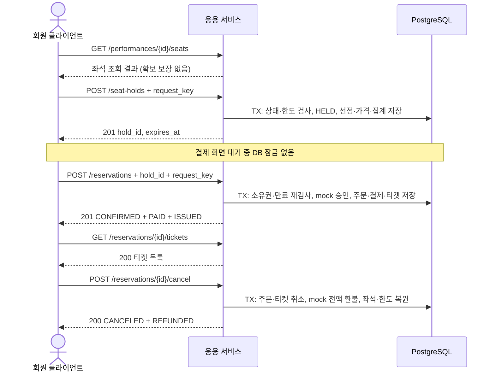

# AsyncTicket HELD v3 API 명세

작성일: 2026-10-28 · 상태: 구현 전 설계 초안

ERD: [AsyncTicket HELD v3 ERDCloud](https://www.erdcloud.com/d/Sr2paEtnJJpGq7MjL)

이 문서는 회원의 지정 좌석 선점 → mock 결제·주문 확정 → 자동 발권 → 주문 전체 취소를 정의한다. 실제 서버 구현·DB 적용·HTTP 테스트 완료를 의미하지 않는다. 엔드포인트, HTTP 상태 코드, 응답 필드와 아래 기본 정책은 팀 검토용 계약이다. 현재 ERD의 상태명과 제약을 우선하며, 과거 설계의 `PENDING`, `SUCCEEDED`, `CANCELLED`를 혼용하지 않는다.

## 1. 전체 흐름과 범위



결제 확정과 발권은 `POST /reservations` 하나의 원자적 작업이다. 독립적인 `POST /payments` 또는 `POST /tickets`를 만들지 않는다. 발권 조회는 별도 GET으로 제공한다. 실제 PG, 부분 취소, 선점 연장, 비회원 예매, 일반 입장 수량 재고, 티켓 사용·입장 처리는 이번 범위에서 제외한다.

| 메서드 | 경로 | 목적 | 정상 응답 |
| --- | --- | --- | --- |
| GET | `/performances/{performance_id}/seats` | 회차 좌석 조회 | 200 |
| POST | `/seat-holds` | 좌석 묶음 선점 | 신규 201 / 성공 요청 재조회 200 |
| GET | `/seat-holds/{hold_id}` | 본인 선점 상태 조회 | 200 |
| DELETE | `/seat-holds/{hold_id}` | 본인 선점 전체 해제 | 200 |
| POST | `/reservations` | mock 승인·주문 확정·자동 발권 | 신규 201 / 성공 요청 재조회 200 |
| GET | `/reservations/{reservation_id}` | 본인 주문·결제·상세 조회 | 200 |
| GET | `/reservations/{reservation_id}/tickets` | 본인 주문의 티켓 조회 | 200 |
| POST | `/reservations/{reservation_id}/cancel` | 주문 전체 취소·mock 전액 환불 | 최초·반복 모두 200 |

만료 정리는 내부 작업이며 공개 만료 API는 두지 않는다. 로그인·로그아웃 API의 토큰 발급 계약은 별도 명세에서 다룬다.

## 2. 공통 계약

### 2.1 인증과 표현 형식

- 좌석 조회는 비회원도 가능하다. 나머지 API는 `Authorization: Bearer <access_token>` 인증이 필요하다. 토큰은 만료·서명·블랙리스트를 검사한다.
- 본인 소유가 아닌 선점·주문은 존재하지 않는 ID와 동일하게 404를 반환한다. 타인 주문 ID·티켓 코드·선점 소유자를 응답하지 않는다.
- 요청·응답은 `application/json`이다. 금액은 부동소수점 오차를 피하기 위해 `"50000.00"` 같은 소수점 두 자리 문자열로 표현한다. 통화는 서비스 고정 `KRW`이며 별도 DB 컬럼은 없다.
- BIGINT ID는 JSON 문자열로 표현한다. 경로 ID와 본문 ID는 양의 정수 문자열이어야 한다. JS 정수 범위를 넘는 ID 손실을 방지한다.
- 시간은 오프셋을 포함한 ISO 8601이다. 예시는 UTC `Z`를 사용한다. `2026-10-28T05:00:00Z`는 한국 시간 14:00이다.
- 정의하지 않은 요청 필드는 422로 거절한다. 회원 ID, 가격, 수량 합계, 결제 금액, 상태, 만료 시각은 클라이언트가 지정하지 않는다.
- 인증된 개인 자원 응답에는 `Cache-Control: no-store`를 적용한다. 예시의 ID·티켓·거래 참조는 설명용 가상 값이다.

### 2.2 정책과 시간 경계

| 항목 | 이번 명세의 기본값 / 규칙 | 근거·성격 |
| --- | --- | --- |
| 매수 한도 | `active_quantity + held_quantity + 신규 수량 ≤ performances.max_tickets_per_user` | 회차 설정 사용, DDL 허용 범위 1~3 |
| 선점 TTL | 180초 | 팀 검토 기본값 |
| 실제 만료 | `min(t_decision + TTL, reservation_closes_at, starts_at)` | SQL 응용 계약 |
| 선점 유효 | `t_decision < expires_at`; 같은 시각이면 만료 | SQL 응용 계약 |
| 선점 생성·확정 가능 | 회차 `OPEN`, `reservation_opens_at ≤ t_decision < reservation_closes_at`, 공연 시작 전 | 이번 API 정책 제안 |
| 동시 선점 그룹 | 회원·회차당 ACTIVE 최대 1개 | DDL 부분 고유 인덱스, 검토 기본값 |
| 선점 변경 | 전체 해제만 허용, 연장·일부 좌석 교체 없음 | 검토 기본값 |
| 가격 | 선점 시 서버 재고 가격을 복사하고 확정에도 사용 | 설계 기본값 |
| 취소 | 본인 CONFIRMED 주문 전체, `t_decision < cancel_deadline_at` | 엄격한 경계는 API 제안 |
| 취소 환불 | mock 전액 즉시 환불만 지원, 성공 시 COMPLETED | API 제안; DDL의 비동기 환불 상태는 확장용 |

회차가 취소·마감된 뒤의 유효 선점을 특별히 확정해 주는 정책은 두지 않는다. 회차 정책 거절만으로 미만료 선점을 임의 소비하지 않는다. 선점 해제·만료는 예매 마감 후에도 수행할 수 있다. 같은 ACTIVE 선점이 이미 있으면 새 요청키로 새 선점을 만들지 않고 409를 반환한다.

### 2.3 상태 전이

| 자원 | 생성 / 성공 | 종료·취소 |
| --- | --- | --- |
| 좌석 재고 | `AVAILABLE → HELD → RESERVED` | 해제·만료 `HELD → AVAILABLE`; 취소 `RESERVED → AVAILABLE` |
| 선점 | `ACTIVE → CONSUMED` | `ACTIVE → RELEASED` 또는 `EXPIRED`; 종료 후 재활성화 없음 |
| 주문·주문 상세 | 확정 시 `CONFIRMED` 생성 | `CONFIRMED → CANCELED` |
| 결제 | 승인 성공 시 `PAID` 생성 | mock 환불 성공 시 `REFUNDED` |
| 환불 | `NONE` | 이번 mock 취소 성공 시 `COMPLETED` |
| 티켓 | 확정 시 `ISSUED` 생성 | `ISSUED → CANCELED` |

`BLOCKED` 좌석은 선점할 수 없다. `HELD` 좌석만 `current_hold_id`를 가지며 RESERVED로 바뀔 때 포인터를 비운다. 주문 취소 후에도 원래 선점은 CONSUMED이고, 과거 선점·주문·티켓 이력은 보존한다.

### 2.4 공통 오류 형식

```json
{
  "error": {
    "code": "SEAT_UNAVAILABLE",
    "message": "선택한 좌석을 선점할 수 없습니다.",
    "retryable": false,
    "details": {"performance_seat_ids": ["1002"]}
  },
  "request_id": "req-example-001"
}
```

`request_id`는 추적 ID이며 멱등키가 아니다. `retryable=true`는 같은 요청이 안전하게 재시도될 수 있음을 뜻하며 성공을 보장하지 않는다. 상태를 모르는 전송 실패에서는 같은 요청키·같은 본문으로 재시도한다. 자동화된 무한 재시도는 하지 않는다.

| HTTP | 공통 코드 | 처리 |
| --- | --- | --- |
| 401 | `AUTH_REQUIRED`, `INVALID_TOKEN` | 인증 복구 후 다시 요청 |
| 404 | `RESOURCE_NOT_FOUND` | 존재하지 않거나 본인 소유가 아님 |
| 409 | 업무 상태·멱등키 충돌 코드 | 오류별 현재 상태를 확인 |
| 422 | `VALIDATION_ERROR` | 경로·본문 형식, 중복 좌석, 지원하지 않는 필드 수정 |
| 429 | `RATE_LIMITED` | 유입 제한을 구현한 경우에만 사용; `Retry-After` 제공 |
| 503 | `TEMPORARILY_UNAVAILABLE` | DB 연결·잠금 대기 제한 등, 제한된 backoff 재시도 |
| 500 | `INTERNAL_ERROR` | 예상치 못한 오류; 저장 상태 확인 후 같은 요청 재시도 |

숫자로 된 rate limit·DB 잠금 timeout 값은 아직 미확정이다. 현재 ERD에 A/B/C가 있다고 429 정책이 구현된 것으로 간주하지 않는다. SQL 예외·스택·민감한 DB 필드는 응답하지 않는다.

## 3. 멱등성과 재시도

### 3.1 요청키

`POST /seat-holds`와 `POST /reservations`의 `request_key`는 필수다. 허용 형식은 1~100자의 영문·숫자·`-`·`_`로 제안한다. 클라이언트는 업무 시도마다 고유 키를 생성하고, 통신 재전송에서는 원래 키를 유지한다.

두 API의 키 공간은 별도다. 각각 `(인증 user_id, request_key)`가 모든 회차에 걸쳐 고유하다. 같은 회원이 같은 선점 생성 키를 다른 회차에서 재사용하면 충돌한다. 두 API 사이에는 같은 문자열을 사용할 수 있지만 운영상 서로 다른 키를 권장한다.

서버가 검증된 의미 필드로 canonical JSON을 만들고 SHA-256을 저장한다. 선점 해시는 `performance_id`와 정렬한 고유 `performance_seat_ids`를 포함한다. 확정 해시는 `hold_id`, `payment.method`를 포함한다. 요청키 자체, JSON 속성 순서, 공백, 추적 ID는 해시 의미에 영향을 주지 않는다. 클라이언트는 `request_hash`를 보내지 않는다.

| 상황 | 결과 |
| --- | --- |
| 새 키 + 정상 요청 | 처리 성공 시 201 |
| 기존 성공 키 + 동일 의미 본문 | 200, 기존 자원의 **현재 상태** 반환; 새 자원 생성 없음 |
| 기존 키 + 다른 의미 본문 | 409 `IDEMPOTENCY_KEY_CONFLICT` |
| 종료된 선점의 생성 요청 재전송 | 200, 같은 hold_id·같은 expires_at·현재 종료 상태; 부활·연장 없음 |
| 소비된 선점 + 원래 확정 키·해시 | 200, 기존 주문; 주문이 취소되었으면 CANCELED 반환 |
| 소비된 선점 + 다른 확정 키 | 409 `HOLD_ALREADY_CONSUMED`, 본인 기존 주문 참조 반환 |

재조회 응답에는 `Idempotent-Replayed: true`를 제공하고, 신규 성공에는 `false`를 제공한다. 이 헤더는 응답 메타데이터이며 추가 DB 컬럼을 요구하지 않는다. 키 충돌 검사와 성공 요청 재조회는 새 처리의 만료·판매 기간 검사보다 앞서 수행하되, 인증·소유권 검사는 항상 수행한다.

실패한 요청의 모든 응답을 영구 재현하는 계약은 아니다. 현재 ERD에는 실패 요청·mock 거절 결과를 저장하는 별도 멱등 저장소가 없다. 선점 생성 실패는 키를 소비하지 않는다. mock 거절 후 선점이 RELEASED라면 같은 확정 요청의 후속 응답은 `HOLD_RELEASED`일 수 있다. 원래 거절 응답의 완전한 재현이 필요하면 저장 모델 확장이 필요하다.

서로 다른 회차의 같은 키가 동시에 들어와 UNIQUE에 충돌하면 해당 TX를 롤백하고 새 TX에서 커밋된 키·해시를 읽어 재조회 또는 충돌로 분류한다. UNIQUE 오류를 무조건 500으로 반환하거나 무시하지 않는다.

## 4. 회차 좌석 조회

### GET `/performances/{performance_id}/seats`

비회원 가능. 서버 가격과 현재 판매 상태를 조회한다. 클라이언트는 이 응답만으로 선점 성공을 판단하면 안 된다. 응답의 좌석 ID는 물리 좌석 ID가 아닌 `performance_seats.id`다.

```http
GET /performances/101/seats
```

```json
{
  "performance_id": "101",
  "performance_status": "OPEN",
  "max_tickets_per_user": 3,
  "currency": "KRW",
  "server_time": "2026-10-28T05:00:00Z",
  "seats": [
    {"performance_seat_id": "1001", "stage_seat_id": "11", "section_name": "A", "seat_number": "A1", "seat_grade": "R", "price": "50000.00", "status": "AVAILABLE"},
    {"performance_seat_id": "1002", "stage_seat_id": "12", "section_name": "A", "seat_number": "A2", "seat_grade": "R", "price": "50000.00", "status": "HELD"}
  ]
}
```

404 `RESOURCE_NOT_FOUND`: 없는 회차. 좌석이 없으면 `seats: []`다. 이번 MVP는 전체 좌석 조회이며 대형 공연장 페이지네이션·구역 필터는 별도 확장이다. 타인의 hold_id·user_id·요청키를 노출하지 않는다. 조회는 재고를 변경하지 않으며, 만료 정리 전에는 HELD가 보일 수 있다. 선점 POST가 잠금 후 만료를 정리하고 최종 판정한다.

## 5. 좌석 묶음 선점

### POST `/seat-holds`

```http
POST /seat-holds
Authorization: Bearer <access_token>
Content-Type: application/json
```

```json
{
  "performance_id": "101",
  "performance_seat_ids": ["1001", "1002"],
  "request_key": "hold-attempt-001"
}
```

| 필드 | 검증 |
| --- | --- |
| performance_id | 필수, 양의 정수 문자열 |
| performance_seat_ids | 필수, 서로 다른 회차 재고 ID 1~3개; 모두 같은 회차 |
| request_key | 필수, 공통 요청키 규칙 |

빈 배열·4개 이상·중복 ID·잘못된 타입은 422다. 요청 배열 길이로 quantity를 계산한다. 동일 키 재조회가 아닌 새 요청에서는 만료 ACTIVE 그룹 정리 후 회원 한도와 좌석을 검사한다. 요청 좌석 중 하나라도 충돌하면 **전체 묶음을 거절**한다.

신규 성공: **201 Created**, `Location: /seat-holds/501`.

```json
{
  "hold_id": "501",
  "performance_id": "101",
  "status": "ACTIVE",
  "is_usable": true,
  "quantity": 2,
  "created_at": "2026-10-28T05:00:00Z",
  "expires_at": "2026-10-28T05:03:00Z",
  "closed_at": null,
  "close_reason": null,
  "server_time": "2026-10-28T05:00:00Z",
  "currency": "KRW",
  "total_amount": "100000.00",
  "items": [
    {"performance_seat_id": "1001", "price_at_hold": "50000.00"},
    {"performance_seat_id": "1002", "price_at_hold": "50000.00"}
  ],
  "member_limit": {"max_quantity": 3, "active_quantity": 0, "held_quantity": 2, "remaining_quantity": 1}
}
```

`is_usable`·`total_amount`·`remaining_quantity`는 계산한 응답값이며 신규 DB 컬럼이 아니다.

| HTTP / code | 조건 / 처리 |
| --- | --- |
| 404 `RESOURCE_NOT_FOUND` | 회차 또는 요청 좌석이 없음 |
| 422 `SEAT_PERFORMANCE_MISMATCH` | 다른 회차의 좌석 혼입; 전체 거절 |
| 409 `SALES_NOT_OPEN` | 판매 시작 전 또는 OPEN 상태 아님 |
| 409 `SALES_CLOSED` | 판매 종료·공연 시작 이후 |
| 409 `PERFORMANCE_CANCELED` | 취소된 회차 |
| 409 `ACTIVE_HOLD_EXISTS` | 본인·회차에 유효 ACTIVE 그룹 존재; 본인 기존 hold_id 반환 |
| 409 `TICKET_LIMIT_EXCEEDED` | 확정 + 선점 + 신규 수량이 회차 한도 초과 |
| 409 `SEAT_UNAVAILABLE` | 타인 유효 선점·RESERVED·BLOCKED 좌석 포함 |
| 409 `IDEMPOTENCY_KEY_CONFLICT` | 기존 생성 키와 다른 본문 |

실패 시 신규 선점·신규 부분 점유는 남지 않는다. 단, 먼저 수행한 정상 만료 정리는 커밋한 뒤 업무 거절을 반환할 수 있다. DB 예외라면 정리를 포함한 해당 TX 전체를 롤백한다.

## 6. 본인 선점 조회

### GET `/seat-holds/{hold_id}`

```http
GET /seat-holds/501
Authorization: Bearer <access_token>
```

200 응답 구조는 선점 생성 응답과 같다. `member_limit`은 조회 시점 집계다. 만료 정리가 아직 실행되지 않았다면 저장 상태 ACTIVE와 사용 가능 여부를 구분한다.

```json
{
  "hold_id": "501",
  "performance_id": "101",
  "status": "ACTIVE",
  "is_usable": false,
  "quantity": 2,
  "created_at": "2026-10-28T05:00:00Z",
  "expires_at": "2026-10-28T05:03:00Z",
  "closed_at": null,
  "close_reason": null,
  "server_time": "2026-10-28T05:03:01Z",
  "currency": "KRW",
  "total_amount": "100000.00",
  "items": [
    {"performance_seat_id": "1001", "price_at_hold": "50000.00"},
    {"performance_seat_id": "1002", "price_at_hold": "50000.00"}
  ],
  "member_limit": {"max_quantity": 3, "active_quantity": 0, "held_quantity": 2, "remaining_quantity": 1}
}
```

`status`는 저장된 상태이며 `is_usable`은 현재 시각·회차 정책·상태로 계산한 표시값이다. GET은 만료 정리나 집계 수정을 하지 않는다. ACTIVE라고 결제 확정을 허용하지 않으며 POST에서 다시 잠금·판정한다. 404는 없는 ID 또는 타인 선점이다. 종료 선점도 본인 이력 조회는 200이다.

## 7. 선점 전체 해제

### DELETE `/seat-holds/{hold_id}`

요청 본문 없음. 물리 삭제가 아니라 ACTIVE 선점을 종료 상태로 전환하는 작업이다.

```http
DELETE /seat-holds/501
Authorization: Bearer <access_token>
```

```json
{
  "hold_id": "501",
  "status": "RELEASED",
  "closed_at": "2026-10-28T05:01:00Z",
  "close_reason": "USER_RELEASED",
  "released_quantity": 2,
  "member_limit": {"max_quantity": 3, "active_quantity": 0, "held_quantity": 0, "remaining_quantity": 3}
}
```

200에서 `released_quantity`는 **이번 호출로 실제 반환한 좌석 수**다. 반복 해제는 200, 기존 종료 시각·사유 유지, `released_quantity: 0`이다. 만료 시각을 지났다면 EXPIRED / `close_reason: "TTL_EXPIRED"`로 정리하고 200을 반환한다. 해제와 만료가 경합해도 한 번만 집계를 줄인다.

| HTTP / code | 상황 |
| --- | --- |
| 404 `RESOURCE_NOT_FOUND` | 없는 ID·타인 선점 |
| 409 `HOLD_ALREADY_CONSUMED` | 이미 주문으로 소비됨; 주문 취소 API 사용 |
| 409 `HOLD_OWNERSHIP_CHANGED` | ACTIVE인데 필요한 현재 포인터가 불일치하는 불변식 위반; 무조건 타인의 재고를 해제하지 않고 TX 롤백·서버 조사 |

종료된 H1의 늦은 DELETE는 H2를 지운다는 의미가 아니다. 종료 H1은 200으로 현재 종료 상태만 반환하고 H2의 좌석·집계를 건드리지 않는다.

## 8. mock 결제 확정·자동 발권

### POST `/reservations`

```http
POST /reservations
Authorization: Bearer <access_token>
Content-Type: application/json
```

```json
{
  "hold_id": "501",
  "request_key": "confirm-attempt-001",
  "payment": {"method": "MOCK"}
}
```

`hold_id`, `request_key`, `payment.method`는 필수다. method는 MOCK만 허용한다. 금액·좌석 목록·수량은 선점에서 결정한다. 성공·실패를 사용자가 지정하는 `approved`, `mock_result` 같은 입력은 제공하지 않는다. 거절 재현은 테스트용 mock 어댑터 설정으로 한다.

신규 성공: **201 Created**, `Location: /reservations/701`.

```json
{
  "reservation_id": "701",
  "order_number": "AT-20261028-000701",
  "hold_id": "501",
  "performance_id": "101",
  "status": "CONFIRMED",
  "quantity": 2,
  "currency": "KRW",
  "total_amount": "100000.00",
  "created_at": "2026-10-28T05:01:00Z",
  "confirmed_at": "2026-10-28T05:01:00Z",
  "canceled_at": null,
  "payment": {
    "payment_id": "801",
    "transaction_reference": "mock-example-801",
    "method": "MOCK",
    "amount": "100000.00",
    "status": "PAID",
    "paid_at": "2026-10-28T05:01:00Z",
    "refund_status": "NONE",
    "refunded_amount": "0.00",
    "refunded_at": null
  },
  "items": [
    {"reservation_item_id": "901", "performance_seat_id": "1001", "price_at_reservation": "50000.00", "status": "CONFIRMED"},
    {"reservation_item_id": "902", "performance_seat_id": "1002", "price_at_reservation": "50000.00", "status": "CONFIRMED"}
  ],
  "tickets": [
    {"ticket_id": "1101", "reservation_item_id": "901", "ticket_code": "DEMO-TICKET-A1", "receive_method": "ON_SITE", "status": "ISSUED", "issued_at": "2026-10-28T05:01:00Z", "canceled_at": null},
    {"ticket_id": "1102", "reservation_item_id": "902", "ticket_code": "DEMO-TICKET-A2", "receive_method": "ON_SITE", "status": "ISSUED", "issued_at": "2026-10-28T05:01:00Z", "canceled_at": null}
  ],
  "member_limit": {"max_quantity": 3, "active_quantity": 2, "held_quantity": 0, "remaining_quantity": 1}
}
```

성공 응답은 주문·상세·PAID 결제·ISSUED 티켓이 모두 커밋된 뒤 반환한다. 티켓 한 장 생성에 실패해도 해당 확정 TX 전체를 롤백한다. 결제 금액 합계 = 주문 합계 = 선점 가격 합계다.

| HTTP / code | 조건 | 변경 |
| --- | --- | --- |
| 404 `RESOURCE_NOT_FOUND` | 없는 ID·타인 선점 | 없음 |
| 422 `VALIDATION_ERROR` | MOCK 이외 method, 임의 금액·상태, 필수값 누락 | 없음 |
| 409 `IDEMPOTENCY_KEY_CONFLICT` | 기존 확정 키와 hold_id·결제 본문 의미가 다름 | 없음 |
| 409 `HOLD_EXPIRED` | ACTIVE지만 잠금 후 판정 시각이 만료 이상, 또는 이미 EXPIRED | 필요한 만료 정리 커밋, 성공 주문 없음 |
| 409 `HOLD_RELEASED` | 사용자 해제 또는 이전 mock 거절로 RELEASED | 없음 |
| 409 `HOLD_ALREADY_CONSUMED` | 다른 확정 키로 소비된 선점 요청 | 기존 본인 reservation_id 안내, 추가 결제 없음 |
| 409 `HOLD_OWNERSHIP_CHANGED` | 현재 좌석 포인터·구성원이 불일치 | TX 롤백, 타인 좌석 유지 |
| 409 `SALES_NOT_OPEN` / `SALES_CLOSED` | 최종 판매 정책 불충족 | 소비하지 않음; 필요한 정상 만료 정리는 별도 반영 가능 |
| 409 `PERFORMANCE_CANCELED` | 회차 취소 | 확정하지 않음 |
| 409 `PAYMENT_DECLINED` | 유효 선점의 예상 mock 승인 거절 | RELEASED·좌석 반환·held 감소 **커밋** |
| 500 `INTERNAL_ERROR` | 주문·결제·티켓 저장 중 예상치 못한 오류 | 새 확정 변경 전체 롤백; 기존 ACTIVE가 남을 수 있음 |

예상 mock 거절 예시:

```json
{
  "error": {
    "code": "PAYMENT_DECLINED",
    "message": "mock 결제가 거절되어 선점을 해제했습니다.",
    "retryable": false,
    "details": {"hold_id": "501", "hold_status": "RELEASED", "close_reason": "MOCK_DECLINED"}
  },
  "request_id": "req-example-002"
}
```

원래 확정 키로 재조회할 때 만료 시각이 이미 지났어도 성공 주문을 먼저 반환한다. 응답 유실만으로 새 키를 만들어 재결제하지 않는다. 주문이 이미 취소되었다면 200 CANCELED·REFUNDED·CANCELED 티켓을 반환한다.

## 9. 주문·결제·상세 조회

### GET `/reservations/{reservation_id}`

```http
GET /reservations/701
Authorization: Bearer <access_token>
```

200 본문은 확정 응답과 동일한 주문 상세 표현이다. 조회 시점 상태·결제·티켓을 반환하며, `member_limit`은 현재 집계다. 존재하지 않거나 타인 주문이면 404다. 주문 상세·결제·티켓을 서로 다른 시점에서 조합하지 않도록 일관된 DB 스냅샷에서 읽는다.

이력 보존을 위해 취소 주문도 200으로 조회한다. 정상적으로 확정된 주문인데 결제 또는 티켓이 누락되었다면 정상 상태로 위장하지 않고 서버 불변식 오류로 조사한다.

## 10. 발권 결과 조회

### GET `/reservations/{reservation_id}/tickets`

```http
GET /reservations/701/tickets
Authorization: Bearer <access_token>
```

```json
{
  "reservation_id": "701",
  "reservation_status": "CONFIRMED",
  "tickets": [
    {"ticket_id": "1101", "reservation_item_id": "901", "performance_seat_id": "1001", "ticket_code": "DEMO-TICKET-A1", "receive_method": "ON_SITE", "status": "ISSUED", "issued_at": "2026-10-28T05:01:00Z", "canceled_at": null},
    {"ticket_id": "1102", "reservation_item_id": "902", "performance_seat_id": "1002", "ticket_code": "DEMO-TICKET-A2", "receive_method": "ON_SITE", "status": "ISSUED", "issued_at": "2026-10-28T05:01:00Z", "canceled_at": null}
  ]
}
```

200이며 발권을 다시 실행하지 않는다. 취소된 주문은 `reservation_status: "CANCELED"`, 각 티켓은 CANCELED와 canceled_at을 반환한다. 티켓이 취소되었다고 숨기거나 새 코드를 발급하지 않는다. 404는 없는 주문·타인 주문이다. 티켓 코드는 인증된 소유자에게만 반환하고 추적 로그에 그대로 남기지 않는다.

## 11. 주문 전체 취소·mock 전액 환불

### POST `/reservations/{reservation_id}/cancel`

요청 본문 없음. 취소 사유 저장 컬럼은 없으므로 `reason`을 필수 입력으로 만들지 않는다. 부분 좌석 ID, 임의 환불액, 새 결제 상태를 받지 않는다.

```http
POST /reservations/701/cancel
Authorization: Bearer <access_token>
```

정상: **200 OK**.

```json
{
  "reservation_id": "701",
  "order_number": "AT-20261028-000701",
  "hold_id": "501",
  "performance_id": "101",
  "status": "CANCELED",
  "quantity": 2,
  "currency": "KRW",
  "total_amount": "100000.00",
  "canceled_at": "2026-10-28T05:02:00Z",
  "payment": {"payment_id": "801", "method": "MOCK", "amount": "100000.00", "status": "REFUNDED", "refund_status": "COMPLETED", "refunded_amount": "100000.00", "refunded_at": "2026-10-28T05:02:00Z"},
  "items": [
    {"reservation_item_id": "901", "performance_seat_id": "1001", "status": "CANCELED"},
    {"reservation_item_id": "902", "performance_seat_id": "1002", "status": "CANCELED"}
  ],
  "tickets": [
    {"ticket_id": "1101", "status": "CANCELED", "canceled_at": "2026-10-28T05:02:00Z"},
    {"ticket_id": "1102", "status": "CANCELED", "canceled_at": "2026-10-28T05:02:00Z"}
  ],
  "member_limit": {"max_quantity": 3, "active_quantity": 0, "held_quantity": 0, "remaining_quantity": 3},
  "already_canceled": false
}
```

응답은 취소 요약 표현이다. 상세의 가격·발급 코드 등 전체 이력은 주문 GET에서 조회한다. 취소는 좌석·주문·상세·티켓·mock 환불·집계를 한 TX에 반영하며 기존 선점은 CONSUMED로 유지한다.

| HTTP / code | 조건 | 처리 |
| --- | --- | --- |
| 404 `RESOURCE_NOT_FOUND` | 없는 주문·타인 주문 | 변경 없음 |
| 409 `CANCEL_DEADLINE_PASSED` | 미취소 주문이며 잠금 후 시각이 취소 기한 이상 | 취소·환불·한도 복원 없음 |
| 409 `REFUND_RECONCILIATION_REQUIRED` | 기존 환불 PENDING·FAILED 등 이번 즉시 mock 계약 밖의 데이터 | 중복 환불하지 않고 조사·복구 경로 필요 |
| 500 `INTERNAL_ERROR` | 취소 저장 실패·정상 주문의 필수 결제/좌석 불변식 위반 | 전체 롤백; 부분 취소 상태를 성공으로 반환하지 않음 |

이미 정상 취소·전액 환불된 주문은 취소 기한이 지난 후에도 **200**, `already_canceled: true`로 기존 canceled_at·refunded_at을 유지한다. 매수·환불액을 다시 변경하지 않는다. 다른 주문이 이후 같은 좌석을 구매했어도 반복 취소는 그 좌석을 반환하지 않는다. 이 API는 주문 상태 기반으로 멱등하며 별도 request_key 저장소를 요구하지 않는다.

현재 DDL에는 환불 PENDING·FAILED 상태가 있지만 이번 MVP는 이를 정상 성공 경로로 사용하지 않는다. 실제 PG의 환불 접수만 된 상태를 200 COMPLETED로 표시해서는 안 된다. 외부 PG를 추가하면 비동기 환불·이벤트·재조정 명세를 먼저 확장한다. 회차 강제 취소에 대한 일괄 환불은 별도 운영 기능이다.

## 12. 잠금·트랜잭션 구현 계약

1. 재고를 바꾸는 각 요청·워커는 독립 DB 세션을 사용하고 한 TX에서 한 회차를 처리한다.
2. 회차 → 관련 회원 한도행(user_id순) → 선점(id순) → 필요한 주문(id순) → 좌석(id순)으로 잠근다. 만료 정리로 다른 회원 집계도 바꾸면 그 회원 행까지 순서대로 포함한다.
3. 모든 필요한 잠금을 얻은 뒤 DB `clock_timestamp()`를 한 번 읽어 `t_decision`으로 사용한다. 추가 잠금·대상 확장이 필요하면 정렬된 전체 잠금 집합으로 재시작한 뒤 최종 시각을 다시 잡는다.
4. 회원 한도행이 없으면 복합 PK를 이용해 안전하게 생성·확보한다. 동시 생성 충돌 후 동일 행을 잠가 집계를 계산한다.
5. ACTIVE 만료 그룹을 정리하고 집계를 검사한다. 예상 업무 거절과 DB 예외를 구분한다. 만료 정리 후 업무 거절은 정리만 커밋하고 응답할 수 있다.
6. 선점 생성 순서는 hold → hold_items → 좌석 HELD·포인터 → held 집계 → 커밋이다. 현재 포인터의 복합 FK 순환을 지킨다.
7. 확정·만료는 같은 잠금 기준으로 단 하나의 상태 전이를 수행한다. 커밋 전에는 성공 응답하지 않는다. 잠금 대기 전의 HTTP 도착 시각으로 유효성을 결정하지 않는다.
8. 예상 mock 거절은 해제 결과를 커밋하고 409를 반환한다. 예외를 던져 UoW 전체가 롤백되면 해제까지 취소되는 구현 실수를 피한다.
9. DB 예외는 TX 전체를 롤백한다. 응답이 유실되면 같은 요청키로 성공 여부를 판정한다. 티켓 코드·거래 참조 UNIQUE 충돌도 중복 발권의 근거가 되지 않는다.
10. 외부 네트워크 결제와 사용자 대기를 이 TX 안에서 수행하지 않는다. 회차 선행 잠금은 성능 최적화가 아니라 MVP 정합성을 위한 선택이다.

## 13. 엔드포인트별 검증 시나리오

아래는 실행 전 검증 기준이다. HTTP 응답뿐 아니라 최종 DB의 선점·포인터·주문·결제·티켓·집계를 확인한다.

| 대상 | 조건·행동 | 기대 결과 |
| --- | --- | --- |
| POST 선점 | A·B가 같은 좌석 동시 요청 | 신규 선점 성공 최대 1개, 나머지 409; 현재 포인터 하나 |
| POST 선점 | 회원의 서로 다른 좌석 2+2 동시 요청 | ACTIVE 1개와 총 매수 한도 유지; 일부 점유 없음 |
| POST 선점 | 3석 중 1석 타인 점유 | 전체 409; 나머지 2석 신규 선점 없음 |
| POST 선점 | 같은 키·동일 본문 재전송 | 201 뒤 200, 같은 ID·만료, 집계 추가 없음 |
| POST 선점 | 같은 키·다른 회차/좌석 | 409 키 충돌 |
| GET 선점 | 만료 시각이 지났지만 정리 전 | status ACTIVE일 수 있으나 is_usable false; GET 집계 변경 없음 |
| DELETE 선점 | 같은 그룹 해제 2회 | 첫 200 해제 수량 N, 다음 200 수량 0; 한 번만 차감 |
| POST 확정 | 유효 본인 선점·mock 승인 | 201, 주문 1·결제 1·상세/티켓 각각 N, 좌석 RESERVED |
| POST 확정 | 원래 키·본문 재전송 | 200, 같은 주문·결제·티켓, 추가 집계 없음 |
| POST 확정 | 취소한 주문의 원래 키 재전송 | 200 CANCELED, 재결제·재발권 없음 |
| POST 확정 | 소비 선점에 새 키 | 409 + 본인 기존 주문 참조 |
| POST 확정 | 만료 직전 시작, 잠금 후 만료 | 409 HOLD_EXPIRED; HTTP 시작 시각으로 통과시키지 않음 |
| POST 확정/만료 | 경계 시각 동시 실행 | 최종 판정 시각 기준 상태 전이 하나; 확정·만료 동시 성공 없음 |
| POST 확정 | A 만료 후 B 재선점, A의 늦은 확정 | A 409, B 포인터·집계 불변 |
| POST 확정 | mock 거절 | 409, RELEASED·좌석 반환·held 감소 커밋, 성공 주문·티켓 없음 |
| POST 확정 | 티켓 저장 중 DB 예외 | 500, 해당 확정 TX 전체 롤백; 기존 ACTIVE는 정리 가능 |
| GET 티켓 | 확정·취소 후 각각 조회 | ISSUED 뒤 CANCELED; 새 티켓 생성 없음 |
| POST 취소 | 정상 주문 전체 취소 | 200, 전액 mock 환불·좌석 반환·active 감소; 선점 CONSUMED 유지 |
| POST 취소 | 동일 주문 동시·반복 취소 | 200, 환불·집계 한 번만 반영 |
| POST 취소 | 취소 기한과 같은 시각 | 미취소 주문 409, 이미 취소 주문은 200 재조회 |
| POST 취소 | A 취소 후 B 구매, A 취소 재전송 | B 좌석·주문·집계 불변 |
| 인증 API 전부 | 토큰 없음·타인 자원·임의 가격 필드 | 401 / 404 / 422; 재고 변경 없음 |
| 다중 워커 | 독립 세션으로 위 경쟁 반복 | 중복 점유·한도 초과 없음; 락 대기·지연은 별도 측정 |

## 14. 구현 전 합의할 항목

- API 경로·HTTP 상태·응답 표현, TTL 180초·ACTIVE 1개·가격 고정·전체 취소 기본값.
- 확정 시 판매 마감 정책, 취소 기한의 엄격한 `<` 경계, 회차 강제 취소 시 운영 복구 절차.
- mock 승인·거절 주입 방법, 즉시 전액 환불 계약, 실제 PG 도입 시 저장 모델 확장.
- 유입 제한·잠금 timeout·재시도 횟수·대형 좌석 조회 방식.
- 실패 응답의 완전한 멱등 재현이 필요한지 여부와 별도 요청 결과 저장소 필요성.

다음 구현 순서는 요청·응답 스키마 → 응용 서비스/UoW → 도메인 규칙·저장소 → 라우터 → main 등록 → 독립 DB 세션 기반 계약 검증으로 제안한다.
